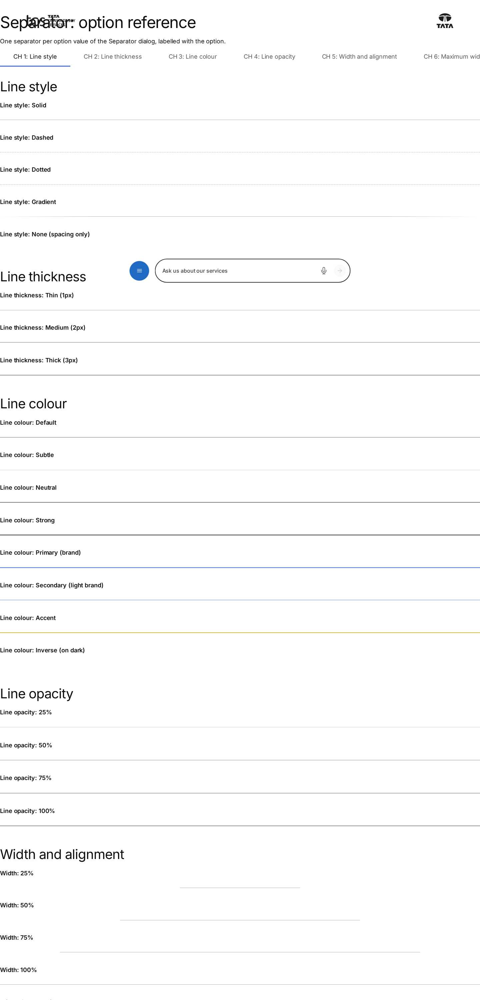
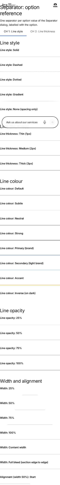

# Separator — Authoring Guide

| Attribute | Value |
| --- | --- |
| Document ID | AUT-C-separator |
| Audience | Content authors, content managers, AEM authoring leads |
| Purpose | How to add, fill in and check the Separator component |
| Scope | — |
| Prerequisites | — |
| Owner | Content Lead / AEM Authoring Lead (proposed) |
| Approver | Product Owner (to be confirmed) |
| Version | 1.0 |
| Status | Draft for review |
| Last updated | 8 November 2026 |
| Last validated | 8 November 2026 |
| Source files | blocks/separator/README.md, blocks/separator/_separator.json |
| Related documents | — |
| Related AEM paths | — |

## Contents

- [Where to see it](#where-to-see-it)
- [For Content Authors](#for-content-authors)
- [Authorable Fields](#authorable-fields)
- [Screenshot-Based Authoring Steps](#screenshot-based-authoring-steps)
- [Variations](#variations)
- [Complete Authoring Example](#complete-authoring-example)
- [Content and Asset Guidelines](#content-and-asset-guidelines)
- [Troubleshooting](#troubleshooting)
- [Screenshots](#screenshots)
- [Known limitations](#known-limitations)
- [Open items](#open-items)
- [Change history](#change-history)

## Where to see it

- https://main--tcs-corp--sradha-tcs.aem.live/design-block-master/en/block-library/separator
- https://main--tcs-corp--sradha-tcs.aem.live/design-block-master/en/block-library/separator/option-reference
- https://main--tcs-corp--sradha-tcs.aem.live/design-block-master/en/block-library/separator/separator-variations
- https://main--tcs-corp--sradha-tcs.aem.live/design-block-master/en/block-library/separator/theme-auto

## For Content Authors

1. **Add the block.** In Universal Editor select a Section, a Columns Container column or a Tabs Container, choose **Add (+)** and pick **Separator**. A new separator stores Decorative, Default, Theme Auto, Line opacity 100%, Maximum width None, Alignment Center, shown on desktop / tablet / mobile, Respect content maximum width on, no animation and Show when printed.
2. **Open its properties.** Select it in the content tree; the panel shows **General**, **Style** and **Additional**.
3. **General tab.** Choose **Accessibility mode**: Semantic for a real change of topic (optionally an **Accessible label**, e.g. "End of the case study"), Decorative for a visual division. Choose a **Separator variant** and, when the background isn't a section style (e.g. an image), a **Theme**.
4. **Style tab, the look.** Leave Line style, Line thickness, Line colour and Separator width on "As the variant" to keep the variant, or override them; set **Line opacity**, **Maximum width**, **Alignment** and the **Start / Center / End decoration**.
5. **Style tab, per device.** Turn **Show on desktop / tablet / mobile** off where it isn't wanted; set **Desktop / Tablet / Mobile width, thickness and alignment** ("As Appearance" keeps the values above) and **top / bottom spacing** per device (Default 1.5rem, i.e. 24px); turn on **Use section padding** to drop the separator's own spacing.
6. **Style tab, extras.** **Animate on view** (Fade, Draw from start, Draw from center) with its **Reduced motion fallback**; **Print**; **Analytics** with an **Analytics label**.
7. **Additional tab.** Anchor ID, Hide block and Padding / Margin (no animation fields: the Separator has its own Animate on view).
8. **Preview and publish.** Check the separator at desktop (from 1200px), tablet (600–1199px) and mobile (under 600px) widths in Preview; publish the page.
9. **Validate the published output.** The line appears only on the intended devices with the intended spacing; a Semantic separator is in the accessibility tree as a separator.

**Minimum required content:** none (an empty separator is a Default, Decorative line). **Recommended:** the right Accessibility mode. **Optional:** everything else.

## Authorable Fields

<!-- BEGIN GENERATED: fields (npm run build:docs) -->

#### Separator (`separator`)

Model `separator`; template name "Separator" (the block class AEM renders); key-value block (one row per property).

Stored on a new component (definition template): `accessibilityMode` = `"decorative"`, `variant` = `"default"`, `theme` = `"auto"`, `lineOpacity` = `"100"`, `maxWidth` = `"none"`, `alignment` = `"center"`, `showDesktop` = `true`, `showTablet` = `true`, `showMobile` = `true`, `respectMaxWidth` = `true`, `animateOnView` = `"none"`, `printVisibility` = `"show"`.

##### General tab — Separator

| Field label | Property | Type | Required | Default | Allowed values | Author guidance | Example |
| ----------- | -------- | ---- | -------- | ------- | -------------- | --------------- | ------- |
| Component ID | `componentId` | text | No | — | regExp: ^[A-Za-z][A-Za-z0-9_-]*$; customErrorMsg: Start with a letter; use letters, digits, - and _. | Unique on the page (letters, digits, - and _). Used by CSS, analytics, tests and links to #id, so changing it changes those. Empty: generated (separator-1, separator-2, ... in page order). Kept for separators authored before; see the other settings. Shown when `componentId` is set. | separator-chapter-break |
| Accessibility mode | `accessibilityMode` | select | No | `decorative` | Decorative (visual only) (`decorative`), Semantic (a thematic break) (`semantic`) | Semantic: screen readers announce a separator (a change of topic). Decorative: hidden from them (visual division only). | decorative |
| Accessible label | `accessibleLabel` | text | No | — | — | Optional. Names the break for screen readers, e.g. "End of the case study". Most separators need none. Shown when `accessibilityMode` is `semantic`. | End of the story |
| Separator variant | `variant` | select | No | `default` | Default (`default`), Subtle (`subtle`), Strong (`strong`), Inset (`inset`), Full width (`full-width`), Dotted (`dotted`), Dashed (`dashed`), Gradient (`gradient`), Branded (`branded`) | A preset of line style, thickness, colour and width; the Appearance settings override it. | branded |
| Theme | `theme` | select | No | `auto` | Auto (as the section) (`auto`), Light background (`light`), Dark background (`dark`), Brand background (`brand`) | — | light |

##### Style tab — Separator

| Field label | Property | Type | Required | Default | Allowed values | Author guidance | Example |
| ----------- | -------- | ---- | -------- | ------- | -------------- | --------------- | ------- |
| Line style | `lineStyle` | select | No | "" | As the variant (""), Solid (`solid`), Dashed (`dashed`), Dotted (`dotted`), Gradient (`gradient`), None (spacing only) (`none`) | None keeps the spacing without a line. A semantic separator stays a break for screen readers but shows nothing; prefer Decorative or remove it. | none |
| Line thickness | `lineThickness` | select | No | "" | As the variant (""), Thin (1px) (`thin`), Medium (2px) (`medium`), Thick (3px) (`thick`) | — | thick |
| Line colour | `lineColor` | select | No | "" | As the variant (""), Default (`default`), Subtle (`subtle`), Neutral (`neutral`), Strong (`strong`), Primary (brand) (`primary`), Secondary (light brand) (`secondary`), Accent (`accent`), Inverse (on dark) (`inverse`) | — | accent |
| Line opacity | `lineOpacity` | select | No | `100` | 25% (`25`), 50% (`50`), 75% (`75`), 100% (`100`) | — | 100 |
| Separator width | `width` | select | No | "" | As the variant (""), 25% (`25-percent`), 50% (`50-percent`), 75% (`75-percent`), 100% (`100-percent`), Content width (`content-width`), Full bleed (section edge to edge) (`full-bleed`) | — | 25-percent |
| Maximum width | `maxWidth` | select | No | `none` | None (`none`), Small (320px) (`small`), Medium (640px) (`medium`), Large (960px) (`large`), Extra large (1280px) (`extra-large`), Content container (`content-container`) | — | medium |
| Alignment | `alignment` | select | No | `center` | Start (`start`), Center (`center`), End (`end`) | For partial widths. Start and end follow the reading direction (right to left languages too). | start |
| Start decoration | `startDecoration` | select | No | `none` | None (`none`), Dot (`dot`), Square (`square`), Diamond (`diamond`) | — | square |
| Center decoration | `centerDecoration` | select | No | `none` | None (`none`), Dot (`dot`), Square (`square`), Diamond (`diamond`) | — | dot |
| End decoration | `endDecoration` | select | No | `none` | None (`none`), Dot (`dot`), Square (`square`), Diamond (`diamond`) | — | square |
| Background contrast | `contrastMode` | select | No | `standard` | Standard (`standard`), High (stronger line) (`high`) | High: a stronger colour, e.g. on busy or tinted backgrounds. Kept for separators authored before; see the other settings. Shown when `contrastMode` is `high`. | high |
| Show on desktop | `showDesktop` | boolean | No | `true` | on / off | — | false |
| Show on tablet | `showTablet` | boolean | No | `true` | on / off | — | false |
| Show on mobile | `showMobile` | boolean | No | `true` | on / off | — | false |
| Desktop width | `desktopWidth` | select | No | `inherit` | As Appearance (`inherit`), 25% (`25-percent`), 50% (`50-percent`), 75% (`75-percent`), 100% (`100-percent`), Content width (`content-width`), Full bleed (section edge to edge) (`full-bleed`) | 1200px and wider | 50-percent |
| Desktop thickness | `desktopThickness` | select | No | `inherit` | As Appearance (`inherit`), Thin (1px) (`thin`), Medium (2px) (`medium`), Thick (3px) (`thick`) | — | medium |
| Desktop alignment | `desktopAlignment` | select | No | `inherit` | As Appearance (`inherit`), Start (`start`), Center (`center`), End (`end`) | — | start |
| Tablet width | `tabletWidth` | select | No | `inherit` | As Appearance (`inherit`), 25% (`25-percent`), 50% (`50-percent`), 75% (`75-percent`), 100% (`100-percent`), Content width (`content-width`), Full bleed (section edge to edge) (`full-bleed`) | 600 to 1199px | 50-percent |
| Tablet thickness | `tabletThickness` | select | No | `inherit` | As Appearance (`inherit`), Thin (1px) (`thin`), Medium (2px) (`medium`), Thick (3px) (`thick`) | — | thick |
| Tablet alignment | `tabletAlignment` | select | No | `inherit` | As Appearance (`inherit`), Start (`start`), Center (`center`), End (`end`) | — | center |
| Mobile width | `mobileWidth` | select | No | `inherit` | As Appearance (`inherit`), 25% (`25-percent`), 50% (`50-percent`), 75% (`75-percent`), 100% (`100-percent`), Content width (`content-width`), Full bleed (section edge to edge) (`full-bleed`) | up to 599px | 100-percent |
| Mobile thickness | `mobileThickness` | select | No | `inherit` | As Appearance (`inherit`), Thin (1px) (`thin`), Medium (2px) (`medium`), Thick (3px) (`thick`) | — | thin |
| Mobile alignment | `mobileAlignment` | select | No | `inherit` | As Appearance (`inherit`), Start (`start`), Center (`center`), End (`end`) | — | center |
| Desktop top spacing | `desktopTopSpacing` | select | No | `default` | Default (`default`), None (`none`), 2XS (4px) (`2xs`), XS (8px) (`xs`), Small (16px) (`small`), Medium (24px) (`medium`), Large (40px) (`large`), XL (64px) (`xl`), 2XL (80px) (`2xl`) | — | xl |
| Desktop bottom spacing | `desktopBottomSpacing` | select | No | `default` | Default (`default`), None (`none`), 2XS (4px) (`2xs`), XS (8px) (`xs`), Small (16px) (`small`), Medium (24px) (`medium`), Large (40px) (`large`), XL (64px) (`xl`), 2XL (80px) (`2xl`) | — | none |
| Tablet top spacing | `tabletTopSpacing` | select | No | `default` | Default (`default`), None (`none`), 2XS (4px) (`2xs`), XS (8px) (`xs`), Small (16px) (`small`), Medium (24px) (`medium`), Large (40px) (`large`), XL (64px) (`xl`), 2XL (80px) (`2xl`) | — | small |
| Tablet bottom spacing | `tabletBottomSpacing` | select | No | `default` | Default (`default`), None (`none`), 2XS (4px) (`2xs`), XS (8px) (`xs`), Small (16px) (`small`), Medium (24px) (`medium`), Large (40px) (`large`), XL (64px) (`xl`), 2XL (80px) (`2xl`) | — | small |
| Mobile top spacing | `mobileTopSpacing` | select | No | `default` | Default (`default`), None (`none`), 2XS (4px) (`2xs`), XS (8px) (`xs`), Small (16px) (`small`), Medium (24px) (`medium`), Large (40px) (`large`), XL (64px) (`xl`), 2XL (80px) (`2xl`) | — | none |
| Mobile bottom spacing | `mobileBottomSpacing` | select | No | `default` | Default (`default`), None (`none`), 2XS (4px) (`2xs`), XS (8px) (`xs`), Small (16px) (`small`), Medium (24px) (`medium`), Large (40px) (`large`), XL (64px) (`xl`), 2XL (80px) (`2xl`) | — | xs |
| Use section padding | `useSectionPadding` | boolean | No | `false` | on / off | On: no spacing of its own (the section's spacing only), so there's no double spacing. | true |
| Stretch to container width | `stretchToContainer` | boolean | No | `false` | on / off | The line fills its container on every breakpoint. Kept for separators authored before; see the other settings. Shown when `stretchToContainer` is `true`. | true |
| Respect content maximum width | `respectMaxWidth` | boolean | No | `true` | on / off | Never wider than the site's content width (also full bleed). | false |
| Animate on view | `animateOnView` | select | No | `none` | None (`none`), Fade (`fade`), Draw from start (`draw-from-start`), Draw from center (`draw-from-center`) | Once, when the separator scrolls into view. | fade |
| Reduced motion fallback | `reducedMotionFallback` | select | No | `static` | Show immediately (`static`), Short fade (`fade`) | For visitors who prefer reduced motion. Shown when `animateOnView` is not `none`. | static |
| Print | `printVisibility` | select | No | `show` | Show when printed (`show`), Hide when printed (`hide`) | — | hide |
| Analytics | `analyticsEnabled` | boolean | No | `false` | on / off | Adds the separator to the Adobe Data Layer (no interaction events). | true |
| Analytics label | `analyticsLabel` | text | No | — | — | Shown when `analyticsEnabled` is `true`. | Chapter break |

##### Additional tab — Separator

| Field label | Property | Type | Required | Default | Allowed values | Author guidance | Example |
| ----------- | -------- | ---- | -------- | ------- | -------------- | --------------- | ------- |
| Anchor ID | `classes_anchor` | text | No | — | regExp: ^anchor-[a-z0-9][a-z0-9-]*$; customErrorMsg: Start with anchor-, then lower-case letters, digits and hyphens. | A unique ID of the block on the page, starting with anchor-, e.g. anchor-our-services; link to it with #anchor-our-services. Delivered as a block class. | — |
| Hide block | `classes_hideblock` | boolean | No | `false` | on / off | Hides the whole block on the page until it is turned off (shown faded in the editor). Delivered as a block class. | — |
| Padding left | `classes_paddingleft` | select | No | "" | Default (""), 0 (none) (`pl-0`), 0.25rem (space-100) (`pl-100`), 0.5rem (space-200) (`pl-200`), 0.75rem (space-300) (`pl-300`), 1rem (space-400) (`pl-400`), 1.25rem (space-500) (`pl-500`), 1.5rem (space-600) (`pl-600`), 2rem (space-800) (`pl-800`), 2.5rem (space-1000) (`pl-1000`), 3rem (space-1200) (`pl-1200`), 4rem (space-1600) (`pl-1600`), 5rem (space-2000) (`pl-2000`), 6rem (space-2400) (`pl-2400`), 7.5rem (space-3000) (`pl-3000`) | Delivered as a block class. | — |
| Padding right | `classes_paddingright` | select | No | "" | Default (""), 0 (none) (`pr-0`), 0.25rem (space-100) (`pr-100`), 0.5rem (space-200) (`pr-200`), 0.75rem (space-300) (`pr-300`), 1rem (space-400) (`pr-400`), 1.25rem (space-500) (`pr-500`), 1.5rem (space-600) (`pr-600`), 2rem (space-800) (`pr-800`), 2.5rem (space-1000) (`pr-1000`), 3rem (space-1200) (`pr-1200`), 4rem (space-1600) (`pr-1600`), 5rem (space-2000) (`pr-2000`), 6rem (space-2400) (`pr-2400`), 7.5rem (space-3000) (`pr-3000`) | Delivered as a block class. | — |
| Padding top | `classes_paddingtop` | select | No | "" | Default (""), 0 (none) (`pt-0`), 0.25rem (space-100) (`pt-100`), 0.5rem (space-200) (`pt-200`), 0.75rem (space-300) (`pt-300`), 1rem (space-400) (`pt-400`), 1.25rem (space-500) (`pt-500`), 1.5rem (space-600) (`pt-600`), 2rem (space-800) (`pt-800`), 2.5rem (space-1000) (`pt-1000`), 3rem (space-1200) (`pt-1200`), 4rem (space-1600) (`pt-1600`), 5rem (space-2000) (`pt-2000`), 6rem (space-2400) (`pt-2400`), 7.5rem (space-3000) (`pt-3000`) | Delivered as a block class. | — |
| Padding bottom | `classes_paddingbottom` | select | No | "" | Default (""), 0 (none) (`pb-0`), 0.25rem (space-100) (`pb-100`), 0.5rem (space-200) (`pb-200`), 0.75rem (space-300) (`pb-300`), 1rem (space-400) (`pb-400`), 1.25rem (space-500) (`pb-500`), 1.5rem (space-600) (`pb-600`), 2rem (space-800) (`pb-800`), 2.5rem (space-1000) (`pb-1000`), 3rem (space-1200) (`pb-1200`), 4rem (space-1600) (`pb-1600`), 5rem (space-2000) (`pb-2000`), 6rem (space-2400) (`pb-2400`), 7.5rem (space-3000) (`pb-3000`) | Delivered as a block class. | — |
| Margin left | `classes_marginleft` | select | No | "" | Default (""), 0 (none) (`ml-0`), 0.25rem (space-100) (`ml-100`), 0.5rem (space-200) (`ml-200`), 0.75rem (space-300) (`ml-300`), 1rem (space-400) (`ml-400`), 1.25rem (space-500) (`ml-500`), 1.5rem (space-600) (`ml-600`), 2rem (space-800) (`ml-800`), 2.5rem (space-1000) (`ml-1000`), 3rem (space-1200) (`ml-1200`), 4rem (space-1600) (`ml-1600`), 5rem (space-2000) (`ml-2000`), 6rem (space-2400) (`ml-2400`), 7.5rem (space-3000) (`ml-3000`) | Delivered as a block class. | — |
| Margin right | `classes_marginright` | select | No | "" | Default (""), 0 (none) (`mr-0`), 0.25rem (space-100) (`mr-100`), 0.5rem (space-200) (`mr-200`), 0.75rem (space-300) (`mr-300`), 1rem (space-400) (`mr-400`), 1.25rem (space-500) (`mr-500`), 1.5rem (space-600) (`mr-600`), 2rem (space-800) (`mr-800`), 2.5rem (space-1000) (`mr-1000`), 3rem (space-1200) (`mr-1200`), 4rem (space-1600) (`mr-1600`), 5rem (space-2000) (`mr-2000`), 6rem (space-2400) (`mr-2400`), 7.5rem (space-3000) (`mr-3000`) | Delivered as a block class. | — |
| Margin top | `classes_margintop` | select | No | "" | Default (""), 0 (none) (`mt-0`), 0.25rem (space-100) (`mt-100`), 0.5rem (space-200) (`mt-200`), 0.75rem (space-300) (`mt-300`), 1rem (space-400) (`mt-400`), 1.25rem (space-500) (`mt-500`), 1.5rem (space-600) (`mt-600`), 2rem (space-800) (`mt-800`), 2.5rem (space-1000) (`mt-1000`), 3rem (space-1200) (`mt-1200`), 4rem (space-1600) (`mt-1600`), 5rem (space-2000) (`mt-2000`), 6rem (space-2400) (`mt-2400`), 7.5rem (space-3000) (`mt-3000`) | Delivered as a block class. | — |
| Margin bottom | `classes_marginbottom` | select | No | "" | Default (""), 0 (none) (`mb-0`), 0.25rem (space-100) (`mb-100`), 0.5rem (space-200) (`mb-200`), 0.75rem (space-300) (`mb-300`), 1rem (space-400) (`mb-400`), 1.25rem (space-500) (`mb-500`), 1.5rem (space-600) (`mb-600`), 2rem (space-800) (`mb-800`), 2.5rem (space-1000) (`mb-1000`), 3rem (space-1200) (`mb-1200`), 4rem (space-1600) (`mb-1600`), 5rem (space-2000) (`mb-2000`), 6rem (space-2400) (`mb-2400`), 7.5rem (space-3000) (`mb-3000`) | Delivered as a block class. | — |

<!-- END GENERATED: fields -->

Notes on the significant fields (the tables above give every label, default and allowed value). Each value is normalized by `separator-config.js` from a controlled list into a block class; the CSS maps the classes to custom properties and site tokens:

| Field | Block class | Rendering, accessibility and data layer |
| ----- | ----------- | --------------------------------------- |
| Component ID | block `id` | Sanitized (lower case; letters, digits, `-`, `_`; a leading non-letter gets `separator-`); a duplicate on the page gets a numeric suffix; it replaces the Anchor ID; empty: the Anchor ID, else `separator-1`, `separator-2`, … in page order |
| Accessibility mode | `semantic` / `decorative` | Semantic: an exposed `<hr>` (always rendered, even with Line style None); Decorative: the line is `aria-hidden="true"` |
| Accessible label | — | `aria-label` on the `<hr>`, Semantic only, at most 120 characters |
| Separator variant | `variant-*` | A preset of line style, thickness, colour and width (`VARIANT_PRESETS`); Inset also indents the line by `--space-1000` on both sides |
| Theme | `theme-*` | Light, Dark or Brand palette; Auto uses the light palette, and the dark / brand palette inside `.section.dark` / `.section.brand` |
| Line style | `line-*` | Solid, dashed, dotted, gradient (fades out at both ends); None: no line (Decorative: no `<hr>` at all) |
| Line thickness | `thickness-*` | `--border-width-100` / `200` / `300` |
| Line colour | `color-*` | The theme palette's token (`--color-border-*`, `--slate-*`, `--brand-*`, `--white-*`) |
| Line opacity | `opacity-*` | 0.25 / 0.5 / 0.75 / 1 |
| Separator width | `width-*` | A share of the container; Content width caps at `--content-max-width`; Full bleed extends over the section's `--section-padding-inline` |
| Maximum width | `max-*` | 20rem, 40rem, 60rem, 80rem or `--content-max-width` |
| Alignment | `align-*` | Flex `justify-content` start / center / end (logical: follows the reading direction) |
| Decorations | `decorated` | `span.separator-decoration` elements, `aria-hidden`, sized from the thickness; none without a visible line |
| Background contrast | `contrast-high` | The strong colour of the palette instead of the Line colour |
| Show on … | `hide-{bp}`, `hidden-all` | `display: none` in that breakpoint (no spacing kept); hidden everywhere: a dashed placeholder in the editor |
| Per-breakpoint width / thickness / alignment | `{bp}-width-*`, `{bp}-thickness-*`, `{bp}-align-*` | Applied only within the breakpoint's range; widths other than Full bleed reset the bleed |
| Top / bottom spacing | `{bp}-top-*`, `{bp}-bottom-*` | Padding (never collapses): None 0, 2XS `--space-100`, XS `--space-200`, Small `--space-400`, Medium `--space-600`, Large `--space-1000`, XL `--space-1600`, 2XL `--space-2000`; Default `--space-600` |
| Use section padding | `section-padding` | No own vertical spacing on any breakpoint |
| Stretch to container width | `stretch` | The line fills its container whatever the width settings (maximum widths still apply) |
| Respect content maximum width | `respect-max` | Caps the line at `--content-max-width`, full bleed included |
| Animate on view | `animate-*`, `motion-*` | Once, when 10 % is in view (IntersectionObserver) |
| Print | `print-hide` | Hidden when printed; otherwise printed at full opacity |
| Analytics / Analytics label | `data-analytics` | On: one data-layer state entry with the label as `dc:title` (at most 120 characters); off: the separator isn't tracked |

**Legacy mapping.** Values authored before are still read: Separator width "Auto" (`auto`, rendered as 100 %) and variant "Custom" (`custom-design`, rendered as Default) were removed from the dialog (block ecosystem audit, handover 2.27); Component ID, Background contrast and Stretch to container width are shown in the dialog only when a separator already has a value ("Kept for separators authored before"). Widths written as "50%" or "50 percent" are read as `50-percent`; booleans accept true / yes / on / 1 / y and false / no / off / 0 / n; unknown values fall back to the defaults.

**Additional tab.** Anchor ID, Hide block and Padding / Margin: see AGENTS.md "Additional tab". The Separator has no Animation Type, Motion Speed or Animation Trigger (it animates with Animate on view; `test/motion/motion.test.mjs` checks it is left out). The Additional tab's Padding top / bottom classes can override the separator's own spacing (handover 6.26.13, Issue 5).

## Screenshot-Based Authoring Steps

#### Authoring Step 1: Add a semantic separator

```text
[Screenshot Placeholder]

File name:
separator-authoring-step-1.png

Purpose:
The General tab of a new Separator with Semantic mode and an Accessible label.

Annotations:
A = Accessibility mode
B = Accessible label
C = Separator variant
D = Theme
```

#### Values to Enter

| Callout | Field | Value | Reason | Expected result |
| ------- | ----- | ----- | ------ | --------------- |
| A | Accessibility mode | Semantic (a thematic break) | The topic changes | `<hr>` exposed to screen readers |
| B | Accessible label | End of the story | Names the break | `aria-label="End of the story"` |
| C | Separator variant | Default | Standard rule | Solid thin line, 100 % |
| D | Theme | Auto (as the section) | Plain section | Light palette |

Author action: Add (+) › Separator between two stories; open General. Expected preview: a thin grey line with 1.5rem above and below. Expected published result: the same. Business rule: the label is used only in Semantic mode. Validation: the accessibility tree shows a separator named "End of the story". Common mistake: Semantic for a purely visual rule; resolution: Decorative.

#### Authoring Step 2: A branded accent

```text
[Screenshot Placeholder]

File name:
separator-authoring-step-2.png

Purpose:
The Style tab of a Branded separator at 25 % width, aligned to the start.

Annotations:
A = Separator variant (General tab)
B = Separator width
C = Alignment
D = Desktop top spacing
```

#### Values to Enter

| Callout | Field | Value | Reason | Expected result |
| ------- | ----- | ----- | ------ | --------------- |
| A | Separator variant | Branded | Brand accent | Solid medium brand line |
| B | Separator width | 25% | Short accent | A quarter of the content width |
| C | Alignment | Start | Under the start of the title | Line at the start edge |
| D | Desktop top spacing | None | Directly under the title | No gap above on desktop |

Author action: set the values. Expected preview: a short brand line directly under the title on desktop. Business rule: Start follows the reading direction. Validation: check at 1440px and 390px. Common mistake: changing Line colour away from "As the variant" and losing the brand colour; resolution: reset to "As the variant".

#### Authoring Step 3: Per-device settings

```text
[Screenshot Placeholder]

File name:
separator-authoring-step-3.png

Purpose:
The per-device fields of the Style tab: Show on tablet and mobile off.

Annotations:
A = Show on desktop
B = Show on tablet
C = Show on mobile
D = Desktop width
```

#### Values to Enter

| Callout | Field | Value | Reason | Expected result |
| ------- | ----- | ----- | ------ | --------------- |
| A | Show on desktop | On | Divider between desktop columns | Visible from 1200px |
| B | Show on tablet | Off | Columns stack | Hidden 600–1199px, no spacing |
| C | Show on mobile | Off | Columns stack | Hidden under 600px, no spacing |
| D | Desktop width | As Appearance | Keep the Appearance width | Unchanged on desktop |

Author action: set the toggles. Expected preview: the line only at desktop widths. Business rule: hidden on every device shows nothing on the page and a dashed note in the editor. Validation: resize the preview across 600px and 1200px. Common mistake: turning all three off; resolution: delete the separator instead.

#### Authoring Step 4: Preview, publish and verify

```text
[Screenshot Placeholder]

File name:
separator-authoring-step-4.png

Purpose:
The published separators at desktop and mobile widths compared with the preview.

Annotations:
A = Semantic separator
B = Branded accent
C = Desktop-only divider (absent on mobile)
```

#### Values to Enter

| Callout | Field | Value | Reason | Expected result |
| ------- | ----- | ----- | ------ | --------------- |
| A | Preview | On, at 1440px and 390px | Per-device settings | The intended lines per width |
| B | Publish | The page | Live page | The same on aem.live |

Author action: preview at several widths, publish. Validation: one line per intended separator and device. Common mistake: double spacing with the section spacing; resolution: Use section padding or smaller spacing.

## Variations

The variations are the values of `_separator.json`, normalized by `separator-config.js` (`VARIANTS`, `THEMES`, `LINE_STYLES`, `WIDTHS`, `ANIMATIONS`, …) and styled in `separator.css`.

#### Semantic, Decorative, Spacing only

| What it is | Settings | Screen readers | Markup |
| ---------- | -------- | -------------- | ------ |
| Thematic break (the topic changes) | Accessibility mode **Semantic** | Announce a separator (with the Accessible label as its name, if set) | `hr.separator-rule` (`aria-label` when labelled) |
| Visual division only | **Decorative** (default) | Ignore it | `div.separator-line[aria-hidden="true"] > hr` |
| Spacing only | Decorative + Line style **None** | Nothing | No `<hr>`; the block keeps its spacing |

A Semantic separator with Line style None is still a break for screen readers but nothing is visible; the editor warns about it (placeholder `separatorInvisible`).

#### Variants: Default, Subtle, Strong, Inset, Full width, Dotted, Dashed, Gradient, Branded

Presets (`VARIANT_PRESETS`): Default solid thin default 100 %; Subtle solid thin subtle 100 %; Strong solid medium strong 100 %; Inset solid thin default 100 % with a `--space-1000` inset; Full width solid thin default full bleed; Dotted dotted medium default; Dashed dashed thin default; Gradient gradient medium primary; Branded solid medium primary 100 %. Any Style setting other than "As the variant" overrides the preset.

```text
[Screenshot Placeholder]

File name:
separator-variants-mobile.png

Purpose:
All nine variants stacked at 390px, each labelled.

Annotations:
A = Default
B = Inset (indented)
C = Full width (over the section padding)
D = Gradient
```

#### Themes: Auto, Light, Dark, Brand

Auto follows the section: the dark palette inside `.section.dark`, the brand palette inside `.section.brand`, else the light palette. Choose Light, Dark or Brand when the background isn't such a section (an image, or Section Style Dark / Dark Green, whose theme contract changes only `--color-border-brand`, i.e. the Primary colour).

#### Widths, maximum width, alignment, stretch

25 / 50 / 75 / 100 %, Content width, Full bleed; Maximum width Small to Extra large or Content container; Alignment Start / Center / End (logical, right-to-left aware); Stretch to container width (legacy) fills the container; Respect content maximum width caps every width at `--content-max-width`. Full bleed uses the section's inline padding, so it never overflows the page.

#### Decorations: dot, square, diamond

At the start, centre and / or end of the line; visual only (`aria-hidden`), coloured as the line, sized with the thickness.

#### Responsive visibility and overrides

Show on desktop / tablet / mobile; per-breakpoint width, thickness, alignment and spacing ("As Appearance" / Default keep the general values).

```text
[Screenshot Placeholder]

File name:
separator-responsive-overrides-tablet.png

Purpose:
A separator with Desktop width 50 %, Tablet width 75 % and Mobile width 100 % at 1024px: the tablet value applies.

Annotations:
A = Line at 75 % on tablet
```

#### Animate on view: Fade, Draw from start, Draw from center

Once, when 10 % of the block is in view: the line fades in (0.6s opacity) or scales from its start (right in right-to-left) or centre. For reduced motion: Show immediately (no animation is prepared) or Short fade (opacity only). The hidden starting state exists only after the script added `animate-ready`, so a failure never hides the line.

#### Print and Analytics

Hide when printed removes it from print; Analytics on adds its state to the data layer (see [Data Layer and Analytics](https://github.com/sradha-tcs/tcs-corp/blob/main/blocks/separator/README.md#data-layer-and-analytics)).

## Complete Authoring Example

Scenario: a chapter break between two case studies on a long article page.

| Field | Example value | Guidance |
| ----- | ------------- | -------- |
| Accessibility mode | Semantic (a thematic break) | The topic changes |
| Accessible label | End of the story | Short, translated per locale |
| Separator variant | Default | Standard rule |
| Theme | Auto (as the section) | Plain section |
| Line thickness | Medium (2px) | A stronger break |
| Separator width | 50% | Centred half-width rule |
| Center decoration | Diamond | Chapter mark |
| Desktop top / bottom spacing | Large (40px) / Large (40px) | Room around the break |
| Show on desktop / tablet / mobile | On / On / On | Everywhere |
| Animate on view | None | Static |
| Analytics / Analytics label | On / Chapter break | State in the data layer |

Steps: add the separator between the two stories (Authoring Step 1), set the Style values (Step 2), keep it visible everywhere (Step 3), preview and publish (Step 4).

Expected output: a 2px grey line at half the content width, centred, with a diamond in its middle and 2.5rem above and below on desktop (1.5rem default on tablet and mobile).

Responsive: the desktop spacing applies from 1200px; tablet and mobile use the default spacing.

Accessibility: a named separator in the accessibility tree; the diamond is hidden from assistive technology.

Analytics / data layer: one state entry `tcs-corp/components/separator` with `dc:title` "Chapter break"; no events.

Personalization fallback: none; the authored separator renders.

Pre-publish checklist:

- [ ] Semantic only for real topic changes; never Semantic with Line style None.
- [ ] Visible on the intended devices (not hidden everywhere).
- [ ] No double spacing with the section spacing.
- [ ] Line visible on its background (Theme / Background contrast).
- [ ] Accessible label translated per locale.

## Content and Asset Guidelines

- **Titles, descriptions, eyebrows, CTAs, links, images, icons.** Not applicable: the separator renders no text, links or images on the published page.
- **Labels.** Accessible label and Analytics label are cut to 120 characters (handover recommendation: about 60 and 40); keep the Analytics label and Component ID identical across locales, translate the Accessible label.
- **Tags and metadata.** None.
- **Min / max items.** No verified technical limit was identified.
- **Asset source / loading / fallback.** None (no assets).

## Troubleshooting

| Symptom | Likely cause | Diagnostic steps | Resolution | Verification |
| ------- | ------------ | ---------------- | ---------- | ------------ |
| Separator not visible | All Show on … off; Hide block on; Decorative with Line style None; low opacity / subtle colour | Edit mode note; Additional tab; `?debug=separator` on preview | Turn on the devices, turn off Hide block, choose a visible style | Line in Preview at all intended widths |
| Editor note "Semantic separator without a line" | Semantic with Line style None | General and Style tabs | Decorative (spacing only) or a visible style | Note gone |
| Theme Auto stays light on a dark background | Auto follows only `.section.dark` / `.section.brand` (not background images or Section Style Dark / Dark Green) | Inspect the section's classes | Set Theme Dark or Brand; consider High contrast | Line visible |
| Double spacing | 1.5rem default spacing plus section spacing | Inspect the block's padding | Use section padding or smaller spacing | Gaps as designed |
| Spacing settings have no effect | Use section padding on; Additional Padding top / bottom override; wrong preview width | Check the fields and the width | Turn them off; preview at the breakpoint | Gap changes |
| Anchor links don't jump | A Component ID replaces the Anchor ID, or was sanitized / suffixed | Inspect the block `id`; `?debug=separator` | Link to the actual id or clear the Component ID | Link scrolls |
| Animation doesn't play | Reduced motion with Show immediately; already in view on load (plays at once); no IntersectionObserver | OS setting; classes `animate-ready` / `is-visible` | Expected behavior | Plays when scrolled into view |

Evidence to collect (no secrets): URL, viewport, the block's classes and `id`, the `?debug=separator` console output, the section's classes.

## Screenshots



*Figure: Separator as published (block library) — desktop 1440 × 900 (/design-block-master/en/block-library/separator/option-reference, captured 2026-11-08).*



*Figure: Separator as published (block library) — mobile 375 × 812 (/design-block-master/en/block-library/separator/option-reference, captured 2026-11-08).*

> **Screenshot required**
>
> - Required screen: Separator dialog in Universal Editor (every tab, including Additional)
> - Required role/access: AEM Sites author with Universal Editor (content author)
> - Required navigation steps: AEM Sites console > /content/tcs-corp/language-masters/en > open a page in Universal Editor
> - Reason unavailable: No AEM author access in the documentation program (access blocker AB-01)
> - Owner: Content Lead / AEM Authoring Lead (proposed)
> - Target completion date: To be confirmed

## Known limitations

- Universal Editor screenshots are placeholders: no author access in this program.

## Open items

- None.

## Change history

| Version | Date | Author | Change |
| --- | --- | --- | --- |
| 1.0 | 8 November 2026 | Delivery team (documentation program) | First version of the role-specific documentation (master documentation prompt), generated from the repository and the published reference pages |
