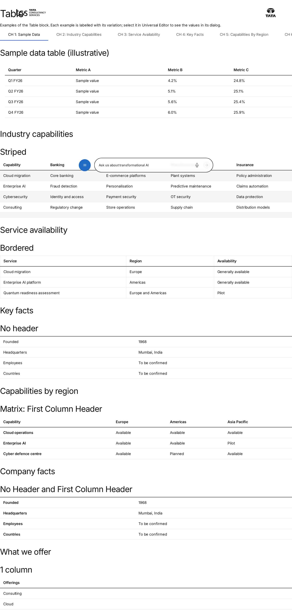
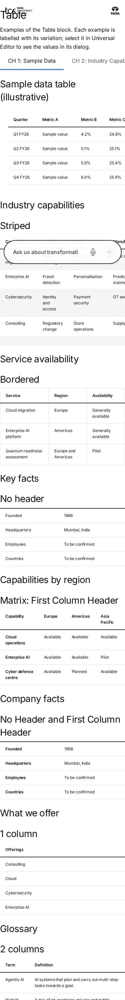

# Table — Authoring Guide

| Attribute | Value |
| --- | --- |
| Document ID | AUT-C-table |
| Audience | Content authors, content managers, AEM authoring leads |
| Purpose | How to add, fill in and check the Table component |
| Scope | — |
| Prerequisites | — |
| Owner | Content Lead / AEM Authoring Lead (proposed) |
| Approver | Product Owner (to be confirmed) |
| Version | 1.0 |
| Status | Draft for review |
| Last updated | 8 November 2026 |
| Last validated | 8 November 2026 |
| Source files | blocks/table/README.md, blocks/table/_table.json |
| Related documents | — |
| Related AEM paths | — |

## Contents

- [Where to see it](#where-to-see-it)
- [For Content Authors](#for-content-authors)
- [Authorable Fields](#authorable-fields)
- [Screenshot-Based Authoring Steps](#screenshot-based-authoring-steps)
- [Variations](#variations)
- [Complete Authoring Example](#complete-authoring-example)
- [Content and Asset Guidelines](#content-and-asset-guidelines)
- [Troubleshooting](#troubleshooting)
- [Screenshots](#screenshots)
- [Known limitations](#known-limitations)
- [Open items](#open-items)
- [Change history](#change-history)

## Where to see it

- https://main--tcs-corp--sradha-tcs.aem.live/design-block-master/en/block-library/table
- https://main--tcs-corp--sradha-tcs.aem.live/design-block-master/en/block-library/table/table

## For Content Authors

1. **Add the block.** Select a Section, a Columns Container column or a Tabs Container tab, choose
   Add (+) and pick **Table**.
2. **Open its properties.** Select the Table; the panel has the **Content** and **Additional**
   tabs.
3. **Choose Columns first.** Set **Columns** (1 to 5); it decides which Row the Add (+) of the
   Table offers. Changing it later affects only Rows added afterwards.
4. **Choose Options.** In **Options** select Striped and / or Bordered (Border group), No Header
   and / or First Column Header (Header group), or nothing.
5. **Add the Rows.** Select the Table, choose Add (+) and pick **Row**; fill Column 1 to Column N.
   Add the header Row first (unless No Header); reorder Rows by dragging them in the content tree.
6. **Name the table.** Put a heading (Title) as the last element right before the Table in the same
   section.
7. **Preview** at desktop, tablet and mobile widths; check that only the table scrolls on mobile.
8. **Publish** the page.
9. **Validate the published output:** header row, row headers and options look as intended; a
   screen reader announces the table with the heading's name.

**Minimum required:** at least one Row (an empty Table renders nothing visible).
**Recommended:** a header Row, a heading right before the table, the right Columns before adding
Rows. **Optional:** Options, the Additional tab.

## Authorable Fields

<!-- BEGIN GENERATED: fields (npm run build:docs) -->

#### Table (`table`)

Model `table`; template name "Table" (the block class AEM renders); children: `table-row`.

##### Content tab — Table

| Field label | Property | Type | Required | Default | Allowed values | Author guidance | Example |
| ----------- | -------- | ---- | -------- | ------- | -------------- | --------------- | ------- |
| Options | `classes` | multiselect | No | "" | Border (`undefined`), Header (`undefined`) | — | — |
| Columns | `filter` | select | No | `table` | 1 Column (`table`), 2 Columns (`table-2-columns`), 3 Columns (`table-3-columns`), 4 Columns (`table-4-columns`), 5 Columns (`table-5-columns`), 6 Columns (`table-6-columns`), 7 Columns (`table-7-columns`), 8 Columns (`table-8-columns`), 9 Columns (`table-9-columns`) | — | table-4-columns |

##### Additional tab — Table

| Field label | Property | Type | Required | Default | Allowed values | Author guidance | Example |
| ----------- | -------- | ---- | -------- | ------- | -------------- | --------------- | ------- |
| Anchor ID | `classes_anchor` | text | No | — | regExp: ^anchor-[a-z0-9][a-z0-9-]*$; customErrorMsg: Start with anchor-, then lower-case letters, digits and hyphens. | A unique ID of the block on the page, starting with anchor-, e.g. anchor-our-services; link to it with #anchor-our-services. Delivered as a block class. | — |
| Hide block | `classes_hideblock` | boolean | No | `false` | on / off | Hides the whole block on the page until it is turned off (shown faded in the editor). Delivered as a block class. | — |
| Animation Type | `classes_animation` | select | No | "" | None (""), Fade in (`motion-fade-in`), Fade up (`motion-fade-up`), Fade down (`motion-fade-down`), Fade left (`motion-fade-left`), Fade right (`motion-fade-right`), Slide up (`motion-slide-up`), Slide down (`motion-slide-down`), Slide left (`motion-slide-left`), Slide right (`motion-slide-right`), Scale in (`motion-scale-in`) | How the block's content appears; repeated items (cards, list items, accordion items, columns) appear one after another. None: shown as is. Not played in the editor or when the visitor prefers reduced motion. Delivered as a block class. | — |
| Motion Speed | `classes_animationspeed` | select | No | "" | Medium (""), Fast (`motion-fast`), Slow (`motion-slow`) | How fast the animation runs: 0.3, 0.6 or 0.9 seconds. Shown when `classes_animation` is set and `classes_animation` is not empty. Delivered as a block class. | — |
| Animation Trigger | `classes_animationtrigger` | select | No | "" | On Scroll / Viewport Entry (""), On Page Load (`motion-on-load`) | When the block's animations run. On Scroll: when the block comes into view (at once if it is in view when the page opens). On Page Load: as soon as the block is ready, wherever it is on the page. Shown when `classes_animation` is set and `classes_animation` is not empty. Delivered as a block class. | — |
| Padding left | `classes_paddingleft` | select | No | "" | Default (""), 0 (none) (`pl-0`), 0.25rem (space-100) (`pl-100`), 0.5rem (space-200) (`pl-200`), 0.75rem (space-300) (`pl-300`), 1rem (space-400) (`pl-400`), 1.25rem (space-500) (`pl-500`), 1.5rem (space-600) (`pl-600`), 2rem (space-800) (`pl-800`), 2.5rem (space-1000) (`pl-1000`), 3rem (space-1200) (`pl-1200`), 4rem (space-1600) (`pl-1600`), 5rem (space-2000) (`pl-2000`), 6rem (space-2400) (`pl-2400`), 7.5rem (space-3000) (`pl-3000`) | Delivered as a block class. | — |
| Padding right | `classes_paddingright` | select | No | "" | Default (""), 0 (none) (`pr-0`), 0.25rem (space-100) (`pr-100`), 0.5rem (space-200) (`pr-200`), 0.75rem (space-300) (`pr-300`), 1rem (space-400) (`pr-400`), 1.25rem (space-500) (`pr-500`), 1.5rem (space-600) (`pr-600`), 2rem (space-800) (`pr-800`), 2.5rem (space-1000) (`pr-1000`), 3rem (space-1200) (`pr-1200`), 4rem (space-1600) (`pr-1600`), 5rem (space-2000) (`pr-2000`), 6rem (space-2400) (`pr-2400`), 7.5rem (space-3000) (`pr-3000`) | Delivered as a block class. | — |
| Padding top | `classes_paddingtop` | select | No | "" | Default (""), 0 (none) (`pt-0`), 0.25rem (space-100) (`pt-100`), 0.5rem (space-200) (`pt-200`), 0.75rem (space-300) (`pt-300`), 1rem (space-400) (`pt-400`), 1.25rem (space-500) (`pt-500`), 1.5rem (space-600) (`pt-600`), 2rem (space-800) (`pt-800`), 2.5rem (space-1000) (`pt-1000`), 3rem (space-1200) (`pt-1200`), 4rem (space-1600) (`pt-1600`), 5rem (space-2000) (`pt-2000`), 6rem (space-2400) (`pt-2400`), 7.5rem (space-3000) (`pt-3000`) | Delivered as a block class. | — |
| Padding bottom | `classes_paddingbottom` | select | No | "" | Default (""), 0 (none) (`pb-0`), 0.25rem (space-100) (`pb-100`), 0.5rem (space-200) (`pb-200`), 0.75rem (space-300) (`pb-300`), 1rem (space-400) (`pb-400`), 1.25rem (space-500) (`pb-500`), 1.5rem (space-600) (`pb-600`), 2rem (space-800) (`pb-800`), 2.5rem (space-1000) (`pb-1000`), 3rem (space-1200) (`pb-1200`), 4rem (space-1600) (`pb-1600`), 5rem (space-2000) (`pb-2000`), 6rem (space-2400) (`pb-2400`), 7.5rem (space-3000) (`pb-3000`) | Delivered as a block class. | — |
| Margin left | `classes_marginleft` | select | No | "" | Default (""), 0 (none) (`ml-0`), 0.25rem (space-100) (`ml-100`), 0.5rem (space-200) (`ml-200`), 0.75rem (space-300) (`ml-300`), 1rem (space-400) (`ml-400`), 1.25rem (space-500) (`ml-500`), 1.5rem (space-600) (`ml-600`), 2rem (space-800) (`ml-800`), 2.5rem (space-1000) (`ml-1000`), 3rem (space-1200) (`ml-1200`), 4rem (space-1600) (`ml-1600`), 5rem (space-2000) (`ml-2000`), 6rem (space-2400) (`ml-2400`), 7.5rem (space-3000) (`ml-3000`) | Delivered as a block class. | — |
| Margin right | `classes_marginright` | select | No | "" | Default (""), 0 (none) (`mr-0`), 0.25rem (space-100) (`mr-100`), 0.5rem (space-200) (`mr-200`), 0.75rem (space-300) (`mr-300`), 1rem (space-400) (`mr-400`), 1.25rem (space-500) (`mr-500`), 1.5rem (space-600) (`mr-600`), 2rem (space-800) (`mr-800`), 2.5rem (space-1000) (`mr-1000`), 3rem (space-1200) (`mr-1200`), 4rem (space-1600) (`mr-1600`), 5rem (space-2000) (`mr-2000`), 6rem (space-2400) (`mr-2400`), 7.5rem (space-3000) (`mr-3000`) | Delivered as a block class. | — |
| Margin top | `classes_margintop` | select | No | "" | Default (""), 0 (none) (`mt-0`), 0.25rem (space-100) (`mt-100`), 0.5rem (space-200) (`mt-200`), 0.75rem (space-300) (`mt-300`), 1rem (space-400) (`mt-400`), 1.25rem (space-500) (`mt-500`), 1.5rem (space-600) (`mt-600`), 2rem (space-800) (`mt-800`), 2.5rem (space-1000) (`mt-1000`), 3rem (space-1200) (`mt-1200`), 4rem (space-1600) (`mt-1600`), 5rem (space-2000) (`mt-2000`), 6rem (space-2400) (`mt-2400`), 7.5rem (space-3000) (`mt-3000`) | Delivered as a block class. | — |
| Margin bottom | `classes_marginbottom` | select | No | "" | Default (""), 0 (none) (`mb-0`), 0.25rem (space-100) (`mb-100`), 0.5rem (space-200) (`mb-200`), 0.75rem (space-300) (`mb-300`), 1rem (space-400) (`mb-400`), 1.25rem (space-500) (`mb-500`), 1.5rem (space-600) (`mb-600`), 2rem (space-800) (`mb-800`), 2.5rem (space-1000) (`mb-1000`), 3rem (space-1200) (`mb-1200`), 4rem (space-1600) (`mb-1600`), 5rem (space-2000) (`mb-2000`), 6rem (space-2400) (`mb-2400`), 7.5rem (space-3000) (`mb-3000`) | Delivered as a block class. | — |

#### Row (`table-row`)

Model `table-row`; template name "Row" (the block class AEM renders).

##### Fields — Row

| Field label | Property | Type | Required | Default | Allowed values | Author guidance | Example |
| ----------- | -------- | ---- | -------- | ------- | -------------- | --------------- | ------- |
| Column 1 | `column1text` | richtext | No | — | — | — | — |

#### Row (`table-col-2`)

Model `table-col-2`; template name "Row" (the block class AEM renders).

##### Fields — Row

| Field label | Property | Type | Required | Default | Allowed values | Author guidance | Example |
| ----------- | -------- | ---- | -------- | ------- | -------------- | --------------- | ------- |
| Column 1 | `column1text` | richtext | No | — | — | — | — |
| Column 2 | `column2text` | richtext | No | — | — | — | — |

#### Row (`table-col-3`)

Model `table-col-3`; template name "Row" (the block class AEM renders).

##### Fields — Row

| Field label | Property | Type | Required | Default | Allowed values | Author guidance | Example |
| ----------- | -------- | ---- | -------- | ------- | -------------- | --------------- | ------- |
| Column 1 | `column1text` | richtext | No | — | — | — | — |
| Column 2 | `column2text` | richtext | No | — | — | — | — |
| Column 3 | `column3text` | richtext | No | — | — | — | — |

#### Row (`table-col-4`)

Model `table-col-4`; template name "Row" (the block class AEM renders).

##### Fields — Row

| Field label | Property | Type | Required | Default | Allowed values | Author guidance | Example |
| ----------- | -------- | ---- | -------- | ------- | -------------- | --------------- | ------- |
| Column 1 | `column1text` | richtext | No | — | — | — | — |
| Column 2 | `column2text` | richtext | No | — | — | — | — |
| Column 3 | `column3text` | richtext | No | — | — | — | — |
| Column 4 | `column4text` | richtext | No | — | — | — | — |

#### Row (`table-col-5`)

Model `table-col-5`; template name "Row" (the block class AEM renders).

##### Fields — Row

| Field label | Property | Type | Required | Default | Allowed values | Author guidance | Example |
| ----------- | -------- | ---- | -------- | ------- | -------------- | --------------- | ------- |
| Column 1 | `column1text` | richtext | No | — | — | — | — |
| Column 2 | `column2text` | richtext | No | — | — | — | — |
| Column 3 | `column3text` | richtext | No | — | — | — | — |
| Column 4 | `column4text` | richtext | No | — | — | — | — |
| Column 5 | `column5text` | richtext | No | — | — | — | — |

#### Row (`table-col-6`)

Model `table-col-6`; template name "Row" (the block class AEM renders).

##### Fields — Row

| Field label | Property | Type | Required | Default | Allowed values | Author guidance | Example |
| ----------- | -------- | ---- | -------- | ------- | -------------- | --------------- | ------- |
| Column 1 | `column1text` | richtext | No | — | — | — | — |
| Column 2 | `column2text` | richtext | No | — | — | — | — |
| Column 3 | `column3text` | richtext | No | — | — | — | — |
| Column 4 | `column4text` | richtext | No | — | — | — | — |
| Column 5 | `column5text` | richtext | No | — | — | — | — |
| Column 6 | `column6text` | richtext | No | — | — | — | — |

#### Row (`table-col-7`)

Model `table-col-7`; template name "Row" (the block class AEM renders).

##### Fields — Row

| Field label | Property | Type | Required | Default | Allowed values | Author guidance | Example |
| ----------- | -------- | ---- | -------- | ------- | -------------- | --------------- | ------- |
| Column 1 | `column1text` | richtext | No | — | — | — | — |
| Column 2 | `column2text` | richtext | No | — | — | — | — |
| Column 3 | `column3text` | richtext | No | — | — | — | — |
| Column 4 | `column4text` | richtext | No | — | — | — | — |
| Column 5 | `column5text` | richtext | No | — | — | — | — |
| Column 6 | `column6text` | richtext | No | — | — | — | — |
| Column 7 | `column7text` | richtext | No | — | — | — | — |

#### Row (`table-col-8`)

Model `table-col-8`; template name "Row" (the block class AEM renders).

##### Fields — Row

| Field label | Property | Type | Required | Default | Allowed values | Author guidance | Example |
| ----------- | -------- | ---- | -------- | ------- | -------------- | --------------- | ------- |
| Column 1 | `column1text` | richtext | No | — | — | — | — |
| Column 2 | `column2text` | richtext | No | — | — | — | — |
| Column 3 | `column3text` | richtext | No | — | — | — | — |
| Column 4 | `column4text` | richtext | No | — | — | — | — |
| Column 5 | `column5text` | richtext | No | — | — | — | — |
| Column 6 | `column6text` | richtext | No | — | — | — | — |
| Column 7 | `column7text` | richtext | No | — | — | — | — |
| Column 8 | `column8text` | richtext | No | — | — | — | — |

#### Row (`table-col-9`)

Model `table-col-9`; template name "Row" (the block class AEM renders).

##### Fields — Row

| Field label | Property | Type | Required | Default | Allowed values | Author guidance | Example |
| ----------- | -------- | ---- | -------- | ------- | -------------- | --------------- | ------- |
| Column 1 | `column1text` | richtext | No | — | — | — | — |
| Column 2 | `column2text` | richtext | No | — | — | — | — |
| Column 3 | `column3text` | richtext | No | — | — | — | — |
| Column 4 | `column4text` | richtext | No | — | — | — | — |
| Column 5 | `column5text` | richtext | No | — | — | — | — |
| Column 6 | `column6text` | richtext | No | — | — | — | — |
| Column 7 | `column7text` | richtext | No | — | — | — | — |
| Column 8 | `column8text` | richtext | No | — | — | — | — |
| Column 9 | `column9text` | richtext | No | — | — | — | — |

<!-- END GENERATED: fields -->

What the tables don't show:

- **Options (`classes`)** is a grouped multiselect; its values become block classes: Striped
  (`striped`: odd body rows on `--color-bg-secondary`), Bordered (`bordered`: a 1px border on every
  cell), No Header (`no-header`: no `thead`; a 2px rule above the first body row), First Column
  Header (`row-header`: the first cell of each body row is a `th scope="row"`). They combine.
- **Columns (`filter`)** selects the component filter of the Table (`table`, `table-2-columns` …
  `table-5-columns`), i.e. which Row model Add offers; the code doesn't read it.
- **Row (Column 1 … Column 5)** are rich text; each Row becomes one `tr`, each column one cell, in
  authored order. Rows of different column counts are padded with empty cells to the widest row.
  New Rows are empty (no sample text in the templates).
- **Accessibility impact:** the header row and row headers become `th` with `scope`; the heading
  before the block names the table (`aria-labelledby`) and the scroll region.
- **Data-layer impact:** none of the fields adds tracking attributes; links in cells are tracked
  centrally.
- **Links in cells:** a link alone in its paragraph is turned into a link button by the content
  buttons decorator before the block is decorated (bold → primary, italic → secondary).
- **Legacy mapping:** none.
- **Additional tab:** as on every block (AGENTS.md "Additional tab"; Animation Type moves the
  block).

## Screenshot-Based Authoring Steps

#### Authoring Step 1: Add the Table and set Columns

```text
[Screenshot Placeholder]

File name:
table-authoring-step-1.png

Purpose:
The Table added to a section, the Columns select open on 4 Columns.

Annotations:
A = The Table in the content tree
B = Columns
```

#### Values to Enter

| Callout | Field | Value | Reason | Expected result |
| ------- | ----- | ----- | ------ | --------------- |
| A | Component | Table | Adds the block | An empty Table |
| B | Columns | 4 Columns | Quarter, Revenue, Growth, Margin | Add (+) offers Rows with Column 1 to Column 4 |

**Author action:** add the Table and set Columns before adding Rows. **Expected preview:** nothing
visible yet. **Expected published result:** nothing until Rows exist. **Business rules:** Columns
doesn't convert existing Rows. **Validation:** Add (+) on the Table shows a Row with four fields.
**Common mistakes:** adding Rows with 1 Column first.

#### Authoring Step 2: Add the header Row and the data Rows

```text
[Screenshot Placeholder]

File name:
table-authoring-step-2.png

Purpose:
The first Row filled with the column titles and a data Row selected in the content tree.

Annotations:
A = Header Row
B = Column 1 to Column 4 of a Row
C = The rendered header row on the canvas
```

#### Values to Enter

| Callout | Field | Value | Reason | Expected result |
| ------- | ----- | ----- | ------ | --------------- |
| A | Row 1: Column 1 … Column 4 | Quarter / Revenue / Growth / Margin | Column headers | Semibold header row on a 2px rule |
| B | Row 2: Column 1 | Q1 FY26 | First data row | A body row below the header |

**Author action:** add Rows with Add (+) on the Table and fill them; drag to reorder. **Expected
preview:** the header row, then the data rows with light separators. **Expected published
result:** the same `table`. **Business rules:** the first Row is the header unless No Header is
selected. **Validation:** count the cells of every row. **Common mistakes:** the header Row isn't
first; units missing in the headers ("Revenue (USD bn)").

#### Authoring Step 3: Choose the Options

```text
[Screenshot Placeholder]

File name:
table-authoring-step-3.png

Purpose:
The Options multiselect with Striped and First Column Header selected, and the result on the canvas.

Annotations:
A = Options
B = Striped rows
C = Row headers in the first column
```

#### Values to Enter

| Callout | Field | Value | Reason | Expected result |
| ------- | ----- | ----- | ------ | --------------- |
| A | Options | Striped, First Column Header | Long table with row labels | Odd body rows grey; first cells semibold row headers |

**Author action:** select the options. **Expected preview / published result:** as described.
**Business rules:** Striped and Bordered combine with everything; No Header and First Column Header
combine (label / value tables). **Validation:** inspect the first column in the accessibility
tree (row headers). **Common mistakes:** No Header on data whose columns need names.

#### Authoring Step 4: Name the table

```text
[Screenshot Placeholder]

File name:
table-authoring-step-4.png

Purpose:
A Title directly before the Table in the same section.

Annotations:
A = Title before the Table
B = The Table
```

#### Values to Enter

| Callout | Field | Value | Reason | Expected result |
| ------- | ----- | ----- | ------ | --------------- |
| A | Title (component) | Quarterly results | Names the table for screen readers | The table is labelled "Quarterly results" |

**Author action:** add a Title as the last element before the Table. **Expected result:** the
heading gets an id and the table `aria-labelledby`; a scrolling table's region is named after it.
**Common mistakes:** the heading is in another section or followed by a Text: the table is unnamed
and the region is called "Table".

## Variations

#### Standard (header row)

- **Purpose:** most tables. **Fields:** Rows, the first one the headers; no Options.
- **Rendering:** `thead` with the first row (`th scope="col"`), `tbody` with the others.
- **Accessibility:** column headers announced with each cell.

#### No Header

- **Purpose:** data whose meaning is obvious without column names. **Options:** No Header.
- **Rendering:** no `thead`; a 2px rule above the first body row; all cells `td` (unless First
  Column Header).

#### First Column Header

- **Purpose:** row labels (a matrix, specifications). **Options:** First Column Header.
- **Rendering:** the first cell of every body row is `th scope="row"` (semibold, start-aligned); the
  header row's first cell stays a column header.

#### Row headers only (No Header + First Column Header)

- **Purpose:** label / value tables (Founded 1968, Headquarters Mumbai, India).
- **Rendering:** no `thead`; semibold row headers in the first column.

#### Striped

- **Purpose:** long tables. **Rendering:** odd body rows (1st, 3rd, …) on `--color-bg-secondary`.

#### Bordered

- **Purpose:** dense numeric tables. **Rendering:** a 1px `--color-border-default` border on every
  cell.

#### 1 to 9 Columns

- **Purpose:** the number of fields per Row (Row models `table-row`, `table-col-2` …
  `table-col-5`). **Dialog:** Columns, before adding Rows.

#### Scroll region (automatic)

- **Rendering:** while the table is wider than the block (`scrollWidth > clientWidth + 1`, watched
  with a ResizeObserver), the block gets `tabindex="0"`, `role="region"` and an `aria-label` (the
  heading's text, else the placeholder `table`, "Table"); removed when it fits. The block scrolls
  horizontally (`overflow-x: auto`) and shows a 2px brand focus outline.
- **Responsive:** typical on mobile from 4 columns.

```text
[Screenshot Placeholder]

File name:
table-row-headers-only-mobile.png

Purpose:
A No Header + First Column Header table at 390 px.

Annotations:
A = Row headers
B = Values
```

Personalization and fallback: none for any variation; every visitor sees the authored rows.

## Complete Authoring Example

Scenario: key facts on an About page as a label / value table.

| Field | Example value | Guidance |
| ----- | ------------- | -------- |
| Title before the block | Key facts | Names the table |
| Columns | 2 Columns | Label and value |
| Options | No Header, First Column Header | Labels are row headers |
| Row 1 | Founded / 1968 | One fact per Row |
| Row 2 | Headquarters / Mumbai, India | |
| Row 3 | Employees / More than 600,000 | |
| Row 4 | Countries / 55 | |

**Steps:** add the Title, then the Table; set Columns and Options; add the four Rows; preview;
publish.

**Expected output:** a 2-column table with a 2px rule above the first row, semibold labels and
regular values, light separators.

**Responsive:** fits at every width; text `--body-font-size-s` below 900px, `--body-font-size-m`
from 900px.

**Accessibility:** labels are `th scope="row"`; the table is labelled "Key facts".

**Analytics / data layer:** `tcs-corp/components/table` (`table-1`); no events unless cells hold
links.

**Personalization fallback:** none.

**Pre-publish checklist:**

1. Columns matches every Row (no padded empty cells).
2. The header Row is first (or No Header is selected).
3. A heading is directly before the table.
4. Units are in the headers; numbers formatted for the locale.
5. Only the table scrolls at 390 px.
6. No empty header cells.

## Content and Asset Guidelines

- **Headers:** short (units in the header); never leave header cells empty.
- **Cells:** short values; descriptive link text inside sentences (a link alone in a cell paragraph
  becomes a link button).
- **Images, icons, tags, metadata:** not part of the design; the block reads no tags or metadata.
- **Min / max items:** 1 to 9 columns (the Row models); no verified technical limit on the number
  of Rows was identified.
- **Localization:** translate every cell; check that translated text doesn't widen the table much;
  number and date formats aren't localised by the block.
- **Missing content:** a Table without Rows renders an empty `table` (nothing visible).

## Troubleshooting

| Symptom | Likely cause | Diagnostic steps | Resolution | Verification |
| ------- | ------------ | ---------------- | ---------- | ------------ |
| First data row shown as header | The first Row is the header unless No Header | Check Options | Add a header Row first, or select No Header | Header as intended |
| Add offers one-column Rows | Columns is 1 Column | Check Columns | Set Columns; recreate the Rows | New Rows have N fields |
| Empty cells at row ends | Rows of different column counts | Count fields per Row | Recreate short Rows with the right Columns | All rows equal |
| Page scrolls sideways on mobile | A wide element (long URL) or large margins | Device mode; find the overflowing element | Link text instead of URLs; reset margins | Only the table scrolls |
| Screen reader says "Table" | No heading directly before the block | Check `aria-labelledby` and the preceding element | Put the heading right before the Table | Region named after the heading |
| A cell link looks like a button | Link alone in its paragraph (content buttons decorator) | Check the cell's rich text | Write the link inside a sentence | Inline link |
| The first Row disappears | It is empty and has at most one cell (read as a tab row) | Check the first Row's content | Fill or delete the empty Row | The header row shows |

Evidence to collect (no secrets): page URL, `.plain.html` of the block, a screenshot at the failing
width, the block's classes and the accessibility tree of the table.

## Screenshots



*Figure: Table as published (block library) — desktop 1440 × 900 (/design-block-master/en/block-library/table/table, captured 2026-11-08).*



*Figure: Table as published (block library) — mobile 375 × 812 (/design-block-master/en/block-library/table/table, captured 2026-11-08).*

> **Screenshot required**
>
> - Required screen: Table dialog in Universal Editor (every tab, including Additional)
> - Required role/access: AEM Sites author with Universal Editor (content author)
> - Required navigation steps: AEM Sites console > /content/tcs-corp/language-masters/en > open a page in Universal Editor
> - Reason unavailable: No AEM author access in the documentation program (access blocker AB-01)
> - Owner: Content Lead / AEM Authoring Lead (proposed)
> - Target completion date: To be confirmed

## Known limitations

- Universal Editor screenshots are placeholders: no author access in this program.

## Open items

- None.

## Change history

| Version | Date | Author | Change |
| --- | --- | --- | --- |
| 1.0 | 8 November 2026 | Delivery team (documentation program) | First version of the role-specific documentation (master documentation prompt), generated from the repository and the published reference pages |
