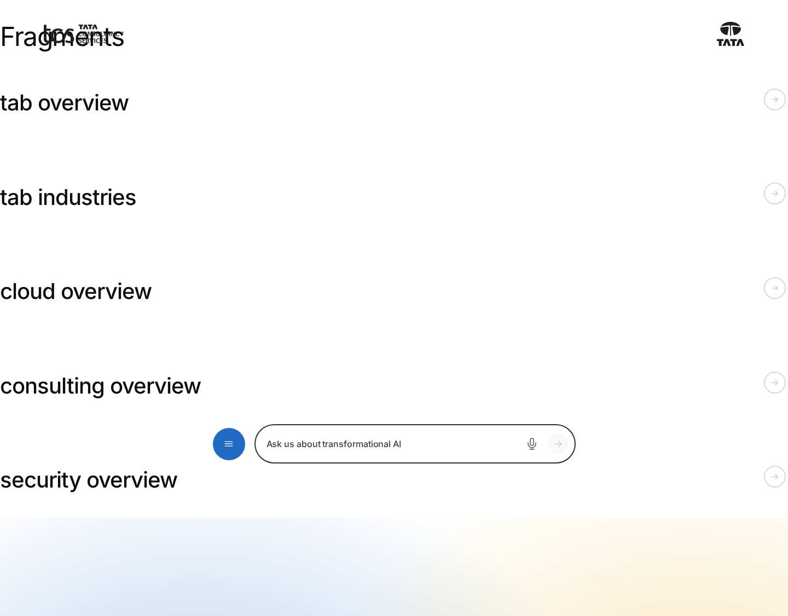
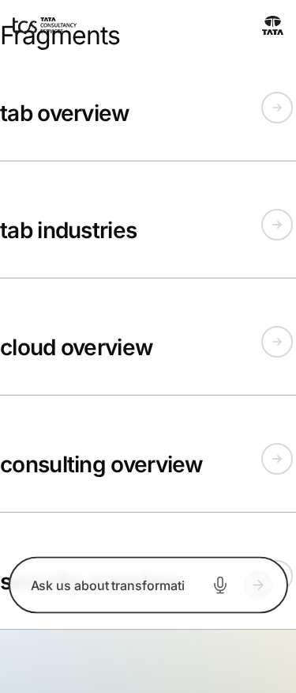

# Tabs — Authoring Guide

| Attribute | Value |
| --- | --- |
| Document ID | AUT-C-tabs |
| Audience | Content authors, content managers, AEM authoring leads |
| Purpose | How to add, fill in and check the Tabs component |
| Scope | — |
| Prerequisites | — |
| Owner | Content Lead / AEM Authoring Lead (proposed) |
| Approver | Product Owner (to be confirmed) |
| Version | 1.0 |
| Status | Draft for review |
| Last updated | 8 November 2026 |
| Last validated | 8 November 2026 |
| Source files | blocks/tabs/README.md, blocks/tabs/_tabs.json |
| Related documents | — |
| Related AEM paths | — |

## Contents

- [Where to see it](#where-to-see-it)
- [For Content Authors](#for-content-authors)
- [Authorable Fields](#authorable-fields)
- [Screenshot-Based Authoring Steps](#screenshot-based-authoring-steps)
- [Variations](#variations)
- [Complete Authoring Example](#complete-authoring-example)
- [Content and Asset Guidelines](#content-and-asset-guidelines)
- [Troubleshooting](#troubleshooting)
- [Screenshots](#screenshots)
- [Known limitations](#known-limitations)
- [Open items](#open-items)
- [Change history](#change-history)

## Where to see it

- https://main--tcs-corp--sradha-tcs.aem.live/design-block-master/en/block-library/tabs
- https://main--tcs-corp--sradha-tcs.aem.live/design-block-master/en/block-library/tabs/fragments
- https://main--tcs-corp--sradha-tcs.aem.live/design-block-master/en/block-library/tabs/fragments/cloud-overview
- https://main--tcs-corp--sradha-tcs.aem.live/design-block-master/en/block-library/tabs/fragments/consulting-overview
- https://main--tcs-corp--sradha-tcs.aem.live/design-block-master/en/block-library/tabs/fragments/security-overview
- https://main--tcs-corp--sradha-tcs.aem.live/design-block-master/en/block-library/tabs/fragments/tab-industries
- https://main--tcs-corp--sradha-tcs.aem.live/design-block-master/en/block-library/tabs/fragments/tab-overview
- https://main--tcs-corp--sradha-tcs.aem.live/design-block-master/en/block-library/tabs/tab
- https://main--tcs-corp--sradha-tcs.aem.live/design-block-master/en/block-library/tabs/tab-deep-link
- https://main--tcs-corp--sradha-tcs.aem.live/design-block-master/en/block-library/tabs/tabs-block
- https://main--tcs-corp--sradha-tcs.aem.live/design-block-master/en/block-library/tabs/tabs-block-styles
- https://main--tcs-corp--sradha-tcs.aem.live/design-block-master/en/block-library/tabs/tabs-block-with-fragments
- https://main--tcs-corp--sradha-tcs.aem.live/design-block-master/en/block-library/tabs/tabs-fixed-width
- https://main--tcs-corp--sradha-tcs.aem.live/design-block-master/en/block-library/tabs/tabs-section

## For Content Authors

**Tabs Container (tabs built on the page)**

1. On the page, choose Add (+) where sections are added and pick **Tabs Container**.
2. Select the Tabs Container to open its properties. In **Content**, enter a **Label** that names the group for screen readers (for example "Our services"); optionally an **Anchor name** (the section id; also the prefix of tab ids without their own ID) and the **Width Type**.
3. In **Styles**, choose the **Style** (Underline, Boxed, Pills), **Alignment** (Left, Center, Full width (stretch)) and **Orientation** (Horizontal, Vertical).
4. Inside the Tabs Container, add a **Tab** and enter its **Title** (required: the tab label). Optionally enter an **ID** for links (`#consulting`) and turn on **Active tab** for the tab shown first. See [Tab](https://github.com/sradha-tcs/tcs-corp/blob/main/blocks/tab/README.md).
5. After the Tab, add the components of that tab (Text, Title, Image, Button, Teaser, Cards, a Tabs block, and the other components the container allows). Then add the next Tab and its components, and so on.
6. For columns inside a tab, add a **Column Break** after the Tab, then the components of the first column, another Column Break, then the components of the second column. Set **Columns per row** on the Tab. Content between the Tab and the first Column Break stays above the columns. See [Column Break](https://github.com/sradha-tcs/tcs-corp/blob/main/blocks/column-break/README.md).
7. To reorder tabs, move a Tab and its components together in the content tree; a component belongs to the Tab above it.

**Tabs block (tabs of fragment pages)**

1. In a Section (or inside a Tabs Container or Columns Container), choose Add (+) and pick **Tabs**.
2. In its properties, enter the **Label** and optionally a **Tab ID prefix**; set Style, Alignment and Orientation in **Styles**; the **Additional** tab has the block options.
3. Inside the block, add a **Tab** item per tab. In its **Tab** tab enter the **Title**, optionally the **ID** and **Active tab**; in its **Fragment** tab choose the **Fragment** page whose content the tab shows.
4. Reorder the Tab items in the content tree to reorder the tabs.

**Preview, publish and validate**

1. Switch Universal Editor to Preview and click each tab; check the tab shown first.
2. Publish the page. For the Tabs block, publish the fragment pages too (a fragment that isn't published leaves its panel empty).
3. On the published page, check each tab, the keyboard (arrow keys), and any `#id` links to tabs.

**Minimum required:** a Tabs Container with at least one Tab with a Title and content after it; or a Tabs block with at least one Tab item with a Title and a Fragment. **Recommended:** a Label, a unique Title per tab, an ID on tabs that are linked to, and a heading at the start of each panel. **Optional:** Active tab, Style, Alignment, Orientation, Width Type, Column Breaks, the Additional tab.

## Authorable Fields

<!-- BEGIN GENERATED: fields (npm run build:docs) -->

#### Tabs Container (`tabs`)

Model `tabs`; template name "Tabs" (the block class AEM renders); children: `tab`, `column-break`, `text`, `image`, `button-block`, `title`, `hero`, `teaser`, `image-collage`, `quote`, `media-contacts`, `testimonial`, `anchor-list`, `accordion`, `table`, `table-list`, `list`, `separator`, `embed`, `video`, `modal`, `form-variations`, `filter-list`, `cards`, `fragment`, `tabs-block`.

Stored on a new component (definition template): `style` = `"tabs-section"`, `tabsStyle` = `"underline"`, `tabsAlignment` = `"left"`, `tabsOrientation` = `"horizontal"`.

##### Content tab — Tabs Container

| Field label | Property | Type | Required | Default | Allowed values | Author guidance | Example |
| ----------- | -------- | ---- | -------- | ------- | -------------- | --------------- | ------- |
| Component | `style` | select | No | `tabs-section` | Tabs (`tabs-section`) | — | tabs-section |
| Anchor name | `anchorName` | text | No | — | regExp: ^#?[a-z0-9][a-z0-9-]*$; customErrorMsg: Lower-case letters, digits and hyphens, e.g. our-offices. | The section id: #links and Anchor List links jump to it; also the prefix of tab ids without their own ID. | — |
| Width Type | `sectionWidth` | select | No | `full-width` | Full Width (`full-width`), Fixed Width (`fixed-width`) | — | full-width |
| Label | `tabsAriaLabel` | text | No | — | — | Names the tab list for screen readers (aria-label), e.g. Our services. | Our services |

##### Styles tab — Tabs Container

| Field label | Property | Type | Required | Default | Allowed values | Author guidance | Example |
| ----------- | -------- | ---- | -------- | ------- | -------------- | --------------- | ------- |
| Style | `tabsStyle` | select | No | `underline` | Underline (`underline`), Boxed (`boxed`), Pills (`pills`) | — | underline |
| Alignment | `tabsAlignment` | select | No | `left` | Left (`left`), Center (`center`), Full width (stretch) (`stretch`) | — | left |
| Orientation | `tabsOrientation` | select | No | `horizontal` | Horizontal (`horizontal`), Vertical (`vertical`) | Vertical: the tab list is on the left of the content on desktop, above it on mobile. | horizontal |

##### Additional tab — Tabs Container

| Field label | Property | Type | Required | Default | Allowed values | Author guidance | Example |
| ----------- | -------- | ---- | -------- | ------- | -------------- | --------------- | ------- |
| Anchor ID | `containerAnchor` | text | No | — | regExp: ^anchor-[a-z0-9][a-z0-9-]*$; customErrorMsg: Start with anchor-, then lower-case letters, digits and hyphens. | The id of the tabs block itself (start with anchor-). Use Anchor name for links to the section. | — |
| Hide block | `containerHide` | boolean | No | `false` | on / off | Hides the whole block on the page until it is turned off (shown faded in the editor). | — |
| Animation Type | `containerAnimation` | select | No | "" | None (""), Fade in (`motion-fade-in`), Fade up (`motion-fade-up`), Fade down (`motion-fade-down`), Fade left (`motion-fade-left`), Fade right (`motion-fade-right`), Slide up (`motion-slide-up`), Slide down (`motion-slide-down`), Slide left (`motion-slide-left`), Slide right (`motion-slide-right`), Scale in (`motion-scale-in`) | How the block's content appears; repeated items (cards, list items, accordion items, columns) appear one after another. None: shown as is. Not played in the editor or when the visitor prefers reduced motion. | — |
| Motion Speed | `containerAnimationSpeed` | select | No | "" | Medium (""), Fast (`motion-fast`), Slow (`motion-slow`) | How fast the animation runs: 0.3, 0.6 or 0.9 seconds. Shown when `containerAnimation` is set and `containerAnimation` is not empty. | — |
| Animation Trigger | `containerAnimationTrigger` | select | No | "" | On Scroll / Viewport Entry (""), On Page Load (`motion-on-load`) | When the block's animations run. On Scroll: when the block comes into view (at once if it is in view when the page opens). On Page Load: as soon as the block is ready, wherever it is on the page. Shown when `containerAnimation` is set and `containerAnimation` is not empty. | — |
| Padding left | `containerPaddingLeft` | select | No | "" | Default (""), 0 (none) (`pl-0`), 0.25rem (space-100) (`pl-100`), 0.5rem (space-200) (`pl-200`), 0.75rem (space-300) (`pl-300`), 1rem (space-400) (`pl-400`), 1.25rem (space-500) (`pl-500`), 1.5rem (space-600) (`pl-600`), 2rem (space-800) (`pl-800`), 2.5rem (space-1000) (`pl-1000`), 3rem (space-1200) (`pl-1200`), 4rem (space-1600) (`pl-1600`), 5rem (space-2000) (`pl-2000`), 6rem (space-2400) (`pl-2400`), 7.5rem (space-3000) (`pl-3000`) | — | — |
| Padding right | `containerPaddingRight` | select | No | "" | Default (""), 0 (none) (`pr-0`), 0.25rem (space-100) (`pr-100`), 0.5rem (space-200) (`pr-200`), 0.75rem (space-300) (`pr-300`), 1rem (space-400) (`pr-400`), 1.25rem (space-500) (`pr-500`), 1.5rem (space-600) (`pr-600`), 2rem (space-800) (`pr-800`), 2.5rem (space-1000) (`pr-1000`), 3rem (space-1200) (`pr-1200`), 4rem (space-1600) (`pr-1600`), 5rem (space-2000) (`pr-2000`), 6rem (space-2400) (`pr-2400`), 7.5rem (space-3000) (`pr-3000`) | — | — |
| Padding top | `containerPaddingTop` | select | No | "" | Default (""), 0 (none) (`pt-0`), 0.25rem (space-100) (`pt-100`), 0.5rem (space-200) (`pt-200`), 0.75rem (space-300) (`pt-300`), 1rem (space-400) (`pt-400`), 1.25rem (space-500) (`pt-500`), 1.5rem (space-600) (`pt-600`), 2rem (space-800) (`pt-800`), 2.5rem (space-1000) (`pt-1000`), 3rem (space-1200) (`pt-1200`), 4rem (space-1600) (`pt-1600`), 5rem (space-2000) (`pt-2000`), 6rem (space-2400) (`pt-2400`), 7.5rem (space-3000) (`pt-3000`) | — | — |
| Padding bottom | `containerPaddingBottom` | select | No | "" | Default (""), 0 (none) (`pb-0`), 0.25rem (space-100) (`pb-100`), 0.5rem (space-200) (`pb-200`), 0.75rem (space-300) (`pb-300`), 1rem (space-400) (`pb-400`), 1.25rem (space-500) (`pb-500`), 1.5rem (space-600) (`pb-600`), 2rem (space-800) (`pb-800`), 2.5rem (space-1000) (`pb-1000`), 3rem (space-1200) (`pb-1200`), 4rem (space-1600) (`pb-1600`), 5rem (space-2000) (`pb-2000`), 6rem (space-2400) (`pb-2400`), 7.5rem (space-3000) (`pb-3000`) | — | — |
| Margin left | `containerMarginLeft` | select | No | "" | Default (""), 0 (none) (`ml-0`), 0.25rem (space-100) (`ml-100`), 0.5rem (space-200) (`ml-200`), 0.75rem (space-300) (`ml-300`), 1rem (space-400) (`ml-400`), 1.25rem (space-500) (`ml-500`), 1.5rem (space-600) (`ml-600`), 2rem (space-800) (`ml-800`), 2.5rem (space-1000) (`ml-1000`), 3rem (space-1200) (`ml-1200`), 4rem (space-1600) (`ml-1600`), 5rem (space-2000) (`ml-2000`), 6rem (space-2400) (`ml-2400`), 7.5rem (space-3000) (`ml-3000`) | — | — |
| Margin right | `containerMarginRight` | select | No | "" | Default (""), 0 (none) (`mr-0`), 0.25rem (space-100) (`mr-100`), 0.5rem (space-200) (`mr-200`), 0.75rem (space-300) (`mr-300`), 1rem (space-400) (`mr-400`), 1.25rem (space-500) (`mr-500`), 1.5rem (space-600) (`mr-600`), 2rem (space-800) (`mr-800`), 2.5rem (space-1000) (`mr-1000`), 3rem (space-1200) (`mr-1200`), 4rem (space-1600) (`mr-1600`), 5rem (space-2000) (`mr-2000`), 6rem (space-2400) (`mr-2400`), 7.5rem (space-3000) (`mr-3000`) | — | — |
| Margin top | `containerMarginTop` | select | No | "" | Default (""), 0 (none) (`mt-0`), 0.25rem (space-100) (`mt-100`), 0.5rem (space-200) (`mt-200`), 0.75rem (space-300) (`mt-300`), 1rem (space-400) (`mt-400`), 1.25rem (space-500) (`mt-500`), 1.5rem (space-600) (`mt-600`), 2rem (space-800) (`mt-800`), 2.5rem (space-1000) (`mt-1000`), 3rem (space-1200) (`mt-1200`), 4rem (space-1600) (`mt-1600`), 5rem (space-2000) (`mt-2000`), 6rem (space-2400) (`mt-2400`), 7.5rem (space-3000) (`mt-3000`) | — | — |
| Margin bottom | `containerMarginBottom` | select | No | "" | Default (""), 0 (none) (`mb-0`), 0.25rem (space-100) (`mb-100`), 0.5rem (space-200) (`mb-200`), 0.75rem (space-300) (`mb-300`), 1rem (space-400) (`mb-400`), 1.25rem (space-500) (`mb-500`), 1.5rem (space-600) (`mb-600`), 2rem (space-800) (`mb-800`), 2.5rem (space-1000) (`mb-1000`), 3rem (space-1200) (`mb-1200`), 4rem (space-1600) (`mb-1600`), 5rem (space-2000) (`mb-2000`), 6rem (space-2400) (`mb-2400`), 7.5rem (space-3000) (`mb-3000`) | — | — |

#### Tabs (`tabs-block`)

Model `tabs-block`; template name "Tabs" (the block class AEM renders); key-value block (one row per property); children: `tabs-item`.

Stored on a new component (definition template): `tabsStyle` = `"underline"`, `tabsAlignment` = `"left"`, `tabsOrientation` = `"horizontal"`.

##### Content tab — Tabs

| Field label | Property | Type | Required | Default | Allowed values | Author guidance | Example |
| ----------- | -------- | ---- | -------- | ------- | -------------- | --------------- | ------- |
| Tab ID prefix | `tabsId` | text | No | — | — | Prefix of the tab ids (e.g. our-offerings-item-1); not an anchor: use Anchor ID for links. | our-offerings |
| Label | `tabsAriaLabel` | text | No | — | — | Names the tab list for screen readers (aria-label), e.g. Our services. | How we help |

##### Styles tab — Tabs

| Field label | Property | Type | Required | Default | Allowed values | Author guidance | Example |
| ----------- | -------- | ---- | -------- | ------- | -------------- | --------------- | ------- |
| Style | `tabsStyle` | select | No | `underline` | Underline (`underline`), Boxed (`boxed`), Pills (`pills`) | — | underline |
| Alignment | `tabsAlignment` | select | No | `left` | Left (`left`), Center (`center`), Full width (stretch) (`stretch`) | — | left |
| Orientation | `tabsOrientation` | select | No | `horizontal` | Horizontal (`horizontal`), Vertical (`vertical`) | Vertical: the tab list is on the left of the content on desktop, above it on mobile. | horizontal |

##### Additional tab — Tabs

| Field label | Property | Type | Required | Default | Allowed values | Author guidance | Example |
| ----------- | -------- | ---- | -------- | ------- | -------------- | --------------- | ------- |
| Anchor ID | `classes_anchor` | text | No | — | regExp: ^anchor-[a-z0-9][a-z0-9-]*$; customErrorMsg: Start with anchor-, then lower-case letters, digits and hyphens. | A unique ID of the block on the page, starting with anchor-, e.g. anchor-our-services; link to it with #anchor-our-services. Delivered as a block class. | — |
| Hide block | `classes_hideblock` | boolean | No | `false` | on / off | Hides the whole block on the page until it is turned off (shown faded in the editor). Delivered as a block class. | — |
| Padding left | `classes_paddingleft` | select | No | "" | Default (""), 0 (none) (`pl-0`), 0.25rem (space-100) (`pl-100`), 0.5rem (space-200) (`pl-200`), 0.75rem (space-300) (`pl-300`), 1rem (space-400) (`pl-400`), 1.25rem (space-500) (`pl-500`), 1.5rem (space-600) (`pl-600`), 2rem (space-800) (`pl-800`), 2.5rem (space-1000) (`pl-1000`), 3rem (space-1200) (`pl-1200`), 4rem (space-1600) (`pl-1600`), 5rem (space-2000) (`pl-2000`), 6rem (space-2400) (`pl-2400`), 7.5rem (space-3000) (`pl-3000`) | Delivered as a block class. | — |
| Padding right | `classes_paddingright` | select | No | "" | Default (""), 0 (none) (`pr-0`), 0.25rem (space-100) (`pr-100`), 0.5rem (space-200) (`pr-200`), 0.75rem (space-300) (`pr-300`), 1rem (space-400) (`pr-400`), 1.25rem (space-500) (`pr-500`), 1.5rem (space-600) (`pr-600`), 2rem (space-800) (`pr-800`), 2.5rem (space-1000) (`pr-1000`), 3rem (space-1200) (`pr-1200`), 4rem (space-1600) (`pr-1600`), 5rem (space-2000) (`pr-2000`), 6rem (space-2400) (`pr-2400`), 7.5rem (space-3000) (`pr-3000`) | Delivered as a block class. | — |
| Padding top | `classes_paddingtop` | select | No | "" | Default (""), 0 (none) (`pt-0`), 0.25rem (space-100) (`pt-100`), 0.5rem (space-200) (`pt-200`), 0.75rem (space-300) (`pt-300`), 1rem (space-400) (`pt-400`), 1.25rem (space-500) (`pt-500`), 1.5rem (space-600) (`pt-600`), 2rem (space-800) (`pt-800`), 2.5rem (space-1000) (`pt-1000`), 3rem (space-1200) (`pt-1200`), 4rem (space-1600) (`pt-1600`), 5rem (space-2000) (`pt-2000`), 6rem (space-2400) (`pt-2400`), 7.5rem (space-3000) (`pt-3000`) | Delivered as a block class. | — |
| Padding bottom | `classes_paddingbottom` | select | No | "" | Default (""), 0 (none) (`pb-0`), 0.25rem (space-100) (`pb-100`), 0.5rem (space-200) (`pb-200`), 0.75rem (space-300) (`pb-300`), 1rem (space-400) (`pb-400`), 1.25rem (space-500) (`pb-500`), 1.5rem (space-600) (`pb-600`), 2rem (space-800) (`pb-800`), 2.5rem (space-1000) (`pb-1000`), 3rem (space-1200) (`pb-1200`), 4rem (space-1600) (`pb-1600`), 5rem (space-2000) (`pb-2000`), 6rem (space-2400) (`pb-2400`), 7.5rem (space-3000) (`pb-3000`) | Delivered as a block class. | — |
| Margin left | `classes_marginleft` | select | No | "" | Default (""), 0 (none) (`ml-0`), 0.25rem (space-100) (`ml-100`), 0.5rem (space-200) (`ml-200`), 0.75rem (space-300) (`ml-300`), 1rem (space-400) (`ml-400`), 1.25rem (space-500) (`ml-500`), 1.5rem (space-600) (`ml-600`), 2rem (space-800) (`ml-800`), 2.5rem (space-1000) (`ml-1000`), 3rem (space-1200) (`ml-1200`), 4rem (space-1600) (`ml-1600`), 5rem (space-2000) (`ml-2000`), 6rem (space-2400) (`ml-2400`), 7.5rem (space-3000) (`ml-3000`) | Delivered as a block class. | — |
| Margin right | `classes_marginright` | select | No | "" | Default (""), 0 (none) (`mr-0`), 0.25rem (space-100) (`mr-100`), 0.5rem (space-200) (`mr-200`), 0.75rem (space-300) (`mr-300`), 1rem (space-400) (`mr-400`), 1.25rem (space-500) (`mr-500`), 1.5rem (space-600) (`mr-600`), 2rem (space-800) (`mr-800`), 2.5rem (space-1000) (`mr-1000`), 3rem (space-1200) (`mr-1200`), 4rem (space-1600) (`mr-1600`), 5rem (space-2000) (`mr-2000`), 6rem (space-2400) (`mr-2400`), 7.5rem (space-3000) (`mr-3000`) | Delivered as a block class. | — |
| Margin top | `classes_margintop` | select | No | "" | Default (""), 0 (none) (`mt-0`), 0.25rem (space-100) (`mt-100`), 0.5rem (space-200) (`mt-200`), 0.75rem (space-300) (`mt-300`), 1rem (space-400) (`mt-400`), 1.25rem (space-500) (`mt-500`), 1.5rem (space-600) (`mt-600`), 2rem (space-800) (`mt-800`), 2.5rem (space-1000) (`mt-1000`), 3rem (space-1200) (`mt-1200`), 4rem (space-1600) (`mt-1600`), 5rem (space-2000) (`mt-2000`), 6rem (space-2400) (`mt-2400`), 7.5rem (space-3000) (`mt-3000`) | Delivered as a block class. | — |
| Margin bottom | `classes_marginbottom` | select | No | "" | Default (""), 0 (none) (`mb-0`), 0.25rem (space-100) (`mb-100`), 0.5rem (space-200) (`mb-200`), 0.75rem (space-300) (`mb-300`), 1rem (space-400) (`mb-400`), 1.25rem (space-500) (`mb-500`), 1.5rem (space-600) (`mb-600`), 2rem (space-800) (`mb-800`), 2.5rem (space-1000) (`mb-1000`), 3rem (space-1200) (`mb-1200`), 4rem (space-1600) (`mb-1600`), 5rem (space-2000) (`mb-2000`), 6rem (space-2400) (`mb-2400`), 7.5rem (space-3000) (`mb-3000`) | Delivered as a block class. | — |

#### Tab (`tabs-item`)

Model `tabs-item`; template name "Tab" (the block class AEM renders).

##### Tab tab — Tab

| Field label | Property | Type | Required | Default | Allowed values | Author guidance | Example |
| ----------- | -------- | ---- | -------- | ------- | -------------- | --------------- | ------- |
| Title | `title` | text | Yes | — | — | The label of the tab. | — |
| ID | `tabId` | text | No | — | regExp: ^#?[a-z0-9][a-z0-9-]*$; customErrorMsg: Lower-case letters, digits and hyphens, e.g. overview. | Links to #ID open this tab (deep link), e.g. overview (lowercase, no spaces). Leave empty for an id from the Tabs ID. | — |
| Active tab | `activeTab` | boolean | No | — | on / off | Shows this tab when the page loads (the first tab if no tab is active). | — |

##### Fragment tab — Tab

| Field label | Property | Type | Required | Default | Allowed values | Author guidance | Example |
| ----------- | -------- | ---- | -------- | ------- | -------------- | --------------- | ------- |
| Fragment | `fragment` | aem-content | No | — | — | A page whose content (any components, e.g. Columns, Title, Text, Image, Button) is shown in the tab. | — |

<!-- END GENERATED: fields -->

Notes on the fields (see the tables above for labels, values and defaults):

- **Component** (`style`, Tabs Container): its only value `tabs-section` makes the section a Tabs Container (`scripts.js` `buildTabsSections` looks for the class `tabs-section`). Keep it.
- **Label** (`tabsAriaLabel`): the tab list's `aria-label`; empty: the placeholder `tabs` ("Tabs"). Screen readers announce it with the tab list.
- **Anchor name** (`anchorName`, Tabs Container) and **Tab ID prefix** (`tabsId`, Tabs block): the base of the panel ids of tabs without an ID (`{base}-item-{n}`); without it the base is `tabs-{n}`. Anchor name is also the section id (`#our-services` scrolls to the section but doesn't change the tab).
- **Style**, **Alignment**, **Orientation** (`tabsStyle`, `tabsAlignment`, `tabsOrientation`): block classes (`underline` / `boxed` / `pills`, `left` / `center` / `stretch`, `horizontal` / `vertical`). The Tabs block accepts only these values (`pick`); the Tabs Container adds the delivered value as a class. Orientation Vertical also sets `aria-orientation="vertical"` on the tab list at every width; the layout is vertical only from 900px.
- **Width Type** (`sectionWidth`, Tabs Container): the section option (`fixed-width` class), as on sections.
- **Tab item Title / ID / Active tab** (`tabs-item`): the tab label (empty: placeholder `tabNumber`, "Tab {n}"), the panel id (normalized to lower case with hyphens; a taken id gets `-2`, `-3`) and the tab shown first (only the value `true` counts; the first active tab wins).
- **Fragment** (`tabs-item`): the page whose content the panel shows; it must be a site path (starting with `/`). The Tab of a Tabs Container has no Fragment.
- **Legacy mapping:** Tab items authored when the item had Content fields have more cells; the Fragment is read from the last cell. Tabs Containers holding built-in Columns blocks authored before keep rendering.
- **Additional tab:** see AGENTS.md "Additional tab". The Tabs block uses the `classes_*` fields (block classes; it has no animation fields). The Tabs Container uses the `container*` fields (AEM doesn't deliver a section's `classes_*` fields), which `scripts.js` `applySectionBlockOptions` turns into classes of the synthetic `tabs` block: Anchor ID, Hide block (hides the whole section on the page), Animation Type / Motion Speed / Animation Trigger (the whole block animates; Tabs is not in the motion decorator's `CONTENT_TARGETS`) and Padding / Margin.
- **Data layer:** each panel is a data-layer component (`tcs-corp/components/tabs/item`) whose title is the tab label; see [Data Layer and Analytics](https://github.com/sradha-tcs/tcs-corp/blob/main/blocks/tabs/README.md#data-layer-and-analytics).

## Screenshot-Based Authoring Steps

#### Authoring Step 1: Add the Tabs Container

```text
[Screenshot Placeholder]

File name:
tabs-authoring-step-1.png

Purpose:
The page's Add (+) menu with Tabs Container selected, and the new Tabs Container's Content tab.

Annotations:
A = Add (+) on the page
B = Tabs Container in the component list
C = Label field
```

#### Values to Enter

| Callout | Field | Value | Reason | Expected result |
|---|---|---|---|---|
| A | Add (+) | Tabs Container | Tabs Containers are added where sections are added | An empty Tabs Container; in edit mode it shows "Add a Tab, then the components of the tab after it." |
| C | Label | Our services | Names the tab list for screen readers | `aria-label="Our services"` on the tab list |
| — | Width Type | Full Width | Default section width | The tabs span the content width |

Author action: add the Tabs Container, select it, enter the Label. Expected preview: the empty-state hint. Expected published result: nothing is shown until the container has a Tab. Business rule: keep Component set to Tabs. Validation: the section has the class `tabs-section`. Common mistake: adding a Section instead (it shows the content one below another, without tabs); resolution: add a Tabs Container and move the components into it.

#### Authoring Step 2: Add the first Tab and its content

```text
[Screenshot Placeholder]

File name:
tabs-authoring-step-2.png

Purpose:
A Tab added inside the Tabs Container with its Content tab open, and a Title and Text added after it.

Annotations:
A = Tab chip in the panel (edit mode)
B = Title field of the Tab
C = ID field
D = Components after the Tab
```

#### Values to Enter

| Callout | Field | Value | Reason | Expected result |
|---|---|---|---|---|
| B | Title | Consulting | The tab label | A tab button "Consulting" |
| C | ID | consulting | Links to `#consulting` open this tab | Panel id `consulting` |
| — | Active tab | On | Shows this tab when the page loads | Consulting is selected on load |
| D | Title, Text after the Tab | Business and technology consulting; a short paragraph | The tab's content | Shown in the Consulting panel |

Author action: inside the Tabs Container add a Tab, fill its fields, then add the components after it. Expected preview: the tab list with Consulting; in edit mode the dashed Tab chip at the top of the panel. Published: the chip is hidden; the content shows in the panel. Business rule: a component belongs to the Tab above it; content before the first Tab becomes an untitled first tab ("Tab 1"). Validation: the tab label matches the Title. Common mistake: components placed before the first Tab; resolution: move them after a Tab.

#### Authoring Step 3: Add more tabs

```text
[Screenshot Placeholder]

File name:
tabs-authoring-step-3.png

Purpose:
The content tree of a Tabs Container with three Tabs (Consulting, Cloud, Cybersecurity), each followed by its components.

Annotations:
A = Tab Consulting and its components
B = Tab Cloud and its components
C = Tab Cybersecurity and its components
```

#### Values to Enter

| Callout | Field | Value | Reason | Expected result |
|---|---|---|---|---|
| B | Title / ID | Cloud / cloud | Second tab | Tab button "Cloud", panel id `cloud` |
| C | Title / ID | Cybersecurity / cybersecurity | Third tab | Tab button "Cybersecurity", panel id `cybersecurity` |

Author action: add each Tab after the content of the previous tab. Expected preview: three tab buttons; selecting a component in the editor shows its tab. Published: one panel at a time. Business rule: keep Active tab on one Tab at most. Validation: each panel holds only its own content. Common mistake: a component dragged under the wrong Tab; resolution: move it in the content tree. Note: a change to a Tab's ID, Active tab, Columns per row or Hide block applies after a reload of the editor (the label updates at once).

#### Authoring Step 4: Lay out a tab in columns

```text
[Screenshot Placeholder]

File name:
tabs-authoring-step-4.png

Purpose:
A tab with a heading, then two Column Breaks each followed by its components, and the Tab's Columns per row set to 2.

Annotations:
A = Columns per row on the Tab
B = Heading above the columns
C = First Column Break and its column
D = Second Column Break and its column
```

#### Values to Enter

| Callout | Field | Value | Reason | Expected result |
|---|---|---|---|---|
| A | Columns per row (Tab) | 2 | Two columns side by side | `per-row-2` on the columns built in the panel |
| B | Title before the first Column Break | Business and technology consulting | Stays above the columns | A heading across the panel |
| C | Column name (Column Break) | Image | Tells the columns apart in the editor | Label "Image" in edit mode only |
| D | Column name (Column Break) | Text | — | Label "Text" in edit mode only |

Author action: after the Tab and the heading, add a Column Break, an Image, a Column Break, a Text. Expected preview: two columns from 900px, stacked below. Published: the same; Column Break labels are hidden. Business rule: in a tab, Gap, Vertical alignment and Side by side from aren't offered (medium gap, top, from Desktop 900px). Validation: the columns sit side by side at desktop width. Common mistake: expecting the Columns Container's Layout fields on the Tab; resolution: use a Columns Container section when those options are needed.

#### Authoring Step 5: Style, preview and publish

```text
[Screenshot Placeholder]

File name:
tabs-authoring-step-5.png

Purpose:
The Styles tab of the Tabs Container with Style Boxed, Alignment Center and Orientation Horizontal, and the preview of the result.

Annotations:
A = Style
B = Alignment
C = Orientation
D = Preview of the tab list
```

#### Values to Enter

| Callout | Field | Value | Reason | Expected result |
|---|---|---|---|---|
| A | Style | Underline | The default, as the Anchor List chapter nav | Brand underline under the selected tab |
| B | Alignment | Left | Default | Tabs start at the left |
| C | Orientation | Horizontal | Default | Tab list above the panel |

Author action: choose the styles, switch to Preview, click each tab, publish. Expected published result: the selected style at every width; tabs that don't fit scroll horizontally. Validation: arrow keys move between tabs; `#cloud` opens Cloud. Common mistake: Vertical tested in a narrow editor canvas (vertical only from 900px); resolution: check at desktop width.

## Variations

#### Tabs Container (section mode)

**Purpose:** tabs whose content is authored on the page. **When to use:** content unique to this page. **When not to use:** content shared by several pages (use the Tabs block). **Required:** Component `tabs-section` (default), at least one Tab with a Title and content after it. **Optional:** Label, Anchor name, Width Type, Styles, Additional tab, Column Breaks. **Dialog:** model `tabs`. **Rendering:** `buildTabsSections` wraps the section content in a synthetic `tabs` block with `data-source="section"`; each Tab starts a group; the Tab wrappers stay in the panels (hidden on the page, shown in edit mode). **Desktop / tablet / mobile:** see [Responsive Behavior](https://github.com/sradha-tcs/tcs-corp/blob/main/blocks/tabs/README.md#responsive-behavior). **Accessibility:** as below. **Data layer:** panels as components, `cmp:show` on change. **Personalization / fallback:** none; the authored content renders.

```text
[Screenshot Placeholder]

File name:
tabs-container-desktop.png

Purpose:
A Tabs Container at desktop width with three tabs and the first panel's own content.

Annotations:
A = Tab list
B = Selected tab
C = Panel content authored after the Tab
```

#### Tabs block (fragment mode)

**Purpose:** tabs of reusable fragment pages. **When to use:** the same tabs on several pages. **When not to use:** content that exists only on this page. **Required:** at least one Tab item with a Title and a Fragment. **Optional:** Label, Tab ID prefix, Styles, Additional tab. **Dialog:** model `tabs-block`, items `tabs-item` (Tab / Fragment tabs). **Rendering:** each item's fragment is loaded (all in parallel) into a `.tabs-fragment` wrapper in its panel; each item's editor instrumentation moves to its panel. **Data layer / personalization:** as the container. A fragment that can't be loaded leaves its panel empty (no message on the page).

```text
[Screenshot Placeholder]

File name:
tabs-block-fragments-desktop.png

Purpose:
A Tabs block whose panel shows the content of its fragment page.

Annotations:
A = Tab list
B = Panel with the fragment's sections
```

#### Style: Underline, Boxed, Pills

Underline (default): plain labels on a divider, the selected tab semibold with a brand bottom border. Boxed: grey boxes with rounded top corners; the selected one white with a border and brand text. Pills: outlined pills, no divider; the selected one filled with the brand colour. Available on both forms. **Accessibility:** state is shown by colour and border and by `aria-selected`. Choose the style that fits the surrounding design.

```text
[Screenshot Placeholder]

File name:
tabs-styles-desktop.png

Purpose:
The three Styles side by side: Underline, Boxed, Pills.

Annotations:
A = Underline
B = Boxed
C = Pills
```

#### Alignment: Left, Center, Full width (stretch)

Left (default): tabs start at the left. Center: the tabs are centred (`justify-content: safe center`, so a list that overflows still scrolls from its start). Full width (stretch): the tabs share the width (`flex: 1 0 auto`). Use Full width for two to four short labels.

```text
[Screenshot Placeholder]

File name:
tabs-alignment-desktop.png

Purpose:
Left, Center and Full width (stretch) alignment of the same tab list.

Annotations:
A = Left
B = Center
C = Full width (stretch)
```

#### Orientation: Horizontal, Vertical

Horizontal (default): the tab list above the panel. Vertical: from 900px a grid with the tab list on the left (`minmax(12.5rem, 1fr)`) and the panel on the right (`3fr`), labels wrapping; below 900px the list stays above the panel. Use Vertical for many or long labels (for example translated labels). `aria-orientation="vertical"` is set at every width, so Arrow Up / Down and Left / Right all work.

```text
[Screenshot Placeholder]

File name:
tabs-vertical-tablet.png

Purpose:
Orientation Vertical below 900px: the tab list stays above the panel.

Annotations:
A = Tab list above the panel
B = Panel
```

#### Width Type: Full Width, Fixed Width (Tabs Container only)

The section option: Full Width (default) or Fixed Width (the `fixed-width` section, capped at the content width by `styles/styles.css`).

```text
[Screenshot Placeholder]

File name:
tabs-width-fixed-desktop.png

Purpose:
A Fixed Width Tabs Container on a wide screen, centred at the content width.

Annotations:
A = Tabs and panel at the content width
```

#### Columns in a tab (Column Breaks)

**Purpose:** columns of components inside a tab (a section can't hold a Columns Container section). **Required:** a Column Break after the Tab, then that column's components; more Column Breaks for more columns. **Optional:** the Tab's Columns per row (Automatic: as many as there are Column Breaks, at most 4). **Rendering:** `columnsOf` builds a `columns-container` block in the panel (decorated while empty, then loaded with `loadBlock`); content before the first Column Break stays above it; the columns get the data-layer id `{panel id}-columns`. Gap, alignment and breakpoint are the Columns Container defaults (medium, top, side by side from 900px). See [Columns Container](https://github.com/sradha-tcs/tcs-corp/blob/main/blocks/columns-container/README.md) and [Column Break](https://github.com/sradha-tcs/tcs-corp/blob/main/blocks/column-break/README.md).

#### Nested Tabs

A Tabs block can be added inside a tab of a Tabs Container (the `tabs` filter allows `tabs-block`). The CSS uses child selectors, so the inner Tabs keep their own Style and Orientation. Selecting a component in the editor or following a deep link opens the outer and the inner tab.

## Complete Authoring Example

Scenario: a services page shows three service lines in a Tabs Container; Cloud is linked from a campaign email as `#cloud`.

| Field | Example value | Guidance |
|---|---|---|
| Label | Our services | Describe the group |
| Style / Alignment / Orientation | Underline / Left / Horizontal | Defaults |
| Tab 1 Title / ID | Consulting / consulting | 1 to 3 words; lower-case ID |
| Tab 1 content | Title "Business and technology consulting", Text, Button "Explore consulting" | Start the panel with a heading |
| Tab 2 Title / ID / Active tab | Cloud / cloud / On | Shown first |
| Tab 2 content | Title, Column Break, Image (with alt text), Column Break, Text; Columns per row 2 | Heading above two columns |
| Tab 3 Title / ID | Cybersecurity / cybersecurity | — |

Steps: add the Tabs Container (Step 1), add the Tabs and their content (Steps 2–4), choose the styles (Step 5), preview, publish.

Expected output: three tab buttons, Cloud selected on load; `/page#consulting` opens Consulting and scrolls the Tabs below the fixed header. Responsive: the list scrolls horizontally if it doesn't fit; the Cloud columns sit side by side from 900px and stack below. Accessibility: tab list named "Our services", arrow keys move between tabs. Analytics: a tab change pushes `cmp:show` for its panel; clicks on the tab buttons push `cmp:click` (see below). Personalization fallback: none; the authored content shows.

Pre-publish checklist:

- Every Tab has a unique Title; at most one Active tab.
- Every panel starts with a heading; images have alt text.
- No component sits before the first Tab.
- IDs used in links match the Tab IDs exactly.
- Tabs block: every fragment page is published.

## Content and Asset Guidelines

- **Tab titles:** short (the handover recommends 1 to 3 words); tabs that don't fit scroll horizontally (`white-space: nowrap` in horizontal lists). Translated labels may be longer: consider Vertical.
- **Label:** a few words naming the group.
- **IDs:** lower-case letters, digits and hyphens (the model validates `^#?[a-z0-9][a-z0-9-]*$`); keep them identical across locales for links.
- **Panel content:** a heading that matches the tab, then the content; keep panels of similar length so the page doesn't jump between tabs. Each component follows its own guidelines (images, alt text, buttons, CTAs).
- **CTAs:** don't place the page's main call to action only in a tab that isn't shown first.
- **Images:** limited to the panel width (`max-width: 100%`, `height: auto`); loading follows the component (Image, Teaser, ...).
- **Min / max items:** no verified technical limit was identified (the tab list scrolls).
- **Tags and metadata:** not used.
- **Missing content:** an empty Title becomes "Tab {n}"; a Tabs Container or Tabs block without tabs renders nothing on the page (a hint in edit mode); a missing fragment leaves its panel empty.

## Troubleshooting

| Symptom | Likely cause | Diagnostic steps | Resolution | Verification |
|---|---|---|---|---|
| Content shown without tabs | A Section instead of a Tabs Container, or Component not `tabs-section` | Inspect the section for the class `tabs-section` and `div.tabs-wrapper` | Use a Tabs Container; keep Component Tabs | Tab list appears |
| An extra "Tab 1" first | A component before the first Tab | Check the content tree order | Move it after a Tab | Only titled tabs |
| Tabs block panel empty | No Fragment, fragment not published, not a site path | Open `{fragment}.plain.html` on the same host; check the network panel | Choose and publish the fragment | Panel shows the fragment |
| Deep link opens the first tab | ID differs (normalized), de-duplicated (`-2`), or the link targets the button or section id | Inspect the panel `id` / `data-tab-id` | Use the exact Tab ID after `#` | The tab opens |
| Wrong tab on load | Several Active tabs, a `#hash`, or the editor keeps the tab shown before a re-render | Check Active tab on every Tab; load without hash | One Active tab | Correct tab on a fresh load |
| Vertical tabs horizontal | Below 900px (by design) or value not delivered | Check width; inspect for the `vertical` class | Test at 900px or wider; re-save | Left column from 900px |
| Tab option change without effect in the editor | Tab ID, Active tab, Columns per row, Hide block apply after a re-render of the container (R-C-7) | Reload the editor | Reload | Option applied |
| Tab chip visible on the page | A Tab outside a Tabs Container | Check the section class | Move or delete the Tab | No chip |

Evidence to collect (no secrets): page URL, viewport width, the section's classes and data attributes, the panel ids, console errors, the `adobeDataLayer` entries for the Tabs.

## Screenshots



*Figure: Tabs as published (block library) — desktop 1440 × 900 (/design-block-master/en/block-library/tabs/fragments, captured 2026-11-08).*



*Figure: Tabs as published (block library) — mobile 375 × 812 (/design-block-master/en/block-library/tabs/fragments, captured 2026-11-08).*

> **Screenshot required**
>
> - Required screen: Tabs dialog in Universal Editor (every tab, including Additional)
> - Required role/access: AEM Sites author with Universal Editor (content author)
> - Required navigation steps: AEM Sites console > /content/tcs-corp/language-masters/en > open a page in Universal Editor
> - Reason unavailable: No AEM author access in the documentation program (access blocker AB-01)
> - Owner: Content Lead / AEM Authoring Lead (proposed)
> - Target completion date: To be confirmed

## Known limitations

- Universal Editor screenshots are placeholders: no author access in this program.

## Open items

- None.

## Change history

| Version | Date | Author | Change |
| --- | --- | --- | --- |
| 1.0 | 8 November 2026 | Delivery team (documentation program) | First version of the role-specific documentation (master documentation prompt), generated from the repository and the published reference pages |
