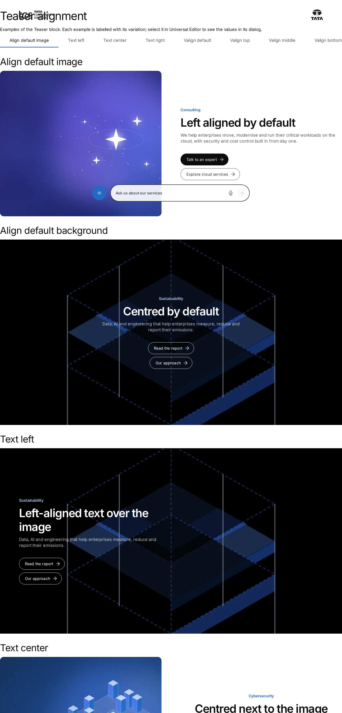
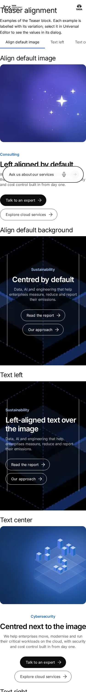

# Teaser — Authoring Guide

| Attribute | Value |
| --- | --- |
| Document ID | AUT-C-teaser |
| Audience | Content authors, content managers, AEM authoring leads |
| Purpose | How to add, fill in and check the Teaser component |
| Scope | — |
| Prerequisites | — |
| Owner | Content Lead / AEM Authoring Lead (proposed) |
| Approver | Product Owner (to be confirmed) |
| Version | 1.0 |
| Status | Draft for review |
| Last updated | 13 November 2026 |
| Last validated | 13 November 2026 |
| Source files | blocks/teaser/README.md, blocks/teaser/_teaser.json |
| Related documents | — |
| Related AEM paths | — |

## Contents

- [Where to see it](#where-to-see-it)
- [For Content Authors](#for-content-authors)
- [Authorable Fields](#authorable-fields)
- [Screenshot-Based Authoring Steps](#screenshot-based-authoring-steps)
- [Variations](#variations)
- [Complete Authoring Example](#complete-authoring-example)
- [Content and Asset Guidelines](#content-and-asset-guidelines)
- [Troubleshooting](#troubleshooting)
- [Screenshots](#screenshots)
- [Known limitations](#known-limitations)
- [Open items](#open-items)
- [Change history](#change-history)

## Where to see it

- https://main--tcs-corp--sradha-tcs.aem.live/design-block-master/en/block-library/teaser
- https://main--tcs-corp--sradha-tcs.aem.live/design-block-master/en/block-library/teaser/alignment
- https://main--tcs-corp--sradha-tcs.aem.live/design-block-master/en/block-library/teaser/article-meta
- https://main--tcs-corp--sradha-tcs.aem.live/design-block-master/en/block-library/teaser/cta-styles
- https://main--tcs-corp--sradha-tcs.aem.live/design-block-master/en/block-library/teaser/description-eyebrow-spacing
- https://main--tcs-corp--sradha-tcs.aem.live/design-block-master/en/block-library/teaser/image-options-and-colours
- https://main--tcs-corp--sradha-tcs.aem.live/design-block-master/en/block-library/teaser/image-positions
- https://main--tcs-corp--sradha-tcs.aem.live/design-block-master/en/block-library/teaser/layouts
- https://main--tcs-corp--sradha-tcs.aem.live/design-block-master/en/block-library/teaser/links-and-stats
- https://main--tcs-corp--sradha-tcs.aem.live/design-block-master/en/block-library/teaser/mobile-image-position
- https://main--tcs-corp--sradha-tcs.aem.live/design-block-master/en/block-library/teaser/title-sizes-and-weights

## For Content Authors

1. **Add the block.** In Universal Editor, select a Section, a Columns Container column, a Gen Carousel section or a Tabs Container. Choose Add (+) and pick **Teaser**.
2. **Open its properties.** Select the block. The dialog has three tabs: Content, Style and Additional.
3. **Choose the layout first** (Style tab › Layout): Image & Text, Text split, Background image or Card. Some fields only appear for some layouts (for example Image position only for Image & Text).
4. **Enter content** (Content tab): Eyebrow, Title (and Title Type, which also sets the size), Description, optionally the Short Description, View All, Date, Reading time, Tags (Display Tags on), Listen link / Download / Share, and the author.
5. **Add the image** (Content tab): Image type (Default or Lotto for a Lottie `.json`), Image, Image alt text, then Image position, Image position (mobile), Image ratio and Image corners where offered.
6. **Add links:** either the Primary and Secondary CTA (Multiple links off), or Link items. To add Link items, select the Teaser in the content tree, choose Add (+), pick **Link**, and set CTA Link, CTA Title, CTA Link Type and CTA Link Style. Link items always render after the CTAs. Set List arrow and Buttons side by side as needed.
7. **Add stats:** Add (+) › **Stat**, with Stats Title and Stats Value. Reorder Link and Stat items by dragging them in the content tree.
8. **Style it** (Style tab): BG Color, Text alignment, Vertical alignment, Title weight, Description size, Eyebrow style, Top spacing. BG Color only sets the colour: add space around the content with the Additional tab's Padding fields.
9. **Preview** at desktop and mobile widths (Image & Text changes at 600px, Text split at 900px).
10. **Publish** the page with its images, Lottie files and author image. Lottie JSON files are only served once published.
11. **Validate** the published page: layout, links (new-window links), alt texts, heading level and tags.

Minimum content: a Title, or any other content part. Recommended: Eyebrow, Title, Description, one or two links, and an Image with alt text (Image & Text, Background image, Card). Optional: everything else.

## Authorable Fields

<!-- BEGIN GENERATED: fields (npm run build:docs) -->

#### Teaser (`teaser`)

Model `teaser`; template name "Teaser" (the block class AEM renders); key-value block (one row per property); children: `teaser-link`, `teaser-stat`, `teaser-collage-image`.

Stored on a new component (definition template): `titleType` = `"h2"`, `imagePosition` = `"left"`, `showEyebrow` = `true`, `showDescription` = `true`, `dateFormat` = `"dd-mm-yyyy"`, `primaryCtaStyle` = `"primary"`, `secondaryCtaStyle` = `"secondary"`.

##### Content tab — Teaser

| Field label | Property | Type | Required | Default | Allowed values | Author guidance | Example |
| ----------- | -------- | ---- | -------- | ------- | -------------- | --------------- | ------- |
| Eyebrow | `eyebrow` | text | No | — | — | — | Industry focus |
| Show Eyebrow | `showEyebrow` | boolean | No | `true` | on / off | — | false |
| Title | `title` | text | No | — | — | — | Banking in Europe |
| Title Type | `titleType` | select | No | `h2` | H1 (64px) (`h1`), H2 (48px) (`h2`), H3 (40px) (`h3`), H4 (28px) (`h4`), H5 (24px) (`h5`), H6 (20px) (`h6`) | The heading level of the title, which also sets its size (desktop sizes; smaller on mobile). Use one H1 per page. Delivered with `title` (field collapse). | h1 |
| Hide Title | `titleHidden` | boolean | No | `false` | on / off | The title stays available to screen readers. | true |
| Description | `description` | richtext | No | "" | — | — | — |
| Show Description | `showDescription` | boolean | No | `true` | on / off | — | false |
| Short Description | `shortDescription` | richtext | No | "" | — | Shown after the links. | — |
| View All Text | `viewAllText` | text | No | — | — | Delivered with `viewAll` (field collapse). | View all |
| View All Link | `viewAll` | aem-content | No | — | — | — | /design-block-master/en/curated-design-pages/insights |
| Show Date | `showDate` | boolean | No | `false` | on / off | — | true |
| Date | `date` | date-time | No | — | — | Shown when `showDate` is `true`. | 2026-10-13 |
| Date Format | `dateFormat` | select | No | `dd-mm-yyyy` | DD-MM-YYYY (`dd-mm-yyyy`), MM-DD-YYYY (`mm-dd-yyyy`), MMM d, yyyy (`mmm-d-yyyy`), DD/MM/YY (`dd/mm/yy`) | Shown when `showDate` is `true`. | — |
| Date label | `dateLabel` | text | No | — | — | Shown before the date, e.g. Published. Shown when `showDate` is `true`. | Published |
| Reading time | `readingTime` | text | No | — | — | Minutes (e.g. 14, shown as "14 min read") or any text. | 14 |
| Display Tags | `displayTags` | boolean | No | `false` | on / off | — | true |
| Tags | `tags` | aem-tag | No | — | — | Select tags for this Teaser. Tags are shown on the page only when Display Tags is enabled. | — |
| Listen link | `listenLink` | aem-content | No | — | — | An audio version of the page: shows the listen icon. | — |
| Download | `download` | boolean | No | `false` | on / off | Shows the download icon (prints the page or saves it as PDF). | true |
| Share | `socialShare` | boolean | No | `false` | on / off | Shows the share icon (share dialog, or the link copied). | true |
| Author name | `authorName` | text | No | — | — | — | Anita Rao |
| Author designation | `authorDesignation` | text | No | — | — | e.g. TCS Role. | Head of AI Research |
| Author image | `authorImage` | reference | No | — | — | — | /content/dam/tcs-corp/block-library/images/avatar-sample-1.svg |
| Author image alt text | `authorImageAlt` | text | No | — | — | Leave empty if the image is decorative. Delivered with `authorImage` (field collapse). | Anita Rao |
| Image type | `imageFormat` | select | No | "" | Default (""), Lottie (`lottie`) | Default: the Image is a picture. Lottie: the Image is a Lottie animation file (.json). | lottie |
| Image | `image` | reference | No | — | — | Image & Text: beside the text. Text split: in the text column (e.g. a chart). Background image and Card: behind the text. | /content/dam/tcs-corp/dummy-pages/images/banking.jpg |
| Image alt text | `imageAlt` | text | No | — | — | Leave empty if the image is decorative. Delivered with `image` (field collapse). | Consultants planning a transformation roadmap |
| Hide Image | `hideImage` | boolean | No | `false` | on / off | — | true |
| Image position | `imagePosition` | select | No | `left` | Left (`left`), Right (`right`), Top (`top`), Bottom (`bottom`) | Image & Text: the image left or right of the text (from 600px wide; above it on smaller screens), or above or below the text on every screen. Shown when `classes` is off or empty or `classes` is empty. | right |
| Image position (mobile) | `imagePositionMobile` | select | No | "" | Default (""), Top (`mobile-image-top`), Bottom (`mobile-image-bottom`) | Image above or below the text on mobile (narrower than 600px for Image & Text, 900px for Text split). Default: as the Image position (Left and Right: above), or in the text order for Text split. Shown when `classes` is off or empty or `classes` is empty or `classes` is `no-image`. | mobile-image-top |
| Image ratio | `imageRatio` | select | No | "" | Default (10:9; 16:9 above or below the text; original in Text split) (""), Portrait (8:9) (`ratio-8-9`), Square (1:1) (`ratio-1-1`), Original (`ratio-original`) | Shown when `classes` is off or empty or `classes` is empty or `classes` is `no-image`. | ratio-8-9 |
| Image corners | `imageCorners` | select | No | "" | Rounded (""), Square (`square`) | Shown when `classes` is off or empty or `classes` is empty. | square |
| Multiple links | `multiLinks` | boolean | No | `false` | on / off | On: the Links list (authored before Link items). Off: the Primary and Secondary CTA. Link items are shown after them either way. | true |
| Links (authored before Link items) | `links` | container (multiple) | No | — | — | Kept for teasers authored before; add items with Add instead. Shown when `multiLinks` is `true`. | — |
| Links (authored before Link items) › CTA Title | `ctaText` | text | No | — | — | — | — |
| Links (authored before Link items) › CTA Link | `cta` | aem-content | No | — | — | — | — |
| Links (authored before Link items) › CTA Link Type | `ctaTarget` | select | No | "" | Default (""), Open in New Window (`new-window`) | — | — |
| Links (authored before Link items) › CTA Link Style | `ctaStyle` | select | No | "" | Text link (""), List (`list`), Primary Button (`primary`), Primary Button (no arrow) (`primary-no-arrow`), Secondary Button (`secondary`), Secondary Button (no arrow) (`secondary-no-arrow`) | — | — |
| Links (authored before Link items) › CTA Background | `ctaBackground` | select | No | "" | Style default (""), White (`button-bg-white`), Blue (`button-bg-blue`), Translucent white (`button-bg-translucent`) | Sets the background of this CTA button. Blue uses rgb(33 106 195). | — |
| Links (authored before Link items) › CTA Shape | `ctaShape` | select | No | "" | Style default (""), Rectangle (`button-rectangle`) | Sets this CTA button's shape. Rectangle uses the grey-200 border. | — |
| List arrow | `linkArrow` | select | No | "" | Right (""), Down right (`arrow-down-right`), None (`arrow-none`) | Right: the default arrows. Down right: the arrow of every link (List links, buttons, Text links) points down and right. None: List links without an arrow (buttons and Text links keep theirs). Links opening a new tab keep their own arrow. | arrow-down-right |
| Primary CTA Title | `primaryCtaText` | text | No | — | — | Shown when `multiLinks` is off or empty. Delivered with `primaryCta` (field collapse). | Read the outlook |
| Primary CTA Link | `primaryCta` | aem-content | No | — | — | Shown when `multiLinks` is off or empty. | /design-block-master/en/dummy-pages/contact |
| Primary CTA Link Type | `primaryCtaTarget` | select | No | "" | Default (""), Open in New Window (`new-window`) | Shown when `multiLinks` is off or empty. | — |
| Primary CTA Link Style | `primaryCtaStyle` | select | No | `primary` | Text link (`tertiary`), List (`list`), Primary Button (`primary`), Primary Button (no arrow) (`primary-no-arrow`), Secondary Button (`secondary`), Secondary Button (no arrow) (`secondary-no-arrow`) | Shown when `multiLinks` is off or empty. | secondary |
| Primary CTA Background | `primaryCtaBackground` | select | No | "" | Style default (""), White (`button-bg-white`), Blue (`button-bg-blue`), Translucent white (`button-bg-translucent`) | Sets the Primary CTA button background. Blue uses rgb(33 106 195). Shown when `multiLinks` is off or empty. | — |
| Primary CTA Shape | `primaryCtaShape` | select | No | "" | Style default (""), Rectangle (`button-rectangle`) | Sets the Primary CTA shape. Rectangle uses the grey-200 border. Shown when `multiLinks` is off or empty. | — |
| Secondary CTA Title | `secondaryCtaText` | text | No | — | — | Shown when `multiLinks` is off or empty. Delivered with `secondaryCta` (field collapse). | Explore cloud services |
| Secondary CTA Link | `secondaryCta` | aem-content | No | — | — | Shown when `multiLinks` is off or empty. | /design-block-master/en/dummy-pages/services/cloud |
| Secondary CTA Link Type | `secondaryCtaTarget` | select | No | "" | Default (""), Open in New Window (`new-window`) | Shown when `multiLinks` is off or empty. | — |
| Secondary CTA Link Style | `secondaryCtaStyle` | select | No | `secondary` | Text link (`tertiary`), List (`list`), Primary Button (`primary`), Primary Button (no arrow) (`primary-no-arrow`), Secondary Button (`secondary`), Secondary Button (no arrow) (`secondary-no-arrow`) | Shown when `multiLinks` is off or empty. | list |
| Secondary CTA Background | `secondaryCtaBackground` | select | No | "" | Style default (""), White (`button-bg-white`), Blue (`button-bg-blue`), Translucent white (`button-bg-translucent`) | Sets the Secondary CTA button background. Blue uses rgb(33 106 195). Shown when `multiLinks` is off or empty. | — |
| Secondary CTA Shape | `secondaryCtaShape` | select | No | "" | Style default (""), Rectangle (`button-rectangle`) | Sets the Secondary CTA shape. Rectangle uses the grey-200 border. Shown when `multiLinks` is off or empty. | — |
| Buttons side by side | `buttonsSideBySide` | boolean | No | `false` | on / off | On: the CTAs and links in a row (wrapping when there is no room). Off: one below the other. List links always fill the width. | true |
| Stats (authored before Stat items) | `stats` | container (multiple) | No | — | — | Kept for teasers authored before; add items with Add instead. | — |
| Stats (authored before Stat items) › Stats Title | `statLabel` | richtext | No | "" | — | — | — |
| Stats (authored before Stat items) › Stats Value | `statValue` | richtext | No | "" | — | A single line, e.g. 40%. | — |

##### Style tab — Teaser

| Field label | Property | Type | Required | Default | Allowed values | Author guidance | Example |
| ----------- | -------- | ---- | -------- | ------- | -------------- | --------------- | ------- |
| Layout | `classes` | select | No | "" | Image & Text (""), Text split (title left, text right) (`no-image`), Background image (`background`), Card (`card`), Image collage (`image-collage`) | Image & Text: image and text side by side. Text split: title left, text, links and stats right. Background image: the image behind centered text. Card: a rounded card with the image behind its text. | no-image |
| BG Color | `bgColor` | select | No | "" | Default (""), Grey (`grey`), Dark (`dark`), Dark green (`dark-green`), Navy (`navy`) | Only the background colour; set the space around the content with the Padding fields of the Additional tab. | grey |
| Text alignment | `textAlignment` | select | No | "" | Layout default (""), Left (`text-left`), Center (`text-center`), Right (`text-right`), Justify (`text-justify`) | Controls content alignment. Left, Center, Right and Justify use the same content width. Justify applies to paragraph content while headings and buttons remain normally spaced. | text-left |
| Vertical alignment | `verticalAlignment` | select | No | "" | Layout default (""), Top (`valign-top`), Center (`valign-middle`), Bottom (`valign-bottom`) | How the text and the image (or the two text columns) line up. Layout default: center, top for Text split. | valign-top |
| Title weight | `titleWeight` | select | No | "" | Layout default (""), Regular (`title-regular`), Semibold (`title-semibold`) | — | title-regular |
| Title color | `titleColor` | select | No | "" | Style default (""), Dark (`title-dark`), White (`title-white`), Light blue (`title-light-blue`) | Overrides the layout's default title colour. Dark uses rgb(48 48 48). | — |
| Description size | `descriptionSize` | select | No | "" | Layout default (""), Regular (18px) (`text-regular`), Large (24px) (`text-large`) | — | text-regular |
| Eyebrow Style | `eyebrowStyle` | select | No | "" | Brand (""), Label (uppercase, grey) (`eyebrow-label`), Grey (`eyebrow-grey`), White (`eyebrow-white`) | Controls the eyebrow appearance and colour. Grey uses rgb(90 90 90). White is intended for dark or image backgrounds. | eyebrow-label |
| Top spacing | `topSpacing` | select | No | "" | Default (""), Page header (extra space above) (`spacing-header`) | Page header: the larger space above a teaser that opens a page. | spacing-header |
| Link CTA Alignment | `linkCtaAlignment` | select | No | `right` | Default (`right`), Left (`left`) | Where the links and CTAs go. Default: with the description. Left: after the text, below the title in the Text split layout. | — |

##### Additional tab — Teaser

| Field label | Property | Type | Required | Default | Allowed values | Author guidance | Example |
| ----------- | -------- | ---- | -------- | ------- | -------------- | --------------- | ------- |
| Anchor ID | `classes_anchor` | text | No | — | regExp: ^anchor-[a-z0-9][a-z0-9-]*$; customErrorMsg: Start with anchor-, then lower-case letters, digits and hyphens. | A unique ID of the block on the page, starting with anchor-, e.g. anchor-our-services; link to it with #anchor-our-services. Delivered as a block class. | — |
| Hide block | `classes_hideblock` | boolean | No | `false` | on / off | Hides the whole block on the page until it is turned off (shown faded in the editor). Delivered as a block class. | — |
| Animation Type | `classes_animation` | select | No | "" | None (""), Fade in (`motion-fade-in`), Fade up (`motion-fade-up`), Fade down (`motion-fade-down`), Fade left (`motion-fade-left`), Fade right (`motion-fade-right`), Slide up (`motion-slide-up`), Slide down (`motion-slide-down`), Slide left (`motion-slide-left`), Slide right (`motion-slide-right`), Scale in (`motion-scale-in`) | How the block's content appears; repeated items (cards, list items, accordion items, columns) appear one after another. None: shown as is. Not played in the editor or when the visitor prefers reduced motion. Delivered as a block class. | motion-fade-in |
| Motion Speed | `classes_animationspeed` | select | No | "" | Medium (""), Fast (`motion-fast`), Slow (`motion-slow`) | How fast the block's animations run (Animation Type 0.3 / 0.6 / 0.9 s; the Background animation takes 1.5 times as long). Shown when (`classes_animation` is set and `classes_animation` is not empty) or (`classes_bganimation` is set and `classes_bganimation` is not empty). Delivered as a block class. | motion-fast |
| Animation Trigger | `classes_animationtrigger` | select | No | "" | On Scroll / Viewport Entry (""), On Page Load (`motion-on-load`) | When the block's animations run. On Scroll: when the block comes into view (at once if it is in view when the page opens). On Page Load: as soon as the block is ready, wherever it is on the page. Shown when (`classes_animation` is set and `classes_animation` is not empty) or (`classes_bganimation` is set and `classes_bganimation` is not empty). Delivered as a block class. | motion-on-load |
| Background animation | `classes_bganimation` | select | No | "" | None (""), Fade in (`bg-motion-fade-in`), Reveal from the centre (`bg-motion-reveal`), Wipe left to right (`bg-motion-wipe-right`), Wipe right to left (`bg-motion-wipe-left`), Wipe bottom to top (`bg-motion-wipe-up`), Scale reveal (`bg-motion-scale`) | How the block's background (its colour, image or overlay as set in the block) appears. It doesn't animate the content: see Animation Type. Motion Speed and Animation Trigger apply to it too. Not played in the editor or when the visitor prefers reduced motion. Shown when `bgColor` is set or `classes` is `background` or `classes` is `card`. Delivered as a block class. | bg-motion-scale |
| Padding left | `classes_paddingleft` | select | No | "" | Default (""), 0 (none) (`pl-0`), 0.25rem (space-100) (`pl-100`), 0.5rem (space-200) (`pl-200`), 0.75rem (space-300) (`pl-300`), 1rem (space-400) (`pl-400`), 1.25rem (space-500) (`pl-500`), 1.5rem (space-600) (`pl-600`), 2rem (space-800) (`pl-800`), 2.5rem (space-1000) (`pl-1000`), 3rem (space-1200) (`pl-1200`), 4rem (space-1600) (`pl-1600`), 5rem (space-2000) (`pl-2000`), 6rem (space-2400) (`pl-2400`), 7.5rem (space-3000) (`pl-3000`) | Delivered as a block class. | pl-1000 |
| Padding right | `classes_paddingright` | select | No | "" | Default (""), 0 (none) (`pr-0`), 0.25rem (space-100) (`pr-100`), 0.5rem (space-200) (`pr-200`), 0.75rem (space-300) (`pr-300`), 1rem (space-400) (`pr-400`), 1.25rem (space-500) (`pr-500`), 1.5rem (space-600) (`pr-600`), 2rem (space-800) (`pr-800`), 2.5rem (space-1000) (`pr-1000`), 3rem (space-1200) (`pr-1200`), 4rem (space-1600) (`pr-1600`), 5rem (space-2000) (`pr-2000`), 6rem (space-2400) (`pr-2400`), 7.5rem (space-3000) (`pr-3000`) | Delivered as a block class. | pr-1000 |
| Padding top | `classes_paddingtop` | select | No | "" | Default (""), 0 (none) (`pt-0`), 0.25rem (space-100) (`pt-100`), 0.5rem (space-200) (`pt-200`), 0.75rem (space-300) (`pt-300`), 1rem (space-400) (`pt-400`), 1.25rem (space-500) (`pt-500`), 1.5rem (space-600) (`pt-600`), 2rem (space-800) (`pt-800`), 2.5rem (space-1000) (`pt-1000`), 3rem (space-1200) (`pt-1200`), 4rem (space-1600) (`pt-1600`), 5rem (space-2000) (`pt-2000`), 6rem (space-2400) (`pt-2400`), 7.5rem (space-3000) (`pt-3000`) | Delivered as a block class. | pt-1600 |
| Padding bottom | `classes_paddingbottom` | select | No | "" | Default (""), 0 (none) (`pb-0`), 0.25rem (space-100) (`pb-100`), 0.5rem (space-200) (`pb-200`), 0.75rem (space-300) (`pb-300`), 1rem (space-400) (`pb-400`), 1.25rem (space-500) (`pb-500`), 1.5rem (space-600) (`pb-600`), 2rem (space-800) (`pb-800`), 2.5rem (space-1000) (`pb-1000`), 3rem (space-1200) (`pb-1200`), 4rem (space-1600) (`pb-1600`), 5rem (space-2000) (`pb-2000`), 6rem (space-2400) (`pb-2400`), 7.5rem (space-3000) (`pb-3000`) | Delivered as a block class. | pb-1600 |
| Margin left | `classes_marginleft` | select | No | "" | Default (""), 0 (none) (`ml-0`), 0.25rem (space-100) (`ml-100`), 0.5rem (space-200) (`ml-200`), 0.75rem (space-300) (`ml-300`), 1rem (space-400) (`ml-400`), 1.25rem (space-500) (`ml-500`), 1.5rem (space-600) (`ml-600`), 2rem (space-800) (`ml-800`), 2.5rem (space-1000) (`ml-1000`), 3rem (space-1200) (`ml-1200`), 4rem (space-1600) (`ml-1600`), 5rem (space-2000) (`ml-2000`), 6rem (space-2400) (`ml-2400`), 7.5rem (space-3000) (`ml-3000`) | Delivered as a block class. | — |
| Margin right | `classes_marginright` | select | No | "" | Default (""), 0 (none) (`mr-0`), 0.25rem (space-100) (`mr-100`), 0.5rem (space-200) (`mr-200`), 0.75rem (space-300) (`mr-300`), 1rem (space-400) (`mr-400`), 1.25rem (space-500) (`mr-500`), 1.5rem (space-600) (`mr-600`), 2rem (space-800) (`mr-800`), 2.5rem (space-1000) (`mr-1000`), 3rem (space-1200) (`mr-1200`), 4rem (space-1600) (`mr-1600`), 5rem (space-2000) (`mr-2000`), 6rem (space-2400) (`mr-2400`), 7.5rem (space-3000) (`mr-3000`) | Delivered as a block class. | — |
| Margin top | `classes_margintop` | select | No | "" | Default (""), 0 (none) (`mt-0`), 0.25rem (space-100) (`mt-100`), 0.5rem (space-200) (`mt-200`), 0.75rem (space-300) (`mt-300`), 1rem (space-400) (`mt-400`), 1.25rem (space-500) (`mt-500`), 1.5rem (space-600) (`mt-600`), 2rem (space-800) (`mt-800`), 2.5rem (space-1000) (`mt-1000`), 3rem (space-1200) (`mt-1200`), 4rem (space-1600) (`mt-1600`), 5rem (space-2000) (`mt-2000`), 6rem (space-2400) (`mt-2400`), 7.5rem (space-3000) (`mt-3000`) | Delivered as a block class. | — |
| Margin bottom | `classes_marginbottom` | select | No | "" | Default (""), 0 (none) (`mb-0`), 0.25rem (space-100) (`mb-100`), 0.5rem (space-200) (`mb-200`), 0.75rem (space-300) (`mb-300`), 1rem (space-400) (`mb-400`), 1.25rem (space-500) (`mb-500`), 1.5rem (space-600) (`mb-600`), 2rem (space-800) (`mb-800`), 2.5rem (space-1000) (`mb-1000`), 3rem (space-1200) (`mb-1200`), 4rem (space-1600) (`mb-1600`), 5rem (space-2000) (`mb-2000`), 6rem (space-2400) (`mb-2400`), 7.5rem (space-3000) (`mb-3000`) | Delivered as a block class. | — |

#### Link (`teaser-link`)

Model `teaser-link`; template name "Link" (the block class AEM renders).

##### Fields — Link

| Field label | Property | Type | Required | Default | Allowed values | Author guidance | Example |
| ----------- | -------- | ---- | -------- | ------- | -------------- | --------------- | ------- |
| CTA Link | `link` | aem-content | Yes | — | — | — | — |
| CTA Title | `linkText` | text | No | — | — | Delivered with `link` (field collapse). | — |
| CTA Link Type | `linkTarget` | select | No | "" | Default (""), Open in New Window (`new-window`) | — | — |
| CTA Link Style | `linkStyle` | select | No | "" | Text link (""), List (`list`), Primary Button (`primary`), Primary Button (no arrow) (`primary-no-arrow`), Secondary Button (`secondary`), Secondary Button (no arrow) (`secondary-no-arrow`) | — | — |
| Button background | `buttonBackground` | select | No | "" | Style default (""), White (`button-bg-white`), Blue (`button-bg-blue`), Translucent white (`button-bg-translucent`) | Sets the background colour of Primary and Secondary CTA buttons. Translucent white uses a 15% white background and is intended for dark or image backgrounds. Text links and List links are not affected. | — |
| Button shape | `buttonShape` | select | No | "" | Style default (""), Rectangle (`button-rectangle`) | Style default uses the button system's existing shape. Rectangle removes the pill shape and uses the grey-200 border. | — |

#### Stat (`teaser-stat`)

Model `teaser-stat`; template name "Stat" (the block class AEM renders).

##### Stat tab — Stat

| Field label | Property | Type | Required | Default | Allowed values | Author guidance | Example |
| ----------- | -------- | ---- | -------- | ------- | -------------- | --------------- | ------- |
| Stats Title | `statLabel` | richtext | No | "" | — | — | — |
| Stats Value | `statValue` | richtext | No | "" | — | A single line, e.g. 40%. | — |

#### Collage image (`teaser-collage-image`)

Model `teaser-collage-image`; template name "Collage image" (the block class AEM renders).

##### Collage image tab — Collage image

| Field label | Property | Type | Required | Default | Allowed values | Author guidance | Example |
| ----------- | -------- | ---- | -------- | ------- | -------------- | --------------- | ------- |
| Image | `image` | reference | Yes | — | — | — | — |
| Image alt text | `imageAlt` | text | No | — | — | Leave empty when the collage image is decorative. Delivered with `image` (field collapse). | — |
| Image treatment | `imageTreatment` | select | No | `black-white` | Black and white (`black-white`), Normal (`normal`) | — | — |

<!-- END GENERATED: fields -->

What the tables don't show:

- **Title Type:** the heading level (H1–H6) and the size together: 64 / 48 / 40 / 28 / 24 / 20px from 900px, and 40 / 32 / 28 / 24 / 18 / 16px below (the global tokens in `styles/styles.css`). Without a Title Type, the title uses a heading level found in the authored title, else H2. **Hide Title** keeps the heading for screen readers (`hideVisually`); it is still the data layer's `dc:title`.
- **Show Eyebrow / Show Description:** on unless explicitly off (`isOnByDefault`). The other toggles (Show Date, Display Tags, Download, Share, Hide Image, Multiple links, Buttons side by side) are off unless set to on.
- **Layout (`classes`):** `no-image` (Text split), `background`, `card`, `image-collage`, or empty (Image & Text). The value is read from the row, else from a block class.
- **Image collage:** the Teaser's own Image is not shown; the images are Collage image items (`teaser-collage-image`, added with Add). AEM delivers each one as a row of three cells: the empty tab cell, the image (its Image alt text collapsed into the ``) and the Image treatment (`COLLAGE_LAYOUT` in `teaser.js`). On the page, a Collage image item is the item row with a picture and no link, or, without an image, an empty image cell and an Image treatment value (a Stat item has neither). The first nine items with an image are used. In Universal Editor the collage images can be selected, and the items not shown are dashed placeholders below the text: without an image (or beyond nine) with `itemEditorHint`; with another Layout with the placeholder `collageEditorHint` ("Shown with Layout Image collage."). Black and white (default) sets `image-black-white`, Normal sets `image-normal`. The collage is decorative (`aria-hidden`). All nine positions are used at every width; below 900px the same composition is cropped at the sides (see Variations › Image collage).
- **Title color:** Style default, Dark, White or Light blue (`title-light-blue`).
- **Image:** with Hide Image on or no image, there is no media. With Image type Lotto and a `.json` link, the block plays a Lottie animation with a pause / play button. Its accessible name is Image alt text, else the delivered link text (`animationLabel`); without either it is decorative. Behind the text (Background image, Card), the animation fills its box like a cover image. With Lotto but a picture, the picture is shown.
- **Image position:** Left (default), Right, Top or Bottom, for Image & Text with media. It sets `image-right`, `image-top` or `image-bottom` and `teaser-has-media`. A legacy `image-*` block class is read too.
- **Image position (mobile):** below 600px (Image & Text) or 900px (Text split). Default keeps the image above (Left / Right) or in the text order (Text split).
- **Image ratio:** Default 10:9 (16:9 above / below the text; Text split shows the image whole), 8:9, 1:1, Original (pictures only). **Image corners:** Rounded (1rem radius token `--radius-l`) or Square.
- **Links:** Primary CTA and Secondary CTA (Multiple links off) fall back to Primary and Secondary Button when their style row is missing; Text link is stored as `tertiary`. A Link item without a style is a Text link. Primary Button (no arrow) keeps the Primary Button dimensions and uses `rgba(1, 22, 39, 1)` as its background, with no visible arrow. A Link item can select this style too. List links render as divided full-width rows; consecutive List links share one list. Links set to Open in New Window get `target="_blank"`, `rel="noopener noreferrer"` and the hidden text from the placeholder `opensInNewTab`; List rows that open a new window show an up-right arrow. View All is always a Primary button in the title row, opening in the same window.
- **List arrow:** Down right turns the arrows of List links, buttons and Text links (not of new-window links). None removes the arrows of List links only. Primary Button (no arrow) hides its arrow independently of List arrow.
- **CTA alignment:** Left, Center and Right alignment use the same full content-width CTA container; the no-arrow style preserves the regular Primary Button's width and height.
- **Date:** shown with Show Date on and a Date, in its Date Format (default DD-MM-YYYY) as a `<time>` element, after the Date label. **Reading time:** a number becomes "{n} min read" (placeholder `minRead`); other text is shown as typed.
- **Listen link / Download / Share:** icon buttons with names from placeholders (`listenToThisPage`, `downloadThisPage`, `shareThisPage`). Download prints the page (`window.print()`). Share opens the Web Share dialog, else copies the URL and shows `linkCopied` for 3 seconds.
- **Tags:** labels from `/{locale}/taxonomy.json`, else derived from the tag ID. They are display only.
- **Author:** the author lockup needs a name or a designation; the round 2.5rem image is optional.
- **Data layer:** links and buttons are tracked centrally (see Data Layer and Analytics).
- **Legacy mapping:** with Multiple links on, the Links multifield (links authored before Link items) renders in its CTA Link Style, falling back to the former Multi Link Style row (`multiLinkStyle`). The Stats multifield (stats authored before Stat items) renders before the Stat items. Title size values authored before handover 2.32 are no longer delivered: the title follows its Title Type. The Personalization field was removed in handover 2.27, and the code adds no personalization marker.
- **Additional tab:** see AGENTS.md "Additional tab". Background animation is offered when a BG Color is set or the Layout is Background image or Card; it animates the background colour, and for Background image / Card also the image (`.teaser-media`) and the overlay.

## Screenshot-Based Authoring Steps

#### Authoring Step 1: Add the Teaser and choose the layout

```text
[Screenshot Placeholder]

File name:
teaser-authoring-step-1.png

Purpose:
A Teaser added to a section, with the Style tab open at Layout.

Annotations:
A = Teaser in the content tree
B = Style tab
C = Layout
```

#### Values to Enter

| Callout | Field | Value | Reason | Expected result |
| ------- | ----- | ----- | ------ | --------------- |
| A | Add (+) | Teaser | Adds the block | A Teaser node |
| C | Layout | Image & Text | Image beside the text | No layout class (the default) |

Author action: add the Teaser and set the Layout before anything else. Expected preview: an empty teaser. Expected published result: nothing until content is added. Business rule: the Layout decides which image fields appear. Validation: the Image position field is offered (Image & Text only). Common mistake: filling image fields for Text split and expecting the image beside the text; in Text split, the image goes in the text column.

#### Authoring Step 2: Text content

```text
[Screenshot Placeholder]

File name:
teaser-authoring-step-2.png

Purpose:
The Content tab with Eyebrow, Title, Title Type and Description filled in.

Annotations:
A = Eyebrow
B = Title
C = Title Type
D = Description
```

#### Values to Enter

| Callout | Field | Value | Reason | Expected result |
| ------- | ----- | ----- | ------ | --------------- |
| A | Eyebrow | Industry focus | Kicker | Brand-blue eyebrow |
| B | Title | Banking in Europe | The heading | Semibold title |
| C | Title Type | H2 | Level and size (48px desktop) | An `<h2>` |
| D | Description | How European banks modernise their core with TCS. | Main text | Grey body text |

Author action: fill in the text fields. Expected preview: the eyebrow, title and description. Expected published result: the same. Business rule: one H1 per page; Title Type also sets the size. Validation: inspect the heading level. Common mistake: choosing H1 for a large look; it also changes the page outline.

#### Authoring Step 3: Image

```text
[Screenshot Placeholder]

File name:
teaser-authoring-step-3.png

Purpose:
Image type, Image, Image alt text, Image position and Image ratio set.

Annotations:
A = Image type
B = Image
C = Image alt text
D = Image position
E = Image ratio
```

#### Values to Enter

| Callout | Field | Value | Reason | Expected result |
| ------- | ----- | ----- | ------ | --------------- |
| A | Image type | Default | A picture | A `<picture>` |
| B | Image | /content/dam/tcs-corp/dummy-pages/images/banking.jpg | The teaser image | Image beside the text from 600px |
| C | Image alt text | Consultants planning a transformation roadmap | Describes the image | The image's alt |
| D | Image position | Right | Alternate with the teaser above | `image-right` |
| E | Image ratio | Default | 10:9 | 10:9 crop |

Author action: select the image and set the options. Expected preview: the image on the right from 600px, above the text below 600px. Expected published result: the same; the image must be published. Business rule: Lotto needs a Lottie `.json` file, published before it can play. Validation: check at 375px and 1440px. Common mistake: leaving the alt text empty for an informative image.

#### Authoring Step 4: Links

```text
[Screenshot Placeholder]

File name:
teaser-authoring-step-4.png

Purpose:
Primary and Secondary CTA fields filled in, and a Link item added with Add (+).

Annotations:
A = Primary CTA Title and Link
B = Primary CTA Link Style
C = Secondary CTA Title and Link
D = Link item in the content tree
E = Buttons side by side
```

#### Values to Enter

| Callout | Field | Value | Reason | Expected result |
| ------- | ----- | ----- | ------ | --------------- |
| A | Primary CTA Title / Link | Read the outlook / /language-masters/en/dummy-pages/contact | Main action | Primary button |
| B | Primary CTA Link Style | Primary Button | Default style | Black primary button |
| C | Secondary CTA Title / Link | Explore cloud services / /language-masters/en/dummy-pages/services/cloud | Second action | Secondary button |
| D | Link item (CTA Link, CTA Title, CTA Link Style) | A related page, List | More links | A List row after the CTAs |
| E | Buttons side by side | On | Two short CTAs in a row | Buttons in one row, wrapping |

Author action: fill in the CTAs, add a Link item if needed, and set Buttons side by side. Expected preview: the buttons, then the List row. Expected published result: the same; new-window links announce "(opens in a new tab)" to screen readers. Business rule: a CTA without a link isn't shown; Link items always come after the CTAs (or after the Links list). Validation: click each link on the preview. Common mistake: turning Multiple links on for new content; it only shows the Links list authored before Link items, and hides the CTA fields.

#### Authoring Step 5: Stats and article meta

```text
[Screenshot Placeholder]

File name:
teaser-authoring-step-5.png

Purpose:
A Text split teaser with Show Date, Date, Date label, Reading time, Share and two Stat items.

Annotations:
A = Show Date / Date / Date label
B = Reading time
C = Share
D = Stat items
```

#### Values to Enter

| Callout | Field | Value | Reason | Expected result |
| ------- | ----- | ----- | ------ | --------------- |
| A | Show Date / Date / Date label | On / 2026-10-13 / Published | Dated content | "Published 13-10-2026" |
| B | Reading time | 14 | Minutes | "14 min read" |
| C | Share | On | Shareable content | Share icon button |
| D | Stat (Stats Title / Stats Value) | Lower operating cost / 40% | A result | A stat with a large value |

Author action: set Layout Text split, fill in the meta fields, and add Stats with Add (+) › Stat. Expected preview: the kicker across the top (from 900px), and the stats in the right column. Expected published result: the same. Business rule: Stats Value is a single line; a Stat without a value isn't shown. Validation: check the date format and the stats. Common mistake: typing "14 min" in Reading time, which is shown as typed instead of "14 min read".

#### Authoring Step 6: Style and publish

```text
[Screenshot Placeholder]

File name:
teaser-authoring-step-6.png

Purpose:
The Style tab with BG Color Grey, and the Additional tab's Padding fields set.

Annotations:
A = BG Color
B = Text alignment
C = Padding top / bottom (Additional tab)
```

#### Values to Enter

| Callout | Field | Value | Reason | Expected result |
| ------- | ----- | ----- | ------ | --------------- |
| A | BG Color | Grey | A light panel | Grey background, no padding |
| B | Text alignment | Layout default | Left for Image & Text | Left-aligned text |
| C | Padding top / bottom | 4rem (space-1600) | Space inside the colour | `pt-1600`, `pb-1600` |

Author action: choose the colour, add padding, preview and publish with the assets. Expected result: a grey panel with the chosen padding. Business rule: BG Color only sets the colour. Validation: the published page matches the preview. Common mistake: expecting BG Color to add space (it did before handover 2.32).

## Variations

#### Image & Text (default layout)

- **Purpose:** an image beside (or above / below) the text. **When to use:** promoting a service, an industry or a capability. **When not to use:** two text columns (Text split).
- **Required / optional:** a Title and an Image are recommended; everything else is optional. **Dialog:** Layout Image & Text; Image position Left / Right / Top / Bottom; Image position (mobile); Image ratio; Image corners.
- **Rendering:** the block is a grid with `teaser-has-media`. Left / Right: two equal columns from 600px; the image is first below 600px, unless Image position (mobile) is Bottom. Top / Bottom: one column at every width, with a 16:9 image by default.
- **Accessibility:** the image alt text, or a decorative `alt=""`. **Data layer:** link clicks. **Personalization and fallback:** none.

```text
[Screenshot Placeholder]

File name:
teaser-image-text-tablet.png

Purpose:
Image & Text, image left, at 768px: two columns (from 600px).

Annotations:
A = Image (10:9)
B = Text column
```

#### Image & Text without image (centred)

- **Purpose:** a text-only message, for example a careers call. **Configuration:** Image & Text with no image (or Hide Image on).
- **Rendering:** without `teaser-has-media` the content is centred in up to 37.5rem, unless Text alignment is Left or Right. Buttons side by side rows are centred too.
- **Accessibility, data layer, personalization:** as above.

```text
[Screenshot Placeholder]

File name:
teaser-image-text-no-image-mobile.png

Purpose:
A centred teaser without an image at 375px.

Annotations:
A = Centred title
B = Centred buttons
```

#### Text split

- **Purpose:** a two-column text section or an article-style header. **Configuration:** Layout Text split (`no-image`).
- **Rendering:** below 900px, one column. From 900px, a grid: the kicker (eyebrow, tags, date, reading time, actions) spans both columns; the title row and the author are on the left; the body (description, image, stats, links, short description) on the right. The title is regular weight and the text larger. An image goes in the body after the description, always without rounded corners, and shown whole unless Image ratio is 8:9 or 1:1. Image position (mobile) Top / Bottom moves it within the body below 900px.
- **Accessibility:** the DOM order is header, then body. **Data layer:** links, listen, download and share clicks.

```text
[Screenshot Placeholder]

File name:
teaser-text-split-mobile.png

Purpose:
Text split at 375px in one column.

Annotations:
A = Kicker
B = Title
C = Body
```

#### Background image

- **Purpose:** a full-width banner. **Configuration:** Layout Background image (`background`), Image.
- **Rendering:** the image covers the block under an overlay (60% near-black; 80% with BG Color Dark, dark green with Dark green). Text is light and centred. Minimum height 35rem, padding 5rem / 1.5rem; from 900px 48.75rem, padding 7.5rem / 5rem. Vertical alignment Top / Bottom moves the content.
- **Accessibility:** light text on the overlay; secondary and text-link buttons turn light (primary buttons keep their style).

```text
[Screenshot Placeholder]

File name:
teaser-background-image-mobile.png

Purpose:
Background image at 375px.

Annotations:
A = Overlay
B = Centred text
```

#### Card

- **Purpose:** a media kit or coverage card. **Configuration:** Layout Card (`card`), Image.
- **Rendering:** a rounded card with the image under a 70% black overlay; the header at the top and the body at the bottom (space-between). Minimum height 25rem, padding 1.5rem; from 900px 35.625rem, padding 2.5rem. Left-aligned by default.
- **Accessibility:** as Background image.

```text
[Screenshot Placeholder]

File name:
teaser-card-tablet.png

Purpose:
Card at 768px.

Annotations:
A = Header
B = Links at the bottom
```

#### Image collage

- **Purpose:** a statement section framed by a collage of images. **Configuration:** Layout Image collage (`image-collage`) and up to nine Collage image items (Image, Image alt text, Image treatment).
- **Rendering:** centred text (title 3rem semibold, description 1.125rem in `#9e9fa3`, a Figma value with no site token: `--teaser-collage-text-color`) on a dark background (`--black-1000` with a soft radial highlight), with pill buttons (white outline and text on `--black-800`). The images are placed absolutely around the text (1.5rem corners), floating 0.5rem up and down (`teaser-collage-zig` / `teaser-collage-zag`, 7s / 8s, endless). From 900px the block is 64rem high (the Figma 1440 × 1024 frame) and each image has its own Figma position, size and opacity (40–100%), partly outside the block. Below 900px the block is 64rem high too, the title 2rem, and the images keep their positions in a fixed 64rem × 64rem composition (Figma 1024 × 1024) centred and cropped at the sides: at 375px images 1, 4, 5 and 8 are in view, at 768px seven of the nine, none over the text. Below 900px the buttons are compact (0.75rem text on one line, 3.125rem high) and the text column is full width; with Buttons side by side they share a row while their labels fit and otherwise wrap, each on a full-width row, so no label is cut off (e.g. "Explore" / "Contact us" side by side down to 320px, longer labels stacked at 375px and side by side at 768px).
- **Accessibility:** the images are decorative (`aria-hidden`). The floating stops with reduced motion (`prefers-reduced-motion`), but there is no pause / play button yet (WCAG 2.2.2, see AGENTS.md "Accessibility").

#### Image type Lotto (Lottie animation)

- **Purpose:** an animated illustration. **Configuration:** Image type Lotto and a Lottie `.json` from AEM Assets (published).
- **Rendering:** `div.teaser-animation` in the media box, with a pause / play button (`.animation-toggle`) in its corner. The player loads when the animation nears the viewport, in idle time; it pauses off screen and stays on its first frame for reduced motion. If the file fails to load, the animation and its button are hidden.
- **Accessibility:** `role="img"` with the label, or `aria-hidden`; the button names come from the placeholders `pauseAnimation` / `playAnimation` (WCAG 2.2.2). **Data layer:** the toggle is a `cmp:click` with `interaction` `animation`.

```text
[Screenshot Placeholder]

File name:
teaser-lotto-mobile.png

Purpose:
A Lotto teaser at 375px with the pause button.

Annotations:
A = Animation
B = Pause / play button
```

#### BG Color (Default, Grey, Dark, Dark green)

- **Purpose:** a coloured panel. **Configuration:** BG Color (`bg-grey`, `bg-dark`, `bg-dark-green`). It sets only the colour; use the Additional tab's Padding for space.
- **Rendering:** Grey uses `--color-bg-secondary`. Dark (`--color-bg-neutral`) and Dark green (`--color-bg-dark-green`) switch the text to light, the eyebrow and stat values to brand 300, and secondary and text-link buttons to light. In a dark Section or Columns Container, a Grey Teaser sets the text tokens back to dark (`styles/styles.css` theme contract).
- **Accessibility:** primary buttons aren't adapted on the Teaser's own Dark / Dark green (see Known Limitations).

```text
[Screenshot Placeholder]

File name:
teaser-bg-dark-mobile.png

Purpose:
BG Color Dark at 375px with padding from the Additional tab.

Annotations:
A = Dark panel
B = Light text
C = Buttons
```

#### Link styles and arrows

- **Purpose:** buttons, text links or a list of links. **Configuration:** CTA Link Style (Text link, List, Primary Button, Primary Button (no arrow), Secondary Button); List arrow (Right, Down right, None); Buttons side by side.
- **Rendering:** Text link is a tertiary button with an arrow. List is a full-width row with a divider (except the last) and an arrow (an up-right arrow when it opens a new window). Primary / Secondary are buttons. Primary Button (no arrow) uses the primary fill `rgba(1, 22, 39, 1)` and hides its arrow without changing button dimensions. Buttons side by side puts them in a wrapping row that follows the text alignment; left, center and right share the same full content-width CTA container; List rows keep the full width.
- **Accessibility:** List links are in a `<ul>`. A new-window link carries a hidden "(opens in a new tab)" (placeholder `opensInNewTab`). **Data layer:** each click is `cmp:click`, `interaction` `link`.

```text
[Screenshot Placeholder]

File name:
teaser-links-mixed-mobile.png

Purpose:
List rows, a primary button and a text link in one teaser at 375px.

Annotations:
A = List rows
B = Primary button
C = Text link
```

#### Article meta (date, reading time, actions, author, tags) and View All

- **Purpose:** an article-style header (Figma "L3 Header"), or a section title with a View All button. **Configuration:** Show Date, Date, Date Format, Date label, Reading time, Listen link, Download, Share, Display Tags, Tags, the author fields, View All Text / Link.
- **Rendering:** the kicker holds the eyebrow, the tags (uppercase, separated by bars) and the info (date, reading time, actions), wrapped and spaced between. The heading row holds the title and View All. The author lockup sits below the title.
- **Accessibility:** icon buttons with names; `role="status"` for "Link copied". **Data layer:** `interaction` `listen`, `download`, `share`, and `link` for View All.

```text
[Screenshot Placeholder]

File name:
teaser-article-meta-mobile.png

Purpose:
A Text split teaser with date, reading time, actions, tags and author at 375px.

Annotations:
A = Tags
B = Date and reading time
C = Action icons
D = Author
```

#### Stats

- **Purpose:** headline numbers. **Configuration:** Stat items (or the Stats multifield authored before them).
- **Rendering:** a `<dl>` with wrapping items of at least 11.25rem; the value is in the brand colour at 2.75rem, and 6rem from 900px.
- **Accessibility:** a description list (`<dt>` title, `<dd>` value).

```text
[Screenshot Placeholder]

File name:
teaser-stats-mobile.png

Purpose:
Stats at 375px.

Annotations:
A = Stat title
B = Stat value
```

#### Style options

- **Text alignment** (`text-left`, `text-center`, `text-right`). Center has no effect in Text split.
- **Vertical alignment** (`valign-top`, `valign-middle`, `valign-bottom`): how the text and image (or the two Text split columns) line up; for Background image it moves the content.
- **Title weight** (`title-regular`, `title-semibold`); **Description size** (`text-regular` 18px, `text-large` 24px on desktop); **Eyebrow style** Label (`eyebrow-label`, small uppercase grey).
- **Top spacing** Page header (`spacing-header`): 4rem above, 12.5rem from 900px. It has no effect on Background image and Card, whose padding wins.

## Complete Authoring Example

Scenario: an insights page opens a report section with an article-style Text split teaser.

| Field | Example value | Guidance |
| ----- | ------------- | -------- |
| Layout | Text split | Style tab |
| Eyebrow | Report | Content type |
| Display Tags / Tags | On / three topic tags | Labels from the taxonomy |
| Show Date / Date / Date label | On / 2026-10-13 / Published | DD-MM-YYYY |
| Reading time | 14 | Becomes "14 min read" |
| Download / Share | On / On | Icon buttons |
| Title / Title Type | The state of AI in banking 2026 / H2 | H1 only if it opens the page |
| Author name / designation / image | Anita Rao / Head of AI Research / avatar-sample-1.svg | Name or designation needed |
| Description | A short summary of the report. | |
| Image / Image alt text | A chart / "Bar chart of AI adoption by region" | Shown whole in the text column |
| Stat items | Lower operating cost / 40% | One per result |
| Primary CTA | Read the outlook, Primary Button | |
| Short Description | Source: TCS research 2026. | After the links |

Steps: add the Teaser, set Layout Text split, fill in the Content tab, add the Stat items, preview at 1440px and 375px, then publish with the assets.

- **Expected output:** the kicker across the top; the title and author on the left; the description, chart, stats, button and short description on the right (from 900px).
- **Responsive:** one column below 900px.
- **Accessibility:** an `<h2>`, `<time>`, named icon buttons, a `<dl>` for the stats, and alt text on the chart.
- **Analytics:** a `tcs-corp/components/teaser` entry; `cmp:click` for the CTA (`link`), Download (`download`) and Share (`share`).
- **Personalization fallback:** none; the authored content renders.

Pre-publish checklist: the Layout is set; the heading level fits the page; the alt texts are set; the links work and new-window links are intended; the tags show localized labels; the images and Lottie files are published; checked at 375, 768 and 1440px.

## Content and Asset Guidelines

- **Titles:** short; Title Type is both the level and the size. **Descriptions:** the main text; Short Description for footnotes and sources after the links.
- **Eyebrows:** a few words; Eyebrow style Label for content types. **Labels:** Date label (for example Published) and Reading time (minutes as a number).
- **CTAs and links:** descriptive link text; new window only when needed. A CTA or Link item without a link isn't shown.
- **Images and alt text:** Default 10:9 (16:9 above / below the text), 8:9, 1:1 or Original, cropped with `object-fit: cover` except Original and the Text split default. Behind the text, the image covers the block. Write alt text for informative images; leave it empty for decorative ones.
- **Lottie:** a `.json` from AEM Assets, published (non-image DAM files are only served once published).
- **Icons:** arrows, listen, download, share and pause / play come from `icons/`; authors don't choose them.
- **Tags and metadata:** tags from the AEM tag picker (display only). The block reads no page metadata; the share title is the teaser title, else `document.title`.
- **Limits:** no verified technical limit on links, stats or tags was identified.
- **Loading:** the delivered pictures are lazy, except the first image of the first section (`waitForFirstImage`); Lottie loads near the viewport.
- **Missing asset:** no media part; an Image & Text teaser then centres its text. A failed Lottie hides itself.

## Troubleshooting

| Symptom | Likely cause | Diagnostic steps | Resolution | Verification |
| ------- | ------------ | ---------------- | ---------- | ------------ |
| A field is missing from the dialog | Its visibility condition (Layout, Show Date, Display Tags, Multiple links) | Check the controlling field | Set the Layout or toggle first | The field appears |
| Links don't appear | Multiple links on (the CTA fields are hidden and ignored), or the CTA has no link | Inspect the rows; check Multiple links | Turn Multiple links off, or add Link items with a CTA Link | The links render |
| Tags show raw or English labels | No taxonomy entry for the locale | Open `/{locale}/taxonomy.json` | Add the tag and publish the taxonomy | Localized labels |
| Text unreadable on Background image / Card | No image (only the overlay colour shows) or a light image | Check `.teaser-media` | Select a darker image; publish it | Readable white text |
| Image cropped or chart cut off | Image ratio crop (`object-fit: cover`) | Check the ratio class | Use Original, or Text split's default (whole image) | The whole image shows |
| Wrong date format or no date | Show Date off, no Date, or Date Format | Inspect `.teaser-date` | Set Show Date and the format | The date shows as chosen |
| Share does nothing visible on desktop | No Web Share API: the link is copied and "Link copied to clipboard" shows for 3 seconds | Paste the clipboard | None needed | The URL is in the clipboard |
| Lottie box empty | The `.json` isn't published, or Image type isn't Lotto | Network tab: the JSON request | Publish the JSON; set Image type Lotto | The animation plays |
| Image position Right has no effect | Narrower than 600px, Layout isn't Image & Text, or no image | Check `image-right` and `teaser-has-media` | Widen the viewport; set an image | The image on the right |

Evidence to collect: the page URL, viewport width, browser, a screenshot, the block's outer HTML and the console messages (for Lottie, "failed to play the Lottie animation"). No credentials or session data.

## Screenshots



*Figure: Teaser as published (block library) — desktop 1440 × 900 (/design-block-master/en/block-library/teaser/alignment, captured 2026-11-08).*



*Figure: Teaser as published (block library) — mobile 375 × 812 (/design-block-master/en/block-library/teaser/alignment, captured 2026-11-08).*

> **Screenshot required**
>
> - Required screen: Teaser dialog in Universal Editor (every tab, including Additional)
> - Required role/access: AEM Sites author with Universal Editor (content author)
> - Required navigation steps: AEM Sites console > /content/tcs-corp/language-masters/en > open a page in Universal Editor
> - Reason unavailable: No AEM author access in the documentation program (access blocker AB-01)
> - Owner: Content Lead / AEM Authoring Lead (proposed)
> - Target completion date: To be confirmed

## Known limitations

- Universal Editor screenshots are placeholders: no author access in this program.

## Open items

- None.

## Change history

| Version | Date | Author | Change |
| --- | --- | --- | --- |
| 1.0 | 13 November 2026 | Delivery team (documentation program) | First version of the role-specific documentation (master documentation prompt), generated from the repository and the published reference pages |
