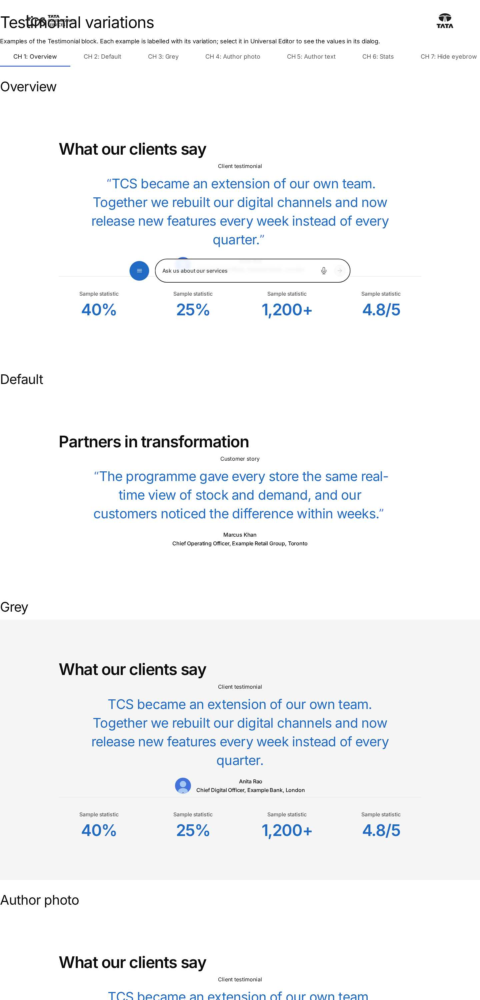
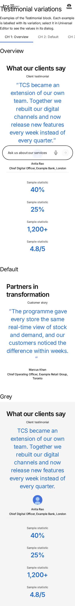

# Testimonial — Authoring Guide

| Attribute | Value |
| --- | --- |
| Document ID | AUT-C-testimonial |
| Audience | Content authors, content managers, AEM authoring leads |
| Purpose | How to add, fill in and check the Testimonial component |
| Scope | — |
| Prerequisites | — |
| Owner | Content Lead / AEM Authoring Lead (proposed) |
| Approver | Product Owner (to be confirmed) |
| Version | 1.0 |
| Status | Draft for review |
| Last updated | 8 November 2026 |
| Last validated | 8 November 2026 |
| Source files | blocks/testimonial/README.md, blocks/testimonial/_testimonial.json |
| Related documents | — |
| Related AEM paths | — |

## Contents

- [Where to see it](#where-to-see-it)
- [For Content Authors](#for-content-authors)
- [Authorable Fields](#authorable-fields)
- [Screenshot-Based Authoring Steps](#screenshot-based-authoring-steps)
- [Variations](#variations)
- [Complete Authoring Example](#complete-authoring-example)
- [Content and Asset Guidelines](#content-and-asset-guidelines)
- [Troubleshooting](#troubleshooting)
- [Screenshots](#screenshots)
- [Known limitations](#known-limitations)
- [Open items](#open-items)
- [Change history](#change-history)

## Where to see it

- https://main--tcs-corp--sradha-tcs.aem.live/design-block-master/en/block-library/testimonial
- https://main--tcs-corp--sradha-tcs.aem.live/design-block-master/en/block-library/testimonial/testimonial-variations

## For Content Authors

1. **Add the block.** In Universal Editor, select a Section, a Columns Container column or a Tabs Container. Choose Add (+) and pick **Testimonial**.
2. **Open its properties.** Select the block. The properties panel has three tabs: Content, Style and Additional.
3. **Enter content.** On the Content tab, fill in Eyebrow, Title (and Title Type), Description (the quote), Author, Author Image (with alt text) and Designation & Location.
4. **Select options.** On the Style tab, choose BG Color (Default or Grey), and use Hide Eyebrow, Hide Title, Show Description and Hide Author Details to hide parts without deleting them.
5. **Add stats.** Select the Testimonial in the content tree, choose Add (+) and pick **Stat**. Fill in Stats Title and Stats Value. Add one Stat per result, and drag the Stat nodes in the content tree to reorder them.
6. **Preview.** Switch to Preview and check desktop and mobile widths.
7. **Publish.** Publish the page with the author image.
8. **Validate.** On the published page, check the quote, the author row, the stats, and the heading level (inspector).

Minimum content: a Description, or an Eyebrow, Author or Stat (otherwise only the title renders). Recommended: Title, Description, Author, Designation & Location, and two to four Stats. Optional: Eyebrow, Author Image, BG Color.

## Authorable Fields

<!-- BEGIN GENERATED: fields (npm run build:docs) -->

#### Testimonial (`testimonial`)

Model `testimonial`; template name "Testimonial" (the block class AEM renders); key-value block (one row per property); children: `testimonial-stat`.

Stored on a new component (definition template): `titleType` = `"h2"`, `showDescription` = `true`.

##### Content tab — Testimonial

| Field label | Property | Type | Required | Default | Allowed values | Author guidance | Example |
| ----------- | -------- | ---- | -------- | ------- | -------------- | --------------- | ------- |
| Eyebrow | `eyebrow` | text | No | — | — | — | Client testimonial |
| Title | `title` | text | No | — | — | — | What our clients say |
| Title Type | `titleType` | select | No | `h2` | H1 (`h1`), H2 (`h2`), H3 (`h3`), H4 (`h4`), H5 (`h5`), H6 (`h6`) | Delivered with `title` (field collapse). | h2 |
| Description | `description` | richtext | No | "" | — | The testimonial quote. | — |
| Author | `authorName` | text | No | — | — | The person’s name, e.g. Ranil Boteju. | Anita Rao |
| Author Image | `authorImage` | reference | No | — | — | — | /content/dam/tcs-corp/block-library/images/avatar-sample-1.svg |
| Author Image Alt Text | `authorImageAlt` | text | No | — | — | Leave empty if the name is next to the image. Delivered with `authorImage` (field collapse). | — |
| Designation & Location | `designationLocation` | richtext | No | "" | — | e.g. Chief Data & Analytics Officer, Lloyds Banking Group, London. | — |
| Stats | `stats` | container (multiple) | No | — | — | Stats authored before Stat items. Add stats to the testimonial with Add (Stat) instead. | — |
| Stats › Stats Title | `statLabel` | richtext | No | "" | — | — | — |
| Stats › Stats Value | `statValue` | richtext | No | "" | — | A single line, e.g. 40%. | — |

##### Style tab — Testimonial

| Field label | Property | Type | Required | Default | Allowed values | Author guidance | Example |
| ----------- | -------- | ---- | -------- | ------- | -------------- | --------------- | ------- |
| BG Color | `bgColor` | select | No | "" | Default (""), Grey (`grey`), Navy (`navy`) | — | grey |
| Hide Eyebrow | `hideEyebrow` | boolean | No | `false` | on / off | — | true |
| Hide Title | `titleHidden` | boolean | No | `false` | on / off | The title stays available to screen readers. | true |
| Show Description | `showDescription` | boolean | No | `true` | on / off | — | true |
| Hide Author Details | `hideAuthor` | boolean | No | `false` | on / off | Hides the author, author image and designation & location | true |

##### Additional tab — Testimonial

| Field label | Property | Type | Required | Default | Allowed values | Author guidance | Example |
| ----------- | -------- | ---- | -------- | ------- | -------------- | --------------- | ------- |
| Anchor ID | `classes_anchor` | text | No | — | regExp: ^anchor-[a-z0-9][a-z0-9-]*$; customErrorMsg: Start with anchor-, then lower-case letters, digits and hyphens. | A unique ID of the block on the page, starting with anchor-, e.g. anchor-our-services; link to it with #anchor-our-services. Delivered as a block class. | — |
| Hide block | `classes_hideblock` | boolean | No | `false` | on / off | Hides the whole block on the page until it is turned off (shown faded in the editor). Delivered as a block class. | — |
| Animation Type | `classes_animation` | select | No | "" | None (""), Fade in (`motion-fade-in`), Fade up (`motion-fade-up`), Fade down (`motion-fade-down`), Fade left (`motion-fade-left`), Fade right (`motion-fade-right`), Slide up (`motion-slide-up`), Slide down (`motion-slide-down`), Slide left (`motion-slide-left`), Slide right (`motion-slide-right`), Scale in (`motion-scale-in`) | How the block's content appears; repeated items (cards, list items, accordion items, columns) appear one after another. None: shown as is. Not played in the editor or when the visitor prefers reduced motion. Delivered as a block class. | motion-fade-up |
| Motion Speed | `classes_animationspeed` | select | No | "" | Medium (""), Fast (`motion-fast`), Slow (`motion-slow`) | How fast the block's animations run (Animation Type 0.3 / 0.6 / 0.9 s; the Background animation takes 1.5 times as long). Shown when (`classes_animation` is set and `classes_animation` is not empty) or (`classes_bganimation` is set and `classes_bganimation` is not empty). Delivered as a block class. | — |
| Animation Trigger | `classes_animationtrigger` | select | No | "" | On Scroll / Viewport Entry (""), On Page Load (`motion-on-load`) | When the block's animations run. On Scroll: when the block comes into view (at once if it is in view when the page opens). On Page Load: as soon as the block is ready, wherever it is on the page. Shown when (`classes_animation` is set and `classes_animation` is not empty) or (`classes_bganimation` is set and `classes_bganimation` is not empty). Delivered as a block class. | — |
| Background animation | `classes_bganimation` | select | No | "" | None (""), Fade in (`bg-motion-fade-in`), Reveal from the centre (`bg-motion-reveal`), Wipe left to right (`bg-motion-wipe-right`), Wipe right to left (`bg-motion-wipe-left`), Wipe bottom to top (`bg-motion-wipe-up`), Scale reveal (`bg-motion-scale`) | How the block's background (its colour, image or overlay as set in the block) appears. It doesn't animate the content: see Animation Type. Motion Speed and Animation Trigger apply to it too. Not played in the editor or when the visitor prefers reduced motion. Shown when `bgColor` is `grey`. Delivered as a block class. | bg-motion-wipe-up |
| Padding left | `classes_paddingleft` | select | No | "" | Default (""), 0 (none) (`pl-0`), 0.25rem (space-100) (`pl-100`), 0.5rem (space-200) (`pl-200`), 0.75rem (space-300) (`pl-300`), 1rem (space-400) (`pl-400`), 1.25rem (space-500) (`pl-500`), 1.5rem (space-600) (`pl-600`), 2rem (space-800) (`pl-800`), 2.5rem (space-1000) (`pl-1000`), 3rem (space-1200) (`pl-1200`), 4rem (space-1600) (`pl-1600`), 5rem (space-2000) (`pl-2000`), 6rem (space-2400) (`pl-2400`), 7.5rem (space-3000) (`pl-3000`) | Delivered as a block class. | — |
| Padding right | `classes_paddingright` | select | No | "" | Default (""), 0 (none) (`pr-0`), 0.25rem (space-100) (`pr-100`), 0.5rem (space-200) (`pr-200`), 0.75rem (space-300) (`pr-300`), 1rem (space-400) (`pr-400`), 1.25rem (space-500) (`pr-500`), 1.5rem (space-600) (`pr-600`), 2rem (space-800) (`pr-800`), 2.5rem (space-1000) (`pr-1000`), 3rem (space-1200) (`pr-1200`), 4rem (space-1600) (`pr-1600`), 5rem (space-2000) (`pr-2000`), 6rem (space-2400) (`pr-2400`), 7.5rem (space-3000) (`pr-3000`) | Delivered as a block class. | — |
| Padding top | `classes_paddingtop` | select | No | "" | Default (""), 0 (none) (`pt-0`), 0.25rem (space-100) (`pt-100`), 0.5rem (space-200) (`pt-200`), 0.75rem (space-300) (`pt-300`), 1rem (space-400) (`pt-400`), 1.25rem (space-500) (`pt-500`), 1.5rem (space-600) (`pt-600`), 2rem (space-800) (`pt-800`), 2.5rem (space-1000) (`pt-1000`), 3rem (space-1200) (`pt-1200`), 4rem (space-1600) (`pt-1600`), 5rem (space-2000) (`pt-2000`), 6rem (space-2400) (`pt-2400`), 7.5rem (space-3000) (`pt-3000`) | Delivered as a block class. | — |
| Padding bottom | `classes_paddingbottom` | select | No | "" | Default (""), 0 (none) (`pb-0`), 0.25rem (space-100) (`pb-100`), 0.5rem (space-200) (`pb-200`), 0.75rem (space-300) (`pb-300`), 1rem (space-400) (`pb-400`), 1.25rem (space-500) (`pb-500`), 1.5rem (space-600) (`pb-600`), 2rem (space-800) (`pb-800`), 2.5rem (space-1000) (`pb-1000`), 3rem (space-1200) (`pb-1200`), 4rem (space-1600) (`pb-1600`), 5rem (space-2000) (`pb-2000`), 6rem (space-2400) (`pb-2400`), 7.5rem (space-3000) (`pb-3000`) | Delivered as a block class. | — |
| Margin left | `classes_marginleft` | select | No | "" | Default (""), 0 (none) (`ml-0`), 0.25rem (space-100) (`ml-100`), 0.5rem (space-200) (`ml-200`), 0.75rem (space-300) (`ml-300`), 1rem (space-400) (`ml-400`), 1.25rem (space-500) (`ml-500`), 1.5rem (space-600) (`ml-600`), 2rem (space-800) (`ml-800`), 2.5rem (space-1000) (`ml-1000`), 3rem (space-1200) (`ml-1200`), 4rem (space-1600) (`ml-1600`), 5rem (space-2000) (`ml-2000`), 6rem (space-2400) (`ml-2400`), 7.5rem (space-3000) (`ml-3000`) | Delivered as a block class. | — |
| Margin right | `classes_marginright` | select | No | "" | Default (""), 0 (none) (`mr-0`), 0.25rem (space-100) (`mr-100`), 0.5rem (space-200) (`mr-200`), 0.75rem (space-300) (`mr-300`), 1rem (space-400) (`mr-400`), 1.25rem (space-500) (`mr-500`), 1.5rem (space-600) (`mr-600`), 2rem (space-800) (`mr-800`), 2.5rem (space-1000) (`mr-1000`), 3rem (space-1200) (`mr-1200`), 4rem (space-1600) (`mr-1600`), 5rem (space-2000) (`mr-2000`), 6rem (space-2400) (`mr-2400`), 7.5rem (space-3000) (`mr-3000`) | Delivered as a block class. | — |
| Margin top | `classes_margintop` | select | No | "" | Default (""), 0 (none) (`mt-0`), 0.25rem (space-100) (`mt-100`), 0.5rem (space-200) (`mt-200`), 0.75rem (space-300) (`mt-300`), 1rem (space-400) (`mt-400`), 1.25rem (space-500) (`mt-500`), 1.5rem (space-600) (`mt-600`), 2rem (space-800) (`mt-800`), 2.5rem (space-1000) (`mt-1000`), 3rem (space-1200) (`mt-1200`), 4rem (space-1600) (`mt-1600`), 5rem (space-2000) (`mt-2000`), 6rem (space-2400) (`mt-2400`), 7.5rem (space-3000) (`mt-3000`) | Delivered as a block class. | — |
| Margin bottom | `classes_marginbottom` | select | No | "" | Default (""), 0 (none) (`mb-0`), 0.25rem (space-100) (`mb-100`), 0.5rem (space-200) (`mb-200`), 0.75rem (space-300) (`mb-300`), 1rem (space-400) (`mb-400`), 1.25rem (space-500) (`mb-500`), 1.5rem (space-600) (`mb-600`), 2rem (space-800) (`mb-800`), 2.5rem (space-1000) (`mb-1000`), 3rem (space-1200) (`mb-1200`), 4rem (space-1600) (`mb-1600`), 5rem (space-2000) (`mb-2000`), 6rem (space-2400) (`mb-2400`), 7.5rem (space-3000) (`mb-3000`) | Delivered as a block class. | — |

#### Stat (`testimonial-stat`)

Model `testimonial-stat`; template name "Stat" (the block class AEM renders).

##### Stat tab — Stat

| Field label | Property | Type | Required | Default | Allowed values | Author guidance | Example |
| ----------- | -------- | ---- | -------- | ------- | -------------- | --------------- | ------- |
| Stats Title | `statLabel` | richtext | No | "" | — | — | — |
| Stats Value | `statValue` | richtext | No | "" | — | A single line, e.g. 40%. | — |

<!-- END GENERATED: fields -->

Notes on the significant fields:

- **Title / Title Type:** a heading at the Title Type level (else a heading level found in the title, else H2). **Hide Title** keeps it in the HTML, visually hidden (`hideVisually`), so screen readers and the data layer's `dc:title` still get it.
- **Description:** the quote, rendered as a `<blockquote>` in a `<figure>`. **Show Description** is on unless it is explicitly off: a missing value shows the description (`isOnByDefault`).
- **Author, Author Image, Designation & Location:** rendered in the `<figcaption>`. The image is a 3rem round photo; Author Image Alt Text replaces its alt, else `alt=""`. Leave the alt text empty when the name is next to the photo. **Hide Author Details** leaves out the whole caption.
- **Hide Eyebrow:** leaves out the eyebrow.
- **BG Color:** Grey adds `bg-grey`: a grey panel with its own padding (see Responsive Behavior).
- **Stat items:** in each Stat, Stats Value is the large value and Stats Title the label above it. A Stat without a value isn't rendered (in the editor it is a placeholder).
- **Legacy mapping:** the **Stats** multifield (stats authored before Stat items) is still read: each item is a run of elements between `<hr>`s, or a list item. The last element is the value, the ones before it the title. These stats render before the Stat items. The BG Color value is also read from a `grey` block class (`optionOf`). The Style field was removed in handover 2.27.
- **Additional tab:** see AGENTS.md "Additional tab". Background animation is shown only when BG Color is Grey (the default block has no background of its own).

## Screenshot-Based Authoring Steps

#### Authoring Step 1: Add the Testimonial and the title

```text
[Screenshot Placeholder]

File name:
testimonial-authoring-step-1.png

Purpose:
The Testimonial added to a section, with Title and Title Type filled in.

Annotations:
A = Testimonial in the content tree
B = Title
C = Title Type
```

#### Values to Enter

| Callout | Field | Value | Reason | Expected result |
| ------- | ----- | ----- | ------ | --------------- |
| A | Add (+) | Testimonial | Adds the block | A Testimonial node |
| B | Title | What our clients say | Section title | Left-aligned heading |
| C | Title Type | H2 | Fits under the page's H1 | An `<h2>` |

Author action: add the block and type the title. Expected preview: the heading. Expected published result: the same. Business rule: one H1 per page. Validation: inspect the heading level. Common mistake: using H1 in the middle of a page.

#### Authoring Step 2: The quote

```text
[Screenshot Placeholder]

File name:
testimonial-authoring-step-2.png

Purpose:
Eyebrow and Description filled in.

Annotations:
A = Eyebrow
B = Description
```

#### Values to Enter

| Callout | Field | Value | Reason | Expected result |
| ------- | ----- | ----- | ------ | --------------- |
| A | Eyebrow | Client testimonial | Context | Centred label |
| B | Description | TCS became an extension of our own team. | The testimonial quote | Large brand-blue text |

Author action: type the eyebrow and the quote. Expected preview: both centred. Expected published result: a `<blockquote>`. Business rule: keep the approved wording. Validation: the quote shows; if not, check Show Description on the Style tab. Common mistake: turning Show Description off and expecting the quote to show.

#### Authoring Step 3: The author

```text
[Screenshot Placeholder]

File name:
testimonial-authoring-step-3.png

Purpose:
Author, Author Image, Author Image Alt Text and Designation & Location filled in.

Annotations:
A = Author
B = Author Image
C = Designation & Location
```

#### Values to Enter

| Callout | Field | Value | Reason | Expected result |
| ------- | ----- | ----- | ------ | --------------- |
| A | Author | Anita Rao | The person's name only | Name in the author row |
| B | Author Image | /content/dam/tcs-corp/block-library/images/avatar-sample-1.svg | Round photo | A 3rem round image |
| C | Designation & Location | Chief Digital Officer, Example Bank, London | Role, organisation, city | Line below the name |

Author action: fill in the author fields; leave Author Image Alt Text empty because the name is next to the photo. Expected preview: the centred author row. Expected published result: the same, in a `<figcaption>`. Business rule: don't repeat the name in Designation & Location. Validation: the name appears once. Common mistake: a landscape photo, which is cropped to a circle.

#### Authoring Step 4: Stats

```text
[Screenshot Placeholder]

File name:
testimonial-authoring-step-4.png

Purpose:
Two Stat items added with Add (+) under the Testimonial, one open in the properties panel.

Annotations:
A = Add (+) on the Testimonial
B = Stat nodes
C = Stats Title
D = Stats Value
```

#### Values to Enter

| Callout | Field | Value | Reason | Expected result |
| ------- | ----- | ----- | ------ | --------------- |
| A | Add (+) | Stat | One item per result | A Stat node |
| C | Stats Title | Faster time to market | What the number measures | Grey label |
| D | Stats Value | 40% | The number, one line | Large brand-blue value |

Author action: add a Stat, fill in both fields, and repeat for each result. Expected preview: the stats in columns under a divider. Expected published result: a `<dl>` with a `<dt>` and `<dd>` per stat. Business rule: Stats Value is a single line. Validation: each value sits below its title. Common mistake: leaving Stats Value empty: the Stat isn't shown (a placeholder in the editor).

#### Authoring Step 5: Style options and publishing

```text
[Screenshot Placeholder]

File name:
testimonial-authoring-step-5.png

Purpose:
The Style tab with BG Color Grey, and the Publish dialog.

Annotations:
A = BG Color
B = Show / hide toggles
C = Publish dialog
```

#### Values to Enter

| Callout | Field | Value | Reason | Expected result |
| ------- | ----- | ----- | ------ | --------------- |
| A | BG Color | Grey | Set the block apart | Grey panel with padding |
| B | Hide Eyebrow / Hide Title / Show Description / Hide Author Details | Off / Off / On / Off | Show every part | Every part renders |
| C | Publish | Page and referenced assets | The author image must be live | Published with the photo |

Author action: set the options, preview, publish. Expected result: as configured. Business rule: hidden parts keep their content. Validation: check the published page. Common mistake: publishing without the image.

## Variations

#### Default

- **Purpose:** a client testimonial. **Fields:** Description (recommended), Author, Designation & Location; Title, Eyebrow and Author Image are optional. **Dialog:** defaults.
- **Rendering:** title, then the centred figure; no stats without Stat items. Desktop and mobile share the layout; the type and gaps are larger from 900px.
- **Accessibility:** `<figure>` / `<blockquote>` / `<figcaption>`. **Data layer:** the block entry only. **Personalization and fallback:** none.

```text
[Screenshot Placeholder]

File name:
testimonial-default-mobile.png

Purpose:
The default Testimonial at 375px.

Annotations:
A = Title
B = Quote
C = Author
```

#### Grey background

- **Purpose:** set the testimonial apart. **Configuration:** BG Color Grey (`bg-grey`).
- **Rendering:** a grey panel (`--color-bg-secondary`), with padding 2.5rem / 1.5rem, and 7.5rem / 5rem from 900px. Background animation becomes available.
- **Accessibility, data layer, personalization:** as Default.

```text
[Screenshot Placeholder]

File name:
testimonial-grey-background-tablet.png

Purpose:
BG Color Grey at 768px.

Annotations:
A = Grey padding
B = Stats
```

#### Author with photo / author text only

- **Purpose:** with or without a photo. **Configuration:** Author Image set or empty.
- **Rendering:** the 3rem round photo beside the name and details, wrapping and centred; without a photo, only the text lines.
- **Accessibility:** the photo is decorative unless Author Image Alt Text is set.

```text
[Screenshot Placeholder]

File name:
testimonial-author-photo-mobile.png

Purpose:
The author row with a photo at 375px.

Annotations:
A = Round photo
B = Name and designation
```

#### With stats

- **Purpose:** quantified results. **Configuration:** Stat items (or the Stats multifield authored before them).
- **Rendering:** a grid of columns at least 10rem wide (wrapping automatically), up to 70rem wide, under a 1px divider; each stat has its title above its value.
- **Accessibility:** a description list (`<dl>`, `<dt>`, `<dd>`).

```text
[Screenshot Placeholder]

File name:
testimonial-with-stats-mobile.png

Purpose:
Four stats at 375px, one per row.

Annotations:
A = Divider
B = Stat title
C = Stat value
```

#### Hide Eyebrow, Hide Title, Show Description off, Hide Author Details

- **Purpose:** hide parts without deleting them (for example a stats-only band, or while an approval is pending). **Configuration:** the Style tab toggles.
- **Rendering:** Hide Eyebrow, Show Description off and Hide Author Details leave their part out. Hide Title keeps the heading visually hidden. Without an eyebrow, description and author, the figure is left out.
- **Accessibility:** a hidden title still names the section for screen readers.

```text
[Screenshot Placeholder]

File name:
testimonial-hide-title-mobile.png

Purpose:
Hide Title on at 375px: no visible title, the heading still in the HTML.

Annotations:
A = Eyebrow (first visible element)
```

## Complete Authoring Example

Scenario: a case study page shows the client's statement and its results.

| Field | Example value | Guidance |
| ----- | ------------- | -------- |
| Eyebrow | Case study results | Context |
| Title | Measurable outcomes | Section title, H2 |
| Description | Moving to a cloud-native platform with TCS changed how fast we deliver. | Approved wording |
| Author | Sara Lee | Name only |
| Designation & Location | Chief Information Officer, Example Insurance, Amsterdam | Role, organisation, city |
| Author Image | /content/dam/tcs-corp/block-library/images/avatar-sample-1.svg | Square headshot |
| BG Color | Default | |
| Stat 1 | Faster time to market / 40% | Stats Title / Stats Value |
| Stat 2 | Lower operating cost / 25% | |
| Stat 3 | Applications migrated / 1,200+ | |

Steps: add the Testimonial, fill in the Content tab, add three Stat items, preview, publish with the image.

- **Expected output:** the title, the centred quote and author, and three stats under the divider.
- **Responsive:** the stats wrap to fewer columns on narrow screens.
- **Accessibility:** a heading, a figure with a blockquote and figcaption, and a description list.
- **Analytics:** a `tcs-corp/components/testimonial` entry with `dc:title` "Measurable outcomes".
- **Personalization fallback:** none; the authored content renders.

Pre-publish checklist: the quote is approved; the name appears once; the stats have values; the image is published; checked at mobile and desktop widths.

## Content and Asset Guidelines

- **Title:** short. **Eyebrow:** a few words. **Description:** the approved quote (the block adds no quotation marks of its own).
- **Author:** the name only. **Designation & Location:** role, organisation and city on one or two lines.
- **Stats:** Stats Value a single line (for example 40%); Stats Title a short label. No verified technical limit on the number of stats was identified; the columns wrap automatically.
- **CTAs / links:** no CTA field. A standalone link in the rich text becomes a button (`decorators/content-buttons-decorator.js`).
- **Images and alt text:** a square headshot, cropped to a 3rem circle (`object-fit: cover`). Leave the alt text empty when the name is next to the photo.
- **Tags and metadata:** none.
- **Asset source:** AEM Assets. **Loading:** the delivered picture, lazy by default; eager only as the first image of the first section (`waitForFirstImage`).
- **Missing asset:** the author row renders without the photo.

## Troubleshooting

| Symptom | Likely cause | Diagnostic steps | Resolution | Verification |
| ------- | ------------ | ---------------- | ---------- | ------------ |
| The quote doesn't appear | Show Description off, or the Description is empty | Check the Style tab and the Description | Turn Show Description on; fill in the Description | The `<blockquote>` renders |
| A stat is missing | Its Stats Value is empty | Look for the placeholder in the editor | Fill in Stats Value | The stat renders |
| Value and title swapped (legacy stats) | In the multifield, the last element of an item is always the value | Read the item's paragraphs | Re-enter the stat as a Stat item | Title above value |
| The author row is missing | Hide Author Details on, or no author fields | Check the Style tab | Turn it off; fill in the fields | The figcaption renders |
| The title isn't visible | Hide Title on | Inspect: `visually-hidden` on the heading | Turn Hide Title off | The heading shows |
| The name appears twice | The name was typed in Designation & Location too | Read both fields | Keep the name in Author only | One name |

Evidence to collect: the page URL, viewport, browser, a screenshot, and the block's outer HTML. No credentials or session data.

## Screenshots



*Figure: Testimonial as published (block library) — desktop 1440 × 900 (/design-block-master/en/block-library/testimonial/testimonial-variations, captured 2026-11-08).*



*Figure: Testimonial as published (block library) — mobile 375 × 812 (/design-block-master/en/block-library/testimonial/testimonial-variations, captured 2026-11-08).*

> **Screenshot required**
>
> - Required screen: Testimonial dialog in Universal Editor (every tab, including Additional)
> - Required role/access: AEM Sites author with Universal Editor (content author)
> - Required navigation steps: AEM Sites console > /content/tcs-corp/language-masters/en > open a page in Universal Editor
> - Reason unavailable: No AEM author access in the documentation program (access blocker AB-01)
> - Owner: Content Lead / AEM Authoring Lead (proposed)
> - Target completion date: To be confirmed

## Known limitations

- Universal Editor screenshots are placeholders: no author access in this program.

## Open items

- None.

## Change history

| Version | Date | Author | Change |
| --- | --- | --- | --- |
| 1.0 | 8 November 2026 | Delivery team (documentation program) | First version of the role-specific documentation (master documentation prompt), generated from the repository and the published reference pages |
