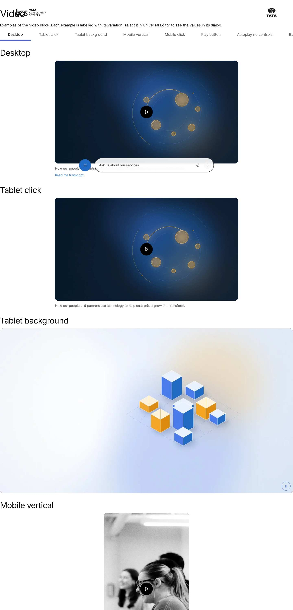
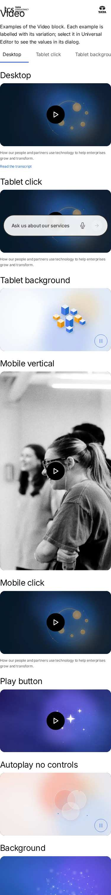

# Video — Authoring Guide

| Attribute | Value |
| --- | --- |
| Document ID | AUT-C-video |
| Audience | Content authors, content managers, AEM authoring leads |
| Purpose | How to add, fill in and check the Video component |
| Scope | — |
| Prerequisites | — |
| Owner | Content Lead / AEM Authoring Lead (proposed) |
| Approver | Product Owner (to be confirmed) |
| Version | 1.0 |
| Status | Draft for review |
| Last updated | 8 November 2026 |
| Last validated | 8 November 2026 |
| Source files | blocks/video/README.md, blocks/video/_video.json |
| Related documents | — |
| Related AEM paths | — |

## Contents

- [Where to see it](#where-to-see-it)
- [For Content Authors](#for-content-authors)
- [Authorable Fields](#authorable-fields)
- [Screenshot-Based Authoring Steps](#screenshot-based-authoring-steps)
- [Variations](#variations)
- [Complete Authoring Example](#complete-authoring-example)
- [Content and Asset Guidelines](#content-and-asset-guidelines)
- [Troubleshooting](#troubleshooting)
- [Screenshots](#screenshots)
- [Known limitations](#known-limitations)
- [Open items](#open-items)
- [Change history](#change-history)

## Where to see it

- https://main--tcs-corp--sradha-tcs.aem.live/design-block-master/en/block-library/video
- https://main--tcs-corp--sradha-tcs.aem.live/design-block-master/en/block-library/video/video
- https://main--tcs-corp--sradha-tcs.aem.live/design-block-master/en/block-library/video/video-pop-up

## For Content Authors

1. **Add the block.** In Universal Editor select a Section, a Columns Container column or a Tabs
   Container tab in the content tree, choose Add (+) and pick **Video**.
2. **Open its properties.** Select the block on the canvas or in the content tree; the properties
   panel shows the tabs **Video**, **Playback** and **Additional**.
3. **Enter the content (Video tab).** Select the video file in **Video** (an MP4 or WebM from AEM
   Assets) or paste a YouTube or Vimeo URL. Enter a **Title** (it names the player and the Play
   button for screen readers; it isn't shown). Add a **Poster Image** with its **Poster Image Alt
   Text**, optionally a **Caption** and a **Transcript** page or document, and for video files a
   **Captions File (WebVTT)** with its language and name.
4. **Choose the playback (Playback tab).** Keep **Playback** on Play button, or choose Autoplay
   when in view (muted) or Background video. Set Muted, Loop, Show Player Controls, Start At / End
   At, Play in a Pop-up (Play button only) and Pause When Out of View as needed.
5. **Choose the display (Playback tab).** Set the **Aspect Ratio** of the file, the **Size**, the
   **Alignment** (for sizes other than Full width) and **Rounded Corners**.
6. **Optional: Additional tab.** Anchor ID, Hide block, animation and spacing (see
   [Authorable Fields](https://github.com/sradha-tcs/tcs-corp/blob/main/blocks/video/README.md#authorable-fields)).
7. **Preview.** Switch Universal Editor to Preview, or open the page on the preview host, and play
   the video at desktop, tablet and mobile widths.
8. **Publish.** Publish the page **with its references**: video files and WebVTT captions are
   served only once they are published (images travel with the page, other assets don't).
9. **Validate the published output.** On the live host the poster and Play button load, the video
   plays, the file and captions requests return 200 and a YouTube video loads from
   `www.youtube-nocookie.com` when Privacy-enhanced Mode is on.

**Minimum required:** Video. **Recommended:** Title, Poster Image with alt text, captions (WebVTT
for files, platform captions for YouTube / Vimeo), Transcript for informative videos. **Optional:**
Caption and every Playback and Additional setting.

## Authorable Fields

<!-- BEGIN GENERATED: fields (npm run build:docs) -->

#### Video (`video`)

Model `video`; template name "Video" (the block class AEM renders); key-value block (one row per property).

Stored on a new component (definition template): `playback` = `"click"`, `controls` = `true`, `pauseOffscreen` = `true`, `aspectRatio` = `"16-9"`, `size` = `"large"`, `alignment` = `"center"`, `rounded` = `true`, `privacyMode` = `true`.

##### Video tab — Video

| Field label | Property | Type | Required | Default | Allowed values | Author guidance | Example |
| ----------- | -------- | ---- | -------- | ------- | -------------- | --------------- | ------- |
| Video | `uri` | aem-content | Yes | — | — | A video file from AEM Assets (MP4, WebM), or a YouTube or Vimeo link | /content/dam/tcs-corp/block-library/videos/sample-video.mp4 |
| Title | `label` | text | No | — | — | Names the video for screen readers (e.g. "TCS AI lab tour"); not shown on the page | Building on belief: the TCS brand film |
| Caption | `caption` | richtext | No | — | — | Shown below the video | — |
| Transcript | `transcript` | aem-content | No | — | — | A page or document with the transcript; shown as a link below the video | /design-block-master/en/dummy-pages/our-story |
| Poster Image | `poster` | reference | No | — | — | Shown before the video plays, with a play button (Click playback). | /content/dam/tcs-corp/dummy-pages/images/banking.jpg |
| Poster Image Alt Text | `posterAlt` | text | No | "" | — | Delivered with `poster` (field collapse). | Engineers collaborating in a modern office |
| Captions File (WebVTT) | `captions` | aem-content | No | — | — | Subtitles for video files (.vtt); YouTube and Vimeo use the captions added there | — |
| Captions Language | `captionsLanguage` | text | No | — | — | Language code, e.g. en, de, ja (default: the page language) | — |
| Captions Name | `captionsLabel` | text | No | — | — | Shown in the player's captions menu, e.g. English | — |
| Privacy-enhanced Mode | `privacyMode` | boolean | No | `true` | on / off | YouTube: no cookies until the video plays (youtube-nocookie.com); Vimeo: do not track | — |

##### Playback tab — Video

| Field label | Property | Type | Required | Default | Allowed values | Author guidance | Example |
| ----------- | -------- | ---- | -------- | ------- | -------------- | --------------- | ------- |
| Playback | `playback` | select | No | `click` | Play button (on the poster image) (`click`), Autoplay when in view (muted) (`autoplay`), Background video (autoplay, muted, loop, no controls) (`background`) | — | background |
| Muted | `muted` | boolean | No | `false` | on / off | Start without sound (always on for autoplay and background videos) | — |
| Loop | `loop` | boolean | No | `false` | on / off | — | — |
| Show Player Controls | `controls` | boolean | No | `true` | on / off | Background videos never show controls | false |
| Start At (seconds) | `startTime` | number | No | — | — | Optional, e.g. 30 | — |
| End At (seconds) | `endTime` | number | No | — | — | Optional | — |
| Play in a Pop-up | `openInModal` | boolean | No | `false` | on / off | The play button opens the video in a dialog over the page Shown when `playback` is `click`. | true |
| Pause When Out of View | `pauseOffscreen` | boolean | No | `true` | on / off | Autoplay and background video files pause when scrolled away and resume when back | — |
| Aspect Ratio | `aspectRatio` | select | No | `16-9` | 16:9 (widescreen) (`16-9`), 4:3 (`4-3`), 1:1 (square) (`1-1`), 21:9 (cinema) (`21-9`), 9:16 (vertical) (`9-16`) | — | 9-16 |
| Size | `size` | select | No | `large` | Full width (`full`), Large (900px) (`large`), Medium (640px) (`medium`), Small (420px) (`small`) | — | full |
| Alignment | `alignment` | select | No | `center` | Center (`center`), Left (`left`), Right (`right`) | For sizes other than full width | left |
| Rounded Corners | `rounded` | boolean | No | `true` | on / off | — | false |

##### Additional tab — Video

| Field label | Property | Type | Required | Default | Allowed values | Author guidance | Example |
| ----------- | -------- | ---- | -------- | ------- | -------------- | --------------- | ------- |
| Anchor ID | `classes_anchor` | text | No | — | regExp: ^anchor-[a-z0-9][a-z0-9-]*$; customErrorMsg: Start with anchor-, then lower-case letters, digits and hyphens. | A unique ID of the block on the page, starting with anchor-, e.g. anchor-our-services; link to it with #anchor-our-services. Delivered as a block class. | — |
| Hide block | `classes_hideblock` | boolean | No | `false` | on / off | Hides the whole block on the page until it is turned off (shown faded in the editor). Delivered as a block class. | — |
| Animation Type | `classes_animation` | select | No | "" | None (""), Fade in (`motion-fade-in`), Fade up (`motion-fade-up`), Fade down (`motion-fade-down`), Fade left (`motion-fade-left`), Fade right (`motion-fade-right`), Slide up (`motion-slide-up`), Slide down (`motion-slide-down`), Slide left (`motion-slide-left`), Slide right (`motion-slide-right`), Scale in (`motion-scale-in`) | How the block's content appears; repeated items (cards, list items, accordion items, columns) appear one after another. None: shown as is. Not played in the editor or when the visitor prefers reduced motion. Delivered as a block class. | — |
| Motion Speed | `classes_animationspeed` | select | No | "" | Medium (""), Fast (`motion-fast`), Slow (`motion-slow`) | How fast the animation runs: 0.3, 0.6 or 0.9 seconds. Shown when `classes_animation` is set and `classes_animation` is not empty. Delivered as a block class. | — |
| Animation Trigger | `classes_animationtrigger` | select | No | "" | On Scroll / Viewport Entry (""), On Page Load (`motion-on-load`) | When the block's animations run. On Scroll: when the block comes into view (at once if it is in view when the page opens). On Page Load: as soon as the block is ready, wherever it is on the page. Shown when `classes_animation` is set and `classes_animation` is not empty. Delivered as a block class. | — |
| Padding left | `classes_paddingleft` | select | No | "" | Default (""), 0 (none) (`pl-0`), 0.25rem (space-100) (`pl-100`), 0.5rem (space-200) (`pl-200`), 0.75rem (space-300) (`pl-300`), 1rem (space-400) (`pl-400`), 1.25rem (space-500) (`pl-500`), 1.5rem (space-600) (`pl-600`), 2rem (space-800) (`pl-800`), 2.5rem (space-1000) (`pl-1000`), 3rem (space-1200) (`pl-1200`), 4rem (space-1600) (`pl-1600`), 5rem (space-2000) (`pl-2000`), 6rem (space-2400) (`pl-2400`), 7.5rem (space-3000) (`pl-3000`) | Delivered as a block class. | — |
| Padding right | `classes_paddingright` | select | No | "" | Default (""), 0 (none) (`pr-0`), 0.25rem (space-100) (`pr-100`), 0.5rem (space-200) (`pr-200`), 0.75rem (space-300) (`pr-300`), 1rem (space-400) (`pr-400`), 1.25rem (space-500) (`pr-500`), 1.5rem (space-600) (`pr-600`), 2rem (space-800) (`pr-800`), 2.5rem (space-1000) (`pr-1000`), 3rem (space-1200) (`pr-1200`), 4rem (space-1600) (`pr-1600`), 5rem (space-2000) (`pr-2000`), 6rem (space-2400) (`pr-2400`), 7.5rem (space-3000) (`pr-3000`) | Delivered as a block class. | — |
| Padding top | `classes_paddingtop` | select | No | "" | Default (""), 0 (none) (`pt-0`), 0.25rem (space-100) (`pt-100`), 0.5rem (space-200) (`pt-200`), 0.75rem (space-300) (`pt-300`), 1rem (space-400) (`pt-400`), 1.25rem (space-500) (`pt-500`), 1.5rem (space-600) (`pt-600`), 2rem (space-800) (`pt-800`), 2.5rem (space-1000) (`pt-1000`), 3rem (space-1200) (`pt-1200`), 4rem (space-1600) (`pt-1600`), 5rem (space-2000) (`pt-2000`), 6rem (space-2400) (`pt-2400`), 7.5rem (space-3000) (`pt-3000`) | Delivered as a block class. | — |
| Padding bottom | `classes_paddingbottom` | select | No | "" | Default (""), 0 (none) (`pb-0`), 0.25rem (space-100) (`pb-100`), 0.5rem (space-200) (`pb-200`), 0.75rem (space-300) (`pb-300`), 1rem (space-400) (`pb-400`), 1.25rem (space-500) (`pb-500`), 1.5rem (space-600) (`pb-600`), 2rem (space-800) (`pb-800`), 2.5rem (space-1000) (`pb-1000`), 3rem (space-1200) (`pb-1200`), 4rem (space-1600) (`pb-1600`), 5rem (space-2000) (`pb-2000`), 6rem (space-2400) (`pb-2400`), 7.5rem (space-3000) (`pb-3000`) | Delivered as a block class. | — |
| Margin left | `classes_marginleft` | select | No | "" | Default (""), 0 (none) (`ml-0`), 0.25rem (space-100) (`ml-100`), 0.5rem (space-200) (`ml-200`), 0.75rem (space-300) (`ml-300`), 1rem (space-400) (`ml-400`), 1.25rem (space-500) (`ml-500`), 1.5rem (space-600) (`ml-600`), 2rem (space-800) (`ml-800`), 2.5rem (space-1000) (`ml-1000`), 3rem (space-1200) (`ml-1200`), 4rem (space-1600) (`ml-1600`), 5rem (space-2000) (`ml-2000`), 6rem (space-2400) (`ml-2400`), 7.5rem (space-3000) (`ml-3000`) | Delivered as a block class. | — |
| Margin right | `classes_marginright` | select | No | "" | Default (""), 0 (none) (`mr-0`), 0.25rem (space-100) (`mr-100`), 0.5rem (space-200) (`mr-200`), 0.75rem (space-300) (`mr-300`), 1rem (space-400) (`mr-400`), 1.25rem (space-500) (`mr-500`), 1.5rem (space-600) (`mr-600`), 2rem (space-800) (`mr-800`), 2.5rem (space-1000) (`mr-1000`), 3rem (space-1200) (`mr-1200`), 4rem (space-1600) (`mr-1600`), 5rem (space-2000) (`mr-2000`), 6rem (space-2400) (`mr-2400`), 7.5rem (space-3000) (`mr-3000`) | Delivered as a block class. | — |
| Margin top | `classes_margintop` | select | No | "" | Default (""), 0 (none) (`mt-0`), 0.25rem (space-100) (`mt-100`), 0.5rem (space-200) (`mt-200`), 0.75rem (space-300) (`mt-300`), 1rem (space-400) (`mt-400`), 1.25rem (space-500) (`mt-500`), 1.5rem (space-600) (`mt-600`), 2rem (space-800) (`mt-800`), 2.5rem (space-1000) (`mt-1000`), 3rem (space-1200) (`mt-1200`), 4rem (space-1600) (`mt-1600`), 5rem (space-2000) (`mt-2000`), 6rem (space-2400) (`mt-2400`), 7.5rem (space-3000) (`mt-3000`) | Delivered as a block class. | — |
| Margin bottom | `classes_marginbottom` | select | No | "" | Default (""), 0 (none) (`mb-0`), 0.25rem (space-100) (`mb-100`), 0.5rem (space-200) (`mb-200`), 0.75rem (space-300) (`mb-300`), 1rem (space-400) (`mb-400`), 1.25rem (space-500) (`mb-500`), 1.5rem (space-600) (`mb-600`), 2rem (space-800) (`mb-800`), 2.5rem (space-1000) (`mb-1000`), 3rem (space-1200) (`mb-1200`), 4rem (space-1600) (`mb-1600`), 5rem (space-2000) (`mb-2000`), 6rem (space-2400) (`mb-2400`), 7.5rem (space-3000) (`mb-3000`) | Delivered as a block class. | — |

<!-- END GENERATED: fields -->

What the tables don't show:

- **Video (`uri`)** decides the player: a URL containing `youtube.com` / `youtu.be` builds a
  YouTube frame, `vimeo.com` a Vimeo frame, anything else a native `video` element with one
  `source` (MIME type from the file extension). Without it the block renders nothing.
- **Title (`label`)** becomes the iframe `title` (YouTube, Vimeo) or the `aria-label` of the
  `video` element, the hidden heading that names the pop-up dialog and the Play button's name
  "Play video: {title}". Empty: the placeholder `video` ("Video") and the button "Play video".
- **Caption** is rich text shown below the video (`div.video-caption`). **Transcript** becomes a
  link below it; its text is the authored link text, or "Read the transcript" (placeholder
  `readTheTranscript`) when the link shows its own URL. It opens in the same tab.
- **Poster Image / Poster Image Alt Text** (`poster`, `posterAlt`; the alt collapses into the
  image) is the poster with the Play button (Play button playback) and the image shown while an
  autoplay or background video loads. Without alt text the image gets `alt=""`. For video files
  the poster image is also the native player's `poster`.
- **Captions File / Captions Language / Captions Name** add one `track kind="captions"` (default
  on) to video files only; Language defaults to the page language, Name to the language code.
  YouTube and Vimeo ignore them (add captions on the platform).
- **Privacy-enhanced Mode** (default on): YouTube from `www.youtube-nocookie.com`, Vimeo with
  `dnt=1`. Off: `www.youtube.com` and no `dnt`.
- **Playback** values: Play button (`click`, default), Autoplay when in view (`autoplay`), Background
  video (`background`: muted, looping, no controls, hidden from screen readers and the keyboard).
  With reduced motion the code always uses Play button.
- **Muted** applies to Play button playback; autoplay and background videos are always muted
  (browsers only autoplay muted videos). **Show Player Controls** off with autoplay adds the pause /
  stop button; Play button playback without a poster keeps the controls even when off (they are
  the only way to start the video).
- **Start At / End At** (seconds): files use a media fragment (`#t=start,end`), YouTube `start` /
  `end` (whole seconds), Vimeo only the start time (`#t=Ns`); End At is ignored for Vimeo.
- **Play in a Pop-up** is shown only for Play button playback; the Play button opens a dialog
  (`blocks/modal/modal.js`, loaded on demand).
- **Pause When Out of View** (default on) applies to autoplay and background video **files** only.
- **Aspect Ratio** sets the media area (`--video-aspect-ratio`); files and posters are cropped to
  it (`object-fit: cover`). **Size**: Full width (no maximum), Large 56.25rem (900px), Medium 40rem
  (640px), Small 26.25rem (420px). **Alignment** places sizes other than Full width; the
  Additional tab's Margin left / right override it. **Rounded Corners** uses `--radius-l` (1rem).
- **Accessibility impact:** Title, poster alt text, captions and transcript are the author's part
  (see [Accessibility](https://github.com/sradha-tcs/tcs-corp/blob/main/blocks/video/README.md#accessibility)).
- **Data-layer impact:** none of the fields adds tracking attributes; the Play and pause / stop
  buttons and the native player events are tracked centrally (see
  [Data Layer and Analytics](https://github.com/sradha-tcs/tcs-corp/blob/main/blocks/video/README.md#data-layer-and-analytics)).
- **Legacy mapping:** blocks added before the key-value model deliver one row per field in dialog
  order (recognised by a valid Playback value in the Playback row); blocks of the first model
  deliver a link and a picture, and their `autoplay` block option plays a background video. The
  code also reads `placeholder` / `placeholderimage` / `placeholderimagealt` rows of the former
  poster group, but AEM never delivered that grouped field in a key-value block, so those posters
  are missing until the content is migrated to Poster Image.
- **Additional tab:** as on every block (AGENTS.md "Additional tab" and "Animation and
  skeletons"); the Video has no background animation, its content animation moves the block.

## Screenshot-Based Authoring Steps

#### Authoring Step 1: Add the Video and select the file

```text
[Screenshot Placeholder]

File name:
video-authoring-step-1.png

Purpose:
The Add (+) menu of a section with Video highlighted, then the Video tab with the Video field filled.

Annotations:
A = Add (+) in the content tree
B = Video in the component list
C = The Video field
```

#### Values to Enter

| Callout | Field | Value | Reason | Expected result |
| ------- | ----- | ----- | ------ | --------------- |
| A | Component | Video | Adds the block to the section | An empty Video block in the content tree |
| C | Video | /content/dam/tcs-corp/block-library/videos/sample-video.mp4 | The film to play | The block shows the media area |

**Author action:** select the section, choose Add (+), pick Video, open its properties and select
the file in Video. **Expected preview:** a 16:9 dark media area with the native player.
**Expected published result:** the same, once the MP4 is published. **Business rules:** Video is
required; YouTube / Vimeo URLs are pasted as watch, share or `vimeo.com/{id}` links.
**Validation:** the file plays in preview. **Common mistakes:** the MP4 isn't published (404 on
the live host): publish the page with its references.

#### Authoring Step 2: Name the video and add the poster

```text
[Screenshot Placeholder]

File name:
video-authoring-step-2.png

Purpose:
The Video tab with Title, Poster Image and Poster Image Alt Text filled, and the poster with the Play button on the canvas.

Annotations:
A = Title
B = Poster Image
C = Poster Image Alt Text
D = The Play button on the poster
```

#### Values to Enter

| Callout | Field | Value | Reason | Expected result |
| ------- | ----- | ----- | ------ | --------------- |
| A | Title | Building on belief: the TCS brand film | Names the player and the Play button | The Play button is announced "Play video: Building on belief: the TCS brand film" |
| B | Poster Image | /content/dam/tcs-corp/dummy-pages/images/banking.jpg | First impression before Play | The poster fills the media area |
| C | Poster Image Alt Text | Engineers collaborating in a modern office | Describes the poster | The poster image has this alt text |

**Author action:** fill the three fields. **Expected preview:** the poster with the round Play
button; the player loads only after Play. **Expected published result:** the same.
**Business rules:** the poster is cropped to the Aspect Ratio. **Validation:** press Play with the
mouse and with the keyboard (Tab, Enter); focus moves into the player. **Common mistakes:** a
poster in another ratio than the video is cropped: use one in the same ratio.

#### Authoring Step 3: Add the caption and the transcript

```text
[Screenshot Placeholder]

File name:
video-authoring-step-3.png

Purpose:
The Caption and Transcript fields filled, and the caption and the Read the transcript link below the video.

Annotations:
A = Caption
B = Transcript
C = The caption below the video
D = The transcript link
```

#### Values to Enter

| Callout | Field | Value | Reason | Expected result |
| ------- | ----- | ----- | ------ | --------------- |
| A | Caption | How our people and partners use technology to help enterprises grow and transform. | Context for every visitor | Grey text below the video |
| B | Transcript | /language-masters/en/dummy-pages/our-story | Text alternative of the film | The link "Read the transcript" below the caption |

**Author action:** enter the caption and pick the transcript page. **Expected preview:** caption,
then the link. **Expected published result:** the link opens the published transcript page.
**Business rules:** a link showing its own URL is renamed "Read the transcript". **Validation:**
follow the link on the preview host. **Common mistakes:** the transcript page isn't published.

#### Authoring Step 4: Choose the playback and the display

```text
[Screenshot Placeholder]

File name:
video-authoring-step-4.png

Purpose:
The Playback tab with Playback, Play in a Pop-up, Aspect Ratio, Size and Alignment set.

Annotations:
A = Playback
B = Play in a Pop-up
C = Aspect Ratio
D = Size
E = Alignment
```

#### Values to Enter

| Callout | Field | Value | Reason | Expected result |
| ------- | ----- | ----- | ------ | --------------- |
| A | Playback | Play button (on the poster image) | The visitor decides to start the film | Poster with Play button |
| B | Play in a Pop-up | Off | Plays in place | The player replaces the poster after Play |
| C | Aspect Ratio | 16:9 (widescreen) | The file's ratio | No cropping |
| D | Size | Large (900px) | Default reading width | At most 56.25rem wide |
| E | Alignment | Center | Centred in the section | Equal space on both sides at desktop |

**Author action:** set the values; Play in a Pop-up is visible only with Playback = Play button.
**Expected preview:** a centred, rounded 16:9 poster. **Expected published result:** the same.
**Business rules:** Alignment has no effect at Size Full width; autoplay and background are always
muted. **Validation:** check at 1440, 768 and 390 px. **Common mistakes:** a 9:16 video at Size
Large is taller than the screen: use Size Small.

## Variations

#### Play button on the poster (default)

- **Purpose / when to use:** most videos; nothing loads from the provider or the file until Play.
- **Fields:** Video; recommended Title, Poster Image and alt text. Playback = Play button.
- **Rendering:** `div.video-placeholder` with the poster and the Play button (`button.video-placeholder-play`);
  after Play the player is built with autoplay (sound on unless Muted) and focus moves into it once
  it has loaded. Without a poster (and no pop-up) the player itself loads when the block comes into
  view, with its controls, and isn't autoplayed.
- **Responsive:** the media area scales with the content width at every viewport; the Size caps it.
- **Accessibility:** a native `button` named "Play video: {title}"; focus continues in the player.
- **Data layer:** the Play click is a `cmp:click` (interaction `button`); file playback pushes
  `cmp:media`.
- **Personalization / fallback:** none; without a poster the native player's first frame shows.

```text
[Screenshot Placeholder]

File name:
video-play-button-mobile.png

Purpose:
The poster with the Play button at 390 px, filling the content width.

Annotations:
A = Poster
B = Play button
```

#### Play in a Pop-up

- **Purpose / when to use:** a keynote or film watched in focus, over the page. Not with autoplay
  or background playback (the field is hidden there).
- **Fields:** Video, Play in a Pop-up on; recommended Title and Poster Image.
- **Rendering:** the poster (or, without one, the dark media area) with the Play button; Play opens
  a native `dialog` (Modal block's `createModal`) holding a hidden `h2` with the Title and the
  player, which starts at once. The dialog width is `min(90vw, 75rem, 80vh × ratio)`. Closing
  removes the dialog and the video; focus returns to the Play button. A double click opens one
  dialog.
- **Accessibility:** the dialog is named by the Title; Escape and the Close button close it.
- **Data layer:** `cmp:click` on the Play button, `cmp:show` / `cmp:hide` (interaction `dialog`) for
  the dialog, `cmp:media` of a file in it (on the dialog's `modal-N` component).

```text
[Screenshot Placeholder]

File name:
video-popup-closed-focus-desktop.png

Purpose:
After closing the pop-up with Escape: the poster again, keyboard focus back on the Play button.

Annotations:
A = Play button with the focus outline
```

#### Autoplay when in view

- **Purpose / when to use:** a short, muted teaser that starts as it scrolls into view. Not for
  essential information or speech without captions.
- **Fields:** Video, Playback = Autoplay when in view; recommended Poster Image (shown while it
  loads and to reduced-motion visitors), Show Player Controls.
- **Rendering:** the player is built when the block comes into view, muted and autoplaying; a poster
  shows until it can play. With Show Player Controls off a pause / stop button (`button.video-toggle`)
  is added: pause / play for files, stop / play for YouTube and Vimeo (the frame is removed and
  rebuilt, so it restarts). Files pause off screen and resume when back (Pause When Out of View).
- **Accessibility:** the toggle meets WCAG 2.2.2; reduced motion turns this into Play button playback.
- **Data layer:** toggle clicks are `cmp:click` with interaction `playback`; file play / pause are
  `cmp:media`, except the pauses and resumes of Pause When Out of View.

```text
[Screenshot Placeholder]

File name:
video-autoplay-with-controls-desktop.png

Purpose:
An autoplay video file with Show Player Controls on: the native controls visible, no separate toggle.

Annotations:
A = Native controls
```

#### Background video

- **Purpose / when to use:** a decorative, silent loop (ambience). Not for content visitors must see.
- **Fields:** Video, Playback = Background video; recommended Poster Image.
- **Rendering:** muted, looping, no controls (YouTube `disablekb`, Vimeo `background=1`); the player
  is `aria-hidden` and its iframe out of the tab order; the pause / stop button is always added.
- **Accessibility:** decorative for screen readers; the toggle is the only control.
- **Data layer:** native media events of a background file aren't pushed (muted, looping, no
  controls); the toggle click is a `cmp:click` (`playback`).

```text
[Screenshot Placeholder]

File name:
video-background-mobile.png

Purpose:
A Full width background video at 390 px with the pause button in the bottom-right corner.

Annotations:
A = Background video
B = Pause button
```

#### Sources: AEM Assets file, YouTube, Vimeo

- **File:** native `video` with `controlslist="nodownload"`, no context menu, `playsinline`,
  `preload` `auto` when autoplaying else `metadata`, WebVTT captions, start / end media fragment.
- **YouTube:** watch, `youtu.be`, `/embed/`, `/shorts/` and `/live/` URLs; `rel=0`, `enablejsapi=1`
  (Tabs can pause it), `playsinline`; loop through `playlist`.
- **Vimeo:** `vimeo.com/{id}`, `player.vimeo.com/video/{id}`, channel URLs and unlisted hashes
  (`h`), unit tested in [vimeo-url.test.mjs](https://github.com/sradha-tcs/tcs-corp/blob/main/test/media/vimeo-url.test.mjs).
- **Privacy:** see Privacy-enhanced Mode above.

```text
[Screenshot Placeholder]

File name:
video-vimeo-desktop.png

Purpose:
A Vimeo video playing in place after Play at 1440 px.

Annotations:
A = Vimeo player frame
```

#### Display: aspect ratio, size, alignment, corners

| Option | Values | Rendering |
| ------ | ------ | --------- |
| Aspect Ratio | 16:9 (default), 4:3, 1:1, 21:9, 9:16 | `aspect-ratio` of `.video-media`; files and posters cropped (`object-fit: cover`) |
| Size | Full width, Large (default), Medium, Small | `max-width` none, 56.25rem, 40rem, 26.25rem |
| Alignment | Center (default), Left, Right | `margin-inline` auto on one or both sides |
| Rounded Corners | On (default), Off | `border-radius: var(--radius-l)` (1rem) or 0 |

Screenshots of every value exist (see the generated table above).

#### Reduced motion (automatic)

Visitors whose system asks for reduced motion get Play button playback for every Autoplay and
Background video: the poster with the Play button, or the player with controls when there is no
poster. No author setting.

#### Blocks authored with an earlier model (compatibility)

One-row-per-field blocks and first-model blocks (a link and a picture, `autoplay` option) still
render (see the legacy mapping above). Screenshot: `video-legacy.jpg` in the generated table.

## Complete Authoring Example

Scenario: the brand film on an About page, played in place from a poster, with a caption and a
transcript.

| Field | Example value | Guidance |
| ----- | ------------- | -------- |
| Video | /content/dam/tcs-corp/block-library/videos/sample-video.mp4 | Web-optimised MP4 or WebM |
| Title | Building on belief: the TCS brand film | Always set it |
| Caption | How our people and partners use technology to help enterprises grow and transform. | One or two sentences |
| Transcript | /language-masters/en/dummy-pages/our-story | A published page or document |
| Poster Image | /content/dam/tcs-corp/dummy-pages/images/banking.jpg | Same ratio as the video |
| Poster Image Alt Text | Engineers collaborating in a modern office | Describe the image |
| Playback | Play button (on the poster image) | Default |
| Aspect Ratio / Size / Alignment | 16:9 / Large (900px) / Center | Defaults |
| Privacy-enhanced Mode | On | Default |

**Steps:** add the Video to the section, fill the fields above (Video tab, then Playback tab),
preview, publish with references.

**Expected output:** a centred, rounded 16:9 poster up to 56.25rem wide with the Play button, the
grey caption and the "Read the transcript" link below; Play loads the native player in place with
sound.

**Responsive:** the media area shrinks with the content width on tablet and mobile; the caption
text follows `--body-font-size-s`.

**Accessibility:** the Play button is announced with the Title; the player is named by the Title;
the transcript is the text alternative.

**Analytics / data layer:** the block is `tcs-corp/components/video` (`video-1` unless it has an
Anchor ID); Play pushes `cmp:click`; play / pause / ended of the file push `cmp:media`.

**Personalization fallback:** none; every visitor sees this content.

**Pre-publish checklist:**

1. Title and poster alt text are filled.
2. The poster and the video have the same aspect ratio.
3. Play works with mouse and keyboard; focus moves into the player.
4. The transcript page is published.
5. The MP4 (and any VTT) is published with the page.
6. The locale's placeholders sheet has `video`, `playVideo`, `playVideoTitle`, `pauseVideo`,
   `stopVideo` and `readTheTranscript`.

## Content and Asset Guidelines

- **Title:** short and specific (it is read before every Play: "Play video: {title}").
- **Caption:** short rich text; key information also belongs in the page text.
- **Transcript link:** a page or document; give the link a readable text or let the block name it.
- **Poster image and alt text:** in the Aspect Ratio of the video (it is cropped with
  `object-fit: cover`); alt text describes the image; the poster of a background video is
  decorative content shown to reduced-motion visitors.
- **Icons:** generated (`icons/play.svg`, `icons/pause.svg`); not authorable.
- **Tags and metadata:** none; the block reads no tags or page metadata.
- **Min / max items:** one video per block; one captions track. No verified technical limit on
  file size was identified.
- **Asset source:** AEM Assets (`/content/dam/tcs-corp/…`), YouTube or Vimeo. Video and VTT files
  must be published to be served.
- **Loading:** the player loads on Play or when the block comes into view; a poster in the first
  section can be the page's LCP image and is then loaded eagerly (`waitForFirstImage` in
  `scripts/aem.js`).
- **Missing asset fallback:** no Video: nothing renders. No poster: the player (or its first frame)
  shows. A file that fails to load leaves the dark media area; the block logs nothing.

## Troubleshooting

| Symptom | Likely cause | Diagnostic steps | Resolution | Verification |
| ------- | ------------ | ---------------- | ---------- | ------------ |
| Nothing renders | Video empty or not delivered | Open `{page}.plain.html`, look for the `uri` row | Select the asset or URL; republish | Poster or player renders |
| Dark area on the live site, 404 for the MP4 | Asset not published (non-image DAM files) | Network panel; asset publication status | Publish with references | File returns 200 |
| Autoplay doesn't start | Reduced motion, not in view yet, or browser policy | OS setting; scroll into view; console | Expected for reduced motion; set a poster | Plays with reduced motion off |
| Picture cropped | Aspect Ratio doesn't match the file | Compare file dimensions | Set the matching ratio | Full frame visible |
| No captions | YouTube / Vimeo source, VTT unpublished or invalid | Source type; open the `.vtt` URL | Platform captions, publish / fix the VTT | Captions in the player menu |
| Vimeo plays past End At | End At isn't applied to Vimeo | Check the source | Edit on Vimeo or host the excerpt as a file | Stops as intended |
| Pop-up doesn't open | Playback isn't Play button, or the Modal code failed | Playback value; console / Network for `blocks/modal/modal.js` | Set Play button; escalate load errors | Dialog opens |
| Poster missing on an older block | Former Placeholder Image group never delivered | `.plain.html` has no poster | Re-select the poster in Poster Image | Poster shows |

Evidence to collect (no secrets): the page URL, `.plain.html` of the block, browser and OS
(including the reduced-motion setting), console errors, the Network entries of the video, VTT and
player requests, and the block's `window.adobeDataLayer` entries.

## Screenshots



*Figure: Video as published (block library) — desktop 1440 × 900 (/design-block-master/en/block-library/video/video, captured 2026-11-08).*



*Figure: Video as published (block library) — mobile 375 × 812 (/design-block-master/en/block-library/video/video, captured 2026-11-08).*

> **Screenshot required**
>
> - Required screen: Video dialog in Universal Editor (every tab, including Additional)
> - Required role/access: AEM Sites author with Universal Editor (content author)
> - Required navigation steps: AEM Sites console > /content/tcs-corp/language-masters/en > open a page in Universal Editor
> - Reason unavailable: No AEM author access in the documentation program (access blocker AB-01)
> - Owner: Content Lead / AEM Authoring Lead (proposed)
> - Target completion date: To be confirmed

## Known limitations

- Universal Editor screenshots are placeholders: no author access in this program.

## Open items

- None.

## Change history

| Version | Date | Author | Change |
| --- | --- | --- | --- |
| 1.0 | 8 November 2026 | Delivery team (documentation program) | First version of the role-specific documentation (master documentation prompt), generated from the repository and the published reference pages |
