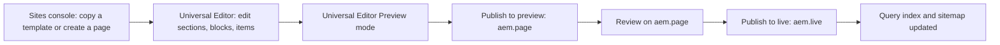

# Getting Started (authors)

| Attribute | Value |
| --- | --- |
| Document ID | AUT-001 |
| Audience | Content authors, content managers, AEM authoring leads |
| Purpose | The systems an author uses, access and the Universal Editor flow |
| Scope | — |
| Prerequisites | — |
| Owner | Content Lead / AEM Authoring Lead (proposed) |
| Approver | Product Owner (to be confirmed) |
| Version | 1.0 |
| Status | Draft for review |
| Last updated | 8 November 2026 |
| Last validated | 8 November 2026 |
| Source files | docs/handover/knowledge-base/authoring.md |
| Related documents | — |
| Related AEM paths | — |

## Contents

- [Access you need](#access-you-need)
- [Where to author](#where-to-author)
- [Systems an author uses](#systems-an-author-uses)
- [The Universal Editor flow](#the-universal-editor-flow)
- [Screenshots](#screenshots)
- [Known limitations](#known-limitations)
- [Open items](#open-items)
- [Change history](#change-history)

## Access you need

- An Adobe ID in the IMS organisation with the AEM Sites author product profile (Content Authors); the AEM administrator grants it.
- Universal Editor opens from the AEM Sites console (select a page > Edit).

## Where to author

| Tree (AEM Sites) | Use it for |
| --- | --- |
| /content/tcs-corp/language-masters/en | The real language master content (the migrated tcs.com pages) and its sheets; validated before it becomes the global site and the regions |
| /content/tcs-corp/language-master/en | Testing page functionality with dummy content and content limitations |
| /content/tcs-corp/design-block-master/en | The block library (every block and variation) and the curated design pages |
| /content/tcs-corp/&lt;country&gt;/&lt;language&gt; | The 13 locale sites (/en, /de-de, ...) |

## Systems an author uses

| System | Purpose | Notes |
| --- | --- | --- |
| AEM as a Cloud Service author, Sites console | Browse `/content/tcs-corp`, create, copy, move, publish, unpublish, page versions | Host and program ids are not repeated here; ask the AEM administrator |
| Universal Editor | Visual editing: canvas, Content tree, Properties panel | Opened from the Sites console with **Edit** |
| AEM Assets | Images and documents under `/content/dam/tcs-corp/` | `/content/dam/tcs-corp/` is in the `includes` of [paths.json](https://github.com/sradha-tcs/tcs-corp/blob/main/paths.json) |
| Preview site | `https://main--tcs-corp--sradha-tcs.aem.page/{locale}/…` | Content published to preview |
| Live site | `https://main--tcs-corp--sradha-tcs.aem.live/{locale}/…` | Production origin; production domain and CDN: Not recorded |
| AEM Sidekick (optional) | Preview / live status and switching on the Edge Delivery hosts | [tools/sidekick/config.json](https://github.com/sradha-tcs/tcs-corp/blob/main/tools/sidekick/config.json) labels the edit link "AEM Editor" |

Access and permissions: AEM user groups, permissions per locale and a publish approval workflow are not part of the repository and are not recorded (handover Part 5, 5.1.2, "To be confirmed"; open item O-06). See [administration-and-operations.md](../../07-administration-governance/markdown/ADMINISTRATION-AND-GOVERNANCE-GUIDE.md#permissions-and-access).

## The Universal Editor flow

- Edits save automatically. After each change [scripts/editor-support.js](https://github.com/sradha-tcs/tcs-corp/blob/main/scripts/editor-support.js) re-decorates only the changed block, section or default content; when it can't, the canvas reloads (expected).
- **Edit mode** (`html.adobe-ue-edit`, `isEditing()` in [utils/environment.js](https://github.com/sradha-tcs/tcs-corp/blob/main/utils/environment.js)): clicks select components; blocks with Hide block are shown faded with a dashed outline; animations don't play and aren't used up; List, Cards, Filter List and new items show editor hints and placeholders ([decorators/editor-item-decorator.js](https://github.com/sradha-tcs/tcs-corp/blob/main/decorators/editor-item-decorator.js)).
- **Preview mode** and the published site: links work, hidden blocks are gone, animations and carousels run.
- On AEM author there is no query index: Lists from child pages or tags and Filter Lists say their pages show on the published page; sheets (placeholders, taxonomy) may not resolve, so the editor can show English fallbacks and ID-derived tag labels. Validate those on `aem.page` (handover Part 14, Known Limitations #18).
- Device sizes: check mobile (below 600 px), tablet (600–1199 px) and desktop (1200 px and above), the breakpoints of [AGENTS.md](https://github.com/sradha-tcs/tcs-corp/blob/main/AGENTS.md#css).

## Screenshots

> **Screenshot required**
>
> - Required screen: Getting Started (authors)
> - Required role/access: AEM Sites author with Universal Editor (content author)
> - Required navigation steps: AEM Sites console > /content/tcs-corp/language-masters/en > open a page in Universal Editor
> - Reason unavailable: No AEM author access in the documentation program (access blocker AB-01)
> - Owner: Content Lead / AEM Authoring Lead (proposed)
> - Target completion date: To be confirmed

## Known limitations

- None recorded for this document.

## Open items

- None.

## Change history

| Version | Date | Author | Change |
| --- | --- | --- | --- |
| 1.0 | 8 November 2026 | Delivery team (documentation program) | First version of the role-specific documentation (master documentation prompt), generated from the repository and the published reference pages |
