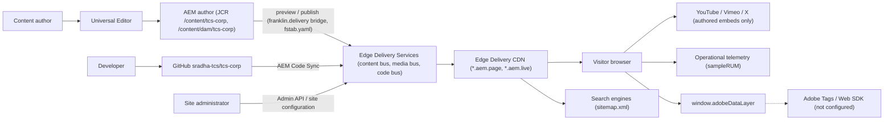
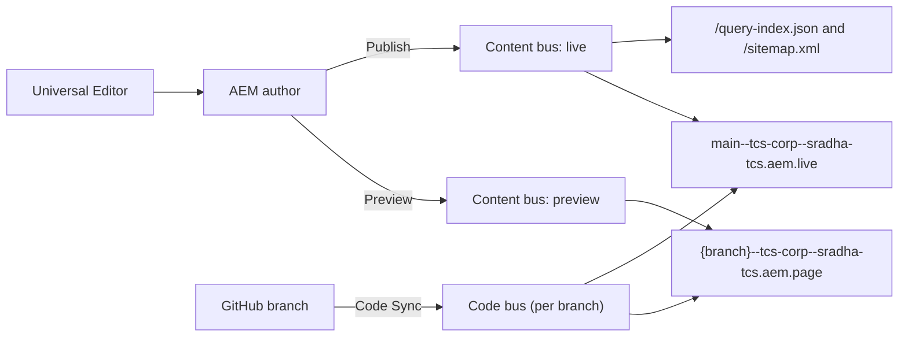
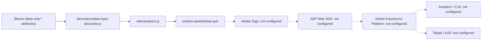
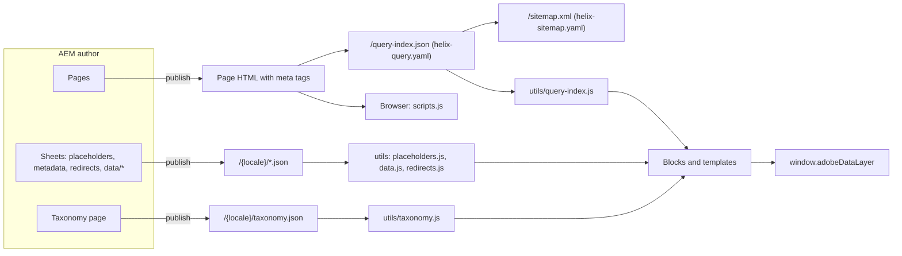
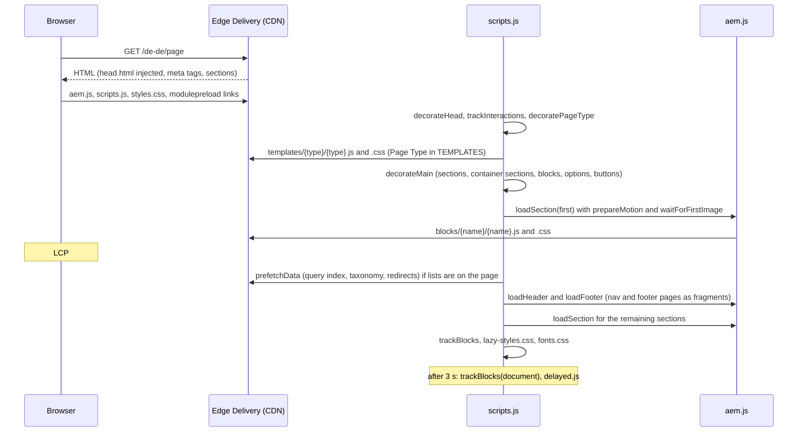

# Architecture

This file is the knowledge base summary of how the TCS Corporate Website is built and run: the solution and its system context, the browser runtime (three-phase loading, block loading, module preloading, templates), authoring with Universal Editor, publishing and delivery through Edge Delivery Services, the component and integration architecture, environments, security boundaries, data and rendering flows, error handling and caching. It states what the repository implements and links to the detailed sources instead of repeating them.

| Attribute | Value |
| --- | --- |
| Audience | Architects, developers, AMS / support, site administrators, AI agents |
| Source of truth | [`scripts/scripts.js`](../../../scripts/scripts.js), [`scripts/aem.js`](../../../scripts/aem.js), [`scripts/editor-support.js`](../../../scripts/editor-support.js), [`utils/`](../../../utils/README.md), [`decorators/`](../../../decorators/README.md), [`head.html`](../../../head.html), [`404.html`](../../../404.html), [`fstab.yaml`](../../../fstab.yaml), [`paths.json`](../../../paths.json), [`AGENTS.md`](../../../AGENTS.md), handover Part 2 — Solution Architecture ([TCS-CORP-HANDOVER.md](../TCS-CORP-HANDOVER.md)) |
| Last reviewed | Written from main at commit 2d06316 on 21 October 2026 |
| Status | Current; integration (Adobe Tags, Web SDK), production CDN / domain and environment access sections: Requires validation |

## Solution summary

The site separates three concerns ([AGENTS.md](../../../AGENTS.md), handover Part 2.1):

| Concern | System | Repository artefacts |
| --- | --- | --- |
| Authoring | AEM Sites as a Cloud Service author with the Universal Editor (xwalk) | `models/`, `blocks/*/_*.json`, `component-definition.json`, `component-models.json`, `component-filters.json`, `xwalk.json`, `scripts/editor-support.js` |
| Code | GitHub repository `sradha-tcs/tcs-corp` (based on `adobe-rnd/aem-boilerplate-xwalk`), deployed by AEM Code Sync | `blocks/`, `templates/`, `decorators/`, `utils/`, `scripts/`, `styles/`, `head.html`, `404.html` |
| Delivery | Edge Delivery Services (content bus, media bus, code bus; preview `*.aem.page`, live `*.aem.live`) | `fstab.yaml`, `paths.json`, `helix-query.yaml`, `helix-sitemap.yaml`, `.hlxignore` |

Key characteristics verified in the repository:

- **No build step.** Vanilla ES modules and CSS are served as committed; `.hlxignore` keeps dot files, Markdown, `package*.json`, `test/*`, `docs/*`, `_*` model partials, `LICENSE` and `karma.config.js` off the code bus.
- **Client-side decoration.** Edge Delivery delivers semantic HTML; `scripts/scripts.js` decorates sections and blocks and loads each block's JS / CSS on demand.
- **One site, 13 locales by path.** Locales are defined once in `LOCALES` ([`utils/site.js`](../../../utils/site.js)); `paths.json` is generated from them (`npm run build:paths`). See [content-architecture.md](./content-architecture.md).
- **Site data from published sheets.** Placeholders, taxonomy, redirects, data sheets and the query index are fetched as JSON by single-purpose utils, cached per page view.
- **Data layer only.** `window.adobeDataLayer` is populated centrally; Adobe Tags and the Web SDK are not configured.

## System context

| Actor / system | Interaction | Status |
| --- | --- | --- |
| Content authors | Edit, preview, publish pages and sheets in AEM with the Universal Editor | Active |
| Developers | Change code through pull requests; feature-branch preview hosts | Active |
| Site administrator | Site configuration (`public.json` paths, `metadata.source`), Admin API operations | Active (roles: Not recorded) |
| Visitors | Browse the 13 locale sites | Active |
| Search engines | Crawl pages and `/sitemap.xml` | Active (sitemap origin is the `main` live host until a production domain exists) |
| Production CDN / domain | Production hostname, redirects, 403 / 500 pages | Requires validation (not configured in the repository; handover open item O-03) |

## Application architecture

The code is layered ([decorators/README.md](../../../decorators/README.md), [utils/README.md](../../../utils/README.md), handover Part 2.3):

| Layer | Location | Responsibility |
| --- | --- | --- |
| Global head | `head.html` | CSP, viewport, `aem.js`, `scripts.js`, `styles.css`, generated `modulepreload` links |
| Core library | `scripts/aem.js` | Edge Delivery boilerplate library: sections, blocks, `loadBlock`, `loadCSS`, `loadScript`, `getMetadata`, `sampleRUM`. **Never modified** (AGENTS.md) |
| Page lifecycle | `scripts/scripts.js` | `loadEager` / `loadLazy` / `loadDelayed`, `decorateMain`, section options and container sections, templates, 404 loading, preloading, prefetch |
| Templates | `templates/{home,article,blog,press-release}/` | Structure and styles per Page Type ([templates/README.md](../../../templates/README.md)) |
| Blocks | `blocks/{name}/` | `{name}.js`, `{name}.css`, `_{name}.json` (models); inventory in [blocks/README.md](../../../blocks/README.md) |
| Decorators | `decorators/` | Create or decorate elements (buttons, links, images, media, data layer, SEO, block options, motion, skeletons) |
| Utils | `utils/` | No-UI helpers (site / locale, metadata, placeholders, taxonomy, data sheets, query index, redirects, ids, environment) |
| Styles | `styles/` | `styles.css` (tokens, LCP), `lazy-styles.css`, `fonts.css`, `card-list.css`, `motion.css` |
| Editor support | `scripts/editor-support.js`, `editor-support-rte.js`, `dompurify.min.js` | Universal Editor live updates (editor context only) |

Layering rules (AGENTS.md "Shared code: decorators and utils"): blocks and templates import decorators and utils; decorators may import utils; **utils never import decorators**; one purpose per file; shared behaviour goes into these folders, not into a block.

## Runtime architecture

### Three-phase loading

`loadPage()` in [`scripts/scripts.js`](../../../scripts/scripts.js) runs `loadEager`, then `loadLazy`, then `loadDelayed`.

| Phase | Steps (in code order) |
| --- | --- |
| Eager (`loadEager`) | `decorateHead()` (SEO head tags and `<html lang>`, `decorators/seo-decorator.js`); `trackInteractions()` (page entry and capture listeners, `decorators/data-layer-decorator.js`); `decorateTemplateAndTheme()`; `decoratePageType()` (Page Type body class); on the 404 page `loadErrorPage(main)`, else `loadTemplate(main)`; `decorateMain(main)`; `reserveHeaderSpace()`; `body.appear`; `preloadBlockModules(first section)`; `loadSection(first)` with `prepareMotion` and `waitForFirstImage` (LCP); `fonts.css` only at 900px and wider or when the session flag `fonts-loaded` is set |
| Lazy (`loadLazy`) | `autolinkModals` (links containing `/modals/` open the Modal block); `preloadBlockModules(main)` and of the chrome blocks (`header`, `footer`, `fragment`, `tcs-header`, `conversation-canvas`); `prefetchData(main)`; `loadHeader`; `loadFooter` (hidden until the sections have loaded); `loadMainSections` (each section with `prepareMotion`, RUM enhancement after the first); footer shown; `trackBlocks(main)`; `addErrorBackButton` on 404 pages; scroll to the URL hash; `lazy-styles.css`; `loadFonts()` |
| Delayed (`loadDelayed`) | After 3 seconds: `trackBlocks(document)` (header, footer, late blocks such as modals) and `import('./delayed.js')`. `scripts/delayed.js` contains only a comment (`// add delayed functionality here`) |

`decorateMain(main)` runs `decorateIcons` → `buildAutoBlocks` (an empty placeholder) → `decorateSectionsWithOptions` (section options, then the container sections Gen Carousel, Tabs Container and Columns Container wrapped in synthetic blocks) → `decorateBlocks` → `applyBlockOptions` (Additional tab) → `decorateButtons`.

`prefetchData(main)` starts the query index (`getPages`) and the taxonomy (`loadTaxonomy`) at the lazy phase only when the page has a `.list`, `.filter-list` or `.conversation-canvas`, and the redirects sheet (`loadRedirects`) only with a `.list`. It isn't run in the eager phase so it doesn't compete with the LCP image (code comment). See [indexing-and-search.md](./indexing-and-search.md).

### Block loading

From [`scripts/aem.js`](../../../scripts/aem.js):

- `decorateBlock(block)` adds `.block`, `data-block-name` (the first class), `data-block-status="initialized"`, wraps text nodes and adds `{name}-wrapper` to the parent.
- `loadBlock(block)` sets `loading`, loads `/blocks/{name}/{name}.css` and imports `/blocks/{name}/{name}.js` in parallel, awaits the default export, catches and logs errors (`failed to load module for {name}`, `failed to load block {name}`) and always ends with `data-block-status="loaded"`.
- `loadSection(section, callback)` loads the section's blocks one after another, runs the callback (here `prepareMotion`), then shows the section.

### Module preloading

There is no bundler, so a module's imports are only discovered after it loads (AGENTS.md "Module preloading"). Two generated lists remove these round trips (`npm run build:modules`, [`tools/modules/generate-module-graph.mjs`](../../../tools/modules/generate-module-graph.mjs)):

- `head.html` has `modulepreload` links for every module `scripts.js` imports (between `<!-- modulepreload -->` markers).
- [`scripts/module-graph.js`](../../../scripts/module-graph.js) lists, per block, the modules it imports beyond `scripts.js` and whether it has a stylesheet; `preloadBlockModules()` adds `modulepreload` links (head) and stylesheet `preload` links (body, because `loadCSS` skips a stylesheet already linked in the head).

`npm test` includes `test/modules/module-graph.test.mjs`; AGENTS.md states the tests fail when the lists are out of date.

### Templates

`loadTemplate(main)` reads the Page Type (`page-type` metadata, else `template`) and, when it is one of `TEMPLATES = ['home', 'article', 'blog', 'press-release']`, imports `templates/{name}/{name}.js` and loads its CSS, then calls the default export with `main` before decoration. Failures are logged (`failed to load template {name}`) and the page continues. What each template adds: [templates/README.md](../../../templates/README.md) and [content-architecture.md](./content-architecture.md).

## Authoring architecture

| Element | Implementation | Source |
| --- | --- | --- |
| Editor | AEM Universal Editor on the AEM author; pages under `/content/tcs-corp`, assets under `/content/dam/tcs-corp` | handover Part 2.9.1–2.9.2, Part 5 |
| Component palette | `component-definition.json`: groups Default Content (4), Sections (1), Blocks (57 components) | generated by `npm run build:json` from `models/_component-definition.json` and `blocks/*/_*.json` |
| Dialogs | `component-models.json` (fields per model) | generated from `models/_component-models.json` and partials |
| Allowed children | `component-filters.json`: `main` allows `section`, `gen-carousel`, `tabs`, `columns-container`; `section` allows 26 components | generated from `models/_component-filters.json` and partials |
| Page properties | `models/_page.json` (model `page-metadata`): Title, Description, Keywords, Page Type, Navigation, Footer, 404 Page | [content-architecture.md](./content-architecture.md) |
| Section properties | `models/_section.json`: Section Name, Style, Width Type, Rounded edge, Background Image, Image alt text, Anchor name | `scripts.js` `decorateSectionsWithOptions` |
| xwalk features | `xwalk.json`: `public.xwalk.multi-field.enabled: true` | AGENTS.md: repeating content uses item children, not composite multifields |
| Live editing | `scripts/editor-support.js` | below |

`scripts/editor-support.js` listens on `main` for `aue:content-patch`, `-update`, `-add`, `-move`, `-remove` and `-copy`. For each change it loads `scripts/dompurify.min.js`, sanitises the returned HTML (`USE_PROFILES: { html: true }`) and re-decorates only the changed `main`, block, section or default content (`decorateMain`, `decorateBlock`, `applyBlockOptions`, `decorateSectionsWithOptions`, `loadBlock`, `loadSections`); when an update can't be applied in place, the page reloads. `editor-support-rte.js` handles rich-text instrumentation, re-run by a `MutationObserver`. The file isn't referenced by `head.html` or `scripts.js`; handover Part 2.3.6 states it is loaded only in the Universal Editor context (the loading mechanism is outside this repository: Requires validation).

Authoring rules that shape code (block rows, field collapse, item rows, sections without `classes_*`): AGENTS.md "AEM delivery rules", the block READMEs and [docs/audit/README.md](../../../docs/audit/README.md).

## Publishing and delivery architecture

| Element | What it does | Source |
| --- | --- | --- |
| `fstab.yaml` | One mount point `/` of type `markup`, suffix `.html`, pointing to the AEM author's `bin/franklin.delivery/sradha-tcs/tcs-corp/main` bridge (host not reproduced here) | [`fstab.yaml`](../../../fstab.yaml) |
| `paths.json` | 154 mappings (143 for the 13 locales, 11 temporary for the language master under review), 15 includes (13 locale pages, `/content/dam/tcs-corp/`, `/content/tcs-corp/language-master/en`), 28 excludes (13 × 2 block-library entries, `site-global-templates` and its children); generated by `npm run build:paths` | [`paths.json`](../../../paths.json), [`tools/paths/generate-paths.mjs`](../../../tools/paths/generate-paths.mjs) |
| Site configuration | AEM uses the configuration's `public.json` → `paths`, not the repository file; `metadata.source` lists the bulk metadata sheets | AGENTS.md "Notes"; handover Part 2.10.13 |
| Preview / live | Preview writes to the preview partition (`*.aem.page`), publish to the live partition (`*.aem.live`); images go to the media bus (`/media_<hash>`) | handover Part 2.5.2, 2.10.3 |
| Code Sync | Every push of every branch updates the code bus for that branch | handover Part 2.5.1, 2.10.5 |
| CI | `.github/workflows/main.yaml` (`Build`): `npm ci`, `npm run lint` on every push; unit tests are not run in CI (handover F-37) | [`.github/workflows/main.yaml`](../../../.github/workflows/main.yaml) |

Publishing details (what must be published separately, sheets, rollback): handover Part 12 — Publishing, Deployment & Release.

## Content architecture (summary)

Pages consist of sections holding default content and blocks; page and bulk metadata arrive as `<meta>` tags; site data (placeholders, taxonomy, redirects, data sheets) is published per locale as JSON; header, footer and 404 pages are reference pages resolved by inherited metadata. Full description: [content-architecture.md](./content-architecture.md). Query index and listings: [indexing-and-search.md](./indexing-and-search.md).

## Component architecture

| Kind | Examples | How it runs |
| --- | --- | --- |
| Authored blocks | Hero, Teaser, List, Cards, Filter List, Accordion, Table, Video, Form Variations, Conversation Canvas | `decorateBlocks` + `loadBlock`; inventory and status in [blocks/README.md](../../../blocks/README.md) |
| Structural blocks | `header`, `footer` | built by `loadHeader` / `loadFooter` (aem.js) in the lazy phase; content from reference pages ([header](../../../blocks/header/README.md), [footer](../../../blocks/footer/README.md)) |
| Section containers | Gen Carousel, Tabs Container, Columns Container | the section is wrapped in a synthetic block by `buildCarouselSections`, `buildTabsSections`, `buildColumnsSections`; the container fields arrive as section data attributes and `applySectionBlockOptions` turns `container*` fields into block classes |
| Fragments | Fragment block, nav and footer pages, modals, tab fragments | `loadFragment(path, from)` in `blocks/fragment/fragment.js` fetches `{path}.plain.html` and decorates it; recursion stopped by the chain of including fragments ([fragment](../../../blocks/fragment/README.md)) |
| Additional tab | Anchor ID, Hide block, spacing, animation | `classes_*` fields as block classes; `decorators/block-options-decorator.js`, `decorators/motion-decorator.js`, `styles/styles.css` |
| Shared modules | 28 decorators, 26 utils | [decorators/README.md](../../../decorators/README.md), [utils/README.md](../../../utils/README.md) |

Shared events (AGENTS.md "Shared events and helpers"): `tabs:reveal` (opens the tab holding its target), `header:menu` (header menu state for the Canvas journey), `form-variations:submit` (with `detail.respondWith(promise)`), `conversation-canvas:search` (cancelable search hand-off).

## Integration architecture

| Integration | Mechanism | Status |
| --- | --- | --- |
| AEM author → Edge Delivery | franklin.delivery bridge (`fstab.yaml`), preview / publish | Active |
| GitHub → Edge Delivery | AEM Code Sync | Active |
| AEM Assets | Asset picker; images on the media bus; `/content/dam/tcs-corp/` in `paths.json` includes; non-image DAM files are served only once published (AGENTS.md) | Active |
| Query index and sitemap | `helix-query.yaml`, `helix-sitemap.yaml` | Active ([indexing-and-search.md](./indexing-and-search.md)) |
| Adobe Client Data Layer | `window.adobeDataLayer` populated by `decorators/data-layer-decorator.js` and `utils/analytics.js` (Core Components schema: page, components, `cmp:*` events) | Active |
| Adobe Tags (Data Collection) | Would be embedded from `scripts/delayed.js` | Not configured (blocked: measurement plan) |
| AEP Web SDK | Through Adobe Tags | Not configured (blocked: measurement plan) |
| Adobe Analytics, CJA, Target, AJO | — | No integration exists in the repository |
| Consent | — | No consent mechanism is implemented |
| Form back end | `form-variations:submit` event; no endpoint in code | No verified back end was identified |
| Search service | `conversation-canvas:search` event, else the authored Search page with `?q=` | No verified search service was identified |
| Third-party media | YouTube (incl. `youtube-nocookie.com`), Vimeo, X widgets, only for authored embeds | Active |
| Operational telemetry | `sampleRUM` in `scripts/aem.js`; `404.html` sends a `404` checkpoint | Active |

Details: AGENTS.md "Data layer", handover Part 11 — Analytics & Data Layer.

## Deployment

1. Develop locally with `aem up` (`http://localhost:3000`, local code with previewed content; `--html-folder drafts` for static drafts).
2. Run `npm run lint` and `npm test`; after model changes `npm run build:json`, after import changes `npm run build:modules`, after locale changes `npm run build:paths`.
3. Push a feature branch: Code Sync serves it at `https://{branch}--tcs-corp--sradha-tcs.aem.page/`; the `Build` workflow lints it.
4. Open a pull request with a feature preview URL (AGENTS.md "Publishing Process"); a reviewer merges to `main`.
5. Code Sync updates `main`; preview and live hosts serve the new code (code isn't versioned per content publication).
6. Configuration that lives outside the repository (`public.json` paths, `metadata.source`) is applied by the site administrator.

Rollback: revert the commit on `main` (handover Part 12.6).

## Environment topology

| Environment | Host pattern | Content | Code |
| --- | --- | --- | --- |
| Local | `http://localhost:3000` | Previewed content, or `drafts/` | Working copy |
| Feature preview | `https://{branch}--tcs-corp--sradha-tcs.aem.page/` | Previewed | Feature branch |
| Preview (main) | `https://main--tcs-corp--sradha-tcs.aem.page/` | Previewed | `main` |
| Live (main) | `https://main--tcs-corp--sradha-tcs.aem.live/` | Published | `main` |
| Production domain | Not recorded (not configured; `helix-sitemap.yaml` uses the live host as origin until `cdn.prod.host` is set) | Published | `main` |
| AEM author | Not reproduced (confidential host) | Source content | — |
| Other AEM environments | Not recorded | — | — |

## Security boundaries

| Boundary | Control in the repository | Source |
| --- | --- | --- |
| Script execution | CSP `script-src 'nonce-aem' 'strict-dynamic' 'unsafe-inline' http: https:; base-uri 'self'; object-src 'none'` with `move-to-http-header="true"` in `head.html` and `404.html`; only nonce scripts and what they load run | [`head.html`](../../../head.html), [`404.html`](../../../404.html) |
| Not restricted by CSP | `style-src`, `img-src`, `frame-src`, `connect-src` aren't set | `head.html`; handover Part 2.7.1 |
| Public code | Everything not in `.hlxignore` is public on the code bus; no secrets in code (AGENTS.md "Security Considerations") | [`.hlxignore`](../../../.hlxignore) |
| Public data | Every published sheet and `/query-index.json` is public (Authors and Media Contacts sheets hold names, e-mail addresses and phone numbers by design, handover Part 2.10.3) | [content-architecture.md](./content-architecture.md) |
| Editor updates | Universal Editor HTML is sanitised with DOMPurify before re-rendering; DOMPurify is loaded only by `editor-support.js` | [`scripts/editor-support.js`](../../../scripts/editor-support.js) |
| Fragments and error pages | `loadFragment` fetches only paths starting with `/` and not `//`; `loadPageContent` (404) fetches same-origin `.plain.html`; `innerHTML` is used only for those responses | `blocks/fragment/fragment.js`, `scripts/scripts.js` |
| Links | `isSafeUrl` (`utils/card-list-config.js`) allows `http:`, `https:`, `mailto:`, `tel:` and relative paths in List and Cards; new-window links get `rel="noopener noreferrer"` (`decorators/link-decorator.js`) | block READMEs |
| Analytics privacy | `cmp:submit` carries field names only; search terms pass `redactSearchTerm` (`utils/privacy.js`: e-mail and phone patterns replaced, 100 characters) | `decorators/data-layer-decorator.js` |
| Unpublished areas | Block libraries and Site Global Templates are excluded in `paths.json` | [`paths.json`](../../../paths.json) |
| Visitor identity | No login, no gated content, no consent mechanism, no cookies set by project code | handover Part 2.7.3 |
| Admin operations | Admin API calls require authorised users; roles are configured outside the repository | Not recorded (handover open item) |
| Preview / live access protection | — | Not recorded |

## Data flow

| Flow | Source → consumer | Detail |
| --- | --- | --- |
| Page metadata | Page properties and bulk metadata → `<meta>` → `getMetadata` / `utils/metadata.js` → SEO decorator, data layer, templates, Page Header | [content-architecture.md](./content-architecture.md) |
| Inherited metadata | Parent pages' `nav`, `footer`, `error-page` metas → `utils/inherited-metadata.js` → header, footer, 404 | parent heads loaded in parallel, cached in `sessionStorage` |
| UI text | `/{locale}/placeholders.json` → `getPlaceholders()` → every block with UI text | English fallback in code |
| Tag labels | `/{locale}/taxonomy.json` → `resolveTags()` | ID-derived labels as fallback |
| Listings | `/query-index.json` → `getPages()` → List, Filter List, Conversation Canvas menu | [indexing-and-search.md](./indexing-and-search.md) |
| Analytics | Blocks' `data-cmp-*` attributes → data layer decorator → `window.adobeDataLayer` | no outbound collection configured |
| Telemetry | `sampleRUM` checkpoints → operational telemetry collector | platform |

## Rendering flow

## Error handling

| Failure | Behaviour | Where |
| --- | --- | --- |
| Block module fails to load or `decorate()` throws | Logged (`failed to load module for {name}`); block marked `loaded`; the section and page continue (block isolation) | `loadBlock`, `scripts/aem.js` |
| Template fails | Logged (`failed to load template {name}`); the page renders without it | `loadTemplate`, `scripts/scripts.js` |
| Missing page | Edge Delivery serves `404.html` (`window.isErrorPage`, `window.errorCode = '404'`); `loadErrorPage` tries the inherited 404 Page, then `/{locale}/error-pages/404`, then `/en/error-pages/404`; a page without content is skipped; else the built-in "404 / Page Not Found / Go home" stays; content from another locale gets its `lang` on `<main>`; "Go back" is added for same-origin referrers | `scripts/scripts.js` `loadErrorPage`, `loadPageContent`, `addErrorBackButton` |
| 403 / 500 | Not served by Edge Delivery; authored `error-pages/403` and `500` exist for a CDN | Requires validation (CDN not configured) |
| Sheet or index request fails | Each util resolves to empty data: placeholders → English fallbacks, taxonomy → ID-derived labels, data sheets → empty lists, redirects → none, query index → no pages | `utils/*.js` (`.catch(() => …)`) |
| Navigation page fails | Falls back to the locale's `references/nav`; none published: header left empty | `blocks/header/header.js` |
| Fragment can't load (unpublished, path not starting with `/`, self-inclusion) | The Fragment block keeps its authored content (the reference link); in Universal Editor edit mode it shows the hint `fragmentEmpty` | `blocks/fragment/fragment.js` |
| Slow data | `renderWhenLoaded` shows a skeleton after 150ms (at least 250ms) and removes it on success or failure | `decorators/skeleton-decorator.js` |
| Universal Editor update can't be applied in place | Page reloads | `scripts/editor-support.js` |
| Analytics push error | Swallowed (`pushToDataLayer` in `try / catch`) | `utils/analytics.js` |
| Storage unavailable | Ignored (`sessionStorage`, `localStorage` in `try / catch`) | `scripts.js`, `utils/inherited-metadata.js`, `utils/header-space.js` |

Troubleshooting by symptom: handover Part 13 — Global Troubleshooting Guide.

## Caching

| Cache | Holds | Lifetime / invalidation | Source |
| --- | --- | --- | --- |
| Edge Delivery CDN | HTML, `.plain.html`, sheet JSON, media, code | Purged for the path on preview / publish and on code sync; manual purge with the Admin API cache operation | handover Part 12.1.8 (platform behaviour) |
| Production CDN | Live responses | Not recorded (not configured) | — |
| Query index rows | `/query-index.json`, all locales | One promise per page view (module variable `pages`) | `utils/query-index.js` `getPages` |
| Pages read from HTML | Rows for pages missing from the index (AEM author) | `Map` per page view | `utils/query-index.js` `getPagesAt` |
| Placeholders, taxonomy, redirects | Locale sheets | One promise per page view | `utils/placeholders.js`, `utils/taxonomy.js`, `utils/redirects.js` |
| Data sheets | Authors, locations, partners, social links, media contacts | `Map` per sheet per page view | `utils/data.js` |
| Inherited metadata | `nav`, `footer`, `error-page` of parent pages | In memory per page view and `sessionStorage` key `tcs-inherited-metadata` for the browser session (a changed parent value shows in a new session) | `utils/inherited-metadata.js` |
| Font flag | `fonts-loaded` | `sessionStorage`, browser session; not set on `localhost` | `scripts/scripts.js` |
| Header height | `header-height-v2-{breakpoint}` (rem) | `localStorage`, no expiry; refreshed when the header loads | `utils/header-space.js` |
| Header overlay mode | `header-overlay-v1` (`always` / `never`; removed for Auto) | `localStorage`, no expiry; set when the header's TCS Header loads, applied in the eager phase (`<html data-header-overlay>`) | `utils/header-space.js` |
| Preloads | Module and stylesheet paths already preloaded | `Set` per page view | `scripts/scripts.js` `preloadedModules` |

## Related

- [content-architecture.md](./content-architecture.md) — sites, locales, page structure, metadata, sheets, references
- [indexing-and-search.md](./indexing-and-search.md) — query index, listings, sitemap, reindexing
- [data-layer-and-analytics.md](./data-layer-and-analytics.md), [blocks.md](./blocks.md), [repository-structure.md](./repository-structure.md), [project-overview.md](./project-overview.md) — related knowledge base files
- [AGENTS.md](../../../AGENTS.md) — project rules (delivery rules, three-phase loading, module preloading, data layer)
- [blocks/README.md](../../../blocks/README.md), [decorators/README.md](../../../decorators/README.md), [utils/README.md](../../../utils/README.md), [templates/README.md](../../../templates/README.md)
- [docs/audit/README.md](../../../docs/audit/README.md), [docs/animation/README.md](../../../docs/animation/README.md)
- Handover ([TCS-CORP-HANDOVER.md](../TCS-CORP-HANDOVER.md)): Part 2 — Solution Architecture, Part 11 — Analytics & Data Layer, Part 12 — Publishing, Deployment & Release, Part 13 — Global Troubleshooting Guide, Part 16 — Handover Findings and Open Items Register
