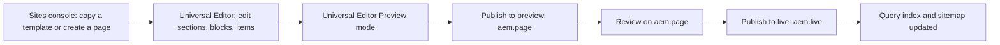

# Authoring

How content authors create, edit, preview and publish pages of the TCS Corporate Website in AEM Sites with Universal Editor and Edge Delivery Services (xwalk). This page summarizes the verified authoring rules and links to the detailed sources: each block's README for its fields and variations, the project handover (Part 5 — Authoring Fundamentals and the cheat sheets of Part 15) for step-by-step walkthroughs, and `AGENTS.md` for the rules of what AEM really delivers.

| Attribute | Value |
| --- | --- |
| Audience | Content authors, content leads, L1 author support, QA |
| Source of truth | [component-filters.json](../../../component-filters.json), [models/](../../../models/), [blocks/README.md](../../../blocks/README.md) and the block READMEs, [AGENTS.md](../../../AGENTS.md), [utils/site.js](../../../utils/site.js), handover Part 5 — Authoring Fundamentals ([TCS-CORP-HANDOVER.md](../TCS-CORP-HANDOVER.md)) |
| Last reviewed | Written from main at commit 2d06316 on 21 October 2026 |
| Status | Requires validation (author permissions, publish destinations of the Universal Editor and the production domain are not recorded) |

## Systems an author uses

| System | Purpose | Notes |
| --- | --- | --- |
| AEM as a Cloud Service author, Sites console | Browse `/content/tcs-corp`, create, copy, move, publish, unpublish, page versions | Host and program ids are not repeated here; ask the AEM administrator |
| Universal Editor | Visual editing: canvas, Content tree, Properties panel | Opened from the Sites console with **Edit** |
| AEM Assets | Images and documents under `/content/dam/tcs-corp/` | `/content/dam/tcs-corp/` is in the `includes` of [paths.json](../../../paths.json) |
| Preview site | `https://main--tcs-corp--sradha-tcs.aem.page/{locale}/…` | Content published to preview |
| Live site | `https://main--tcs-corp--sradha-tcs.aem.live/{locale}/…` | Production origin; production domain and CDN: Not recorded |
| AEM Sidekick (optional) | Preview / live status and switching on the Edge Delivery hosts | [tools/sidekick/config.json](../../../tools/sidekick/config.json) labels the edit link "AEM Editor" |

Access and permissions: AEM user groups, permissions per locale and a publish approval workflow are not part of the repository and are not recorded (handover Part 5, 5.1.2, "To be confirmed"; open item O-06). See [administration-and-operations.md](./administration-and-operations.md#permissions-and-access).

## The Universal Editor flow

- Edits save automatically. After each change [scripts/editor-support.js](../../../scripts/editor-support.js) re-decorates only the changed block, section or default content; when it can't, the canvas reloads (expected).
- **Edit mode** (`html.adobe-ue-edit`, `isEditing()` in [utils/environment.js](../../../utils/environment.js)): clicks select components; blocks with Hide block are shown faded with a dashed outline; animations don't play and aren't used up; List, Cards, Filter List and new items show editor hints and placeholders ([decorators/editor-item-decorator.js](../../../decorators/editor-item-decorator.js)).
- **Preview mode** and the published site: links work, hidden blocks are gone, animations and carousels run.
- On AEM author there is no query index: Lists from child pages or tags and Filter Lists say their pages show on the published page; sheets (placeholders, taxonomy) may not resolve, so the editor can show English fallbacks and ID-derived tag labels. Validate those on `aem.page` (handover Part 14, Known Limitations #18).
- Device sizes: check mobile (below 600 px), tablet (600–1199 px) and desktop (1200 px and above), the breakpoints of [AGENTS.md](../../../AGENTS.md#css).

## Creating and editing pages

### Where pages live

The 13 locale sites and their published paths are listed in [AGENTS.md](../../../AGENTS.md#site-structure-and-site-data) and defined in `LOCALES` of [utils/site.js](../../../utils/site.js).

| Location (below `/content/tcs-corp/{country}/{language}`) | Contents | Published |
| --- | --- | --- |
| The locale page itself | The locale's Home page | Yes, at `/{locale}/` |
| Content pages below it | All content pages | Yes |
| `references/` | Navigation (`nav`), `footer`, other fragments | Yes (read by other pages) |
| `error-pages/` | `404` (used by the site); `403` / `500` (for a CDN, not used by code) | Yes |
| `block-library/` | Every block variation in the locale's language | No (`excludes` of [paths.json](../../../paths.json)) |
| `/content/tcs-corp/site-global-templates/` | Template pages to copy (home, article, blog, press release) | No |

### Creating a page

1. In the Sites console copy the template page from `site-global-templates` and paste it into the locale folder; rename it (the page name becomes the URL segment). For pages without a template use **Create > Page** (the AEM page template offered there is not recorded).
2. Open it with **Edit**, set the page properties, edit the content, then preview and publish.
3. Values that aren't page properties (author, dates, reading time, region, images, card values, SEO and social columns) come from the locale's bulk metadata sheet (see [Metadata](#metadata)).

Walkthrough: handover Part 5, 5.3, and the cheat sheet in Part 15, 15.5.1.

### Page properties

The page model is `page-metadata` in [models/_page.json](../../../models/_page.json):

| Field | Name | Notes |
| --- | --- | --- |
| Title | `jcr:title` | Browser, SEO and social title; Page Header heading; card title fallback |
| Description | `jcr:description` | Meta description; Page Header description; card description fallback |
| Keywords | `keywords` | Meta keywords |
| Page Type | `page-type` | Default, Home, Article, Blog, Press Release: loads `templates/{name}/` ([templates/README.md](../../../templates/README.md)); overrides the sheet's `page-type` |
| Navigation | `nav` | Inherited (see [References](#references-navigation-footer-and-404)) |
| Footer | `footer` | Inherited |
| 404 Page | `error-page` | Inherited |

`TEMPLATES` in [scripts/scripts.js](../../../scripts/scripts.js) is `home`, `article`, `blog`, `press-release`; another value loads no template code but is still added as a body class.

### Sections

A section is a band of the page with default content and blocks. Its fields (Section Name, Style Default / Grey / Dark / Dark Green, Width Type, Rounded edge, Background Image and its alt text, Anchor name) are in [models/_section.json](../../../models/_section.json); the backgrounds and the dark theme contract are described in [AGENTS.md](../../../AGENTS.md#blocks) ("Backgrounds and theme"). Sections don't get `classes_*` fields delivered, so a section has no Additional tab; the container sections use `container*` fields instead.

## Adding and configuring blocks

### Where components can be added

What the **Add (+)** picker offers is defined by the filters in [component-filters.json](../../../component-filters.json) (aggregated from [models/_component-filters.json](../../../models/_component-filters.json), [models/_section.json](../../../models/_section.json) and each block's `_<block>.json`):

| Container | Allowed components |
| --- | --- |
| Main (the page) | Section, Gen Carousel, Tabs Container, Columns Container |
| Section | Text, Image, Button (Button Block), Title, Page Header, Hero, Teaser, Quote, Testimonial, Anchor List, Accordion, Tabs (block), Table, Table List, List, Separator, Embed, Video, Modal, Form Variations, Filter List, Conversation Canvas, Cards, Fragment, Footer, TCS Header |
| Columns Container | Column Break, then the Section's components except Page Header, Footer and TCS Header |
| Tabs Container | Tab, Column Break, then the Section's components except Page Header, Conversation Canvas, Footer and TCS Header |
| Gen Carousel | Hero, Teaser |

The item filters of each block (Accordion Item, Card, List Item, CTA, Link, Stat, form fields, Table rows, ...) are listed in [blocks/README.md](../../../blocks/README.md#container-and-child-relationships). Not offered in any filter: the built-in Columns (compatibility only), the built-in Button ("Button (basic)"), and Interactive Dashboard (placeholder) ([blocks/README.md](../../../blocks/README.md#deprecated-blocks)).

### Block reference

Each block README holds the dialog fields per tab (generated from the models), the variations, authoring steps, accessibility, data layer and troubleshooting. Don't repeat fields elsewhere; read them there.

| Block | README | Added in | Status |
| --- | --- | --- | --- |
| Accordion | [accordion](../../../blocks/accordion/README.md) | Section, Columns Container, Tabs Container | Active |
| Anchor List | [anchor-list](../../../blocks/anchor-list/README.md) | Section, Columns Container, Tabs Container | Active |
| Button (Button Block) | [button-block](../../../blocks/button-block/README.md) | Section, Columns Container, Tabs Container | Active |
| Cards | [cards](../../../blocks/cards/README.md) | Section, Columns Container, Tabs Container | Active |
| Column Break | [column-break](../../../blocks/column-break/README.md) | Columns Container, Tabs Container | Active |
| Columns (built-in) | [columns](../../../blocks/columns/README.md) | None (no longer offered) | Compatibility-only |
| Columns Container | [columns-container](../../../blocks/columns-container/README.md) | Main (page) | Active |
| Conversation Canvas | [conversation-canvas](../../../blocks/conversation-canvas/README.md) | Section, Columns Container | Active |
| Embed | [embed](../../../blocks/embed/README.md) | Section, Columns Container, Tabs Container | Active |
| Filter List | [filter-list](../../../blocks/filter-list/README.md) | Section, Columns Container, Tabs Container | Active |
| Footer | [footer](../../../blocks/footer/README.md) | Section (on the footer reference page) | Active |
| Form Variations | [form-variations](../../../blocks/form-variations/README.md) | Section, Columns Container, Tabs Container | Active |
| Fragment | [fragment](../../../blocks/fragment/README.md) | Section, Columns Container, Tabs Container | Active |
| Gen Carousel | [gen-carousel](../../../blocks/gen-carousel/README.md) | Main (page) | Active |
| Header | [header](../../../blocks/header/README.md) | Not a component: built from the nav page | Active |
| Hero | [hero](../../../blocks/hero/README.md) | Section, Columns Container, Tabs Container, Gen Carousel | Active |
| Interactive Dashboard | [interactive-dashboard](../../../blocks/interactive-dashboard/README.md) | None | Experimental |
| List | [list](../../../blocks/list/README.md) | Section, Columns Container, Tabs Container | Active |
| Modal | [modal](../../../blocks/modal/README.md) | Section, Columns Container, Tabs Container | Active |
| Page Header | [page-header](../../../blocks/page-header/README.md) | Section | Active |
| Quote | [quote](../../../blocks/quote/README.md) | Section, Columns Container, Tabs Container | Active |
| Separator | [separator](../../../blocks/separator/README.md) | Section, Columns Container, Tabs Container | Active |
| Tab | [tab](../../../blocks/tab/README.md) | Tabs Container | Active |
| Table | [table](../../../blocks/table/README.md) | Section, Columns Container, Tabs Container | Active |
| Table List | [table-list](../../../blocks/table-list/README.md) | Section, Columns Container, Tabs Container | Active |
| Tabs Container and Tabs (block) | [tabs](../../../blocks/tabs/README.md) | Main (container); Section, Columns Container, Tabs Container (block) | Active |
| TCS Header | [tcs-header](../../../blocks/tcs-header/README.md) | Section (on the nav page) | Active |
| Teaser | [teaser](../../../blocks/teaser/README.md) | Section, Columns Container, Tabs Container, Gen Carousel | Active |
| Testimonial | [testimonial](../../../blocks/testimonial/README.md) | Section, Columns Container, Tabs Container | Active |
| Video | [video](../../../blocks/video/README.md) | Section, Columns Container, Tabs Container | Active |

Default content (Text, Title, Image) uses AEM's built-in components (handover Part 6, chapters 6.6 to 6.8).

### The Additional tab

Every block model except the header and footer ends with an **Additional** tab (rules in [AGENTS.md](../../../AGENTS.md#blocks), "Additional tab" and "Animation and skeletons"):

| Field | Name | Effect |
| --- | --- | --- |
| Anchor ID | `classes_anchor` | Must match `anchor-…` (lower case, digits, hyphens); becomes the block's `id` ([decorators/block-options-decorator.js](../../../decorators/block-options-decorator.js)), de-duplicated as `-2`, `-3`; also the block's data layer id |
| Hide block | `classes_hideblock` | Hidden on the site and in Preview; faded in edit mode; the content stays in the delivered HTML (not an embargo mechanism) |
| Padding / Margin Left, Right, Top, Bottom | `classes_padding*`, `classes_margin*` | `--space-*` tokens, the same at every breakpoint |
| Animation Type, Motion Speed, Animation Trigger | `classes_animation*` | Content animation on 19 blocks; never in edit mode or for reduced motion ([docs/animation/README.md](../../../docs/animation/README.md)) |
| Background animation | `classes_bganimation` | Hero, Teaser, Quote, Testimonial, Form Variations, Conversation Canvas |

Container sections (Columns Container, Tabs Container, Gen Carousel) carry the same options as `container*` fields (`containerAnchor`, `containerHide`, ...), applied by `applySectionBlockOptions` in [scripts/scripts.js](../../../scripts/scripts.js).

## Containers and child items

- **Section containers** are added at page level (Main): a [Columns Container](../../../blocks/columns-container/README.md) holds Column Breaks and the components of each column; a [Tabs Container](../../../blocks/tabs/README.md) holds Tabs (and Column Breaks inside a tab: a section can't hold a section); a [Gen Carousel](../../../blocks/gen-carousel/README.md) holds Heroes and Teasers as slides. `scripts.js` wraps each in a synthetic block.
- **Column Break** ([README](../../../blocks/column-break/README.md)) starts a column: the components after it belong to that column. In a Tab, content before the first Column Break stays above the columns; the Tab's **Columns per row** sets the layout.
- **Item children**: repeating content is added to the block with **Add (+)**, not with composite multifields: List Items, Cards, Hero and Page Header CTAs, Teaser Links and Stats, Testimonial Stats, Anchor Links, Filter List tags / categories / pages, Footer Links, form fields, Table rows, Canvas buttons ([AGENTS.md](../../../AGENTS.md#blocks), "Item children"). The multifields authored before are still read but don't render from content packages (handover finding F-87).
- An item without content yet is a dashed placeholder in the editor (placeholder key `itemEditorHint`).
- Universal Editor collapses a dialog's tabs into a dropdown when they don't fit; models keep at most three tabs, the last one Additional.
- Built-in **Columns** and **Button (basic)** authored before stay editable but aren't offered; use a Columns Container and the [Button](../../../blocks/button-block/README.md) block.

## Previewing

1. Switch the Universal Editor to **Preview** and check the three device sizes: no editor hints left, hidden blocks gone, animations play.
2. Publish to the preview tier and open `https://main--tcs-corp--sradha-tcs.aem.page/{locale}/{path}`; Lists, Filter Lists, placeholders and taxonomy labels only resolve there (not on author).
3. Use a private window or a cache-busting query to bypass the browser cache.

Which publish destinations the Universal Editor offers in this program (Preview and / or Live) is not recorded (handover Part 5, 5.7.2).

## Publishing

| Task | Where | Verify |
| --- | --- | --- |
| One page | Universal Editor **Publish** (keep changed references selected) | Live URL in a private window |
| Several pages or a branch | Sites console **Manage Publication** (include children; schedule Later) | Sample URLs, `/query-index.json` |
| Quick publish | Sites console **Quick Publish** | Live URL |
| A sheet or data sheet | Select the sheet, **Quick Publish** | `/{locale}/{sheet}.json` |
| Take down | **Manage Publication > Unpublish** (add a redirect first if the URL was public) | The locale's 404 page |
| Undo a change | **Timeline > Revert to this Version**, then publish | Live URL |

**Published separately.** A change to these items only takes effect when the item itself is published: `references/` pages (nav, footer, fragments), error pages, the sheets (`placeholders`, `metadata`, `taxonomy`, `redirects`), the data sheets (`data/authors`, `locations`, `partners`, `social-links`, `media-contacts`) and assets. A published nav, footer or fragment change shows on every page that loads it without republishing those pages.

**Order when content depends on new code or data.** Code first (merged and synced), then sheets (placeholders, taxonomy, data, metadata), then fragments (nav, footer), then pages (handover Part 12, 12.4.2).

Pages under `block-library/` and `site-global-templates/` can't be published (`excludes` of [paths.json](../../../paths.json)); during the language master review its block library is published for the review (handover revision 2.20).

## Corrective publishing

Re-publication after a correction is the verified recovery path, recorded in the handover revision history:

- Package 1.0.9 was published; on `aem.live` the container sections' Additional tab had no effect (re-audit finding R-L-1). The code was corrected (PR #121), package 1.0.10 installed, and its 312 pages previewed, published and reindexed (312 / 312) (handover revisions 2.30, 2.31; [REAUDIT-2026-10-20.md](../../../docs/audit/REAUDIT-2026-10-20.md)).
- Package 1.0.12: one page timed out on its first preview and went through on retry (handover revision 2.35).

For one page: fix the content (or restore a version), check it in Preview mode, publish to preview, verify, then publish to live. If a correction is not visible, check that the referenced item (fragment, sheet, asset) was published too, then escalate to L1 (Admin API status, re-preview and cache operations are for administrators; see [administration-and-operations.md](./administration-and-operations.md#publishing-and-the-admin-api)).

## Assets

- Images and documents live in AEM Assets under `/content/dam/tcs-corp/`; image fields (`reference`) open the Assets picker.
- **Images travel with the page**: on publish, Edge Delivery copies each referenced image to the media bus (`media_…` URLs) and serves responsive renditions. The first image of the first section loads eagerly (LCP), the others lazily.
- **Non-image DAM files** (Lottie `.json`, videos, WebVTT captions, PDFs) are served only once they are published themselves; until then they return 404 on `aem.page` ([AGENTS.md](../../../AGENTS.md#blocks), "AEM delivery rules"; re-audit operations R-B-2, R-D-6). Publish them from AEM Assets.
- A non-image reference is delivered as a link whose text is its **Alt**: fill the Alt field of Lottie and other file references (`animationLabel` in [utils/media.js](../../../utils/media.js)).
- Alt text: describe informative images; leave it empty only for decorative images (the code then sets `alt=""`); don't put text inside images. Rules and image guidance: handover Part 5, 5.5.
- Image licensing rules and the DAM folder convention per locale are not recorded.

## Links and CTAs

- Buttons authors add are **Button** blocks (`button-block`: Link, View, Type `buttonVariant`, Icon, Alignment); see [blocks/button-block/README.md](../../../blocks/button-block/README.md) and [AGENTS.md](../../../AGENTS.md#blocks) ("Button").
- In default content, a standalone link in its own paragraph becomes a button: bold / italic (or a Type) gives a button, otherwise a link button; inline links stay links ([decorators/content-buttons-decorator.js](../../../decorators/content-buttons-decorator.js)).
- CTAs of Hero, Page Header and Teaser are item children (CTA, Link); see each block README.
- Link to published paths (`/en/...`), not `/content/tcs-corp/...`. Links set to open in a new tab are announced to screen readers (placeholder `opensInNewTab`).
- Anchors: a section's **Anchor name** (normalised to lower case with hyphens) or a block's **Anchor ID** (`anchor-…`), linked as `#…`; the `tabs:reveal` event opens the tab holding a deep-link target.
- The per-locale `redirects` sheet is not applied by the platform; the List links its cards to the redirect targets ([utils/redirects.js](../../../utils/redirects.js)). Add a redirect row before moving or unpublishing a public page, but a mechanism that applies it is not configured (see [administration-and-operations.md](./administration-and-operations.md#known-limitations-relevant-to-operations)).

## Metadata

| Source | What it sets | Notes |
| --- | --- | --- |
| Page properties | Title, Description, Keywords, Page Type, Navigation, Footer, 404 Page | [models/_page.json](../../../models/_page.json) |
| Bulk metadata sheet `{locale}/metadata` | Every other page-level value: `author-id`, `publish-date`, `reading-time`, `region`, `content-type`, `featured-image`, card values (`card-title`, `card-style`, ...), SEO and social columns | Column list in [AGENTS.md](../../../AGENTS.md#site-structure-and-site-data); URL patterns must start with the locale (`/de-de/**`) |

The bulk sheets apply only once the administrator lists all 13 in the site configuration's `metadata.source`; whether that is done is not recorded (handover open item O-04). The Page Header takes all its content from metadata (only its Layout and CTAs are authored). Republish a page after its card values changed so the query index row updates. Field reference: handover Part 8 — Metadata Documentation.

## Taxonomy

- Tags are AEM tags (`tcs-corp:` namespace) set in page properties and in block tag fields (Teaser, Cards, List Items, List, Filter List).
- Labels come from the locale's taxonomy page (`/{locale}/taxonomy.json`; a language sheet such as `de` when translated) through [utils/taxonomy.js](../../../utils/taxonomy.js); a tag missing there shows a label derived from its ID.
- Publish the taxonomy page after a change; Lists and Filter Lists match tags from the query index, so republish pages after re-tagging. Governance: handover Part 7 — Taxonomy Documentation.

## Placeholders

All UI text of the blocks (button labels, ARIA labels, editor hints) comes from the locale's `placeholders` sheet (Key, Text; Description and Category are for authors) through [utils/placeholders.js](../../../utils/placeholders.js). Keys match without case or separators; a missing key shows the code's English fallback (not the `/en` sheet's text). Keep `{n}`, `{total}`, `{title}` and similar variables. The key list is in handover Part 4, 4.5 and Part 14, 14.8.3.

## References: navigation, footer and 404

| Value | Resolution (first match wins) |
| --- | --- |
| Navigation (`nav`) | The page's own value (page property or the sheet's `nav`), else the nearest parent page's up to the locale Home, else `{locale}/references/nav` |
| Footer (`footer`) | The same chain, else `{locale}/references/footer` |
| 404 Page (`error-page`) | The same chain, else `/{locale}/error-pages/404`, else `/en/error-pages/404`, else the built-in content |

Implemented by `getInheritedMetadata` in [utils/inherited-metadata.js](../../../utils/inherited-metadata.js) and `resolvePagePath` / `getParentPages` in [utils/site.js](../../../utils/site.js). Leave the three fields empty on ordinary pages; set them on the top page of a sub-site. Values may be AEM paths, published paths or paths relative to the locale root (`references/nav-careers`). Inherited values are cached per browser session (`sessionStorage` key `tcs-inherited-metadata`): check a change in a new private window. Header and footer authoring: [blocks/header/README.md](../../../blocks/header/README.md), [blocks/tcs-header/README.md](../../../blocks/tcs-header/README.md), [blocks/footer/README.md](../../../blocks/footer/README.md).

## Localization

- Each of the 13 locales is a separate page tree with its own references, error pages, sheets, data and block library; locales share no content. Link only to the locale's own references and sheets.
- The page language (`<html lang>`) is the page's `language` metadata when valid, else the locale's tag ([decorators/seo-decorator.js](../../../decorators/seo-decorator.js)).
- Creating a locale's content, translation projects, MSM live copies, a language switcher and `hreflang` are not implemented in code; the translation process is not recorded (handover Part 4, 4.9.6; open item O-12).
- Month abbreviations in formatted dates are English in every locale; prefer the numeric date formats where a block offers a choice (handover 4.9.7).
- Temporary: pages below `/language-master/en` read the language master's own references, sheets and index rows until its rollout to `/en` (`REVIEW_*` in [utils/site.js](../../../utils/site.js)).

## Accessibility responsibilities

The code implements WCAG 2.1 AA behaviour ([AGENTS.md](../../../AGENTS.md#blocks), "Accessibility"); authors are responsible for the content:

- One `h1` per page (Page Header, a Hero with H1 or a Title h1) and heading levels in order; don't choose a level for its size.
- Alt text for every informative image and every Lottie / file reference; empty only for decorative images.
- Meaningful link and button text (not "click here"); the Accessibility label fields of List Items and Cards where the visible text isn't enough.
- Captions for videos with speech (WebVTT, published as an asset).
- Don't rely on colour alone; use the Section Style and BG Color options, which keep the theme contrast.
- Use animations sparingly (one or two effects per page); reduced motion is honoured by the code.

## Analytics authoring fields

Every block is in the Adobe Client Data Layer (`window.adobeDataLayer`), populated centrally by [decorators/data-layer-decorator.js](../../../decorators/data-layer-decorator.js). Adobe Tags and the AEP Web SDK are not configured (blocked: measurement plan), so nothing is collected yet.

| Field | Where | Effect |
| --- | --- | --- |
| Anchor ID (`classes_anchor`) | Additional tab of every block | The block's `id` and its data layer component id: renaming it changes the analytics id |
| Analytics (`analyticsEnabled`) | List, Cards (default on), Separator (default off) | On: component state and card events in the data layer; off: `data-analytics="off"` |
| Analytics label (`analyticsLabel`) | List Item, Card, Separator | `data-analytics-label` and the data layer `dc:title` (else the title) |
| Component ID (`componentId`) | Separator | Its own id |

Keep personal data out of Anchor IDs, Component IDs and analytics labels. Event details: handover Part 11 — Analytics & Data Layer, and each block README's Data Layer section.

## Personalization fields

None. No verified personalization field exists in the models; the Teaser's Personalization option (a marker nothing read) was removed in the block audit (D-B-3). No Adobe Target, AJO or CJA integration exists; every block renders its authored default content.

## Pre-publish checklist

- [ ] Title and Description set; Page Type correct; Navigation, Footer and 404 Page empty unless the page needs its own.
- [ ] One `h1`; headings in order.
- [ ] Alt text on informative images and file references; decorative images empty.
- [ ] Links point to published paths and to pages that are published; new-tab links only where needed.
- [ ] No block unintentionally hidden (faded blocks in edit mode); no confidential content anywhere on the page.
- [ ] Anchor IDs start with `anchor-` and are used once per page.
- [ ] Checked in Preview mode at mobile, tablet and desktop.
- [ ] Referenced fragments, sheets and non-image assets are published or selected in the Publish dialog.
- [ ] New placeholder keys and tags exist in the locale's sheets.
- [ ] Bulk metadata rows cover the page (URL pattern starts with the locale).

## Post-publish validation

- [ ] The live URL in a private window shows the change, with the locale's header and footer.
- [ ] Lists and Filter Lists that should show the page list it (after a few minutes) and `/query-index.json` has its row.
- [ ] UI labels are translated (locale `placeholders.json` published) and tags show titles.
- [ ] Lottie, video and caption files load (published assets).
- [ ] The page head has the expected `description`, `page-type` and tags.

This is the author definition of done V-01 of handover Part 17 — Operations Guide.

## Troubleshooting

| Symptom | Likely cause | Handover chapter (Part 13 — Global Troubleshooting Guide) |
| --- | --- | --- |
| Page not updated after publish | Published to preview only, reference not published, browser cache | 13.2 |
| Dialog fields missing or outdated | Editor not reloaded after a code release | 13.5 |
| Wrong header or footer | Inherited Navigation / Footer value; session cache | 13.6 |
| English or built-in 404 in a locale | Locale 404 page not published | 13.7 |
| Page missing from List / Filter List | Not published, excluded, `hide-in-nav`, filters | 13.9, 13.11 |
| List or Filter List empty in the editor | No query index on author (expected) | 13.10 |
| UI text in English | Key missing or sheet not published | 13.13 |
| Tag shows an ID-like label | Taxonomy title missing or not published | 13.14 |
| Bulk metadata ignored | `metadata.source` not configured or pattern wrong | 13.17 |
| Block missing on the site | Hide block on | 13.18 |
| Anchor link doesn't jump | Missing `anchor-` prefix or duplicate id | 13.19 |
| Lottie, video or captions 404 | Non-image asset not published | 13.30 and [REAUDIT-2026-10-20.md](../../../docs/audit/REAUDIT-2026-10-20.md) |
| Fragment, modal or tab content missing | Fragment not published | 13.31 |

Escalate to L1 with the AEM and published path, locale, steps, screenshot and time (handover Part 14, 14.5).

## Related

- [administration-and-operations.md](./administration-and-operations.md) and [deployment-and-release.md](./deployment-and-release.md)
- [blocks.md](./blocks.md), [content-architecture.md](./content-architecture.md), [indexing-and-search.md](./indexing-and-search.md), [data-layer-and-analytics.md](./data-layer-and-analytics.md), [personalization.md](./personalization.md), [design-system.md](./design-system.md)
- [blocks/README.md](../../../blocks/README.md) and each block README
- [AGENTS.md](../../../AGENTS.md): AEM delivery rules, Additional tab, item children, site structure and site data
- [docs/animation/README.md](../../../docs/animation/README.md), [templates/README.md](../../../templates/README.md)
- Handover ([TCS-CORP-HANDOVER.md](../TCS-CORP-HANDOVER.md)): Part 5 — Authoring Fundamentals, Part 6 — Component Library, Part 7 — Taxonomy, Part 8 — Metadata, Part 9 — Data Sheets, Part 15 — Appendix (15.5 Authoring Cheat Sheets), Part 18 — New Joiner Training Guide
- [docs/audit/README.md](../../../docs/audit/README.md): block audit and re-audit
