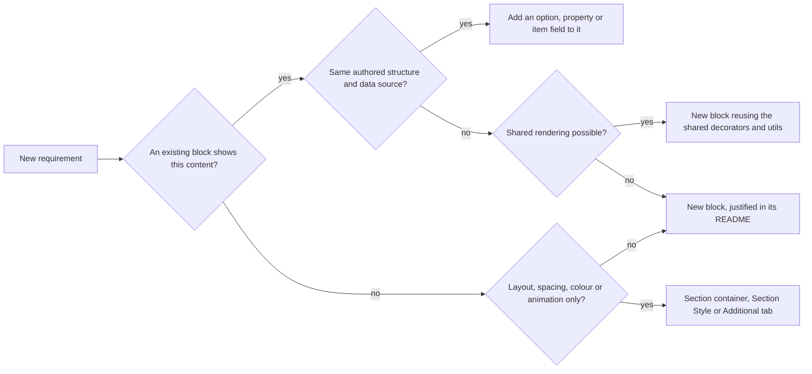

# Blocks: Governance Guide

This guide is the governance view of the blocks of the TCS Corporate Website (AEM Sites with Edge Delivery Services, xwalk / Universal Editor): which blocks exist, how they relate, which are active, compatibility-only or experimental, how variations are expressed, when an existing block should be extended and when a new block is justified, and which patterns are known to fail. It summarizes verified facts and links to the block documentation; the fields, variations and behaviour of each block are in its README.

| Attribute | Value |
| --- | --- |
| Audience | Developers, architects, content leads, QA and AI agents changing or reviewing blocks |
| Source of truth | [blocks/README.md](../../../blocks/README.md), `blocks/<block>/README.md`, [tools/docs/blocks.json](../../../tools/docs/blocks.json) (status, type, purpose, relationships), [tools/docs/library-snapshot.json](../../../tools/docs/library-snapshot.json) (library usage), [component-definition.json](../../../component-definition.json), [component-filters.json](../../../component-filters.json), [AGENTS.md](../../../AGENTS.md), [docs/audit/](../../../docs/audit/BLOCK-ECOSYSTEM-AUDIT.md) |
| Last reviewed | Written from main at commit 2d06316 on 21 October 2026 |
| Status | Current |

## At a Glance

| Fact | Value | Source |
| --- | --- | --- |
| Block folders | 30 (each with a README) | `blocks/` |
| Components in the editor | 62: Default Content 4 (Text, Title, Image, Button (basic)), Sections 1, Blocks 57 (blocks, items and section containers) | `component-definition.json` |
| Models / filters | 63 models, 26 filters | `component-models.json`, `component-filters.json` |
| Statuses | 28 Active, 1 Compatibility-only (Columns), 1 Experimental (Interactive Dashboard) | `tools/docs/blocks.json` |
| Block library | Package 1.0.13 of the language master (`/content/tcs-corp/language-master/en`): 157 block library pages and 11 curated design pages contain blocks | `tools/docs/library-snapshot.json` |
| Checks | `npm test` 311 tests passed and `npm run lint` passed on 21 October 2026 at commit 2d06316 | run for this guide |

## Block Types and Categories

The type and category of each block are kept by hand in `tools/docs/blocks.json` and rendered into [blocks/README.md](../../../blocks/README.md#blocks-by-category) by `npm run build:docs`.

| Type | Meaning | Blocks |
| --- | --- | --- |
| Independent | A block on its own, no child items | Button, Columns, Embed, Interactive Dashboard, Modal, Quote, Separator, TCS Header, Video |
| Container | A block with child items added with Add | Accordion, Anchor List, Cards, Conversation Canvas, Filter List, Form Variations, Hero, List, Page Header, Table, Table List, Teaser, Testimonial |
| Container (section) | A section that `scripts/scripts.js` wraps in a synthetic block | Columns Container, Gen Carousel, Tabs (Tabs Container; the folder also holds the Tabs block) |
| Child item | Only inside its parent | Column Break, Tab |
| Structural | Site chrome or page structure | Footer, Fragment, Header |

| Category | Blocks |
| --- | --- |
| Content | Button, Hero, Page Header, Quote, Table, Teaser, Testimonial |
| Navigation | Anchor List, Footer, Header, TCS Header |
| Listing | Cards, Filter List, List, Table List |
| Interactive | Accordion, Conversation Canvas, Form Variations, Modal |
| Media | Embed, Video |
| Structural | Separator |
| Container (section) | Columns Container, Gen Carousel, Tabs |
| Child item | Column Break, Tab |
| Utility | Fragment, Interactive Dashboard |
| Deprecated / compatibility-only | Columns |
| Layout | None: layout comes from the section containers and the Section Style |
| Personalization | None: no personalization runtime (Adobe Target, AJO) exists |

Default content (Text, Title, Image) uses AEM's built-in components, not blocks (handover Part 6, chapters 6.6 to 6.8).

## Block Inventory

One line per block folder; the field tables, variations and guidance are in each README. Status values follow the knowledge base vocabulary.

| Block (folder) | Type | Status | Purpose |
| --- | --- | --- | --- |
| [Accordion](../../../blocks/accordion/README.md) (`accordion`) | Container | Active | Expandable question / answer or detail panels (native details / summary) |
| [Anchor List](../../../blocks/anchor-list/README.md) (`anchor-list`) | Container | Active | In-page navigation to section anchors, optionally sticky |
| [Button](../../../blocks/button-block/README.md) (`button-block`) | Independent | Active | A link styled as a button, icon button or link button; replaces the built-in Button for new content |
| [Cards](../../../blocks/cards/README.md) (`cards`) | Container | Active | Manually authored cards with the List's presentation |
| [Column Break](../../../blocks/column-break/README.md) (`column-break`) | Child item | Active | Starts a column in a Columns Container or a Tab |
| [Columns](../../../blocks/columns/README.md) (`columns`) | Independent | Compatibility-only | The built-in Columns block; not offered in any filter; replaced by the Columns Container |
| [Columns Container](../../../blocks/columns-container/README.md) (`columns-container`) | Container (section) | Active | A section laid out in columns of default content and blocks |
| [Conversation Canvas](../../../blocks/conversation-canvas/README.md) (`conversation-canvas`) | Container | Active | Search prompt with quick actions; one floating journey across header, page and footer |
| [Embed](../../../blocks/embed/README.md) (`embed`) | Independent | Active | Third-party embeds (YouTube, Vimeo, X, other URLs) behind a privacy-friendly facade |
| [Filter List](../../../blocks/filter-list/README.md) (`filter-list`) | Container | Active | Filterable listing of the locale's pages from the query index |
| [Footer](../../../blocks/footer/README.md) (`footer`) | Structural | Active | Site footer bar on the footer reference page |
| [Form Variations](../../../blocks/form-variations/README.md) (`form-variations`) | Container | Active | Forms (contact, download, subscribe) built from field items |
| [Fragment](../../../blocks/fragment/README.md) (`fragment`) | Structural | Active | Includes the sections of another page |
| [Gen Carousel](../../../blocks/gen-carousel/README.md) (`gen-carousel`) | Container (section) | Active | A section whose Heroes or Teasers rotate as slides |
| [Header](../../../blocks/header/README.md) (`header`) | Structural | Active | Site header from the nav reference page (no model of its own: authored through the nav page) |
| [Hero](../../../blocks/hero/README.md) (`hero`) | Container | Active | Full-width banner with image or Lottie, title, description and CTAs |
| [Interactive Dashboard](../../../blocks/interactive-dashboard/README.md) (`interactive-dashboard`) | Independent | Experimental | Placeholder reserved for a future dashboard; renders nothing; in no filter |
| [List](../../../blocks/list/README.md) (`list`) | Container | Active | Child pages, a fixed list or tagged pages from the query index, as cards or links |
| [Modal](../../../blocks/modal/README.md) (`modal`) | Independent | Active | Opens a page's content in a dialog (button or auto-linked `/modals/` links) |
| [Page Header](../../../blocks/page-header/README.md) (`page-header`) | Container | Active | The title area of a page from its metadata |
| [Quote](../../../blocks/quote/README.md) (`quote`) | Independent | Active | A quotation with author, optional image and title |
| [Separator](../../../blocks/separator/README.md) (`separator`) | Independent | Active | A divider line between content |
| [Tab](../../../blocks/tab/README.md) (`tab`) | Child item | Active | Starts a tab panel in a Tabs Container |
| [Table](../../../blocks/table/README.md) (`table`) | Container | Active | A data table of rows with 1 to 5 columns |
| [Table List](../../../blocks/table-list/README.md) (`table-list`) | Container | Active | A numbered list of linked items (industries, services) |
| [Tabs](../../../blocks/tabs/README.md) (`tabs`) | Container (section) and block | Active | Tabs Container section (Tab items and content) and the Tabs block (tabs of fragments, `tabs-block`) |
| [TCS Header](../../../blocks/tcs-header/README.md) (`tcs-header`) | Independent | Active | The TCS and TATA logos of the header, on the nav page |
| [Teaser](../../../blocks/teaser/README.md) (`teaser`) | Container | Active | Title, text, image and links in one of four layouts |
| [Testimonial](../../../blocks/testimonial/README.md) (`testimonial`) | Container | Active | A client testimonial with author, image and stats |
| [Video](../../../blocks/video/README.md) (`video`) | Independent | Active | A DAM, YouTube or Vimeo video inline or in a pop-up, with poster and captions |

## Container and Child Relationships

The allowed children come from the filters in [component-filters.json](../../../component-filters.json); the full table is generated in [blocks/README.md](../../../blocks/README.md#container-and-child-relationships).

| Level | Filter | Allowed components |
| --- | --- | --- |
| Page (`main`) | `main` | Section, Gen Carousel, Tabs Container, Columns Container |
| Section | `section` | Text, Image, Button (`button-block`), Title, Page Header, Hero, Teaser, Quote, Testimonial, Anchor List, Accordion, Tabs block, Table, Table List, List, Separator, Embed, Video, Modal, Form Variations, Filter List, Conversation Canvas, Cards, Fragment, Footer, TCS Header |
| Columns Container | `columns-container` | Column Break and the section components except Page Header, Footer and TCS Header |
| Tabs Container | `tabs` | Tab, Column Break and the Columns Container components except Conversation Canvas (re-audit R-C-4: a Canvas in a hidden tab took over the floating Canvas) |
| Gen Carousel | `gen-carousel` | Hero, Teaser |

| Container block | Item components |
| --- | --- |
| Accordion | Accordion Item (`accordion-item`) |
| Anchor List | Anchor Link (`anchor-list-item`) |
| Cards | Card (`card`) |
| Conversation Canvas | Conversation Canvas Button (`conversation-canvas-button`) |
| Filter List | Filter Tag, Filter Category, Filter Page (`filter-list-tag`, `filter-list-category`, `filter-list-page`) |
| Footer | Footer Link (`footer-link`) |
| Form Variations | `field-text`, `field-select`, `field-textarea`, `field-checkbox`, `contact-card`, `field-submit` |
| Hero | CTA (`hero-cta`) |
| List | List Item (`list-item`) |
| Page Header | CTA (`page-header-cta`) |
| Table | Row (`table-row`; `table-col-2` to `table-col-5` through the `table-n-columns` filters) |
| Table List | Table List Item (`table-list-card`) |
| Tabs block | Tab (`tabs-item`) |
| Teaser | Link (`teaser-link`), Stat (`teaser-stat`) |
| Testimonial | Stat (`testimonial-stat`) |

How the relationships work:

- **Items are rows of their block.** AEM renders each item as a row with a cell per field (empty cells and one empty cell per dialog tab included) after the block's own rows. `itemRows` in [utils/cells.js](../../../utils/cells.js) finds them by `data-aue-model` in Universal Editor and by their cell count on the page (`KEY_VALUE_ITEM`: 1 or 3+ cells; `FIELD_ROW_ITEM`: 2+ cells), tested in `test/items/item-rows.test.mjs`. Items have no folder and are documented in their block's README.
- **Section containers.** A section can't hold a section, so columns inside a tab are Column Breaks (`columnsOf` in `blocks/tabs/tabs.js`), not a Columns Container. `scripts/scripts.js` `buildColumnsSections`, `buildTabsSections` and `buildCarouselSections` wrap the section in a synthetic block and `applySectionBlockOptions` turns the `container*` fields into its classes.
- **Template names are block classes.** AEM renders a block with the class-name form of its template name, not its component id ("Column Break" becomes `column-break`, "Button Block" becomes `button-block`); `test/models/block-names.test.mjs` checks that each template name names a block folder.
- **Site chrome.** The Header loads the nav page (with its TCS Header and an optional Conversation Canvas) and the Footer the footer page, both through the Fragment loader; Header and Canvas communicate only through the `header:menu` event ([AGENTS.md](../../../AGENTS.md#blocks), "Header", "Floating Canvas").

## Lifecycle Status

| Status | Meaning in this project | Blocks and components |
| --- | --- | --- |
| Active | Offered in a filter, maintained, documented | 28 block folders (all except Columns and Interactive Dashboard), the item components above |
| Compatibility-only | Not offered for new content; the definition and code stay so content authored before renders and stays editable | Columns (`columns`, built-in Columns, replaced by Columns Container / Column Breaks); Button (basic) (built-in `core/franklin/components/button/v1/button`, model `button-basic`, replaced by the Button block); the former shared `button` model (kept for components authored before); the legacy composite multifields of Hero, Teaser, Page Header, Testimonial, List, Filter List, Anchor List and Footer (labelled "authored before" in the dialog, still read by the code) |
| Deprecated | Scheduled for removal | None recorded as a separate status: the replaced components are kept as Compatibility-only until production content is checked (audit deferral D-B-14) |
| Experimental | Placeholder, not for live pages | Interactive Dashboard (renders nothing, in no filter; one library instance stays editable) |
| Unused candidate | No usage found | None recorded. Columns has 0 instances in the library package (its 37 library instances were migrated), but production usage is not verified |
| Requires validation | Behaviour not verifiable from the repository | Production usage of compatibility-only components and legacy multifields (blocked: AEM author access or a content export) |

The deprecation precedents (built-in Columns and Button, PR #119; audit section 4) define how a block is retired: remove it from every filter, keep its definition and model, keep the code reading its content, migrate the block library content (`.home-work/bl/bl-migrate.mjs`, not in git), record the replacement and the migration in the block README and `tools/docs/blocks.json` (`replacement`, `deprecation`), and leave production content until its usage is known ([BLOCK-ECOSYSTEM-AUDIT.md](../../../docs/audit/BLOCK-ECOSYSTEM-AUDIT.md), sections 4 and 11).

## Variation Strategy

A visual or behavioural variant is expressed inside the existing block, in this order of preference:

| Mechanism | How it reaches the code | Examples | Rule |
| --- | --- | --- | --- |
| Block option (`classes` select / multiselect, `classes_<name>`) | Values become classes on the block; they never shift content rows | Teaser Layout `classes` (`no-image`, `background`, `card`); Hero `classes_alignment`, `classes_horizontal`, `classes_media`; Page Header `classes` (`landing`, `secondary`, `article`, `display`); Conversation Canvas `classes`, `classes_journey`, `classes_actions` | Use for presentation; every value must be applied by the CSS or JavaScript |
| Key-value property | A `name \| value` row read with `readProperties` (`utils/properties.js`) | List / Cards layout per breakpoint, Separator settings, Video playback | Use for settings-heavy blocks (17 key-value blocks) |
| Shared presentation group | One field group reused by several models | `models/_card-list.json` groups `header`, `cards`, `layout`, `scroll`, `advanced` used by List and Cards | Reuse the group instead of copying fields |
| Additional tab | `classes_*` fields (blocks) or `container*` fields (section containers) | Anchor ID, Hide block, padding, margin, Animation Type, Motion Speed, Animation Trigger, Background animation | Never re-implement spacing, anchors or animation as block fields |
| Background colour | Shared labels, classes and tokens | Teaser BG Color, Columns Container BG Color (`containerBgColor`), Section Style (`bg-grey`, `bg-dark`, `bg-dark-green`) | Sets only the colour; use the theme tokens for text |
| Item model | Child items with their own fields | Card style and Card colour per Card / List Item; Teaser Link and Stat | Repeating content is items, never a new block per variant |

Duplicate options were removed in the audit in favour of one canonical control: Hero and Table List Motion Type became the Additional tab animations (`addLegacyMotion` in `utils/motion.js` still maps old values), List / Cards Component ID became the Anchor ID, Separator Width "Auto" and Variant "Custom" were dropped, Quote / Testimonial Style (one option, no effect) and the Teaser Personalization option (no runtime) were removed ([BLOCK-ECOSYSTEM-AUDIT.md](../../../docs/audit/BLOCK-ECOSYSTEM-AUDIT.md), section 4). A new option must do something on the delivered page; options AEM never delivers (the built-in Button's View, Icon and Alignment; the built-in Columns' Additional tab) are not offered.

## Dialog Standards

The dialog rules are in [universal-editor.md](./universal-editor.md); the essentials for block governance:

- At most three short tabs per model, the last one Additional (28 models have an Additional tab; Header and Footer have none).
- Every block model except Header and Footer has the Additional tab; section containers use `container*` fields because AEM doesn't deliver a section's `classes_*` fields (re-audit R-L-1).
- No sample content in templates or model defaults: definition template values are stored on every new component (re-audit R-A-6, R-C-10, R-C-11, R-D-9). The Submit Button label "Send" is a retained exception (re-audit review D, low).
- Field names avoid the collapse suffixes Text, Title, Type, Alt and MimeType unless the field is meant to fold into its base field (`buttonVariant`, not `buttonType`).
- Repeating content is items, not composite multifields.

## Reuse Strategy

| Shared need | Module | Used by |
| --- | --- | --- |
| Buttons, icon buttons, link buttons | `decorators/button-decorator.js`, `icon-button-decorator.js`, `content-buttons-decorator.js` | most blocks; every button goes through them |
| Cards, list layout, horizontal scroll | `decorators/card-list-decorator.js`, `utils/card-list-config.js`, `decorators/scroller-decorator.js`, `styles/card-list.css` | List, Cards |
| Article meta (date, reading time, actions, author) | `decorators/article-meta-decorator.js` | Page Header, Teaser, Filter List, card list decorator |
| Stats | `decorators/stats-decorator.js` | Teaser, Testimonial |
| Item rows and properties | `utils/cells.js`, `utils/properties.js` | every container and key-value block |
| Animation, skeletons, data layer | `decorators/motion-decorator.js`, `skeleton-decorator.js`, `data-layer-decorator.js` | all blocks (central) |
| UI text | `utils/placeholders.js` | every block with UI text |

The full module inventory and the rules for shared code are in [decorators-and-utilities.md](./decorators-and-utilities.md). A block that needs behaviour another block already has imports the shared module (or moves the behaviour into one), it doesn't copy it ([AGENTS.md](../../../AGENTS.md#shared-code-decorators-and-utils)).

## Extend an Existing Block or Create a New One

The audits assessed every pair of similar blocks and retained both only where the authored structure, the data source or the design component differs ([BLOCK-ECOSYSTEM-AUDIT.md](../../../docs/audit/BLOCK-ECOSYSTEM-AUDIT.md), section 4):

| Pair | Decision | Reason |
| --- | --- | --- |
| Cards / List / Table List | Retain all three | List lists pages (query index, child pages, fixed list), Cards holds authored cards, Table List is rows; Cards and List share the card list code |
| Hero / Teaser / Page Header | Retain | Different structures; Page Header comes from page metadata |
| Quote / Testimonial | Retain | Separate Figma components |
| Tabs Container / Tabs block | Retain both | The block shows fragments; the container holds authored content |
| Embed / Video | Retain | Third-party embeds vs DAM / provider video with poster and captions |
| Table / Table List | Not redundant | Data table vs linked list |
| TCS Header / Header | Not redundant | Logos on the nav page vs the site header |
| Columns / Columns Container | Columns hidden (compatibility-only) | Default content only, no Additional tab; the container lays out blocks |
| Button (basic) / Button block | Button (basic) hidden (compatibility-only) | Built-in Button delivers only link, text, title and Primary / Secondary |

Extend the existing block when the requirement is a visual variant, a layout per breakpoint, a colour, spacing, an animation, an extra optional field or another value of an existing option. A new block is justified only when the authored contract (rows, cells, items) would have to change incompatibly, the data source differs, the semantics or interaction differ (a form, a dialog, a carousel), or the design system defines a separate component. Record the justification in the new block's README ("For Architects") and in `tools/docs/blocks.json` (`related`).

## Anti-Patterns

| Anti-pattern | What went wrong | Do instead | Source |
| --- | --- | --- | --- |
| Composite multifields for repeating content (`container` with `multi: true`) | Didn't render from content packages | Item children added with Add; keep reading the multifields authored before | AGENTS.md "Item children" |
| Duplicate blocks for a variant | Two blocks to maintain, authors pick inconsistently | An option or property of the existing block | Audit section 4 |
| Duplicate options (block field and Additional tab doing the same) | Conflicting values; Hero Motion Type vs Animation Type | One canonical control; map legacy values in code | Audit section 4 |
| Per-block re-implementation of buttons, ids, links, placeholders, scrolling | Inconsistent behaviour and accessibility | Import the decorator or util; move shared code there | AGENTS.md "Shared code: decorators and utils" |
| `classes_*` fields on sections | AEM doesn't deliver them: the container Additional tab had no effect (R-L-1) | `container*` fields, applied by `applySectionBlockOptions` | AGENTS.md "AEM delivery rules", re-audit |
| A field ending in Text, Title, Type, Alt or MimeType that must be read on its own | It collapses into its base field (`linkType` becomes bold / italic around the link) | Another name (`buttonVariant`) | AGENTS.md "AEM delivery rules" |
| Grouped fields (`prefix_name`) in key-value blocks | Not delivered (Video `placeholder_image`, poster lost: audit L-2) | Plain names (`poster`, `posterAlt`) | AGENTS.md "AEM delivery rules" |
| Reading "the first row" of a non key-value block | AEM adds an empty row per dialog tab (forms empty on the live site, D-D-1; Table header row, Accordion empty item) | Read rows by `data-aue-prop` in the editor, skip empty tab rows on the page | AGENTS.md "AEM delivery rules" |
| Relying on an item's `name` for case-sensitive keys | Delivered in class-name form (`firstName` becomes `firstname`, R-D-1) | A dedicated field (Form Variations `fieldName`) | AGENTS.md "AEM delivery rules" |
| Sample content in templates or model defaults | Stored on every new component (Table List "Explore", Tab "Tab", Lorem Ipsum, "Column1") | Empty templates; UI text from placeholders | Re-audit R-A-6, R-C-10, R-C-11, R-D-9 |
| A block class equal to a global class | `button` would clash with `.button` links | Distinct template name ("Button Block") | AGENTS.md "Button" |
| Options AEM never delivers or no code reads | Dead dialog controls (built-in Button View / Icon, Teaser Personalization) | Remove them; verify on aem.page | Audit section 1 |
| Removing a block or field without migration | Content authored before breaks | Hide from filters, keep reading old values, migrate content | Audit section 11 |
| Canvas logic in header or footer code | Coupled chrome | `header:menu` event and the Canvas controller | AGENTS.md "Floating Canvas" |
| Hard-coded user-facing strings | Not translatable per locale | `getPlaceholders()` with an English fallback | AGENTS.md "Accessibility", `utils/placeholders.js` |
| Testing only the local preview | Four delivery rules were missed until compared with aem.page (L-4) | Compare aem.page with the local preview after model changes | Audit sections 1 and 13 |

## Block Library and Curated Design Pages

The block library and the curated design pages are AEM content of the language master (`/content/tcs-corp/language-master/en/block-library/...` and `.../curated-design-pages/...`), built as a content package from the corrected models; the build workspace (`.home-work/`, with `render-lib.mjs` for the local preview and `bl/bl-migrate.mjs` for migrations) is not in git. Each locale also has a `block-library/` folder, excluded from publishing in `paths.json`; the language master is published at `/language-master/en` while it is under review (temporary, `REVIEW_*` in `utils/site.js`).

Uses:

- **Validation of every variation**: each block has library pages (e.g. `block-library/list/sources`, `block-library/animation/speed-and-trigger`, `block-library/foundations/section-colours-with-blocks` for the dark-background theme contract).
- **Design reference**: 11 curated design pages (case study, collection, home, industry landing page, insights, media and investor, product, services, story, what we do, who we are) rebuild Figma page designs from blocks.
- **Regression runs**: the audits loaded every library and curated page at 5 widths with axe and data-layer checks (188 pages, 940 loads) and compared aem.page with the local preview.
- **Example values in the READMEs**: `npm run build:docs` reads the library snapshot for the "Example" column and the usage section of each README.

Usage recorded in [tools/docs/library-snapshot.json](../../../tools/docs/library-snapshot.json) (package 1.0.13; instances in all pages; pages counted once per block; "other" are the dummy pages used as List and Filter List sources):

| Block | Instances | Library pages | Curated pages | Other pages |
| --- | --- | --- | --- | --- |
| [Accordion](../../../blocks/accordion/README.md) | 8 | 4 | 0 | 0 |
| [Anchor List](../../../blocks/anchor-list/README.md) | 5 | 3 | 2 | 0 |
| [Button](../../../blocks/button-block/README.md) | 79 | 18 | 0 | 1 |
| [Cards](../../../blocks/cards/README.md) | 70 | 14 | 4 | 0 |
| [Column Break](../../../blocks/column-break/README.md) | 161 | 13 | 0 | 0 |
| [Columns](../../../blocks/columns/README.md) | 0 | 0 | 0 | 0 |
| [Columns Container](../../../blocks/columns-container/README.md) | 38 | 9 | 0 | 0 |
| [Conversation Canvas](../../../blocks/conversation-canvas/README.md) | 33 | 8 | 3 | 0 |
| [Embed](../../../blocks/embed/README.md) | 6 | 1 | 0 | 0 |
| [Filter List](../../../blocks/filter-list/README.md) | 32 | 8 | 2 | 1 |
| [Footer](../../../blocks/footer/README.md) | 3 | 3 | 0 | 0 |
| [Form Variations](../../../blocks/form-variations/README.md) | 19 | 5 | 0 | 0 |
| [Fragment](../../../blocks/fragment/README.md) | 1 | 1 | 0 | 0 |
| [Gen Carousel](../../../blocks/gen-carousel/README.md) | 5 | 5 | 0 | 0 |
| [Header](../../../blocks/header/README.md) | Not recorded (authored through the nav page) | 0 | 0 | 0 |
| [Hero](../../../blocks/hero/README.md) | 182 | 13 | 5 | 123 |
| [Interactive Dashboard](../../../blocks/interactive-dashboard/README.md) | 1 | 1 | 0 | 0 |
| [List](../../../blocks/list/README.md) | 240 | 47 | 9 | 85 |
| [Modal](../../../blocks/modal/README.md) | 3 | 3 | 0 | 0 |
| [Page Header](../../../blocks/page-header/README.md) | 18 | 15 | 3 | 0 |
| [Quote](../../../blocks/quote/README.md) | 12 | 3 | 2 | 0 |
| [Separator](../../../blocks/separator/README.md) | 118 | 3 | 0 | 0 |
| [Tab](../../../blocks/tab/README.md) | 53 | 4 | 0 | 0 |
| [Table](../../../blocks/table/README.md) | 12 | 1 | 0 | 0 |
| [Table List](../../../blocks/table-list/README.md) | 23 | 6 | 6 | 0 |
| [Tabs](../../../blocks/tabs/README.md) (container and block) | 24 | 7 | 0 | 0 |
| [TCS Header](../../../blocks/tcs-header/README.md) | 2 | 2 | 0 | 0 |
| [Teaser](../../../blocks/teaser/README.md) | 172 | 18 | 11 | 0 |
| [Testimonial](../../../blocks/testimonial/README.md) | 17 | 3 | 4 | 0 |
| [Video](../../../blocks/video/README.md) | 27 | 2 | 0 | 0 |

These counts describe the library package, not production usage; production usage is not recorded in the repository.

## Governance Rules

1. **Check the existing blocks first.** Read the inventory above, [blocks/README.md](../../../blocks/README.md) and the candidate block's README ("Variations", "Extending the Block") before proposing a block.
2. **Prefer a variation or a property.** Add an option, a property or an item field to the existing block (see Variation Strategy); a new block needs the justification of the section above.
3. **Preserve container-child patterns.** Keep the item models, their cell layout (`ITEM_LAYOUT`, `CARD_LAYOUT` and the tests in `test/`) and the filters; adding a tab to an item model adds a cell to its rows.
4. **Child items aren't redundant.** Accordion Items, Cards, CTAs, Links, Stats, List Items, Column Breaks, Tabs and form fields are the authored content of their container; they look like small blocks but are rows of their parent and are never consolidated into the parent's fields or removed as duplicates.
5. **Remove or deprecate only after usage and migration analysis.** Measure usage (library snapshot and production content), define the replacement and the value mapping, keep the code reading the old values, migrate the content, then hide the component from the filters; delete the definition only when no content uses it.
6. **One canonical control per behaviour.** No option may duplicate the Additional tab, the Section Style or another field.
7. **Verify on aem.page.** After a model change compare the published preview with the local preview; the delivery rules in [AGENTS.md](../../../AGENTS.md#blocks) are what AEM really renders.
8. **Keep the documentation generated and current.** `npm run build:json`, `npm run build:docs`, `npm run build:modules` after the respective changes; `npm test` fails on stale generated sections, broken links and stale module graphs.

## Change Checklist for a Block

| Step | Check |
| --- | --- |
| Model | `_<block>.json` edited, `npm run build:json`, `npm run lint` (xwalk rules) passed |
| Filters | New block added to `section` (and `columns-container` / `tabs` where it belongs); items to their container's filter |
| Code | Shared decorators / utils used; placeholders for UI text; `data-cmp-*` attributes for interactions |
| Animation | New animated blocks added to `CONTENT_TARGETS` / `BACKGROUNDS` in `decorators/motion-decorator.js` and the fields to the model |
| Imports | `npm run build:modules` after adding or changing an import |
| Tests | Unit tests for pure logic in `test/`; `npm test` passed |
| Library | Library page with every variation; aem.page compared with the local preview |
| Docs | Block README written sections, `tools/docs/blocks.json`, `npm run build:docs`; handover component chapter and revision history for significant changes |

## Related

- [universal-editor.md](./universal-editor.md): models, definitions, filters, dialog and field conventions
- [decorators-and-utilities.md](./decorators-and-utilities.md): shared modules and their rules
- [blocks/README.md](../../../blocks/README.md): generated inventory, categories, relationships and shared conventions
- [docs/blocks/BLOCK-DOCUMENTATION-REPORT.md](../../../docs/blocks/BLOCK-DOCUMENTATION-REPORT.md): documentation inventory and handover-vs-code discrepancies
- [docs/audit/BLOCK-ECOSYSTEM-AUDIT.md](../../../docs/audit/BLOCK-ECOSYSTEM-AUDIT.md) and [docs/audit/REAUDIT-2026-10-20.md](../../../docs/audit/REAUDIT-2026-10-20.md): audits, redundancy assessments, migrations
- [docs/proposals/README.md](../../../docs/proposals/README.md): the open Cards and Card refactoring proposal (decisions D-1 to D-6 open)
- [docs/animation/README.md](../../../docs/animation/README.md): animation and skeleton loading
- [AGENTS.md](../../../AGENTS.md): project rules
- Handover Part 6 — Component Library and Part 15.4 — Content Modeling Standards: [TCS-CORP-HANDOVER.md](../TCS-CORP-HANDOVER.md)
- Other knowledge base files: [architecture.md](./architecture.md), [authoring.md](./authoring.md), [design-system.md](./design-system.md), [accessibility.md](./accessibility.md), [data-layer-and-analytics.md](./data-layer-and-analytics.md), [testing-and-quality.md](./testing-and-quality.md), [decision-log.md](./decision-log.md)
