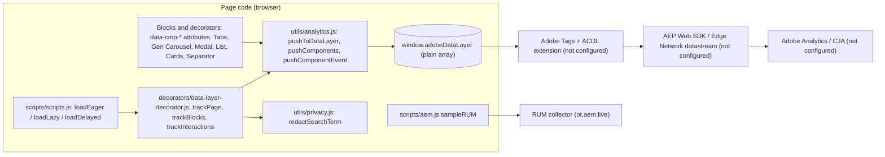
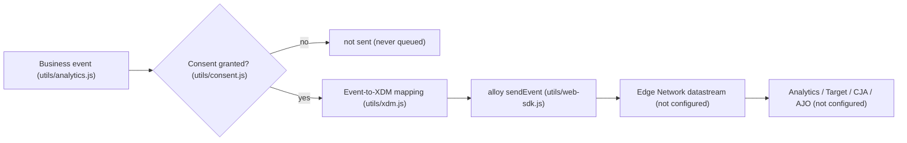

# Data Layer and Analytics

This file describes the analytics foundation that is implemented in the repository: the Adobe Client Data Layer (`window.adobeDataLayer`) that every page and block fills, the entries and events it holds, how blocks refine it, what is measured today, and what is not configured (Adobe Tags, the AEP Web SDK, Analytics, CJA). It summarizes the code and links to the detailed sources; the handover Part 11 (Analytics & Data Layer) holds the long-form reference with examples.

| Attribute | Value |
| --- | --- |
| Audience | Developers, analytics engineers, QA, AMS / operations, AI agents |
| Source of truth | [`decorators/data-layer-decorator.js`](../../../decorators/data-layer-decorator.js), [`utils/analytics.js`](../../../utils/analytics.js), [`utils/privacy.js`](../../../utils/privacy.js), [`scripts/scripts.js`](../../../scripts/scripts.js), [`decorators/README.md`](../../../decorators/README.md) (Data layer), [`AGENTS.md`](../../../AGENTS.md) (Data layer), handover Part 11 — Analytics & Data Layer ([`TCS-CORP-HANDOVER.md`](https://github.com/sradha-tcs/tcs-corp-delivery/blob/main/archive/docs-before-role-docs-2026-11-08/docs/handover/TCS-CORP-HANDOVER.md)) |
| Last reviewed | Written from main at commit 2d06316 on 21 October 2026 |
| Status | Current (data layer); Requires validation (Adobe Tags, Web SDK, Analytics, CJA, consent: blocked, measurement plan) |

## Status at a glance

| Capability | Status | Where |
| --- | --- | --- |
| Data layer array `window.adobeDataLayer` (created on the first push, `window.adobeDataLayer \|\| []`) | Active | `utils/analytics.js` `pushToDataLayer` |
| Page entry (once per page) | Active | `trackPage` |
| Component entry per block (once per block) | Active | `trackBlocks` |
| Events `page:view`, `cmp:click`, `cmp:show`, `cmp:hide`, `cmp:media`, `cmp:mediaProgress`, `cmp:search`, `cmp:formStart`, `cmp:submit`, `cmp:formSuccess`, `cmp:formError`, `cmp:change`, `app:error` | Active | `trackInteractions` (document listeners) and Tabs, Gen Carousel, Modal, Form Variations (`form:result`) |
| Event id, timestamp, schema version 1.0, sanitizing, validation, duplicate protection | Active (unit tested, KB-D-074) | `utils/analytics.js`, `test/analytics/data-layer.test.mjs` |
| Richer state for List, Cards, Separator, Tabs panels | Active | `decorators/card-list-decorator.js` `trackCardList`, `blocks/separator/separator.js`, `blocks/tabs/tabs.js` |
| Search term redaction | Active (unit tested) | `utils/privacy.js` `redactSearchTerm`, `test/privacy/privacy.test.mjs` |
| Adobe Client Data Layer library (`getState()`, `addEventListener()`) | Not loaded: the array stays a plain JavaScript array | — |
| Event-to-XDM mapping, Web SDK bridge, environment configuration template | Ready, off until configured (KB-D-074) | `utils/xdm.js`, `utils/web-sdk.js` (started by `scripts/delayed.js` with metadata web-sdk = on), `tools/web-sdk/web-sdk.template.csv`, `test/analytics/xdm-web-sdk.test.mjs` |
| Adobe Tags (Data Collection), AEP Web SDK, Edge Network, datastreams, XDM schema | Blocked: measurement plan (not configured) | — |
| Adobe Analytics, Customer Journey Analytics | Blocked: measurement plan (not configured) | — |
| Consent interface for a CMP | Ready, no CMP (every category unknown: nothing sent) | `utils/consent.js` |
| Consent management platform, visitor identity | Not implemented | — |
| Personalized impressions | None (no personalization runtime) | [Personalization](./personalization.md) |
| Real User Monitoring (RUM, including the 404 checkpoint) | Active (platform) | `scripts/aem.js` `sampleRUM`, `404.html` |

Nothing is sent to an analytics server by project code today: the data layer lives only in the visitor's browser until a tag manager processes it. RUM (`sampleRUM`, part of the Edge Delivery library) is the only measurement that leaves the page.

## Architecture



## Modules

| Module | Exports | Role |
| --- | --- | --- |
| [`utils/analytics.js`](../../../utils/analytics.js) | `pushToDataLayer(entry)`, `pushComponents(components)`, `pushComponentEvent(event, id, info)` | Low-level pushes; every push is wrapped in `try / catch` so analytics never breaks rendering or links |
| [`decorators/data-layer-decorator.js`](../../../decorators/data-layer-decorator.js) | `trackPage()`, `trackBlocks(container)`, `trackInteractions()`, `componentIdOf(block)` | Page and component state, document-wide listeners (capture phase), component ids |
| [`decorators/card-list-decorator.js`](../../../decorators/card-list-decorator.js) | `trackCardList(block, options)` | List and Cards state with one entry per card |
| [`blocks/separator/separator.js`](../../../blocks/separator/separator.js), `separator-config.js` | `analyticsEntry(config, id)` | Separator state (opt-in Analytics field) |
| [`blocks/tabs/tabs.js`](../../../blocks/tabs/tabs.js), [`blocks/gen-carousel/gen-carousel.js`](../../../blocks/gen-carousel/gen-carousel.js), [`blocks/modal/modal.js`](../../../blocks/modal/modal.js) | — | `cmp:show` for tab panels, slides and dialogs; Tabs also pushes its panels as components |
| [`decorators/skeleton-decorator.js`](../../../decorators/skeleton-decorator.js) | `showSkeleton` | Marks a block `data-analytics="pending"` while its skeleton shows and tracks it once rendered |
| [`utils/privacy.js`](../../../utils/privacy.js) | `redactSearchTerm(value)` | Data minimisation of search terms |
| [`utils/viewport.js`](../../../utils/viewport.js) | `currentBreakpoint()` | `breakpoint` of clicks: `mobile` (< 600px), `tablet` (600–1199px), `desktop` (>= 1200px) |
| [`utils/metadata.js`](../../../utils/metadata.js) | `getPageMetadata()`, `getPageLanguage()`, `getPageTags()` | Page entry values |

## When entries are pushed

| Phase (`scripts/scripts.js`) | Call | What is pushed |
| --- | --- | --- |
| Eager, start of `loadEager` | `trackInteractions()` | The page entry (first entry); the document listeners start |
| Eager and lazy, while blocks decorate | `trackCardList`, Separator, Tabs | List / Cards (and their cards), Separator (when its Analytics is on), tab panels |
| Lazy, after `loadMainSections(main)` | `trackBlocks(main)` | One entry for every block in `main` not yet tracked |
| Skeleton removed (List, Filter List) | `trackBlocks(block.parentElement)` | The block once it has rendered, not its skeleton |
| Delayed, 3 seconds after load (`loadDelayed`) | `trackBlocks(document)`, then `import('./delayed.js')` | Header, footer and blocks added later (for example modals); `delayed.js` adds nothing today |
| Any time | document listeners, Tabs, Gen Carousel, Modal | `cmp:*` events |

The same code runs in Universal Editor, so entries are also pushed while authors edit (nothing leaves the browser).

## Page entry

`trackPage()` pushes one entry: `{ page: { 'page-{hash}': { ... } } }`. The id is `page-` plus a djb2-style hash of `window.location.pathname` in base 36, so the same path always gets the same id.

| Field | Value |
| --- | --- |
| `@type` | `tcs-corp/components/page` |
| `dc:title` | The sheet's `meta-title`, else the dialog's Title (`og:title`, else `document.title`; `utils/sheet-metadata.js`) |
| `xdm:language` | The `language` metadata when it is a language code, else the locale's language tag (`utils/site.js`) |
| `xdm:template` | The Page Type (the sheet's `sheet-page-type` metadata, else the page's `page-type`); omitted when empty |
| `xdm:tags` | `article:tag` meta values and the `cq-tags` meta, else the comma-separated `tags` meta; de-duplicated |
| `repo:path` | `window.location.pathname` (the published path) |

Region, country, persona, content type, author and campaign id are page metadata (`utils/metadata.js`) but are not in the page entry. There is no separate page-view event: the page entry is the page-view signal a future Tags rule would use.

## Component entries, naming and ids

### Generic entries

`trackBlocks(container)` adds every decorated `.block` once: `{ component: { '{id}': { ... } } }`.

| Field | Value |
| --- | --- |
| (key) | The component id (`componentIdOf`, below) |
| `@type` | `tcs-corp/components/{block}`: the block's `data-block-name`, else its first class (for example `teaser`, `hero`, `header`, `footer`, `columns-container`) |
| `parentId` | The id of the nearest enclosing block (a Hero in a Gen Carousel, a block in a Fragment), else the page id |
| `dc:title` | The first heading (`h1`–`h6`) of the block: its `aria-label` or text, whitespace collapsed, at most 100 characters; omitted without a heading |

A block is skipped when it already has `data-cmp-tracked`, or when it or an ancestor carries `data-analytics` (`off`, `custom` or `pending`). Blocks hidden with the Additional tab's Hide block are still added. The Tab and Column Break markers set `data-analytics="off"` so they aren't registered as components.

### Component ids

`componentIdOf(block)` stores the id as `data-cmp-id`:

1. An existing `data-cmp-id`.
2. Else the block's `id`: the Anchor ID of the Additional tab (`decorators/block-options-decorator.js`), the Component ID of List, Cards and Separator, or an id the block sets itself.
3. Else `{block}-{n}`: a counter per block name in the order ids are first requested (normally page order), for example `teaser-1`, `teaser-2`.

`{block}-{n}` ids shift when blocks are added, removed or reordered; give blocks that matter for reporting a stable Anchor ID (or Component ID).

### Item ids and positions

| Block | Child component ids | Position |
| --- | --- | --- |
| List | `{list id}-item-{hash}` per card (`@type` `tcs-corp/components/list/item`) | `xdm:position` in the card entry; `data-cmp-position` on the card `li` (the feature card is position 1) |
| Cards | `{cards id}-item-{n}` per card (`tcs-corp/components/cards/item`) | As List |
| Tabs (block and Tabs Container) | Each panel id (`tcs-corp/components/tabs/item`, `parentId` the Tabs block); columns built in a panel get `{panel id}-columns` | — |
| Gen Carousel | `data-cmp-id` per slide (`{carousel}-slide-{n}`); slides aren't component entries | `position` in `cmp:show` |

Card entries carry `dc:title` (the item's Analytics label, else its title, else the start of its description), `xdm:linkURL`, `xdm:position` and `repo:modifyDate`. The List entry adds `xdm:listSource` (`parent`, `fixed`, `tags`) and `xdm:variant`; the Separator entry adds its configured options (see [`blocks/separator/README.md`](../../../blocks/separator/README.md)).

Variations are not recorded as a generic field: only List / Cards (`xdm:variant`, the card style or `links`) and Separator push a variant. Block classes (Additional tab, Style) are not in the entries.

## Events

All events use the envelope pushed by `pushComponentEvent`:

```json
{ "event": "cmp:click", "eventInfo": { "path": "component.{id}", "...": "..." } }
```

`eventInfo.path` is `component.{id}`, or `page.page-{hash}` for clicks outside any block (links in default content). The component of an event (`componentOf`) is the nearest `data-cmp-id` inside the same block (a card, a slide), else the block, else the page. The document listeners run once, in the capture phase.

| Event | Fires when | Extra `eventInfo` fields | Not pushed for |
| --- | --- | --- | --- |
| `cmp:click` | Click on `a[href]`, `button`, `[role="tab"]`, `[role="button"]` in a block, or a link in `main` default content | `interaction` (`data-cmp-interaction`, else `link` / `button`), `dc:title` (label, 100 characters), `xdm:linkURL`, `xdm:linkType` (`download`, `exit`, `other`), `value` (`data-cmp-value`), `position` (`data-cmp-position` of the element or its item), `breakpoint` | `summary` elements; elements in `data-analytics="off"`; the submit button of a search form; the click ending a scroller drag (`data-dragged`); `aria-disabled="true"` controls; elements outside blocks and outside `main` links |
| `cmp:show` | An accordion `<details>` opens (`toggle`); the user selects another tab; the active Gen Carousel slide changes (not the first slide on load; autoplay changes included); a Modal opens | `dc:title` (item or tab label), `position` (slide), `interaction: 'dialog'` (Modal) | The initial tab and the first slide |
| `cmp:hide` | An accordion item closes; any `<dialog>` closes (close button, Escape, backdrop) | `dc:title` (item), `interaction: 'dialog'` | — |
| `cmp:media` | `play`, `pause`, `ended` of a `<video>` / `<audio>` in a block | `interaction` (the event type), `xdm:mediaURL` (`currentSrc`), `position` (seconds) | Background videos (no controls, loop, muted); play / pause made by the page (`data-cmp-auto`, set by the Video block's off-screen pause / resume); YouTube and Vimeo iframes |
| `cmp:search` | Submit of a form in a block with `role="search"` or an `input[type="search"]` (today the Conversation Canvas search) | `xdm:searchTerm`: the redacted term | Empty terms (after redaction) |
| `cmp:submit` | Submit of any other form in a block (today Form Variations) that passes the browser's constraint validation (`novalidate` forms are checked with `checkValidity()`) | `dc:title` (the form's `aria-label`, else its `aria-labelledby` heading text, else its id, else the block name), `fields` (unique field names, never values) | Invalid submissions |
| `cmp:change` | `change` of an `input` / `select` with `data-cmp-interaction` (today Filter List options) | `interaction`, `value` (`data-cmp-value`, else the control value: the tag id), `checked` (checkboxes) | Controls without `data-cmp-interaction` (all Form Variations fields) |

`xdm:linkType` is `download` when the link has a `download` attribute or its URL ends in `.pdf`, `.doc(x)`, `.xls(x)`, `.ppt(x)`, `.zip`, `.csv`, `.txt`, `.mp3` or `.mp4`; `exit` when it goes to another origin (also `mailto:` and `tel:` links); else `other`.

Pushes outside the listeners: Tabs `cmp:show` (`blocks/tabs/tabs.js`, also the DOM event `tabs:change`), Gen Carousel `cmp:show`, Modal `cmp:show` (`blocks/modal/modal.js`). Tab buttons also push a `cmp:click` (`interaction` `button`). Other DOM events (`form-variations:submit`, `conversation-canvas:search`, `header:menu`, `tabs:reveal`) are not in the data layer.

## data-cmp-* attributes

| Attribute | Set by | Effect |
| --- | --- | --- |
| `data-cmp-id` | `componentIdOf` on blocks; blocks on child components (cards, slides) | The component of events inside it |
| `data-cmp-interaction` | Blocks and decorators on links, buttons, inputs | `interaction` of `cmp:click`; makes an input / select push `cmp:change` |
| `data-cmp-value` | Blocks on links, buttons, inputs | `value` of `cmp:click` / `cmp:change` (for example a filter tag id or `all`) |
| `data-cmp-position` | `decorators/card-list-decorator.js` on card items | `position` of `cmp:click` (1-based) |
| `data-cmp-tracked` | `trackBlocks` | Prevents a second state entry |
| `data-cmp-auto` | `blocks/video/video.js` before an automatic pause / play | The next media event is not pushed |
| `data-analytics="off"` | List / Cards / Separator with Analytics off, Tab, Column Break | No state and no events inside the block |
| `data-analytics="custom"` | `trackCardList`, Separator with Analytics on | The block pushes its own state; its events are still tracked |
| `data-analytics="pending"` | `decorators/skeleton-decorator.js` | Not tracked until rendered |
| `data-analytics-label` | Card links (List, Cards) | Informational; the Analytics label becomes the card entry's `dc:title` |

`data-cmp-interaction` values in the code:

| Value | Where |
| --- | --- |
| `card`, `cta`, `previous`, `next` | `decorators/card-list-decorator.js` (List, Cards) |
| `filter`, `filter-option`, `load-more` | `blocks/filter-list/filter-list.js` |
| `filter` (tag filters) | `blocks/conversation-canvas/conversation-canvas.js` |
| `previous`, `next`, `pause` / `play` (the toggle's current action) | `blocks/gen-carousel/gen-carousel.js` |
| `play` | `blocks/embed/embed.js` (placeholder play button) |
| `playback` | `blocks/video/video.js` (playback toggle) |
| `listen`, `download`, `share` | `decorators/article-meta-decorator.js` (Page Header) |
| `animation` | `decorators/animation-decorator.js` (Lottie pause / play) |

Author fields that affect analytics: the Anchor ID (Additional tab) becomes the component id; List / Cards Component ID, Analytics (`analyticsEnabled`, default on) and the items' Analytics label; Separator Component ID, Analytics (default off) and Analytics label. See the block READMEs ([List](../../../blocks/list/README.md), [Cards](../../../blocks/cards/README.md), [Separator](../../../blocks/separator/README.md)).

## What is measured today

| Measurement | Status | How (in the data layer) |
| --- | --- | --- |
| Page views | Active (data layer only) | The page entry, once per page load; no page-view event |
| Component impressions | Active (state only) | One component entry per block and per List / Cards card when the block is decorated; no visibility-based impression events |
| Shown content | Active | `cmp:show` for accordion items, tabs, carousel slides, modals |
| Clicks (links, buttons, CTAs, cards, navigation) | Active | `cmp:click` with `interaction`, `xdm:linkType`, `position`, `breakpoint`; header and footer links are attributed to the header / footer blocks |
| Downloads | Active | `cmp:click` with `xdm:linkType` `download`; the Page Header download (print) action is `interaction` `download` |
| Exit links | Active | `cmp:click` with `xdm:linkType` `exit` |
| Internal search | Active | `cmp:search` with the redacted term (Conversation Canvas); no search results page code in the repository |
| Filters | Active | Filter List pills (`cmp:click` `filter`), advanced options (`cmp:change` `filter-option`), Load more; Conversation Canvas tag filters (`cmp:click` `filter`) |
| Forms | Active (attempts) | `cmp:submit` for valid submissions, field names only; the outcome (sent / failed) is not pushed (blocked: measurement plan) |
| Video | Active (file videos) | `cmp:media` play / pause / ended for `<video>` files; YouTube / Vimeo iframes are not tracked beyond the Embed play button and the Video playback toggle (`cmp:click`) |
| Errors (404) | Active (RUM only) | `404.html` calls `sampleRUM('404', { source: document.referrer })`; the data layer pushes the regular page entry of the 404 document, with no error event |
| Personalized impressions | None | No personalization runtime ([Personalization](./personalization.md)) |

RUM (`sampleRUM` in [`scripts/aem.js`](../../../scripts/aem.js), never modified) samples page views (by default one in 100, overridable with `?rum=` / `?optel=`), sends checkpoints of sampled page views with `navigator.sendBeacon` to the RUM collector and loads the RUM enhancer for them (`sampleRUM.enhance()` after the first section in `loadMainSections`). It is independent of the data layer.

## Duplicate-event prevention

| Rule | Code |
| --- | --- |
| One page entry per page | `trackPage` keeps the page id |
| Listeners registered once | `trackInteractions` (`listening` flag) |
| One state entry per block | `data-cmp-tracked`; blocks with `data-analytics` (custom state, off, pending) are skipped |
| A search is one `cmp:search`, not also a click | `onClick` ignores the submit button of a search form |
| A drag isn't a click | `decorators/scroller-decorator.js` marks `data-dragged="true"` during a drag |
| A disabled control isn't a click | `aria-disabled="true"` ignored |
| Accordion summaries push show / hide, not a click | `summary` ignored by `onClick` |
| Automatic media actions aren't the visitor's | `data-cmp-auto` (Video block off-screen pause / resume); background loops ignored |
| No empty searches, no invalid submits | `redactSearchTerm` returns `''`; `checkValidity()` for `novalidate` forms |

The audit harness confirms it: in the re-audit, 758 of 758 test clicks pushed exactly one `cmp:click`, and no page had duplicate component ids ([`docs/audit/REAUDIT-2026-10-20.md`](https://github.com/sradha-tcs/tcs-corp-delivery/blob/main/archive/docs-before-role-docs-2026-11-08/docs/audit/REAUDIT-2026-10-20.md)).

## Privacy and data minimisation

| Rule | Code |
| --- | --- |
| No form values | `cmp:submit` carries field names only; Form Variations fields have no `data-cmp-interaction`, so typing pushes nothing |
| Search terms redacted | `redactSearchTerm`: e-mail addresses become `[email]`, phone-like numbers (7+ digits) `[number]`, trimmed, at most 100 characters; unit tested |
| Labels truncated | `dc:title` of clicks and generic entries at most 100 characters |
| Opt-out per block | `data-analytics="off"` (List, Cards, Separator Analytics fields) |
| No storage | The data layer code writes no cookies or web storage |

Known residual risks (not corrected in code): `mailto:` and `tel:` links are pushed in full as `xdm:linkURL` (handover finding F-05); query strings of link URLs are pushed as they are; the Conversation Canvas Search page URL carries the raw query (`?q=`), which a future Web SDK would collect as the page URL (re-audit R-D-12, blocked until Tags exists). See [Security, privacy and consent](./security-privacy-consent.md).

## Event structure (schema version 1.0, KB-D-074)

Every event keeps the Core Components form (`{ event, eventInfo }`) and gets, from `utils/analytics.js`:

| Field | Type | Example | Rule |
| --- | --- | --- | --- |
| `eventInfo.eventId` | string (UUID) | `d1a85cb2-…` | unique per event; the Web SDK bridge sends an id once |
| `eventInfo.eventName` | string | `cmp:click` | the event name again (for Tags rules that read eventInfo only) |
| `eventInfo.eventTimestamp` | string (ISO 8601, UTC) | `2026-11-22T09:25:06.331Z` | the time of the push |
| `eventInfo.schemaVersion` | string | `1.0` | raised when a field changes meaning |
| `eventInfo.path` | string | `component.teaser-2`, `page.page-c8tr38` | the state entry the event is about (required for `cmp:*`) |

Rules: names are `namespace:name` with the namespaces `page`, `cmp`, `consent`, `app` (`validateDataLayerEvent`; an invalid event isn't pushed); empty values are dropped and e-mail addresses and international phone numbers in free text are replaced (`sanitizeDataLayerPayload`, `utils/privacy.js` `redactPersonalData`; URL fields are kept); the same event with the same fields within 50 ms is a duplicate dispatch and isn't pushed (`isDuplicateEvent`). `pushDataLayerEvent(event, info, path)` is the one entry point; `pushComponentEvent(event, id, info)` and `pushPersonalizationEvent(kind, id, decision)` call it. `?dldebug` in the URL (or `localStorage['dl-debug'] = '1'`) logs every entry and every rejected one.

The page entry has, besides the Core Components fields, the page context of `utils/page-context.js` `getPageContext()`: `pageName` (`{root}:{section}:…`), `pageURL` (no query string or fragment), `siteSection`, `subSection`, `country`, `region`, `contentType`, `publishDate`, `authorId` (an id, never a name) and `schemaVersion`. `getComponentContext(el)` (`decorators/data-layer-decorator.js`) gives `componentId` (data-cmp-id, the Anchor ID or `{block}-{n}`, never visible text), `componentName`, `componentType`, `componentPosition`.

### Events

| Event | Trigger | Fields (besides the common ones) | Source | Consent category | XDM `eventType` | Consumers |
| --- | --- | --- | --- | --- | --- | --- |
| `page:view` | once, after the page entry (eager phase) | `pageName` | data-layer-decorator `trackPage` | analytics | `web.webpagedetails.pageViews` | Analytics, CJA, Target (page-load decisions) |
| `cmp:click` | link or button click (also navigation, CTA, downloads, exits) | `interaction`, `dc:title`, `xdm:linkURL`, `xdm:linkType` (other / download / exit), `value`, `position`, `breakpoint` | data-layer-decorator | analytics | `web.webinteraction.linkClicks` | Analytics, CJA |
| `cmp:show` / `cmp:hide` | accordion item, dialog, tab, slide | `dc:title`, `interaction`, `position` | decorator, tabs, modal, gen-carousel | analytics | `tcs.componentShow` / `tcs.componentHide` | CJA |
| `cmp:formStart` | first input in a form (not search) | `dc:title` | decorator | analytics | `tcs.formStart` | CJA, AJO |
| `cmp:submit` | valid form submit | `dc:title`, `fields` (names, never values) | decorator | analytics | `tcs.formSubmit` | Analytics, CJA, AJO |
| `cmp:formSuccess` / `cmp:formError` | the form's `form:result` event | `value` (error reason: `validation`, `formError`, `formNotConnected`) | form-variations | analytics | `tcs.formSuccess` / `tcs.formError` | CJA, AJO |
| `cmp:search` | search form submit | `xdm:searchTerm` (redacted) | decorator | analytics | `tcs.search` | Analytics, CJA |
| `cmp:change` | filter change | `interaction`, `value`, `checked` | decorator | analytics | `tcs.filterChange` | CJA |
| `cmp:media` / `cmp:mediaProgress` | play, pause, ended / 25, 50, 75% | `interaction`, `value`, `xdm:mediaURL`, `position` | decorator | analytics | `tcs.media` / `tcs.mediaProgress` | Analytics, CJA |
| `cmp:personalizationDisplay` / `cmp:personalizationClick` | an offer shown / clicked (interface, no caller yet) | `decisionScope`, `activityId`, `experienceId` | `pushPersonalizationEvent` | personalization | `decisioning.propositionDisplay` / `…Interact` | Target, AJO |
| `consent:update` | the CMP reports a change (also a withdrawal) | `analytics`, `personalization`, `marketing` | `utils/consent.js` `updateConsent` | essential | none (Web SDK `setConsent`) | Web SDK |
| `app:error` | script error or unhandled rejection (at most 5 a page) | `interaction` (script / promise), `value` (error name), `dc:title` (message without query), `source` | decorator | analytics | `tcs.applicationError` | CJA, operations |

Example (`cmp:click`):

```json
{
  "event": "cmp:click",
  "eventInfo": {
    "path": "component.teaser-2",
    "interaction": "link",
    "dc:title": "Read the report",
    "xdm:linkURL": "https://www.tcs.com/en/insights/report.pdf",
    "xdm:linkType": "download",
    "position": 2,
    "breakpoint": "desktop",
    "eventId": "1b0c…",
    "eventName": "cmp:click",
    "eventTimestamp": "2026-11-22T09:25:06.331Z",
    "schemaVersion": "1.0"
  }
}
```

## XDM mapping and the Web SDK bridge (KB-D-074, not configured)



- **Mapping (`utils/xdm.js` `toXdm`):** `web.webPageDetails` (`name`, `URL`, `siteSection`, `pageViews`), `web.webInteraction` (`name`, `URL`, `type`, `linkClicks`) for clicks, `_experience.decisioning` for personalization events; everything else only in the custom field group `_{tenantId}.tcs` (`page`, `component`, `interaction`, `schemaVersion`), written only when the tenant ID is configured. Empty values are never sent. Required AEP schema: XDM ExperienceEvent with the AEP Web SDK ExperienceEvent field group and a `tcs` object in the tenant namespace with the fields above (to be created and approved by the AEP schema owner).
- **Bridge (`utils/web-sdk.js`):** started by `scripts/delayed.js` only on pages with the metadata `web-sdk` = `on` (bulk metadata column), so no module loads otherwise. It reads the site's `web-sdk` sheet (`/{root}/web-sdk.json`; template `tools/web-sdk/web-sdk.template.csv`, columns environment, host, datastreamId, orgId, edgeDomain, tenantId, decisionScopes, consentStandard, configure, debug); rows with template placeholders are ignored. Environments: `dev` (localhost), `stage` (`*.aem.page`), `prod` (`*.aem.live`, production domain; debug never on). It never loads the Web SDK: Tags (Web SDK extension) or the standard snippet does; without `window.alloy` it does nothing. It configures alloy only with `configure` = yes (`defaultConsent: 'pending'`), maps consent to `setConsent` (Adobe 2.0) with `consentStandard` = `adobe-2.0`, sends each event once (eventId) while analytics consent is granted, and asks for `decisionScopes` on the page view only with personalization consent. Use the bridge or Tags rules that send the same events, never both.
- **Early personalization:** not enabled. A pre-render Target decision would need the SDK in the eager phase, a flicker-control style with a timeout (default content shown after it) and its cost on LCP measured; a decision log entry first.

## Consent and identity

No CMP and no consent banner exist. `utils/consent.js` is the interface a CMP adapter connects to (`registerConsentProvider`, `updateConsent` on every change, `onConsentChange`); without one every category (analytics, personalization, marketing) is `unknown`, `canCollect` is false and nothing is sent. The module neither asks for nor stores consent (the CMP preserves it across pages). The data layer itself stays in the page and is essential; sending it is not. No visitor identity (ECID, login, CRM id) is read or set; ECID comes with the Web SDK once configured.

## Debugging and validation

Console checks on preview or live (not in Universal Editor edit mode, where clicks select components):

```js
window.adobeDataLayer;                                   // all entries
adobeDataLayer.find((e) => e.page);                      // the page entry
adobeDataLayer.filter((e) => e.component)
  .flatMap((e) => Object.entries(e.component))
  .map(([id, c]) => [id, c['@type'], c.parentId]);       // component ids and types
adobeDataLayer.filter((e) => e.event);                   // events only
adobeDataLayer.filter((e) => e.event).at(-1);            // the last event
```

`adobeDataLayer.getState()` and `addEventListener()` exist only once an ACDL library is loaded. Enable "Preserve log" (or Ctrl / Cmd + click) when testing links that navigate. `?debug=list` and `?debug=separator` log the List / Separator configuration to the console (not data layer entries).

| Validation | Status | Source |
| --- | --- | --- |
| Audit harness: data layer present, page entry, component count, duplicate component ids, one `cmp:click` per test click (local preview, 188 pages × 5 widths) | Passed (re-audit, 20 October 2026) | [`docs/audit/tools/harness.mjs`](https://github.com/sradha-tcs/tcs-corp-delivery/blob/main/archive/docs-before-role-docs-2026-11-08/docs/audit/tools/harness.mjs), [`docs/audit/REAUDIT-2026-10-20.md`](https://github.com/sradha-tcs/tcs-corp-delivery/blob/main/archive/docs-before-role-docs-2026-11-08/docs/audit/REAUDIT-2026-10-20.md) |
| Search redaction unit tests (`npm test`) | Passed (5 of 5, run locally on 21 October 2026; CI runs lint only, not `npm test`) | [`test/privacy/privacy.test.mjs`](../../../test/privacy/privacy.test.mjs) |
| Unit tests of the data layer decorator | Not applicable (none exist) | — |
| Adobe Tags, Web SDK, Analytics / CJA, duplicate-event checks in the AEP Debugger | Blocked: Tags property, datastream and measurement plan | Audit section 9 |

Manual test cases (page entry, 3-second component entries, link / download / exit clicks, cards, accordion, tabs, carousel, modal, video, search, form, filter, Analytics off, breakpoint) are listed in the handover 11.8; troubleshooting is handover Part 13 (13.20 Data Layer Events Missing).

## Rules for developers

- Reuse the data layer code: new blocks get state, clicks, accordion toggles, dialogs, media and forms automatically. Describe interactions with `data-cmp-interaction`, `data-cmp-value`, `data-cmp-position` and `data-cmp-id`; don't push clicks from blocks ([`AGENTS.md`](../../../AGENTS.md), Data layer).
- Push only state the central code can't know, with `pushComponentEvent` / `pushComponents` from `utils/analytics.js` (for example a tab or slide shown); for richer state set `data-analytics="custom"` (see `trackCardList`).
- Don't add parallel tracking libraries, a second data layer or a tag script in `head.html`; a future Tags embed belongs in `scripts/delayed.js`.
- Never push form values or other personal data; run free text through `utils/privacy.js`.
- Document new interactions in [`decorators/README.md`](../../../decorators/README.md) and the block README.

## Related

- [Architecture](./architecture.md), [Blocks](./blocks.md), [Indexing and search](./indexing-and-search.md), [Decision log](./decision-log.md)
- [Personalization](./personalization.md)
- [Security, privacy and consent](./security-privacy-consent.md)
- [`decorators/README.md`](../../../decorators/README.md), [`utils/README.md`](../../../utils/README.md)
- [`AGENTS.md`](../../../AGENTS.md) (Data layer, Three-Phase Page Loading)
- Handover Part 11 — Analytics & Data Layer, Part 13 — Global Troubleshooting Guide, Part 16 — Handover Findings and Open Items Register ([`TCS-CORP-HANDOVER.md`](https://github.com/sradha-tcs/tcs-corp-delivery/blob/main/archive/docs-before-role-docs-2026-11-08/docs/handover/TCS-CORP-HANDOVER.md))
- [`docs/audit/BLOCK-ECOSYSTEM-AUDIT.md`](https://github.com/sradha-tcs/tcs-corp-delivery/blob/main/archive/docs-before-role-docs-2026-11-08/docs/audit/BLOCK-ECOSYSTEM-AUDIT.md) (sections 6, 7 and 9), [`docs/audit/REAUDIT-2026-10-20.md`](https://github.com/sradha-tcs/tcs-corp-delivery/blob/main/archive/docs-before-role-docs-2026-11-08/docs/audit/REAUDIT-2026-10-20.md)
- Block READMEs with data layer sections: [`blocks/README.md`](../../../blocks/README.md)
