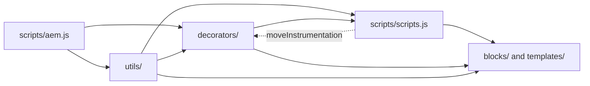

# Decorators and Utilities

This file is the knowledge base entry for the shared code of the TCS Corporate Website: every module in `decorators/` and `utils/` and the shared helpers in `scripts/`, with their purpose, consumers, inputs and outputs, side effects, tests and status, followed by the rules for writing and changing shared code. Consumers were found by searching the imports of `blocks/`, `decorators/`, `utils/`, `scripts/`, `templates/` and `test/`; purposes come from each file's header comment and exports.

| Attribute | Value |
| --- | --- |
| Audience | Developers and AI agents writing blocks or shared code; reviewers |
| Source of truth | The code in [decorators/](../../../decorators/README.md), [utils/](../../../utils/README.md) and [scripts/](../../../scripts/scripts.js); [test/](../../../test/); [AGENTS.md](../../../AGENTS.md#shared-code-decorators-and-utils); [tools/modules/generate-module-graph.mjs](../../../tools/modules/generate-module-graph.mjs) |
| Last reviewed | Written from main at commit 2d06316 on 21 October 2026 |
| Status | Current |

## Layering

| Layer | Builds UI | May import | Verified |
| --- | --- | --- | --- |
| `scripts/aem.js` | Core decoration (Edge Delivery library) | nothing project-specific | Never modified (AGENTS.md) |
| `utils/` (26 modules) | No | other utils, `scripts/aem.js` (`toClassName`, `getMetadata`, `loadScript`) | **No util imports a decorator** (grep of every `import` in `utils/` at commit 2d06316; the only mentions of `decorators/` are in comments) |
| `decorators/` (28 modules) | Yes (elements, behaviour) | utils, other decorators, `scripts/aem.js`, `scripts/scripts.js` (`moveInstrumentation`) | Yes |
| `scripts/scripts.js` | Page decoration and loading | decorators, utils, `aem.js`, `module-graph.js` | Yes |
| `blocks/`, `templates/` | Blocks and templates | all of the above | Yes |

`scripts/scripts.js` imports seven decorators and some decorators import `moveInstrumentation` from `scripts/scripts.js` (`content-decorator`, `card-list-decorator`, `editor-item-decorator`, `heading-decorator`, `image-decorator`, `stats-decorator`): these are ES module cycles resolved at call time. `responsive-image-decorator.js` is kept free of `scripts.js` imports so `scripts.js` can use it.

## Decorators Inventory

Status: every decorator is Active (imported by at least one block, template or script). Tests: decorators touch the DOM and have no unit tests; they were validated by the browser runs of the audits (188 pages at 5 widths).

| Name | Path | Purpose | Consumers | Inputs / Outputs | Side effects | Tests | Status |
| --- | --- | --- | --- | --- | --- | --- | --- |
| a11y | [decorators/a11y-decorator.js](../../../decorators/a11y-decorator.js) | Visually hidden content for assistive technology | teaser, testimonial, conversation-canvas; link, social-links, card-list decorators | `hideVisually(el)`, `createHiddenText(text)` return the element | Adds `.visually-hidden` | None | Active |
| animation | [decorators/animation-decorator.js](../../../decorators/animation-decorator.js) | Lottie animations (the "Lotto" image type): loaded near the viewport, paused off screen and for reduced motion, pause / play button | hero, teaser | `createAnimation(path, options)` returns a container with `animationToggle`; `playAnimation(container, path)` | Loads the vendored Lottie player once (`utils/lottie.js`); observers on the container | None | Active |
| article-meta | [decorators/article-meta-decorator.js](../../../decorators/article-meta-decorator.js) | Published date, reading time, listen / download / share actions, author lockup (Figma "L3 Header") | page-header, teaser, filter-list; card-list decorator | `buildPublished`, `buildReadingTime`, `buildPageActions`, `buildAuthorLockup` return elements | Share button handler (Web Share API, else copies the link to the clipboard) | None | Active |
| author-bio | [decorators/author-bio-decorator.js](../../../decorators/author-bio-decorator.js) | "About the author" card from the Authors sheet | templates/article (also used by blog through article) | `buildAuthorBio(author, labels)` returns an element | None | None | Active |
| block-options | [decorators/block-options-decorator.js](../../../decorators/block-options-decorator.js) | Additional tab: an `anchor-…` class becomes the block id (unique, `-2`, `-3`) | `scripts.js` (`decorateMain`), `editor-support.js` | `applyBlockOptions(container)` | Sets `id` on blocks | None | Active |
| button | [decorators/button-decorator.js](../../../decorators/button-decorator.js) | The single place for button views, types, alignment and states | 13 blocks (button-block, hero, teaser, header, footer, modal, video, ...), `scripts.js`, 5 decorators | `decorateButton(a, options)`, `createButton`, `setButtonDisabled`, `setButtonAlignment`, `removeButtonDecoration` | Classes and ARIA on the element; new-tab hint | None | Active |
| card-list | [decorators/card-list-decorator.js](../../../decorators/card-list-decorator.js) | Cards of the TCS DS List variations: header, image / panel / report / stat / feature cards, rows, grid or scroll per breakpoint, skeleton, empty state, data layer state | list, cards | `renderCardList(block, config)` and the card renderers, `applyCardListLayout`, `buildCardListSkeleton`, `renderCardListEmpty`, `renderEditorItems`, `cardListId`, `trackCardList` | Replaces block content; scroller; pushes component state | Indirect: `test/cards`, `test/list` (data side), Passed | Active |
| contact-list | [decorators/contact-list-decorator.js](../../../decorators/contact-list-decorator.js) | Contacts with mail / phone links (Media Contacts sheet) | templates/press-release | `buildContactList(contacts, heading)` returns an element | None | None | Active |
| content-buttons | [decorators/content-buttons-decorator.js](../../../decorators/content-buttons-decorator.js) | Standalone authored links in content become buttons, icon buttons or link buttons | `scripts.js` (re-exported for `editor-support.js`) | `decorateButtons(container)` | Changes link classes in the container | None | Active |
| content | [decorators/content-decorator.js](../../../decorators/content-decorator.js) | Moves a property cell's content into a new element, keeping editor instrumentation | teaser, quote, form-variations, testimonial, video, footer | `fromCell(cell, tagName, className)` returns the element | Moves `data-aue-*` attributes | None | Active |
| data-layer | [decorators/data-layer-decorator.js](../../../decorators/data-layer-decorator.js) | Page, blocks and interactions in the Adobe Client Data Layer (Core Components schema) | `scripts.js`, tabs, modal; skeleton, card-list decorators | `trackPage()`, `trackBlocks(container)`, `trackInteractions()`, `componentIdOf(block)` | Pushes to `window.adobeDataLayer`; document-level capture listeners (click, toggle, close, play, pause, ended, submit, change), registered once; `data-cmp-id`, `data-cmp-tracked` on blocks | Indirect: `test/privacy` (search redaction), Passed | Active |
| date | [decorators/date-decorator.js](../../../decorators/date-decorator.js) | `<time>` for authored or page-property dates | filter-list; article-meta decorator | `buildTime(value, format, className)` returns `HTMLTimeElement` or null | None | Indirect: `formatDate` in `test/cards`, Passed | Active |
| editor-item | [decorators/editor-item-decorator.js](../../../decorators/editor-item-decorator.js) | In Universal Editor, an item the block doesn't render yet (just added) as a selectable placeholder | hero, teaser, testimonial, page-header, anchor-list, accordion, filter-list, footer; stats decorator | `editorItemHint(rows)` (placeholder `itemEditorHint`, loaded only in the editor), `buildEditorItems(rows, hint)` | None on the published page | None | Active |
| heading | [decorators/heading-decorator.js](../../../decorators/heading-decorator.js) | Heading from a title property and its Title Type | teaser, quote, form-variations, testimonial; card-list decorator | `buildHeading(cell, typeCell, className, fallback)`, `HEADINGS` | Moves instrumentation | None | Active |
| icon-button | [decorators/icon-button-decorator.js](../../../decorators/icon-button-decorator.js) | Icon-only `<button>`s on the button decorator | conversation-canvas, gen-carousel, modal, embed, video, filter-list; card-list, animation, article-meta decorators | `createIconButton({ label, icon, ... })` returns a button | None | None | Active |
| image | [decorators/image-decorator.js](../../../decorators/image-decorator.js) | The picture of an image property with its alt field | tcs-header, teaser, quote, testimonial, video | `pictureOf(cell, altCell)` returns `<picture>` or null | Sets `alt` (empty = decorative) | None | Active |
| link | [decorators/link-decorator.js](../../../decorators/link-decorator.js) | New-tab links and their announcement | teaser, page-header, footer; button, card-list, social-links, author-bio decorators | `setLinkTarget(a, newWindow)`, `announceNewTab(a, hint)` | `target`, `rel`, hidden hint text | None | Active |
| masonry | [decorators/masonry-decorator.js](../../../decorators/masonry-decorator.js) | Packs grid items of different heights into columns in reading order; native masonry where supported | filter-list | `layoutMasonry(grid)` returns `{ disconnect }` | ResizeObserver and MutationObserver until `disconnect()` | None | Active |
| media | [decorators/media-decorator.js](../../../decorators/media-decorator.js) | YouTube, Vimeo, iframe and video players built with DOM APIs (no URL in HTML strings) | embed, video | `createFrame`, `createYoutubeFrame`, `createVimeoFrame`, `createVideoElement` return elements | None until inserted | Indirect: `test/media/vimeo-url.test.mjs` (URLs), Passed | Active |
| motion | [decorators/motion-decorator.js](../../../decorators/motion-decorator.js) | Content and Background animations of the Additional tab, prepared before a section shows, run by one IntersectionObserver | `scripts.js`, fragment, header, footer; skeleton decorator | `prepareMotion(container)`, `releaseMotion(block)` | Loads `styles/motion.css` when needed; one page-wide observer; classes and inline styles removed at the end (safety timeout 4 s); nothing in edit mode or for reduced motion | Indirect: `test/motion/motion.test.mjs` (`utils/motion.js`), Passed | Active |
| responsive-image | [decorators/responsive-image-decorator.js](../../../decorators/responsive-image-decorator.js) | Image from a URL; site media optimized as `<picture>` | conversation-canvas, page-header, filter-list, `scripts.js`; social-links, card-list, author-bio decorators | `buildImage({ src, alt }, breakpoints)` returns an element | None | None | Active |
| scroller | [decorators/scroller-decorator.js](../../../decorators/scroller-decorator.js) | Previous / next, indicator, drag and keyboard for a CSS horizontal scroller, active only while it scrolls | card-list decorator | `createScroller(viewport, options)` returns `{ update, scrollToItem, destroy }` | Listeners and a ResizeObserver until `destroy()`; measurements batched in one animation frame (reads, then writes) | None | Active |
| seo | [decorators/seo-decorator.js](../../../decorators/seo-decorator.js) | Bulk metadata SEO / social columns to the standard head tags, `<html lang>` | `scripts.js` (`loadEager`) | `decorateHead()` | Writes `<title>`, meta and link tags, `lang` | None | Active |
| skeleton | [decorators/skeleton-decorator.js](../../../decorators/skeleton-decorator.js) | Block-shaped placeholders while data loads; render directly when data is there within 150 ms | list, filter-list, conversation-canvas; card-list decorator | `renderWhenLoaded(block, { data, render, skeleton })`, `skeletonWhile`, `showSkeleton`, `skeletonElement`, `bone` | Timers (150 ms delay, 250 ms minimum); skeleton removed on success and failure | None | Active |
| social-links | [decorators/social-links-decorator.js](../../../decorators/social-links-decorator.js) | Social Links sheet as an icon list | footer | `buildSocialLinks(links, className, labelOf, newTabHint)` returns a list | None | None | Active |
| stats | [decorators/stats-decorator.js](../../../decorators/stats-decorator.js) | Stats from Stat items and the legacy Stats multifield, as a description list | teaser, testimonial | `buildStats(cell, prefix, rows, hint)` returns `<dl>` | Moves instrumentation | None | Active |
| tag | [decorators/tag-decorator.js](../../../decorators/tag-decorator.js) | A list of tag labels | teaser, page-header | `buildTagList(tags, className)` returns `<ul>` or null | None | None | Active |
| template | [decorators/template-decorator.js](../../../decorators/template-decorator.js) | Structure a Site Global Template adds before decoration (Page Header, loaded sections) | templates/article, templates/press-release (blog through article) | `ensurePageHeader(main)`, `appendLoadedSection(main, className, build)` | Adds sections to `main` | None | Active |

## Utilities Inventory

Status: every util is Active. "Passed" means the listed test file passed in `npm test` (311 tests) at commit 2d06316.

| Name | Path | Purpose | Consumers | Inputs / Outputs | Side effects | Tests | Status |
| --- | --- | --- | --- | --- | --- | --- | --- |
| analytics | [utils/analytics.js](../../../utils/analytics.js) | Adobe Client Data Layer pushes (Core Components schema); never throws | tabs, separator, gen-carousel, modal; data-layer, card-list decorators | `pushToDataLayer(entry)` returns a boolean; `pushComponents(map)`, `pushComponentEvent(event, id, info)` | Creates / pushes to `window.adobeDataLayer` | None | Active |
| buttons | [utils/buttons.js](../../../utils/buttons.js) | Button vocabulary and reading button options from authored link markup | button-block, conversation-canvas, tabs, hero, table-list; button, content-buttons, card-list decorators | `BUTTON_VIEWS`, `BUTTON_TYPES`, `BUTTON_ALIGNMENTS`, `pick`, `readButtonOptions(a)` | None (pure) | None | Active |
| card-list-config | [utils/card-list-config.js](../../../utils/card-list-config.js) | Presentation settings of List and Cards without the DOM: defaults, validation, card style / colour precedence | list (`list.js`, `list-data.js`), cards (`cards.js`, `cards-data.js`), filter-list; card-list decorator | `normalizePresentation(read)`, `kindOf`, `themeOf`, option lists, `isSafeUrl`, `isExternal`, `toISODate`, `toSafeId`, `hash`, `normalizePath` | None (pure) | `test/cards/cards-data.test.mjs`, `test/list/*`, Passed | Active |
| cells | [utils/cells.js](../../../utils/cells.js) | Item rows of a block, tab cells, cells matched to model fields | 11 blocks (list, cards, tabs, hero, teaser, testimonial, page-header, anchor-list, filter-list, footer, table-list) | `itemRows(block, models, isItem)`, `KEY_VALUE_ITEM`, `FIELD_ROW_ITEM`, `withoutTabCells(cells, layout)`, `matchCells(cells, fields, matchers)` | None (pure) | `test/items/item-rows.test.mjs`, `test/list/list-data.test.mjs`, Passed | Active |
| data | [utils/data.js](../../../utils/data.js) | The locale's data sheets (authors, locations, partners, social links, media contacts), loaded once per page | list, page-header, filter-list, footer; templates/article, templates/press-release | `getAuthor(id)`, `getAuthors`, `getSocialLinks`, `getMediaContacts`, `getLocations`, `getPartners`, `inRegion`, `loadDataSheet` return typed rows (empty lists for missing sheets) | Fetches `/{locale}/data/*.json`; module cache | None | Active |
| dates | [utils/dates.js](../../../utils/dates.js) | Formats authored dates without time zone shifts | list-data, cards-data; date decorator | `formatDate(value, format)` returns a string | None (pure) | `test/cards/cards-data.test.mjs`, Passed | Active |
| environment | [utils/environment.js](../../../utils/environment.js) | Reduced motion and Universal Editor checks | 13 blocks; motion, animation, scroller decorators | `prefersReducedMotion()`, `scrollBehavior()`, `isAuthor()` (path starts with `/content/`), `isEditing()` (`adobe-ue-edit`), `isInEditor(el)` | None (reads `matchMedia`, location, classes) | None | Active |
| header-space | [utils/header-space.js](../../../utils/header-space.js) | Reserves the header's remembered height before it loads (no layout shift) | header, `scripts.js` | `reserveHeaderSpace()`, `rememberHeaderSpace(header)` | Reads / writes `localStorage` key `header-height-v2-{breakpoint}`; sets `--header-reserved` on `<html>` | None | Active |
| ids | [utils/ids.js](../../../utils/ids.js) | Unique element ids per block instance; authored ids kept unless taken | 9 blocks, `scripts.js`; block-options, article-meta, card-list decorators | `uniqueId(name)`, `nextInstance(name)`, `createIdFactory(prefix)`, `availableId(id, self)` | Per-page counters (module state) | None | Active |
| inherited-metadata | [utils/inherited-metadata.js](../../../utils/inherited-metadata.js) | Navigation, Footer and 404 Page inherited from the nearest parent page up to Home | header, footer, `scripts.js` (404) | `getInheritedMetadata(name)` returns a promise of the value; `INHERITED_METADATA` | Fetches parent page heads in parallel; caches values in `sessionStorage` for the session | None | Active |
| links | [utils/links.js](../../../utils/links.js) | Authored links and their Link Type / Open in New Window values | 10 blocks (hero, teaser, page-header, footer, list, button-block, conversation-canvas, form-variations, video, tcs-header) | `linkOf(cell)`, `linkPathsOf`, `readLinkItems`, `readLinkRows`, `NEW_WINDOW` | None (pure) | None | Active |
| lottie | [utils/lottie.js](../../../utils/lottie.js) | Loads the vendored Lottie player once (`scripts/lib/lottie/lottie_light.min.js`) | animation decorator | `loadLottie()` returns a promise of the player | Adds a script once | None | Active |
| media | [utils/media.js](../../../utils/media.js) | Video providers and player URLs; Lottie link label | teaser, hero, embed, video; media decorator | `isYoutube`, `isVimeo`, `isAnimation`, `youtubeId`, `youtubeEmbedUrl`, `vimeoEmbedUrl`, `animationLabel`, `videoType` | None (pure) | `test/media/vimeo-url.test.mjs`, Passed | Active |
| metadata | [utils/metadata.js](../../../utils/metadata.js) | Page metadata from page properties and the bulk metadata sheet | conversation-canvas, page-header; seo, data-layer decorators; templates | `getPageMetadata()`, `getPageTags()`, `getPageLanguage()` | None (reads `<meta>`) | None | Active |
| motion | [utils/motion.js](../../../utils/motion.js) | Additional tab animation values read from block classes; legacy Motion Type mapping | hero, table-list; motion decorator | `contentMotionOf`, `backgroundMotionOf`, `speedOf`, `triggerOf`, `isSeen`, `staggerIndex`, `isHorizontal`, `isVisibleColor`, `addLegacyMotion`, option lists | None (pure; unknown values ignored) | `test/motion/motion.test.mjs`, Passed | Active |
| multifield | [utils/multifield.js](../../../utils/multifield.js) | Reads composite multifields authored before item children | anchor-list, filter-list; stats decorator; links util | `readMultifieldItems(cell)` returns item element runs | None (pure) | None | Active (compatibility path) |
| placeholders | [utils/placeholders.js](../../../utils/placeholders.js) | UI text from the locale's placeholders sheet, with English fallbacks | 24 blocks, `scripts.js`, templates; editor-item, animation decorators | `getPlaceholders()` returns `t(key, fallback, values)`; `fillPlaceholder`, `loadPlaceholders` | Fetches `/{locale}/placeholders.json` once (empty map on failure) | None | Active |
| privacy | [utils/privacy.js](../../../utils/privacy.js) | Data minimisation of values that leave the page | data-layer decorator | `redactSearchTerm(value)`: e-mail addresses and phone numbers replaced, trimmed, cut at 100 characters | None (pure) | `test/privacy/privacy.test.mjs`, Passed | Active |
| properties | [utils/properties.js](../../../utils/properties.js) | Reads key-value block properties | 18 blocks; image, content, card-list, heading decorators; tags util | `readProperties(block)`, `textOf`, `isOn`, `isOnByDefault`, `optionOf`, `normalizeKey`, `textSource` | None (pure) | Indirect through `test/cards`, `test/list`, Passed | Active |
| query-index | [utils/query-index.js](../../../utils/query-index.js) | Published pages of the locale from `/query-index.json` (or the language master under review), loaded once | conversation-canvas, header, list, list-data, filter-list, `scripts.js` (prefetch) | `getPages()`, `getPagesAt(paths)` (pages read from their HTML, e.g. on author), `tagsOf`, `columnOf`, `listOf`, `rowOfDocument`, `pageTree` / `getPageTree(root, depth)` (the site tree of the Canvas and header menus) | Fetches the index in pages of 500; module cache | `test/list/query-index-tags.test.mjs`, `test/site/page-tree.test.mjs`, Passed | Active |
| redirects | [utils/redirects.js](../../../utils/redirects.js) | Redirect targets from the locale's redirects sheet (not applied by the platform) | list, `scripts.js` (prefetch) | `loadRedirects()` (a map), `resolveRedirect(map, href)` (up to 5 hops), `normalizeRedirectPath` | Fetches `/{locale}/redirects.json` once | `test/list/list-data.test.mjs`, Passed | Active |
| site | [utils/site.js](../../../utils/site.js) | The 13 locale sites, AEM and published paths, sheets, parent pages; temporary language master review | 6 blocks, `scripts.js`, 8 utils, `tools/paths/generate-paths.mjs` | `LOCALES`, `DEFAULT_LOCALE`, `getLocale`, `localePagePath`, `resolvePagePath`, `localeSheetPath`, `toPublishedPath`, `toAemPath`, `getParentPages`, `pageLink`, `indexRoot`, `sheetRows`, `REVIEW_*` | None (reads location) | `test/site/index-root.test.mjs`, Passed | Active |
| tags | [utils/tags.js](../../../utils/tags.js) | Tag ids to ids and labels (fallback when the taxonomy lacks them) | teaser, list, cards, filter-list; taxonomy util | `parseTag(id)`, `readTagValues(cell)`, `readTags` | None (pure) | None | Active |
| taxonomy | [utils/taxonomy.js](../../../utils/taxonomy.js) | Tag labels from the locale's taxonomy (language sheet when translated) | teaser, conversation-canvas, list, cards, page-header, filter-list, `scripts.js` (prefetch) | `loadTaxonomy()`, `resolveTags(values)` | Fetches `/{locale}/taxonomy.json` once | None | Active |
| urls | [utils/urls.js](../../../utils/urls.js) | AEM content paths to published paths | conversation-canvas, table-list | `toSitePath(path)` | None (pure) | None | Active |
| viewport | [utils/viewport.js](../../../utils/viewport.js) | Defers work until content is near the viewport; breakpoints | gen-carousel, embed, video, filter-list; card-list, animation, data-layer decorators; header-space util | `onVisible(el, callback)` (once, disconnects), `watchVisibility(el, callback)`, `currentBreakpoint()` | IntersectionObserver per call | None | Active |

### Exports without a consumer outside their module

Found by searching every exported name across `blocks/`, `decorators/`, `utils/`, `scripts/`, `templates/`, `test/` and `tools/`. Most are used inside their own module or kept as part of a small API; `getLocations` and `getPartners` (`utils/data.js`) are used nowhere and are **Unused candidates** (their sheets, `data/locations` and `data/partners`, are published per locale; remove them only after checking planned use).

| Module | Exports |
| --- | --- |
| decorators | `playAnimation`, `setButtonDisabled`, `cardHeadingLevel`, `renderRow`, `renderFeature`, `SKELETON_DELAY_MS`, `SKELETON_MIN_MS`, `showSkeleton` |
| utils | `STYLE_OPTIONS`, `loadDataSheet`, `getLocations`, `getPartners`, `nextInstance`, `INHERITED_METADATA`, `MOTION_TRIGGERS`, `loadPlaceholders`, `rowOfDocument`, `normalizeRedirectPath`, `REVIEW_SHEETS`, `REVIEW_PAGES`, `readTags` (`LOCALES` and `toAemPath` are used by `tools/paths/generate-paths.mjs`) |

## Shared Helpers in scripts/

| Name | Path | Purpose | Consumers | Inputs / Outputs | Side effects | Tests | Status |
| --- | --- | --- | --- | --- | --- | --- | --- |
| aem.js | [scripts/aem.js](../../../scripts/aem.js) | Edge Delivery core library: `decorateBlock(s)`, `loadSection(s)`, `loadBlock`, `loadCSS`, `loadScript`, `getMetadata`, `toClassName`, `createOptimizedPicture`, `sampleRUM` | everything | Library | RUM (`sampleRUM`) | None | Active; never modified |
| scripts.js exports | [scripts/scripts.js](../../../scripts/scripts.js) | `moveInstrumentation` / `moveAttributes` (Universal Editor attributes to a new element), `decorateMain`, `decorateSectionsWithOptions`, `preloadBlockModules`, re-exported `decorateButtons` | `moveInstrumentation`: 18 blocks and 6 decorators; `decorateMain`: fragment, `editor-support.js` | DOM in, DOM out | Importing it runs `loadPage()` (eager, lazy, delayed phases); `autolinkModals` adds a document click listener for `/modals/` links | None | Active |
| scripts.js internals | [scripts/scripts.js](../../../scripts/scripts.js) | `applySectionBlockOptions` (`container*` fields to classes), `buildColumnsSections`, `buildTabsSections`, `buildCarouselSections`, `loadTemplate`, `loadErrorPage`, `prefetchData` (query index, taxonomy, redirects in the lazy phase), `loadMainSections` (`loadSection(section, prepareMotion)`) | Page loading | Not exported | Fonts flag in `sessionStorage` (`fonts-loaded`) | None | Active |
| loadFragment | [blocks/fragment/fragment.js](../../../blocks/fragment/fragment.js) | Fetches and decorates another page's sections; recursion stopped by the chain of including fragments (`from`) | header, footer, modal, tabs | `loadFragment(path, from)` returns a `main` element or null | Fetches `{path}.plain.html` | None | Active |
| editor-support.js | [scripts/editor-support.js](../../../scripts/editor-support.js) | Universal Editor live updates: sanitizes the patch with DOMPurify, re-decorates the changed block, section or main, falls back to a reload | Not referenced by `head.html` or `scripts.js`; loaded when the page is rendered for Universal Editor (loading mechanism requires validation) | `aue:content-*` events | Listeners on `main`; drops ids of the replaced element (re-audit R-C-9); a MutationObserver for rich text | None | Active |
| editor-support-rte.js | [scripts/editor-support-rte.js](../../../scripts/editor-support-rte.js) | Groups rich-text instrumentation (`data-richtext-*`) | `editor-support.js` | `decorateRichtext(container)` | Moves instrumentation attributes | None | Active |
| module-graph.js | [scripts/module-graph.js](../../../scripts/module-graph.js) | Generated by `npm run build:modules`: per block, the modules its JavaScript imports beyond `scripts.js`, and the blocks with a stylesheet | `scripts.js` (`preloadBlockModules`) | `blockModules(name)`, `blockStylesheet(name)` | None | `test/modules/module-graph.test.mjs`, Passed | Active (generated; don't edit) |
| delayed.js | [scripts/delayed.js](../../../scripts/delayed.js) | Delayed phase (3 s after load) | `scripts.js` (`loadDelayed`) | None | None: the file only has a comment; Adobe Tags / Web SDK are not configured (blocked: measurement plan) | None | Active (empty) |

Block-local pure modules follow the same pattern and are unit tested: `blocks/list/list-data.js` (`test/list/`), `blocks/cards/cards-data.js` (`test/cards/`), `blocks/separator/separator-config.js` (`test/separator/`), `blocks/conversation-canvas/canvas-journey.js` (`test/conversation-canvas/`); `canvas-controller.js` applies the Canvas journey to the page.

## Rules for Shared Code

### Reuse before creating

Search this inventory, [decorators/README.md](../../../decorators/README.md) and [utils/README.md](../../../utils/README.md) before writing a helper. Every button and link button goes through the button decorators; ids through `utils/ids.js`; UI text through `getPlaceholders()`; key-value properties through `readProperties`; item rows through `itemRows`. When two blocks need the same behaviour, move it into a decorator or util instead of copying it (the audit replaced per-block copies with `matchCells`, `availableId`, `getPages`, `buildImage` and `announceNewTab`).

### Single responsibility and layering

One purpose per file; add a new module rather than growing an unrelated one. Decorators may import utils; **utils never import decorators** (verified). Utils build no page elements. `scripts/aem.js` is never modified.

### No hidden global side effects

Importing a decorator or util does no work: their top level only declares constants, functions and caches (the one environment read at import is the masonry decorator's `CSS.supports` check for native masonry). The global effects that exist are deliberate and documented in the module header:

| Effect | Module |
| --- | --- |
| Document-level capture listeners, registered once | `data-layer-decorator.js` (`trackInteractions`), `scripts.js` (`autolinkModals`) |
| `window.adobeDataLayer` | `utils/analytics.js` |
| One page-wide IntersectionObserver; `styles/motion.css` loaded when needed | `motion-decorator.js` |
| Browser storage | `utils/header-space.js` (`localStorage`), `utils/inherited-metadata.js` and `scripts.js` fonts flag (`sessionStorage`) |
| Module caches of fetched data | `placeholders`, `taxonomy`, `redirects`, `query-index`, `data`, `inherited-metadata`, `lottie` |
| Per-page counters | `utils/ids.js`, `data-layer-decorator.js` |

A new global effect needs the same: a reason, the module header, the README entry.

### Idempotency

Decoration can run more than once (fragments, Universal Editor re-renders). The existing guards: `trackInteractions` registers once (`listening`); `trackBlocks` marks blocks `data-cmp-tracked` and `componentIdOf` keeps an existing `data-cmp-id`; `preload` in `scripts.js` preloads each path once; loaders memoize their promise; `availableId` keeps an id that is already the element's own; `editor-support.js` drops the ids of a replaced element so the new one gets them (R-C-9). New helpers must be safe to call twice on the same element.

### Error handling

Shared code never breaks rendering: `pushToDataLayer` catches and returns `false`; sheet loaders resolve to empty values when a sheet is missing (placeholders: an empty map, data sheets: empty lists); `renderWhenLoaded` removes the skeleton on failure; a failed Lottie animation hides with its control (R-B-2); code always passes an English fallback to `t()`.

### Async work

Loaders return one memoized promise per page; shared data (query index, taxonomy, redirects) is prefetched when the lazy phase starts, never in the eager phase where it would compete with the LCP image; data later than 150 ms shows a skeleton so a section isn't held back (`renderWhenLoaded`).

### Multiple instances

Blocks appear several times per page: ids come from `uniqueId` / `createIdFactory` / `availableId`; data-layer ids are `{block}-{n}` unless the block has an id; scrollers, masonry grids and animations are per instance; the same fragment may be loaded twice side by side, but not inside itself (`loadFragment` chain, R-C-5).

### Listener and observer cleanup

Helpers that observe return a way to stop: `createScroller` returns `destroy()`, `layoutMasonry` returns `disconnect()`, `onVisible` disconnects after its first call, the motion decorator unobserves each block and aborts its `animationend` listeners (`AbortController`, 4 s safety timeout). Known gap: editor-only listener leaks (audit deferral D-C-19).

### Consent awareness

No consent mechanism is implemented. The data layer is filled without a consent check but stays in the page: no Adobe Tags, Web SDK, Analytics or Target library consumes it. Embeds use privacy-enhanced players (youtube-nocookie; Vimeo `dnt=1` in Embed and in Video with privacy mode). Any helper that would send data to a third party is blocked until a consent model exists (blocked: consent categories and CMP).

### Data minimisation

`utils/privacy.js` `redactSearchTerm` replaces e-mail addresses and phone numbers and cuts search terms at 100 characters before `cmp:search` (unit tested); `cmp:submit` carries the form id and field names, never values; the data layer code writes no storage. Open items: `mailto:` / `tel:` link URLs are still pushed in full as `xdm:linkURL` (handover finding F-05, to be masked in Tags) and the Conversation Canvas Search page URL carries the raw query (re-audit R-D-12, blocked until Tags is set up).

### Performance

- **No forced layout during decoration**: the scroller decorator measures all scrollers in one animation frame, reads before writes; the Canvas controller writes `<html>` custom properties only when they change and never measures while scrolling.
- **Module preloading**: there is no build step, so `head.html` preloads every module `scripts.js` imports and `preloadBlockModules` preloads each block's modules and stylesheet from `scripts/module-graph.js`. Run `npm run build:modules` after adding, removing or changing an import; `test/modules` fails when the lists are stale.
- **Load only when needed**: the Lottie player near the viewport, `styles/motion.css` only with animations, the placeholder hint only in the editor, shared data once per page.

### Backward compatibility

Keep exported names and signatures stable (blocks import them directly); keep the readers of content authored before (`readMultifieldItems`, `addLegacyMotion`, the legacy Stats multifield in `buildStats`, the Video poster group); unknown option values are ignored rather than turned into classes (`utils/motion.js`).

### Tests and documentation

Pure logic goes into utils or block-local data modules with a Node test in `test/**/*.test.mjs` (`npm test`); DOM helpers are validated on the block library pages. Update the module header, the table in `decorators/README.md` or `utils/README.md` and, when a block's dependencies change, `npm run build:docs` (the generated files section of the block READMEs). The "Used by" columns of the two READMEs have drifted from the imports (e.g. the heading, content, image, link and data-layer decorators, and `utils/site.js`); the consumers in this inventory come from the imports at commit 2d06316.

## Related

- [blocks.md](./blocks.md): reuse strategy and anti-patterns for blocks
- [universal-editor.md](./universal-editor.md): models whose values these helpers read
- [decorators/README.md](../../../decorators/README.md) (with the data layer contract) and [utils/README.md](../../../utils/README.md)
- [templates/README.md](../../../templates/README.md): templates using the template, author-bio and contact-list decorators
- [docs/animation/README.md](../../../docs/animation/README.md): motion and skeleton decorators
- [AGENTS.md](../../../AGENTS.md#shared-code-decorators-and-utils): shared code rules, data layer, module preloading
- Handover Part 2.3 — Component Architecture and Part 11 — Analytics & Data Layer: [TCS-CORP-HANDOVER.md](../TCS-CORP-HANDOVER.md)
- Other knowledge base files: [architecture.md](./architecture.md), [development-standards.md](./development-standards.md), [performance.md](./performance.md), [data-layer-and-analytics.md](./data-layer-and-analytics.md), [security-privacy-consent.md](./security-privacy-consent.md), [testing-and-quality.md](./testing-and-quality.md)
