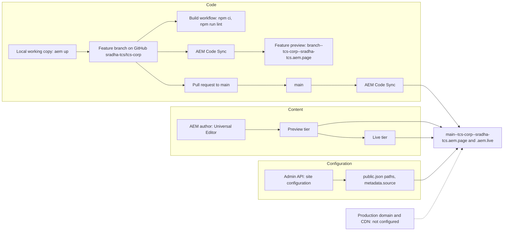

# Deployment and Release

How code, content and configuration of the TCS Corporate Website reach the preview and live sites: local development, feature branches, pull requests, the automated checks that exist in the repository, the content packages of the block library, promotion between environments, publishing and reindexing, testing, rollback, release evidence and production readiness. It records only verified commands and flows and links to `AGENTS.md` ("Deployment") and the project handover (Part 12 — Publishing, Deployment & Release; Part 17 — Operations Guide, 17.5 Release Activities).

| Attribute | Value |
| --- | --- |
| Audience | Developers (L3), technical lead, release manager, Site Administrator, QA |
| Source of truth | [package.json](../../../package.json), [.github/workflows/](../../../.github/workflows/main.yaml), [.github/pull_request_template.md](../../../.github/pull_request_template.md), [.husky/pre-commit.mjs](../../../.husky/pre-commit.mjs), [.renovaterc.json](../../../.renovaterc.json), [AGENTS.md](../../../AGENTS.md#deployment), [docs/audit/tools/](../../../docs/audit/README.md), handover Part 12 ([TCS-CORP-HANDOVER.md](../TCS-CORP-HANDOVER.md)) |
| Last reviewed | Written from main at commit 2d06316 on 21 October 2026 |
| Status | Requires validation (branch protection, required checks, change management and emergency approval, production domain and CDN are not recorded; rollback has not been exercised) |

## Delivery streams

Content, code and configuration are released independently: a code merge doesn't publish content and publishing content doesn't deploy code. A release that needs both goes **code first, then content** (handover Part 12, introduction).

## Local development

| Task | Command | Notes |
| --- | --- | --- |
| Install dependencies | `npm install` | Also installs the Husky pre-commit hook (`prepare: husky`) |
| Start the dev server | `npx -y @adobe/aem-cli up --no-open --forward-browser-logs` (or `aem up` with the CLI installed globally) | `http://localhost:3000`: local code, previewed content |
| Serve static test content | Add `--html-folder drafts` | Files in `drafts/` (`.html` or `.plain.html`); 14 files are tracked |
| Lint | `npm run lint` (`lint:js`: ESLint on `.json`, `.js`, `.mjs`; `lint:css`: Stylelint on `blocks/**/*.css`, `styles/*.css`) | `npm run lint:fix` fixes what it can |
| Unit tests | `npm test` (`node --test 'test/**/*.test.mjs'`) | Pure modules, model layout, docs, module graph |
| Rebuild the Universal Editor files | `npm run build:json` | `component-models.json`, `component-definition.json`, `component-filters.json` from the partials |
| Regenerate the path mapping | `npm run build:paths` | After changing `LOCALES` in [utils/site.js](../../../utils/site.js); commit both |
| Regenerate the module graph | `npm run build:modules` | [tools/modules/generate-module-graph.mjs](../../../tools/modules/generate-module-graph.mjs), used for module preloading |
| Regenerate block READMEs | `npm run build:docs` | Generated sections of the block READMEs ([blocks/README.md](../../../blocks/README.md#maintaining-this-documentation)) |

Inspect delivered content with `curl http://localhost:3000/{path}`, `.md` and `.plain.html` ([AGENTS.md](../../../AGENTS.md#content)). Node.js: [README.md](../../../README.md) states 20 or newer; the workflows install Node 24. The local preview renderer used by the audits (`.home-work/render-lib.mjs`, named in [AGENTS.md](../../../AGENTS.md#blocks)) is not tracked in Git.

## Branches and feature previews

- `main` is production. Changes go through short-lived branches merged with pull requests (130 merge commits on `main` at 2d06316, latest #129).
- Branch prefixes in use: `feature/`, `feat/`, `fix/`, `perf/`, `docs/` (for example `fix/block-reaudit`, `perf/module-preload`, `docs/block-readmes`). The handover's `feature/tcs-<topic>` convention (12.2.2) is not what recent history uses; no naming rule is enforced.
- AEM Code Sync serves every pushed branch at `https://{branch}--tcs-corp--sradha-tcs.aem.page/` (slashes become hyphens; keep names short and lower case: branch, repository and owner form the host name).

## Pull requests

The publishing process of [AGENTS.md](../../../AGENTS.md#publishing-process):

1. Push the feature branch; Code Sync makes it available on the feature preview.
2. Run PageSpeed Insights on the feature preview URL and fix issues; target a score of 100.
3. Open a pull request to `main`. The description **must** link `https://{branch}--tcs-corp--sradha-tcs.aem.page/{path}` showing the change, or the PR is rejected. Without a page, create test content in `drafts/` and ask an author to create a CMS page to link.
4. Check the status of code sync, linting and performance tests (`gh pr checks`).
5. A human reviewer reviews the code, opens the URL and merges; Code Sync updates `main`.

[.github/pull_request_template.md](../../../.github/pull_request_template.md) asks for the GitHub issue (`Fix #<gh-issue-id>`) and Before / After test URLs. It still contains the boilerplate placeholders `{repo}` and `{owner}`: replace them with `tcs-corp` and `sradha-tcs` (the `cleanup-on-create` workflow that would replace them only runs on repository creation or manual dispatch).

Approval rules: the number of required reviews, required checks and branch protection on `main` are not recorded (handover 12.3; open item O-05).

## Automated checks

| Check | Defined in | When | What it does | Status at 2d06316 |
| --- | --- | --- | --- | --- |
| Husky pre-commit | [.husky/pre-commit](../../../.husky/pre-commit) → [.husky/pre-commit.mjs](../../../.husky/pre-commit.mjs) | Every local commit | If staged files include a model partial (`_*.json`), runs `npm run build:json` and stages the three aggregated files | Aggregated files match the partials: Passed |
| Build | [.github/workflows/main.yaml](../../../.github/workflows/main.yaml) | Every push, every branch (`on: [push]`) | `npm ci`, then `npm run lint` (ESLint with `airbnb-base`, `plugin:json`, `plugin:xwalk/recommended`; Stylelint `stylelint-config-standard`) | `npm run lint` locally: Passed |
| Unit tests | [package.json](../../../package.json) `test` | Manual only: not in any workflow | 311 tests in 53 suites (`test/`) | `npm test` locally: Passed (311 / 311) |
| cleanup-on-create | [.github/workflows/cleanup-on-create.yaml](../../../.github/workflows/cleanup-on-create.yaml) | Repository creation or manual dispatch | Boilerplate clean-up; no role in releases | Not applicable |
| Renovate | [.renovaterc.json](../../../.renovaterc.json) | Renovate schedule | Dependency PRs; devDependency PRs labelled `ignore-psi-check` and auto-merged when tests pass; ESLint pinned to `^8.0.0` | Not applicable |
| AEM Code Sync | GitHub app (not a repository file) | Every push | Syncs the branch to the code bus and reports a check | Not verified here (no GitHub access) |
| PageSpeed (`aem-psi-check`) | AEM GitHub app (not a repository file) | Pull requests | PageSpeed Insights on the URLs in the PR description | Not verified here |

The CI gate is lint only. Run `npm test` before every PR; adding it to `main.yaml` is a recommendation of the handover (14.9 #19, F-37), not a decision.

## Content packages

The block library, the curated design pages and sample pages are delivered to AEM as content packages built **outside the repository**:

- The build and migration tooling lives in the delivery workspace (`.home-work/bl/`, for example `bl-migrate.mjs`, which maps old fields to new ones when the pages and the package are built); it is not tracked in Git ([BLOCK-ECOSYSTEM-AUDIT.md](../../../docs/audit/BLOCK-ECOSYSTEM-AUDIT.md), section 11).
- The packages are distributed on the branch `home-content-package` of the repository (files only, no site code; its README describes each package). For example `block-library/tcs-corp-block-library-content-1.0.13.zip` (current), the curated design pages, Home and Columns Container packages and the matching sheet rows (placeholders, metadata, taxonomy, data CSVs).
- Install with AEM **Package Manager** (Upload Package, Install). Installing replaces each page of the package: changes made in AEM to those pages since the last install are overwritten; pages outside the package are kept.
- Tags `home-content-package_<date>` mark earlier states of that branch ("Downloads branch before the handover PDF …"); they are not code releases.

What the handover records (revision history):

| Package | Change | Publication recorded |
| --- | --- | --- |
| 1.0.3, 1.0.4 | Block library Animation folder | Published with the language master review (2.20) |
| 1.0.7 | Library migrated after the block audit | Not recorded (2.27) |
| 1.0.8 | Columns → Columns Containers / Column Breaks, buttons → Button blocks | Not recorded (2.28) |
| 1.0.9 | Re-audit fixes; language-master Placeholders (109) and Metadata (311 rows) imported | 312 / 312 previewed and published; defect R-L-1 found on live (2.30) |
| 1.0.10 | Container sections' `container*` fields | 312 / 312 previewed, published and reindexed (2.31) |
| 1.0.12 | Section Style colours (with the 1.0.11 Teaser and Columns Container options) | 313 / 313 published and reindexed (2.35) |
| 1.0.13 | List Item display options, dark-background theme | 315 / 315 previewed, published and reindexed (2.35) |

## Environment promotion

| Step | From → to | How | Owner |
| --- | --- | --- | --- |
| 1 | Local → feature preview | Push the branch; Code Sync | Developer |
| 2 | Feature preview → `main` (preview and live code) | Reviewed PR merged; Code Sync updates `main--tcs-corp--sradha-tcs.aem.page` and `.aem.live` | Reviewer |
| 3 | Universal Editor | Authors reload the editor to get new definitions, models and filters | Content team |
| 4 | Configuration | Apply `public.json` paths, `metadata.source`, sitemap or CDN settings through the configuration Admin API, saving the current JSON first | Site Administrator |
| 5 | Content: author → preview → live | Publish sheets, then fragments, then pages | Content team |

There is no separate staging environment in the repository: feature previews and the `main` preview tier play that role. The author environment reads the code of `main` ([fstab.yaml](../../../fstab.yaml) mount point). The production domain and CDN are not configured (open item O-03).

## Installation validation

After a code release or a package install, validate on the preview tier first, then on live:

- [ ] Code Sync check green on the merge commit; a changed file on `main--tcs-corp--sradha-tcs.aem.page/blocks/…` matches the commit (Part 17, R-06).
- [ ] The Universal Editor shows the new fields and components after a reload (R-08).
- [ ] After a package install: every package page previewed, published and, where listed, reindexed, with the count recorded (as in 312 / 312 for 1.0.10).
- [ ] Changed pages and one page per changed block render without `failed to load module for …` or `failed to load template …` (V-02).
- [ ] Header, footer and 404 page correct per locale; sheets reachable (V-03, V-08).
- [ ] Non-image DAM assets used by the pages published (Lottie, video, captions).
- [ ] `aem.page` compared with the local preview block by block ([docs/audit/tools/compare.mjs](../../../docs/audit/tools/compare.mjs)): this comparison found R-L-1 and R-L-2 after 1.0.9.

## Publishing

Content publishing (Universal Editor, Sites console, sheets, references, assets, scheduling) is described in [authoring.md](./authoring.md#publishing); Admin API operations in [administration-and-operations.md](./administration-and-operations.md#publishing-and-the-admin-api). In a release, publish in this order: sheets (placeholders, taxonomy, data, metadata) → fragments (nav, footer, other references) → pages (handover 12.4.2, Part 17 R-09). Content that depends on new code is prepared in AEM but published only after Code Sync of the merge.

## Reindexing

- Publishing updates the page's row in `/query-index.json` automatically.
- After a change to [helix-query.yaml](../../../helix-query.yaml), rows are rewritten only when pages are republished or re-indexed: `POST https://admin.hlx.page/index/sradha-tcs/tcs-corp/main/{path}` for the affected paths (bulk paths agreed with the site owner), then check the columns (Part 17, R-10, W-01).
- The packages 1.0.10, 1.0.12 and 1.0.13 were reindexed page by page (Admin API `preview`, `live`, `index` per page); after 1.0.10 the query index listed 307 language-master pages (handover revision 2.31).
- The sitemap ([helix-sitemap.yaml](../../../helix-sitemap.yaml)) is built from the index.

## Smoke and regression testing

| Test | Command / tool | Scope | Result at 2d06316 |
| --- | --- | --- | --- |
| Unit tests | `npm test` | `test/` (cards, conversation-canvas, docs, items, list, media, models, modules, motion, privacy, separator, site) | Passed (311 / 311) |
| Lint | `npm run lint` | JS, JSON, models (xwalk rules), CSS | Passed |
| Generated files | `npm run build:json` then check that nothing changed (Part 17, R-03) | Aggregated component files | Passed (compared with a fresh merge) |
| Runtime harness | [docs/audit/tools/harness.mjs](../../../docs/audit/tools/harness.mjs) | Every block library and curated page of the local preview at 1440, 1024, 768, 600 and 390 px: console and page errors, failed requests, block status, overflow, duplicate ids, broken images, data layer, axe (WCAG A / AA) at 1440 and 390, a click test | Not run for this page |
| Published vs local | [docs/audit/tools/compare.mjs](../../../docs/audit/tools/compare.mjs) | Block-by-block signature of `aem.page` against the local preview | Not run for this page |
| Inventory | [docs/audit/tools/inventory.mjs](../../../docs/audit/tools/inventory.mjs) | Definitions, models, filters, fields, options and their usage in the content package | Not run for this page |
| Defect register | [docs/audit/tools/register.mjs](../../../docs/audit/tools/register.mjs) | The audit's defects and outcomes | Not applicable |
| Manual | Part 17 V-01 … V-09 | Content, code, configuration, data layer, SEO, accessibility, locale launch, cache | Not recorded |

The audit tools hard-code paths of the delivery workspace (a Playwright install, an axe copy under `/tmp/audit`, `drafts/en/block-library`, the unpacked content package under `.home-work/`), which are not in Git: re-running them from a clean clone is Blocked until those inputs are provided. Their recorded runs: 940 page loads before and after the first audit, and the re-audit runs ([BLOCK-ECOSYSTEM-AUDIT.md](../../../docs/audit/BLOCK-ECOSYSTEM-AUDIT.md), [REAUDIT-2026-10-20.md](../../../docs/audit/REAUDIT-2026-10-20.md), [data/runtime-before-after.csv](../../../docs/audit/data/runtime-before-after.csv)). The block libraries in each locale (`block-library/`) are the manual regression pages for every variation.

## Rollback

No rollback has been recorded; the procedures below are the handover's (Part 12, 12.6) and Require validation.

| Stream | Procedure |
| --- | --- |
| Code | Revert the merged PR in GitHub (a revert PR, checks, merge) or `git revert -m 1 <merge-commit>` on a branch, newest first; Code Sync deploys the previous code. Never force-push or rewrite `main` |
| Models | The revert restores partials and aggregated files; authors reload the editor; values saved with removed fields stay stored but aren't shown |
| Content | Sites console **Timeline > Revert to this Version** (or Restore Version), check, publish again; sheets the same way; unpublish when no good version exists |
| Configuration | Re-apply the saved JSON (`public.json` paths from a previous `paths.json`: `git show <commit>:paths.json`; the previous `metadata.source` list); repository configuration files by reverting the PR, then re-index or regenerate the sitemap |
| Content package | Reinstall the previous package version from the `home-content-package` branch (installing replaces the package's pages) |

Emergency change approval and the hotfix path are not recorded (handover 12.6.1, Part 17 R-15).

## Release evidence

| Evidence | Where | State |
| --- | --- | --- |
| Change history | Merge commits of the pull requests on `main`; the handover revision history (versions 0.1 to 2.37) | Available |
| Validation reports | [docs/audit/](../../../docs/audit/README.md) (audit, re-audit, dialog options; CSV registers and runtime before / after) | Available |
| Publication records | Handover revisions 2.31 and 2.35 (counts of pages previewed, published, reindexed) | Available |
| Release tags | None on `main`; `package.json` keeps the boilerplate version `1.3.0`; no `CHANGELOG.md` | Not recorded |
| Change records | Change management process | Not recorded |
| Release checklists | Handover 12.4 and Part 17, 17.5 (R-01 … R-15) define what to attach | Defined, no completed record in the repository |

## Production readiness

| Item | State |
| --- | --- |
| Code on `main`: lint, unit tests, generated files | Passed at 2d06316 |
| Preview and live on `*.aem.page` / `*.aem.live` | Active |
| Production domain, CDN, push invalidation, robots.txt | Blocked: not configured (O-03) |
| Sitemap origin | `.aem.live` host until the production domain exists |
| Redirects (per-locale sheets, `/` → `/en/`) | Blocked: no mechanism applies them |
| Site configuration `public.json` paths and `metadata.source` | Requires validation (O-04) |
| Language master review (`REVIEW_*`, `/language-master/en`) | Temporary; remove after the rollout to `/en` |
| Adobe Tags / Web SDK, consent | Blocked: measurement plan and consent model |
| Form back end, search service | Blocked (O-08, O-09) |
| Non-image DAM assets published | Requires validation (re-audit operations action) |
| Branch protection, required checks, support model and SLAs | Not recorded (O-05, O-13) |
| Universal Editor dialog checks on the real author | Blocked: author access (audit section 9) |

## Related

- [authoring.md](./authoring.md), [administration-and-operations.md](./administration-and-operations.md)
- [architecture.md](./architecture.md), [repository-structure.md](./repository-structure.md), [indexing-and-search.md](./indexing-and-search.md), [decision-log.md](./decision-log.md)
- [AGENTS.md](../../../AGENTS.md#deployment): environments and publishing process
- [package.json](../../../package.json), [.github/workflows/main.yaml](../../../.github/workflows/main.yaml), [.github/pull_request_template.md](../../../.github/pull_request_template.md), [.husky/pre-commit.mjs](../../../.husky/pre-commit.mjs), [.renovaterc.json](../../../.renovaterc.json)
- [docs/audit/README.md](../../../docs/audit/README.md) and its tools
- Handover ([TCS-CORP-HANDOVER.md](../TCS-CORP-HANDOVER.md)): Part 12 — Publishing, Deployment & Release, Part 13 — Global Troubleshooting Guide (13.15 lint and PageSpeed failures, 13.22 Code Sync), Part 17 — Operations Guide (17.5 Release Activities, 17.6 Validation Activities)
