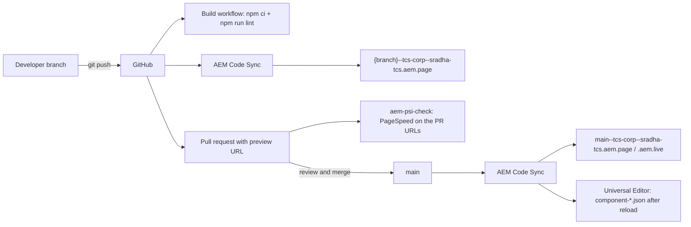

# Development Standards

This page is the working agreement for changing the TCS Corporate website code (AEM Sites with Edge Delivery Services, Universal Editor / xwalk). It summarizes the verified repository workflow, the coding, modeling and documentation conventions, the backward-compatibility rules imposed by what AEM really delivers, and the definition of done, and links to the detailed sources. Where a source and the code differ, this page follows the code and the difference is recorded in the knowledge base notes.

| Attribute | Value |
| --- | --- |
| Audience | Developers, technical leads, reviewers, AI coding agents |
| Source of truth | [AGENTS.md](../../../AGENTS.md), [package.json](../../../package.json), [.eslintrc.js](../../../.eslintrc.js), [.stylelintrc.json](../../../.stylelintrc.json), [.github/pull_request_template.md](../../../.github/pull_request_template.md), [.github/workflows/main.yaml](../../../.github/workflows/main.yaml), [.husky/pre-commit.mjs](../../../.husky/pre-commit.mjs), git history, [blocks/README.md](../../../blocks/README.md), handover Part 12 — Publishing, Deployment & Release |
| Last reviewed | Written from main at commit 2d06316 on 21 October 2026 |
| Status | Current (branch protection and approval rules: Requires validation) |

## Repository and Branching Workflow

The repository is `sradha-tcs/tcs-corp` on GitHub, based on `adobe-rnd/aem-boilerplate-xwalk`. There is no build step: the committed JavaScript and CSS are what the site serves. The model is trunk-based: short-lived branches merged into `main` through pull requests with merge commits (`Merge pull request #NN from sradha-tcs/<branch>`).



### Steps

1. Branch from an up-to-date `main`.
2. `npm install` once per clone: it also installs the Husky pre-commit hook (`prepare`).
3. Run the local server: `npx -y @adobe/aem-cli up --no-open --forward-browser-logs` (or `aem up`), at `http://localhost:3000`. Add `--html-folder drafts` for static test pages in `drafts/`.
4. Implement the change following [AGENTS.md](../../../AGENTS.md#code-style-guidelines).
5. Run the generators the change needs (see [Definition of Done](#definition-of-done)): `npm run build:json`, `npm run build:modules`, `npm run build:docs`, `npm run build:paths`.
6. `npm run lint` and `npm test`.
7. Push the branch and check the feature preview `https://{branch}--tcs-corp--sradha-tcs.aem.page/{path}` (slashes in branch names become hyphens in the host).
8. Run PageSpeed Insights on the feature preview URL; the target is 100 ([AGENTS.md](../../../AGENTS.md#publishing-process)).
9. Open the pull request to `main` with a link to the feature preview page that shows the change: AGENTS.md states that a PR without it is rejected.
10. `gh pr checks`: Build, AEM Code Sync and the PageSpeed check must be green; a reviewer inspects the URL and merges.
11. After the merge, Code Sync updates `main`; authors reload Universal Editor to get changed models.

### Branch naming

| Prefix (from `git log --merges`) | Merges | Used for | Examples |
| --- | --- | --- | --- |
| `feature/` | 85 (74 of them `feature/tcs-…`) | New features (the earlier history) | `feature/tcs-cards-manual-list`, `feature/columns-container` |
| `fix/` | 30 | Defects and audits | `fix/block-reaudit`, `fix/section-options-delivery` |
| `docs/` | 6 | Handover and documentation | `docs/handover-2-35`, `docs/block-readmes` |
| `feat/` | 2 | Features (recent) | `feat/list-item-display`, `feat/section-bg-colors` |
| `perf/` | 2 | Performance | `perf/module-preload`, `perf/font-fallback` |

Keep names short, lower case and valid in a host name (branch, repository and owner form the `aem.page` sub-domain). The handover (12.3) recommends `feature/tcs-<topic>`; the recent history uses `<type>/<topic>` without `tcs-`. No naming rule is enforced by tooling.

### Automated checks

| Check | Defined in | Runs | Verifies |
| --- | --- | --- | --- |
| Husky pre-commit | [.husky/pre-commit.mjs](../../../.husky/pre-commit.mjs) | Every local commit | If a model partial (`_*.json`) is staged, runs `npm run build:json` and stages `component-models.json`, `component-definition.json`, `component-filters.json` |
| Build | [.github/workflows/main.yaml](../../../.github/workflows/main.yaml) | Every push, every branch | `npm ci`, `npm run lint` (Node 24) |
| AEM Code Sync | GitHub app (not in the repository) | Every push | Syncs the branch to the code bus |
| PageSpeed (aem-psi-check) | AEM GitHub app (not in the repository) | Pull requests | PageSpeed Insights on the URLs in the PR description |
| Renovate | [.renovaterc.json](../../../.renovaterc.json) | Scheduled | Dependency PRs; devDependencies labelled `ignore-psi-check` and auto-merged when tests pass; ESLint pinned to `^8.0.0` |
| Unit tests | `package.json` `test` | **Manual only** | Not run by CI: run `npm test` before every PR and state it in the PR |

### Merging, tags and releases

- Never force-push or rewrite `main`; undo a merge with a revert PR (handover 12.6 Rollback).
- Branch protection rules and required approvals on `main`: Not recorded (handover 12.3 lists them as to be confirmed).
- Git tags: the repository has `home-content-package_<date>` tags that mark the content-package downloads branch before a handover PDF update; production code releases are not tagged.
- `package.json` keeps the boilerplate name and version (`@adobe/aem-boilerplate`, `1.3.0`); there is no changelog file: PR titles, the handover revision history and each block README's Change History record changes.

## Naming Conventions

| Item | Convention | Source |
| --- | --- | --- |
| Block folder and class | kebab-case; the folder name is the block class (`blocks/teaser`, `.teaser`) | [AGENTS.md](../../../AGENTS.md) "Blocks" |
| Block files | `{block}.js`, `{block}.css`, `_{block}.json`, `README.md`; helper modules beside them (`list-data.js`, `cards-data.js`, `separator-config.js`, `canvas-journey.js`) | `blocks/` |
| Component template name | AEM renders a block with the class of its **template name** (class-name form), not its component id: the template name must name a block folder ("Column Break", "Button Block") | [test/models/block-names.test.mjs](../../../test/models/block-names.test.mjs), AGENTS.md "Columns Container", "Button" |
| Model field names | Don't end a field that must be read in Text, Title, Type, Alt or MimeType (it collapses into its base field: `buttonVariant`, `titleHidden`); no grouped `prefix_name` fields in key-value blocks (`poster`, not `placeholder_image`) | AGENTS.md "AEM delivery rules" |
| Additional tab fields | `classes_anchor`, `classes_hideblock`, `classes_padding*`, `classes_margin*`, `classes_animation*`, `classes_bganimation` on blocks; `container*` on container sections (sections don't get `classes_*`) | AGENTS.md "Additional tab", "AEM delivery rules" |
| Anchor ids | `anchor-` prefix, validated `^anchor-[a-z0-9][a-z0-9-]*$`; duplicates get `-2`, `-3` | [decorators/block-options-decorator.js](../../../decorators/block-options-decorator.js) |
| CSS classes | Scoped to the block (`.{block} .item-list`); never `{block}-container` or `{block}-wrapper` (used by sections) | AGENTS.md "CSS" |
| Placeholder keys | camelCase in code with an English fallback: `t('nextSlide', 'Next slide')`; the sheet's Key may use any casing | [utils/README.md](../../../utils/README.md) |
| DOM events | `{block or module}:{event}` custom events: `tabs:reveal`, `tabs:change`, `tabs:tab-update`, `form-variations:submit`, `header:menu`, `conversation-canvas:search`, `animation:failed` | AGENTS.md "Shared events and helpers", block READMEs, `grep "new CustomEvent"` |
| Data layer types | `tcs-corp/components/{block}`; ids from the block id (Anchor ID), else `{block}-{n}` | [decorators/data-layer-decorator.js](../../../decorators/data-layer-decorator.js) |
| Tests | `test/<area>/<topic>.test.mjs` (Node test runner) | [package.json](../../../package.json) |
| Shared modules | `decorators/{purpose}-decorator.js`, `utils/{purpose}.js`, one purpose per file | [decorators/README.md](../../../decorators/README.md), [utils/README.md](../../../utils/README.md) |

## Block Folder Structure

```text
blocks/{block}/
├── {block}.js        # export default async function decorate(block)
├── {block}.css       # block-scoped styles (optional; preloaded when listed in scripts/module-graph.js)
├── _{block}.json     # Universal Editor definitions, models and filters (aggregated by npm run build:json)
├── README.md         # written sections + sections generated by npm run build:docs
└── {block}-*.js      # optional pure helpers, unit tested in test/{block}/
```

- `decorate(block)` loads dependencies, reads the configuration, transforms the DOM and adds listeners; it must tolerate missing or extra fields (authors may omit any field).
- Decide the authored structure (the content contract) before writing code, and treat it as an interface: existing pages depend on it.
- Register a new block in the section / container filters, the module graph (`npm run build:modules`), the docs inventory (`tools/docs/blocks.json`, `npm run build:docs`), and, if animated, `CONTENT_TARGETS` / `BACKGROUNDS` in [decorators/motion-decorator.js](../../../decorators/motion-decorator.js).
- Inventory, categories, containers and deprecated blocks: [blocks/README.md](../../../blocks/README.md).

## JavaScript Conventions

- Vanilla ES modules (ES6+), no transpiling, no bundler, no runtime npm dependencies (vendored libraries: `scripts/dompurify.min.js` for Universal Editor updates, `scripts/lib/lottie/` for Lottie animations).
- ESLint: `airbnb-base`, `plugin:json/recommended`, `plugin:xwalk/recommended`, with `import/extensions` requiring `.js` in imports, Unix line endings, and `no-param-reassign` allowing property changes ([.eslintrc.js](../../../.eslintrc.js)). Tests (`test/**/*.mjs`) run with Node globals and also require `.mjs` extensions.
- [scripts/aem.js](../../../scripts/aem.js) is the core library: **never modify it**. Page logic goes in [scripts/scripts.js](../../../scripts/scripts.js); post-load third-party code in [scripts/delayed.js](../../../scripts/delayed.js) (empty today).
- Scripts must pass the Content Security Policy of `head.html` / `404.html` (`'nonce-aem' 'strict-dynamic'`): load third-party scripts from code (`loadScript`), never as inline tags without the nonce.
- Universal Editor: `scripts/editor-support.js` re-renders the changed block from the editor's update and reloads the page when it can't apply it; a block must be decoratable again from fresh markup.
- After adding, removing or changing an `import`, run `npm run build:modules` (preload lists in `head.html` and `scripts/module-graph.js`); `npm test` fails when they are stale.

## CSS Conventions

- Stylelint `stylelint-config-standard` ([.stylelintrc.json](../../../.stylelintrc.json)) on `blocks/**/*.css` and `styles/*.css`. `templates/*/*.css` is not covered by `npm run lint:css`.
- Mobile first; `min-width` media queries at 600px, 900px and 1200px (written as `@media (width >= 600px)`); the desktop header starts at 1200px (`blocks/header/header.js` `matchMedia('(min-width: 1200px)')`).
- All sizes in `rem` (1rem = 16px, at most 4 decimals); only breakpoints stay in px. Letter-spacing derived from the rule's font size and reset where a rule resizes a heading, button or tag.
- Every selector scoped to its block; no `{block}-container` / `{block}-wrapper` classes.
- Use the design tokens of [styles/styles.css](../../../styles/styles.css) (not primitives) for text, links and focus so blocks follow the dark-background theme contract (AGENTS.md "Backgrounds and theme").
- `styles/styles.css` is eager (LCP), `styles/lazy-styles.css` loads in the lazy phase, `styles/motion.css` only when an animation is used.

## Model and Definition Conventions

Models live in the partials (`blocks/{block}/_{block}.json`, `models/_*.json`); the aggregated `component-definition.json`, `component-models.json` and `component-filters.json` are generated by `npm run build:json` (the pre-commit hook does it for staged partials) and never edited by hand. The rules that matter most:

- At most three short dialog tabs, the last one **Additional** (every block except header and footer); in item models each tab is an empty cell, so keep `ITEM_LAYOUT` / `CARD_LAYOUT` and their tests in step.
- Repeating content is **item children** added with Add, not composite multifields.
- No sample content in templates or model defaults (they are stored on every new component).
- `xwalk/max-cells`, `no-duplicate-fields`, `invalid-field-name`, `no-orphan-collapsible-fields` and `no-custom-resource-types` run in `npm run lint`; per-model `max-cells` limits are in `.eslintrc.js`. Prefer field collapsing and element grouping to raising a limit.

Details, delivery rules per field type and the editor behaviour: [universal-editor.md](./universal-editor.md) and [AGENTS.md](../../../AGENTS.md) "Content Modeling", "Dialog tabs", "AEM delivery rules", "Item children".

## Shared Code: Decorators and Utilities

Blocks don't re-implement shared behaviour: `decorators/` create or decorate elements (buttons, links, headings, images, media, data layer, motion, skeletons), `utils/` build no UI (properties, cells, links, dates, tags, URLs, ids, environment, viewport, media, metadata, placeholders, taxonomy, site, query index). Decorators may import utils; **utils never import decorators**; one purpose per file; every button and link button goes through the button decorators. Before adding a module, search both READMEs for an existing export, then list the new module in its README. See [decorators-and-utilities.md](./decorators-and-utilities.md), [decorators/README.md](../../../decorators/README.md) and [utils/README.md](../../../utils/README.md).

## Error Handling

Verified patterns to follow:

| Layer | Behaviour in code |
| --- | --- |
| Block loading | `loadBlock` (`scripts/aem.js`) catches import and `decorate()` errors, logs `failed to load module for <block>` and still marks the block `data-block-status="loaded"`: one block never stops the page |
| Templates, auto blocks | `loadTemplate` logs `failed to load template <name>`; `buildAutoBlocks` logs `Auto Blocking failed` |
| Shared data | Placeholders, taxonomy, data sheets, the query index and redirects resolve to empty values on a failed request (`.catch(() => new Map())`, `[]`), never throw; UI text falls back to the English text in code |
| Analytics | Every data layer push is wrapped in `try / catch` (`utils/analytics.js`): analytics never breaks rendering or links |
| Motion, skeletons, Lottie | `decorators/motion-decorator.js` and `skeleton-decorator.js` catch and log (`motion`, `skeleton`); a failed Lottie logs `failed to play the Lottie animation` and dispatches `animation:failed` |
| Fragments | `loadFragment(path, from)` returns `null` for paths not starting with `/` (or starting with `//`), for the page itself and for recursion along the including chain; in the editor the Fragment shows a hint |
| Authoring gaps | Missing or invalid fields fall back to defaults; in Universal Editor blocks show placeholder hints (List setup message, empty item placeholder `itemEditorHint`) instead of failing |
| Fallback chains | Header / footer fall back to the locale's `references/nav` / `references/footer`; the 404 page falls back locale → `/en` → built-in content |

Rules: validate authored values against allow-lists (unknown values never become classes), keep decoration idempotent, and never let a block's failure hide the rest of the page.

## Logging

- No `console.log` in site code. Errors that need support attention use `console.error` with a stable message (listed in handover 14.3 Logs); each needs `// eslint-disable-next-line no-console`.
- Debug output only behind a URL switch: `?debug=list` (`[list] …`) and `?debug=separator` (`[separator] …`) via `console.debug` (enable the console's Verbose level).
- RUM (`sampleRUM` in `scripts/aem.js`; `?rum=on` forces sampling) is the only telemetry; never log personal data, form values or search terms.

## Responsive Design

Mobile-first CSS with the three breakpoints above; `utils/viewport.js` names the breakpoint (`mobile` < 600px, `tablet` 600–1199px, `desktop` ≥ 1200px), which the data layer also reports. Responsive block options (List grid / scroll per breakpoint, Columns Container "Side by side from") use the same breakpoints. Check new work at the five harness widths (1440, 1024, 768, 600, 390px): no horizontal overflow. See [testing-and-quality.md](./testing-and-quality.md#responsive-testing).

## Accessibility First

WCAG 2.1 AA is the target (AGENTS.md "Accessibility"): real `<button>`s with `aria-expanded` / `aria-controls` for disclosures, Escape closes popups and returns focus, pause / play for moving content, `prefers-reduced-motion` honoured (nothing animates for reduced motion or in edit mode), new-tab links announced (`announceNewTab`), form errors next to the field and linked with `aria-describedby`, one `h1` per page, alt text fields on images, and **all UI text from placeholders**. Use the tokens so contrast holds on dark backgrounds.

## Performance First

- Three-phase loading (eager: first section and LCP; lazy: other sections, header, footer, `lazy-styles.css`, fonts; delayed: after 3 seconds, late block tracking and `delayed.js`): [AGENTS.md](../../../AGENTS.md#three-phase-page-loading).
- **Module preloading**: no build step, so each import level is a round trip; keep `head.html` and `scripts/module-graph.js` current with `npm run build:modules`. Stylesheet preloads go in the body because `loadCSS` skips any stylesheet whose href is already linked in the head, whatever its `rel`.
- **No forced layout while decorating**: measure in one shared animation frame, reads before writes (`decorators/scroller-decorator.js`); write `<html>` custom properties only when they change.
- Keep the fallback font faces (`inter-fallback`, `-roboto`, `-dejavu`) when touching fonts (CLS).
- Data blocks render through `renderWhenLoaded` (skeleton after 150ms); shared data loads once per page.
- No third-party script on load; nothing render-blocking added to `head.html`.
- Verify with PageSpeed Insights / Lighthouse on the feature preview (target 100).

## Data Layer Integration

Every block is in the Adobe Client Data Layer (`window.adobeDataLayer`, Core Components schema), filled centrally by [decorators/data-layer-decorator.js](../../../decorators/data-layer-decorator.js) through [utils/analytics.js](../../../utils/analytics.js): the page entry once, one component entry per block, and document-level listeners for click, toggle, close, media, submit and change.

- Blocks **don't push clicks**. They describe them with `data-cmp-interaction`, `data-cmp-value`, `data-cmp-position` and `data-cmp-id` (child components such as cards); the central capture pushes exactly one `cmp:click`.
- Blocks push only state the central code can't know, with `pushComponentEvent` (a tab or slide shown).
- `data-analytics="off"` stops state and events for a block (List, Cards, Separator Analytics fields); blocks inside `[data-analytics]` are skipped by the generic tracking and push their own state.
- Never push form values (field names only), raw search terms (`redactSearchTerm`, `utils/privacy.js`) or other personal data.
- Adobe Tags and the Web SDK are **not configured** (blocked: measurement plan), so nothing leaves the browser; `adobeDataLayer` stays a plain array (no `getState`) until the ACDL library is loaded.

Contract and events: handover Part 11 — Analytics & Data Layer ([TCS-CORP-HANDOVER.md](../TCS-CORP-HANDOVER.md)) and [decorators/README.md](../../../decorators/README.md#data-layer).

## Personalization

None. No Adobe Target, AJO, CJA or audience integration exists in the repository; every block renders its authored default content, which Edge Delivery caches. The only personalization option (a Teaser marker nothing read) was removed in the block audit (D-B-3). Don't add personalization hooks without an approved personalization design (blocked dependency in [docs/audit/BLOCK-ECOSYSTEM-AUDIT.md](../../../docs/audit/BLOCK-ECOSYSTEM-AUDIT.md#9-blocked-dependencies-and-what-is-needed)).

## Tests

- Pure logic goes in pure modules (no DOM) so it can be unit tested with Node's test runner: `npm test` runs `test/**/*.test.mjs` (14 files, 311 tests at commit 2d06316).
- Tests also guard generated files: the module graph (`npm run build:modules`) and the block documentation (`npm run build:docs`) fail `npm test` when stale; component template names must map to block folders.
- When an item model changes, update its layout constant and the cell tests (`test/model-layout.mjs` derives the expected cells from the model).
- Browser behaviour is checked on the local preview and the feature preview (and with the audit harness); see [testing-and-quality.md](./testing-and-quality.md).

## Documentation

Update in the same change ([AGENTS.md](../../../AGENTS.md#contributing)):

| Change | Update |
| --- | --- |
| A block's model, fields, files or library usage | `npm run build:docs` (generated sections of `blocks/README.md` and the block README); the written sections by hand; `tools/docs/blocks.json` for status, type, purpose and relationships |
| A block's behaviour | Its README (written sections, Change History) |
| A decorator or util export | [decorators/README.md](../../../decorators/README.md) / [utils/README.md](../../../utils/README.md) |
| A project rule, delivery rule, shared event or convention | [AGENTS.md](../../../AGENTS.md) |
| Significant changes | The handover [TCS-CORP-HANDOVER.md](../TCS-CORP-HANDOVER.md): component chapter, Part 16 findings, revision history; then regenerate the PDF ([docs/handover/README.md](../README.md)) |
| Anything this knowledge base summarizes | The knowledge base page (see [Knowledge Base Governance](#knowledge-base-governance)) |
| A design proposal | [docs/proposals/](../../../docs/proposals/README.md) |

## Backward Compatibility and Migration

Content authored before a change must keep rendering. Code and the local preview must assume what AEM really delivers ([AGENTS.md](../../../AGENTS.md) "AEM delivery rules", verified on aem.page): empty rows for each dialog tab in non key-value blocks, `<node name>, <classes>` first cells for items with a `classes` field, collapsed `*Text` / `*Title` / `*Type` / `*Alt` / `*MimeType` fields, no grouped fields in key-value blocks, no `classes_*` on sections, item names in class-name form, template values stored on new components, non-image DAM files served only once published.

Legacy values the code still reads (verified in code):

| Legacy value | Still handled by | Current replacement |
| --- | --- | --- |
| Composite multifields (CTA List, links, stats, filter tags, footer links) | The block reads them before the item children | Item children (`hero-cta`, `teaser-link`, `footer-link`, …) |
| Hero Motion Type `motion-fade` / `motion-slide` / `motion-zoom`; Table List `motion` | `LEGACY_MOTIONS` in `blocks/hero/hero.js`; `addLegacyMotion` in `utils/motion.js` | Additional tab Animation Type / Background animation |
| Video `placeholder_image` / `placeholder_imageAlt` | `blocks/video/video.js` (where delivered; the grouped field mostly wasn't, so posters need re-selection) | `poster` / `posterAlt` |
| Column items named "Column" (class `column`) | `scripts.js` replaces `column` with `column-break` | Column Break |
| Built-in Columns and Button components | Definitions kept (`button-basic` model); not offered in filters | Columns Container / Column Breaks; Button Block |
| Section Style `highlight` | `main .section.highlight` in `styles/styles.css` | Style Grey (`bg-grey`) |
| Teaser `titleSize` | No longer delivered; the title takes its level's size | Title Type |
| List Item rows of 16 cells (before the Display toggles) | `itemLayoutFor` in `blocks/list/list-data.js` | 22-cell rows |
| Form item `name` (lower-cased by AEM) | Keys still work in lower case | `fieldName` |
| Index columns `featureCard` / `featuredPriority` | `utils/query-index.js` fallbacks | `featured` / `priority` |
| Separator Width Auto, Variant Custom; List / Cards Component ID | Still read | The widths, Default, Anchor ID |

Migration rules: keep reading a removed value while AEM still delivers it; migrate the library content (the delivery workspace's migration scripts are not in the repository); record the migration in the block README, the handover and the audit register ([BLOCK-ECOSYSTEM-AUDIT.md](../../../docs/audit/BLOCK-ECOSYSTEM-AUDIT.md#11-migration-and-backward-compatibility-deliverables-32-34), [DIALOG-OPTIONS-2026-10-20.md](../../../docs/audit/DIALOG-OPTIONS-2026-10-20.md#5-legacy-property-migration-mapping)). Production content migration of the items above is an open content action (re-audit section 5).

## Code Review

- Template: [.github/pull_request_template.md](../../../.github/pull_request_template.md) asks for the GitHub issue (`Fix #<id>`) and Before / After test URLs. It still contains the boilerplate `{repo}` / `{owner}` placeholders: write `tcs-corp` / `sradha-tcs` in the URLs.
- The PR description must link `https://{branch}--tcs-corp--sradha-tcs.aem.page/{path}` showing the change (AGENTS.md "Publishing Process"); the PageSpeed check reads the URLs from it.
- Reviewer checks: Build, Code Sync and PageSpeed green; `npm test` passed (not in CI); aggregated `component-*.json` included when partials changed; generated files current; scoped CSS in rem; placeholders for UI text; no clicks pushed by blocks; legacy content still renders; docs updated.
- Required reviewers and branch protection: Not recorded.

## Definition of Done

A change is done when all of these hold:

1. `npm run lint` passes (ESLint with xwalk model rules, Stylelint).
2. `npm test` passes; new pure logic has unit tests.
3. Generators run and their output committed where relevant: `npm run build:json` (models), `npm run build:modules` (imports), `npm run build:docs` (models, new blocks), `npm run build:paths` (`LOCALES`).
4. Verified on the local preview and the feature preview at mobile, tablet and desktop widths; no console errors, no overflow; authored content from before still renders.
5. Keyboard, focus, names and contrast checked on changed blocks; reduced motion honoured.
6. Data layer: one `cmp:click` per click, no duplicate component ids, no personal data.
7. PageSpeed Insights on the feature preview (target 100); no new render-blocking resources.
8. Documentation updated in the same change (table above).
9. PR with the preview URL; checks green; reviewed and merged with a merge commit.
10. Items that need an author, a measurement plan or another environment are reported as **Blocked**, not as passed.

## Do and Don't

| Do | Don't |
| --- | --- |
| Search `decorators/`, `utils/` and similar blocks before writing code | Re-implement buttons, links, images, ids or placeholders in a block |
| Read rows by `data-aue-prop` in the editor and skip empty tab rows on the page (`itemRows`) | Assume "the first row" or a fixed cell count |
| Use names that survive delivery (`buttonVariant`, `titleHidden`, `container*` on sections) | End a readable field in Text, Title, Type, Alt or MimeType; group fields in key-value blocks |
| Use placeholders with English fallbacks for every UI string | Hard-code user-facing text |
| Scope CSS to the block, in rem, mobile first, with tokens | Style `{block}-container` / `-wrapper` or use px sizes |
| Describe interactions with `data-cmp-*` | Push `cmp:click` from a block |
| Keep reading legacy values; migrate content | Rename or remove a field without checking existing content |
| Run `build:json`, `build:modules`, `build:docs` when relevant | Edit `component-*.json`, `scripts/module-graph.js` or generated README sections by hand |
| Load third-party scripts from `delayed.js` | Add inline scripts or edit `scripts/aem.js` |
| Report what couldn't be tested as Blocked | Claim exhaustive or unexecuted tests as passed |

## The Five Rules

1. **Search for reusable implementations first**: decorators, utils, shared card-list code (`decorators/card-list-decorator.js`, `utils/card-list-config.js`, `models/_card-list.json`), existing blocks and their READMEs.
2. **Avoid duplicates**: one option per purpose (the audits removed duplicate dialog options such as Teaser Title size vs Title Type, Section Highlight vs Grey); one module per purpose.
3. **Validate existing content before removal or renaming**: check usage (block library, the audit inventories in [docs/audit/data/](../../../docs/audit/data/block-inventory.csv), the published pages, and production content through an author); production usage needs AEM author access (Blocked for the agent).
4. **Preserve backward compatibility or provide migration**: keep reading values AEM still delivers, map legacy values in code, migrate content, and document the mapping.
5. **Update tests and documentation in the same change**: unit tests, item layouts, generated sections, READMEs, AGENTS.md, the handover and this knowledge base.

## Knowledge Base Governance

Rules for `docs/handover/knowledge-base/`:

- **Update the knowledge base in the same change** when a change alters a fact it states: the workflow or checks (`.github/`, `.husky/`, `package.json` scripts), lint or style rules, model or delivery rules, decorators / utils exports, the data layer contract, loading and performance mechanisms, test suites, locales and site data, troubleshooting behaviour (console messages, fallbacks), or an integration's status (Adobe Tags, consent, personalization).
- Summarize and link; the detailed sources (AGENTS.md, block READMEs, decorators / utils READMEs, the handover, the audit reports) stay authoritative.
- Verify every statement in the repository (code first); write "Not recorded" or `Blocked: <what is needed>` rather than inventing.
- **Freshness**: set "Last reviewed" only with evidence (the commit the page was checked against and the date); otherwise "Not recorded". A page with unverified sections has Status "Requires validation".
- No secrets or confidential identifiers (program / environment ids, author hosts, tokens, personal data).

## Related

- [testing-and-quality.md](./testing-and-quality.md), [troubleshooting.md](./troubleshooting.md)
- [universal-editor.md](./universal-editor.md), [decorators-and-utilities.md](./decorators-and-utilities.md), [architecture.md](./architecture.md), [repository-structure.md](./repository-structure.md), [deployment-and-release.md](./deployment-and-release.md), [data-layer-and-analytics.md](./data-layer-and-analytics.md), [accessibility.md](./accessibility.md), [decision-log.md](./decision-log.md)
- [AGENTS.md](../../../AGENTS.md), [blocks/README.md](../../../blocks/README.md), [decorators/README.md](../../../decorators/README.md), [utils/README.md](../../../utils/README.md), [templates/README.md](../../../templates/README.md)
- Handover ([TCS-CORP-HANDOVER.md](../TCS-CORP-HANDOVER.md)): Part 12 — Publishing, Deployment & Release; 15.4 Content Modeling Standards; Part 16 — Handover Findings and Open Items Register
- [docs/audit/README.md](../../../docs/audit/README.md), [docs/blocks/BLOCK-DOCUMENTATION-REPORT.md](../../../docs/blocks/BLOCK-DOCUMENTATION-REPORT.md), [docs/proposals/README.md](../../../docs/proposals/README.md)
