# Performance

This page summarises the performance requirements of the TCS Corporate Website, the measured evidence, how the code loads JavaScript, CSS, fonts, images and shared data, how layout shift is prevented, what third-party code exists, and what must be validated when blocks, dialog options or pages change. Figures are quoted from the handover and the audits; nothing here is a new measurement.

| Attribute | Value |
| --- | --- |
| Audience | Developers, QA, site administrators, architects, AI agents |
| Source of truth | [`scripts/scripts.js`](../../../scripts/scripts.js), [`scripts/aem.js`](../../../scripts/aem.js) (never modified), [`head.html`](../../../head.html), [`scripts/module-graph.js`](../../../scripts/module-graph.js), [AGENTS.md](../../../AGENTS.md) "Three-Phase Page Loading" and "Testing & Quality Assurance", [handover](../TCS-CORP-HANDOVER.md) 1.7.1, revision 2.36 and F-106 |
| Last reviewed | Written from main at commit 2d06316 on 21 October 2026 |
| Status | Current for the implementation; Requires validation for field data (no RUM results recorded) and budgets (none defined) |

## Requirements (Core Web Vitals and NFRs)

| Requirement | Value | Source | Enforcement |
| --- | --- | --- | --- |
| PageSpeed Insights / Lighthouse score | 100, mobile and desktop, on the feature preview URL before merge | AGENTS.md "Publishing Process" step 3, handover 1.7.1 | Process: the aem-psi-check app on pull requests; CI (`.github/workflows/main.yaml`) runs lint only |
| Largest Contentful Paint | < 2.5 s (RUM, p75) | handover 13.16 (escalation thresholds), revision 2.36 ("the 2.5 s NFR") | Code: eager phase loads only the first section and its first image |
| Cumulative Layout Shift | ≤ 0.1 (< 0.1 at p75 in RUM) | handover 13.16, revision 2.36 ("NFR ≤ 0.1") | Code: header space reservation, footer hidden until sections load, metric-matched fallback fonts |
| Interaction to Next Paint | escalate above 200 ms at p75 | handover 13.16 | No specific code rule; long tasks avoided while decorating |
| Three-phase loading, per-block code splitting, module preloading, no forced layout while decorating, image optimisation, no third-party scripts on load, shared data loaded once and early, RUM | as implemented below | handover 1.7.1 table | Code (module graph also checked by `npm test`) |

## Measured evidence

Recorded in handover revision **2.36** (20 October 2026) and finding **F-106** (closed in 2.36):

| Measurement | Before | After |
| --- | --- | --- |
| Lighthouse 12 on aem.live (curated Home, Insights, What we do, a block library page), mobile / desktop | 96–100 / 100; LCP 1.2–1.4 s mobile; CLS ≤ 0.011; Total Blocking Time up to 220 ms | 99–100 mobile, 100 desktop (Home and What we do) |
| Local preview, 4× CPU and mobile network | LCP 1.9–2.6 s; all sections 4.4–5.4 s; blocking 60–80 ms | LCP 1.7–1.95 s; all sections 3.5–3.8 s; blocking 25–48 ms |
| aem.live, branch against main, same throttling, 3 runs: Home | LCP 1.83–1.88 s; header 3.30–3.43 s; all sections 3.89–4.04 s | LCP 1.12–1.61 s; header 2.05–2.51 s; all sections 2.34–2.77 s (about 37 % sooner) |
| aem.live, same: What we do | LCP 2.36–2.43 s; all sections 3.42–3.50 s | LCP 0.94–1.00 s; all sections 1.60–1.68 s (about 52 % sooner) |
| Font swap on a block library page with a long intro (mobile, Android / Linux metrics) | CLS 0.33 (paragraph 230 → 205 px) | CLS 0.003 (205 → 205 px) |
| Regression | — | 955 loads: 0 errors, 0 axe violations, 0 overflow; 791 / 791 test clicks |

Causes found (F-106): no build step, so the 21 modules of `scripts.js` loaded over 4 network round trips before the first section and each block's (up to 42 modules) over up to 7 more; one 225 ms forced layout per List scroller; the Canvas controller rewrote `<html>` custom properties on every resize during loading (100–120 ms tasks); header block stylesheets were requested only after its fragments were decorated. Earlier layout-shift fixes: F-90 (footer, sticky Anchor List, CLS 0.35, 2.13), F-93 (header, CLS 0.14–0.25 → below 0.01, 2.15).

## Lab and field data

| Kind | Tool | Status |
| --- | --- | --- |
| Lab | Lighthouse / PageSpeed Insights (pull requests, manual runs), throttled browser runs recorded in 2.36 | Recorded for the pages above |
| Field (RUM) | `sampleRUM` in `scripts/aem.js` (Edge Delivery Operational Telemetry): about 1 in 100 page views (`weight` 100), checkpoints to `ot.aem.live`, the RUM enhancer loaded for sampled views after the first section (`sampleRUM.enhance()` in `loadMainSections`); `404.html` sends a `404` checkpoint | Implemented; **no field results are recorded** in the repository or handover; dashboard access and domain key "[To be confirmed]" (handover 2.10.14) |

Lab figures don't replace field data: low-traffic locales give few samples (handover 2.10.14). Read RUM before and after a release when it becomes available.

## JavaScript loading

```mermaid
flowchart LR
  A[head.html: aem.js, scripts.js, styles.css, 20 modulepreload links] --> B[loadEager]
  B --> C[decorateMain, reserveHeaderSpace, body.appear]
  C --> D[preloadBlockModules first section]
  D --> E[loadSection first: prepareMotion, waitForFirstImage]
  E --> F[loadLazy]
  F --> G[preloadBlockModules rest and chrome, prefetchData]
  G --> H[loadHeader, loadFooter hidden]
  H --> I[loadMainSections in order]
  I --> J[footer shown, trackBlocks, lazy-styles.css, fonts.css]
  J --> K[loadDelayed after 3 s: trackBlocks, delayed.js]
```

| Phase | What runs (`scripts/scripts.js`) |
| --- | --- |
| Eager (`loadEager`) | `decorateHead` (SEO tags, `<html lang>`), `trackInteractions` (data-layer listeners and page entry), template / theme / page-type classes, the 404 content or the Page Type template (`templates/{name}`), `decorateMain`, `reserveHeaderSpace`, `body.appear`, `preloadBlockModules(first section)`, then the first section with `prepareMotion` and `waitForFirstImage` (sets the first image `loading="eager"` and waits for it); `fonts.css` only on wide viewports or when cached |
| Lazy (`loadLazy`) | Modal auto-links, `preloadBlockModules` for the rest of `main` and the chrome blocks (`header`, `footer`, `fragment`, `tcs-header`, `conversation-canvas`), `prefetchData`, `loadHeader`, `loadFooter` (hidden), `loadMainSections` (each section in order, animations prepared before it shows), then footer shown, `trackBlocks(main)`, Go back on 404 pages, hash scroll, `lazy-styles.css`, `loadFonts` |
| Delayed (`loadDelayed`) | After 3 s: `trackBlocks(document)` (blocks added later, such as header, footer, modals) and `import('./delayed.js')`, which is empty ("add delayed functionality here") |

- **Per-block code splitting**: `loadBlock` (`scripts/aem.js`) loads a block's CSS and JS in parallel only when the block is on the page; blocks of a section load one after another, and sections load in order.
- **Module preloading**: there is no build step, so each import level is a network round trip. `head.html` has 20 `modulepreload` links (the modules `scripts.js` imports); `preloadBlockModules` adds `modulepreload` for each block's modules and a `preload as="style"` for its stylesheet from the generated `scripts/module-graph.js`. Stylesheet preloads go in the **body**, because `loadCSS` skips any stylesheet whose href is already linked in the head. Run `npm run build:modules` after any import change; `npm test` (`test/modules/module-graph.test.mjs`) fails when the graph or the head links are stale (AGENTS.md "Setup Commands").
- **Dynamic imports**: on-demand modules are imported only when needed: `utils/inherited-metadata.js` (404 pages), `utils/placeholders.js` (Go back), `utils/query-index.js`, `utils/taxonomy.js`, `utils/redirects.js` (`prefetchData`), `blocks/modal/modal.js` (modal links and the video pop-up), template modules; the Lottie player (`scripts/lib/lottie`, vendored) loads when an animation is near the viewport.

## CSS loading

| Stylesheet | When it loads |
| --- | --- |
| `styles/styles.css` | Render-blocking `<link>` in `head.html` (tokens, global styles, sections, buttons, theme contract, fallback font faces, skeletons, Additional tab classes) |
| `blocks/<name>/<name>.css` | With the block (`loadBlock`), preloaded by `preloadBlockModules` (`blockStylesheet`) |
| `styles/card-list.css` | `@import` from `blocks/list/list.css` and `blocks/cards/cards.css` (a chained request after the block stylesheet; not in the preload list) |
| `templates/<name>/<name>.css` | With the Page Type template in the eager phase (`templates/blog/blog.css` imports `article.css`) |
| `styles/motion.css` | Only on pages with an animated block (`prepareMotion`) |
| `styles/fonts.css` | Eager on viewports ≥ 900px or when the session flag is set, else end of the lazy phase |
| `styles/lazy-styles.css` | End of the lazy phase (currently only the Universal Editor item placeholder styles) |

## Images

- Authored images are optimised `/media_…` renditions served as `<picture>` with WebP and fallback sources (`createOptimizedPicture`: 2000px from 600px, 750px below; `format=webply&optimize=medium`).
- The first image of the first section is the LCP candidate: `waitForFirstImage` sets `loading="eager"` on it and waits for it before the lazy phase. The Hero sets `loading="eager"` and `fetchPriority="high"` on its image when it opens the page; the Page Header does the same for its featured image; List / Cards "Image loading" Eager gives only the first image a high fetch priority (`decorators/card-list-decorator.js`).
- `buildImage` (`decorators/responsive-image-decorator.js`) optimises same-origin media URLs and lazy-loads other URLs; section backgrounds use 2000px / 750px. Open: a featured image that isn't site media stays lazy (handover F-14).
- Icons are lazy `` (16 × 16 attributes). Images committed to git must be optimised (AGENTS.md "Performance"); the only font file is 48,256 bytes.

## Fonts

- One self-hosted variable font (`fonts/inter-variable.woff2`, `font-display: swap`, Latin `unicode-range`); no external font service.
- Eager only when `window.innerWidth >= 900` or `sessionStorage` `fonts-loaded` is set (set after the first load, except on localhost); otherwise loaded at the end of the lazy phase, so the font doesn't compete with the LCP image on small screens.
- Text first renders in a fallback face scaled to Inter: `inter-fallback` (Arial, Liberation Sans), `inter-fallback-roboto` (Android), `inter-fallback-dejavu` (Linux), in `styles/styles.css` (values in [design-system.md](./design-system.md#fonts)). Keep the faces when the font changes, or text reflows when Inter arrives (2.36: CLS 0.33 → 0.003).

## Layout shift prevention

| Source of shift | Prevention |
| --- | --- |
| Header (lazy phase) | `header:not(:has(.nav-wrapper))` keeps `--header-reserved` (the logo bar `--nav-height`: 4rem, 7.75rem from 1200px) or the height remembered for the breakpoint (`utils/header-space.js`, `localStorage` key `header-height-v2-<breakpoint>`); from 1200px the header lies over a light first hero out of the flow; the header Canvas lies on the hero and takes no header space |
| Header / footer content | `header .header` and `footer .footer` stay `visibility: hidden` until `data-block-status="loaded"` |
| Footer | `display: none` until all main sections have loaded |
| Fonts | Metric-matched fallback faces |
| Data blocks (List, Filter List) | Skeletons shaped like the block (`renderWhenLoaded`) when data takes longer than 150 ms; shown at least 250 ms so they don't flash |
| Sticky Anchor List | Doesn't pin while its section is hidden (F-90) |
| Animations | Only `opacity`, `transform`, `clip-path`; first frames applied only on screen; Background animation on the first hero delays the LCP image paint (F-94: use it below the fold) |

## DOM size, listeners and observers

- DOM size: no measurement or limit is recorded. Skeletons add about 20–40 small spans per block, removed with the skeleton; animations add no wrapper elements ([animation report](../../../docs/animation/README.md), section I).
- Data-layer listeners are delegated: one capturing listener per event type on `document` (`click`, `toggle`, `close`, `play` / `pause` / `ended`, `submit`, `change`), registered once (`trackInteractions`).
- Observers: one IntersectionObserver for all animations (`decorators/motion-decorator.js`); `utils/viewport.js` `onVisible` / `watchVisibility` for deferred work (Embed, Video, Gen Carousel, Lottie in `decorators/animation-decorator.js`); own IntersectionObservers in the Separator (motion) and the Modal (inside the editor); ResizeObserver in scrollers, masonry, Table, Anchor List, Header and the Canvas controller (resizes measured once they settle).
- Scroll listeners are passive and scheduled (Anchor List, Canvas controller); the Canvas never measures while scrolling.
- Layout reads are batched: scrollers measure in one shared animation frame, reads before writes; the Canvas controller writes `<html>` custom properties only when they change (AGENTS.md module preloading paragraph).

## Query and data requests

| Data | Loading |
| --- | --- |
| Query index (`/query-index.json`) | `utils/query-index.js` `getPages()`: fetched once per page view in pages of 500 rows (`offset` / `limit`), kept as an in-memory promise, filtered to the locale (or the review root) |
| Taxonomy, redirects, placeholders, data sheets | Fetched once per page view, cached in memory |
| Inherited metadata (Navigation, Footer, 404 Page) | Parent pages' heads loaded in parallel, cached per browser session (`sessionStorage`) |
| Prefetch | `prefetchData` starts the query index and taxonomy (and, with a List, the redirects) when the lazy phase begins on pages with a List, Filter List or Conversation Canvas; not in the eager phase, so it doesn't compete with the LCP image |
| Late data | `renderWhenLoaded`: data within 150 ms renders directly; else a skeleton, so the section is shown and the sections below aren't held back (a 1.5 s index showed the sections below a List at 0.5 s instead of after the index) |

## Analytics dispatch

The Adobe Client Data Layer (`window.adobeDataLayer`) is filled by `decorators/data-layer-decorator.js`: the page entry and interaction listeners in the eager phase (`trackInteractions`), the blocks of `main` once its sections have loaded (`trackBlocks(main)`), and the rest (header, footer, later blocks) in the delayed phase after 3 s (`trackBlocks(document)`). No analytics library consumes it: Adobe Tags and the Web SDK are **not configured** (blocked: measurement plan), and `scripts/delayed.js` is empty, so there is no tag-manager cost today. When Tags is added, load it from the delayed phase (`scripts/delayed.js`) and re-measure.

## Personalization

None: no Adobe Target, AJO or edge personalization runtime exists, so there is no flicker, anti-flicker snippet or personalization request. Every page is the cached default content.

## Third-party code

| Code | When |
| --- | --- |
| `head.html` | No external script; a CSP with `nonce-aem` and `strict-dynamic` |
| X (Twitter) widgets | `platform.twitter.com/widgets.js` only when an X embed is rendered (`blocks/embed/embed.js`) |
| YouTube / Vimeo | Behind a placeholder with a Play button when a placeholder image is authored, else loaded when the block is visible (`onVisible`); privacy-enhanced domains |
| Lottie player | Vendored (`scripts/lib/lottie/lottie_light.min.js`), loaded when an animation is near the viewport |
| RUM enhancer | Loaded for sampled views only |
| DOMPurify | `scripts/dompurify.min.js`, used by the Universal Editor support code |

## Budgets

**No verified performance budget** (bytes, requests, long tasks) is defined in the repository, CI or handover. The working targets are the NFRs above (PSI 100, LCP < 2.5 s, CLS ≤ 0.1, INP ≤ 200 ms at p75). Proposed budgets are a recommendation, not a decision.

## Testing tools and evidence

| Tool | Use | Where recorded |
| --- | --- | --- |
| PageSpeed Insights (aem-psi-check on pull requests) | Score and diagnostics for the preview URL in the PR description; a missing or wrong URL fails it | handover 13.15; PR descriptions |
| Lighthouse (local, Chrome) | Lab scores with mobile / desktop presets | handover revision 2.36 |
| Throttled browser runs (4× CPU, mobile network) | LCP, header time, all-sections time, blocking time on the local preview and on aem.live (branch vs main, 3 runs) | handover revision 2.36 |
| Performance panel recording | Long tasks, forced layouts, the block that decorates last in the first section | handover 13.16 diagnosis |
| Audit harness ([`docs/audit/tools/harness.mjs`](../../../docs/audit/tools/harness.mjs)) | Every block library and curated page at 1440 / 1024 / 768 / 600 / 390px: console errors, failed requests, block status, overflow, broken images, axe, data layer, clicks | [audit](../../../docs/audit/BLOCK-ECOSYSTEM-AUDIT.md) section 2, [re-audit](../../../docs/audit/REAUDIT-2026-10-20.md) section 2; uses delivery-workspace paths (Requires validation before re-use) |
| `npm test` | `test/modules/module-graph.test.mjs` keeps the preload graph and `head.html` current | repository |
| RUM (`sampleRUM`) | Field Core Web Vitals | No results recorded |

No Lighthouse or performance script is committed to the repository; the 2.36 runs are documented in the handover only.

## Required performance validation

Validate before merging (AGENTS.md "Publishing Process"; handover 12.4 release checklist and 13.16):

| Change | Validate |
| --- | --- |
| A block's JS or CSS | PageSpeed Insights 100 on the feature preview of a page using the block (mobile and desktop); `npm run build:modules` if imports changed, then `npm test`; no forced layout while decorating (reads before writes in one frame); no new eager work in the first section; the block README's "Performance Considerations" updated |
| A dialog option or combination | The block library page of the option, first section and below the fold; options that load media or data (Image loading Eager / Lazy, Background animation, Lotto, autoplay video, List sources) checked for LCP and CLS; the [dialog options report](../../../docs/audit/DIALOG-OPTIONS-2026-10-20.md) "Responsive and performance" section is the model (CSS-only options: no new requests, listeners or blocking resources) |
| Block library pages | The harness run (0 errors, 0 failed requests, 0 overflow) and Lighthouse on a representative library page |
| Curated design pages and key templates (Home, Insights, What we do, article) | Lighthouse mobile / desktop and a throttled run against main on aem.live; CLS from the font swap on Android-like metrics (long intro paragraphs) |
| A new third-party script | Loaded from `scripts/delayed.js` or on interaction / visibility, never in `head.html`; CSP compatible |
| Fonts | Keep the fallback faces; measure CLS on mobile |

Author guidance that affects performance: keep the LCP image in the first block (Hero or Page Header); set List / Cards "Image loading" to Eager only for lists in the first section; avoid page lists from the query index and Background animation as the first block (handover 13.16, F-94).

## Gaps and recommendations

| Gap | Status | Proposed next step (not an approved decision) |
| --- | --- | --- |
| Field data (RUM) results and dashboard access | Requires validation: RUM domain key and dashboard access "[To be confirmed]" | Review p75 LCP / CLS / INP per locale after each release |
| Performance budgets | Not recorded | Define budgets (JS / CSS bytes, requests, long tasks) per template |
| PSI is a process check, not enforced by CI | Recorded (handover 1.7.1) | Keep the PR preview URL mandatory |
| `styles/card-list.css` is an `@import` of the List and Cards stylesheets, outside the preload graph | Observation | Consider preloading it with the block stylesheet |
| Featured image from a non-site URL stays lazy (F-14) | Open | Apply loading attributes to plain `img` too |
| Harness and performance scripts tied to the delivery workspace | Requires validation | Commit runnable versions under `tools/` |

## Related

- [design-system.md](./design-system.md): fonts and fallback faces, tokens
- [accessibility.md](./accessibility.md): skeleton and loading states, reduced motion
- Other knowledge base pages: [architecture.md](./architecture.md), [testing-and-quality.md](./testing-and-quality.md), [troubleshooting.md](./troubleshooting.md), [data-layer-and-analytics.md](./data-layer-and-analytics.md), [security-privacy-consent.md](./security-privacy-consent.md), [deployment-and-release.md](./deployment-and-release.md)
- [AGENTS.md](../../../AGENTS.md#three-phase-page-loading) "Three-Phase Page Loading" and [Performance](../../../AGENTS.md#performance)
- [`scripts/scripts.js`](../../../scripts/scripts.js), [`head.html`](../../../head.html), [`scripts/module-graph.js`](../../../scripts/module-graph.js), [`tools/modules/generate-module-graph.mjs`](../../../tools/modules/generate-module-graph.mjs), [`decorators/skeleton-decorator.js`](../../../decorators/skeleton-decorator.js), [`utils/query-index.js`](../../../utils/query-index.js)
- Each block README's "Performance Considerations" ([`blocks/README.md`](../../../blocks/README.md))
- [Animation report](../../../docs/animation/README.md) (I. Performance), [block ecosystem audit](../../../docs/audit/BLOCK-ECOSYSTEM-AUDIT.md)
- [Handover](../TCS-CORP-HANDOVER.md): Part 1 — 1.7.1 Performance, 2.10.14 Operational Telemetry (RUM), 13.15 and 13.16 (troubleshooting), Part 16 — F-106, revision 2.36
