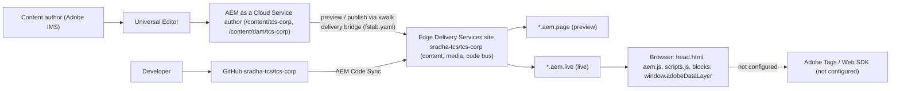

# Project Overview

This page gives anyone joining the TCS Corporate Website project, human or AI agent, a verified summary of what the project is: its objectives and business value, who it serves, the brand, the 13 locale sites and the temporary language master review, the site structure, how content and code are delivered, the technology stack, what is in and out of scope, and the assumptions, dependencies and constraints it works under. It summarizes and links the detailed sources (the handover Part 1, `AGENTS.md`, `utils/site.js`) rather than copying them.

| Attribute | Value |
| --- | --- |
| Audience | Business teams, product owner, new joiners, architects, developers, AMS / support, AI agents |
| Source of truth | [utils/site.js](../../../utils/site.js), [paths.json](../../../paths.json), [fstab.yaml](../../../fstab.yaml), [package.json](../../../package.json), [AGENTS.md](../../../AGENTS.md), [blocks/README.md](../../../blocks/README.md), handover Part 1 — Project Overview ([TCS-CORP-HANDOVER.md](../TCS-CORP-HANDOVER.md)) |
| Last reviewed | Written from main at commit 2d06316 on 21 October 2026 |
| Status | Requires validation (business KPIs, stakeholder names, production domain and launch scope are not recorded) |

## Project at a Glance

| Attribute | Value |
| --- | --- |
| Project name | TCS Corporate Website (code name `tcs-corp`) |
| Purpose | The multi-locale corporate web presence of TCS (Tata Consultancy Services) |
| Platform | Adobe Experience Manager (AEM) as a Cloud Service with Edge Delivery Services |
| Authoring | Universal Editor (AEM authoring for Edge Delivery Services, "xwalk") |
| Content source | The AEM as a Cloud Service author, through the xwalk delivery bridge configured in [fstab.yaml](../../../fstab.yaml) (type `markup`, suffix `.html`) |
| Code repository | GitHub `sradha-tcs/tcs-corp`, default branch `main` |
| Edge Delivery org / site | `sradha-tcs` / `tcs-corp` |
| Boilerplate | `adobe-rnd/aem-boilerplate-xwalk` (`package.json` still carries the boilerplate name `@adobe/aem-boilerplate` and version `1.3.0`) |
| Sites | 13 locale sites, plus the language master published temporarily for review |
| Hosts in use | `main--tcs-corp--sradha-tcs.aem.page` (preview) and `main--tcs-corp--sradha-tcs.aem.live` (live) |
| Production domain and CDN | Not recorded (handover open item O-03, "To be confirmed") |
| Handover | [TCS-CORP-HANDOVER.md](../TCS-CORP-HANDOVER.md) version 2.37 (PDF: [TCS-CORP-HANDOVER.pdf](../TCS-CORP-HANDOVER.pdf)), status "Draft for review"; approvals pending |

## Business and Program Objectives

The handover states that its objectives are derived from the delivered implementation; business KPIs and target values are not recorded in the repository (handover 1.2, BO-9 and SC-9 "To be confirmed").

| Id | Objective | How the implementation supports it |
| --- | --- | --- |
| BO-1 | One corporate web platform for all markets | 13 locale sites served by one code base; locale-aware navigation, footer, error pages, UI text, taxonomy and data ([utils/site.js](../../../utils/site.js)) |
| BO-2 | Fast, search-friendly pages | Three-phase loading, image optimisation, self-hosted Inter variable font, module preloading, PageSpeed target of 100 |
| BO-3 | Autonomous, efficient authoring | Universal Editor component models for every block, the Additional tab, Site Global Templates, a block library per locale |
| BO-4 | Consistent brand experience | TCS.com Design System (Figma) patterns implemented as blocks; design tokens in [styles/styles.css](../../../styles/styles.css) |
| BO-5 | Content discovery | List, Filter List, Cards and Conversation Canvas over the query index and taxonomy |
| BO-6 | Measurable digital experience | Adobe Client Data Layer for every page and block ([decorators/data-layer-decorator.js](../../../decorators/data-layer-decorator.js)) |
| BO-7 | Inclusive experience | WCAG 2.1 AA target in blocks and shared decorators |
| BO-8 | Low operational overhead | Serverless delivery, Git-based deployment through AEM Code Sync, no build pipeline |
| BO-9 | Business KPIs | Not recorded |

Program goals (handover 1.3), with their state on `main` at commit 2d06316:

| Id | Goal | State |
| --- | --- | --- |
| PG-1 | Launch on Edge Delivery Services with Universal Editor authoring | Running on the `aem.page` / `aem.live` hosts; production domain not recorded |
| PG-2 | Block library covering the TCS.com Design System patterns | 30 block folders documented in [blocks/README.md](../../../blocks/README.md); Interactive Dashboard is a placeholder (Experimental) |
| PG-3 | 13 locale sites with their own references, error pages, sheets and data | Implemented in code and `paths.json`; content status per locale not recorded |
| PG-4 | Templates for recurring page types | Home, Article, Blog, Press Release ([templates/README.md](../../../templates/README.md)) |
| PG-5 | Analytics readiness | Data layer implemented; Adobe Tags, Web SDK, Analytics, CJA, Target and AJO not configured |
| PG-6 | Accessibility (WCAG 2.1 AA) | Implemented in blocks and decorators; a formal third-party audit is not recorded |
| PG-7 | Performance (Lighthouse / PageSpeed 100) | Handover revision 2.36 records Lighthouse 99–100 mobile and 100 desktop on the measured pages; no PageSpeed check runs in CI |
| PG-8 | Handover to the run organisation (AMS) | The handover document; AMS acceptance not recorded |

## Business Value

Summarized from handover 1.5 (Business Benefits); each benefit is traceable to code:

- **Performance and SEO**: pages are rendered by Edge Delivery Services from authored HTML and served from its CDN; only the code of the blocks on the page loads; the first section is rendered first for LCP (`scripts/scripts.js`, `scripts/aem.js`).
- **Faster time to market**: authors build and publish pages from ready blocks; code ships by merging to `main` (AEM Code Sync), without a build or deployment window.
- **Lower cost of ownership**: no delivery application servers, no front-end framework or build chain, one code base for 13 locales.
- **Global consistency with local autonomy**: shared design and blocks; each locale owns its navigation, footer, 404 page, UI text, taxonomy, metadata, redirects and data sheets.
- **Data-driven optimisation, once tags are deployed**: every block and interaction is described in the Adobe Client Data Layer, so Adobe Tags rules could be configured without block changes.
- **Inclusive reach and reuse**: accessibility built into shared decorators; templates add structure (Page Header, About the author, Media contacts) from metadata and sheets.

**Why Edge Delivery Services, xwalk and Universal Editor.** No verified selection rationale was identified: the handover records the platform as given (Document Control, 1.1) and lists its benefits (1.5), but does not state why it was chosen over alternatives. The handover does state that authors use the Universal Editor and that documents (Google Drive / SharePoint) are not a content source (assumption 5 in 1.8).

## Target Users

| Group | What they do with the solution | Source |
| --- | --- | --- |
| Site visitors | Browse the 13 locale sites | Handover 2.2 (Solution Context) |
| Search engines | Crawl the pages and `/sitemap.xml` | Handover 2.2, [helix-sitemap.yaml](../../../helix-sitemap.yaml) |
| Content authors (13 locale teams) | Create, edit, preview and publish pages and sheets in Universal Editor | Handover 2.2, Part 5 |
| Developers | Change code through pull requests, preview on feature-branch hosts | Handover 2.2, [AGENTS.md](../../../AGENTS.md) |
| Site and AEM platform administrators | Edge Delivery site configuration, Admin API, AEM users and groups | Handover 2.2, Part 14 |
| AMS / support | Run support, troubleshooting, monitoring | Handover Parts 13, 14, 17 |

Visitor segments or personas are not defined: a `persona` metadata column is indexed ([helix-query.yaml](../../../helix-query.yaml)) and an optional `tcs-corp:audience` tag tree (`cxo`, `it-leaders`, `investors`, `analysts`, `job-seekers`, `media`) is only **proposed** in handover 7.3.2; the published namespace has only `content-type`, `industry` (empty) and `region` (handover 7.3.1).

## Brands

| Brand element | Where it appears | Source |
| --- | --- | --- |
| TCS (Tata Consultancy Services) | The site's brand: the TCS logo in the header brand area, linked to its authored TCS Logo Link (usually the locale Home); accessible name from its alt text, else the `tcsLogo` placeholder ("Tata Consultancy Services") | [blocks/tcs-header/tcs-header.js](../../../blocks/tcs-header/tcs-header.js), [blocks/tcs-header/README.md](../../../blocks/tcs-header/README.md) |
| TATA Group | The TATA logo in the header tools area (TATA Logo Link, usually `https://www.tata.com/`); accessible name from its alt text, else the `tataLogo` placeholder ("TATA Group") | Same |
| TCS.com Design System | The Figma design the blocks implement ("New Screens from New DS" in the handover revisions) | Handover 1.2 (BO-4), revision history 2.2–2.6; the Figma files are not in the repository |

No multi-brand or sub-brand mechanism exists in the code: one brand, one design token set ([styles/styles.css](../../../styles/styles.css)) and one header for all locales.

## Locales

One code base serves every locale; the locale is resolved from the AEM path when editing in Universal Editor, else from the published path (`getLocale` in [utils/site.js](../../../utils/site.js)). Pages outside a locale (Site Global Templates, drafts) use the default locale `en`. [paths.json](../../../paths.json) is generated from `LOCALES` by `npm run build:paths` ([tools/paths/generate-paths.mjs](../../../tools/paths/generate-paths.mjs)).

| # | AEM path (below `/content/tcs-corp`) | Published at | `<html lang>` |
| --- | --- | --- | --- |
| 1 | `us/en` | `/en` | en-US |
| 2 | `de/de-de` | `/de-de` | de-DE |
| 3 | `fr/fr-fr` | `/fr-fr` | fr-FR |
| 4 | `ca/fr-ca` | `/fr-ca` | fr-CA |
| 5 | `es/es-es` | `/es-es` | es-ES |
| 6 | `pt/pt-pt` | `/pt-pt` | pt-PT |
| 7 | `nl/nl-nl` | `/nl-nl` | nl-NL |
| 8 | `se/sv-se` | `/sv-se` | sv-SE |
| 9 | `dk/da-dk` | `/da-dk` | da-DK |
| 10 | `no/no-no` | `/no-no` | no-NO |
| 11 | `cn/zh-cn` | `/zh-cn` | zh-CN |
| 12 | `jp/ja-jp` | `/ja-jp` | ja-JP |
| 13 | `kr/ko-kr` | `/ko-kr` | ko-KR |

**Language master under review (temporary).** The language master `/content/tcs-corp/language-master/en`, the rollout source of `/en`, is published at `/language-master/en/` so it can be reviewed as a site of its own. Its pages list the language master's own pages from the query index, read its own placeholders, redirects, taxonomy and data sheets and its own references and error pages, and inherit Navigation, Footer and 404 Page up to its root page (`REVIEW_ROOTS`, `REVIEW_SHEETS`, `REVIEW_PAGES`, `indexRoot`, `localeSheetPath`, `localePagePath` in [utils/site.js](../../../utils/site.js); the `REVIEW` block of [tools/paths/generate-paths.mjs](../../../tools/paths/generate-paths.mjs): 11 of the 154 mappings and one include). It is to be removed after the rollout (handover 3.9, finding F-88); the rollout date is not recorded. Test: [test/site/index-root.test.mjs](../../../test/site/index-root.test.mjs).

Content status per locale and the launch scope per locale are not recorded (handover PG-3, SC-1 "To be confirmed"). There is no language switcher component and no hreflang (handover 1.6.2).

## Site Structure

Every locale site has the same layout (details: [AGENTS.md](../../../AGENTS.md#site-structure-and-site-data), handover Part 3 — Site Structure):

```text
/content/tcs-corp/                  site root (not published; "/" needs a redirect to /en/)
├── us/en/                          a locale site; the locale page itself is Home (/en/)
│   ├── …                           content pages
│   ├── references/                 nav (header), footer and other fragments
│   ├── error-pages/                404 (used by 404.html); 403 / 500 for a CDN
│   ├── block-library/              every block variation; not published
│   ├── placeholders, metadata, taxonomy, redirects   sheets / taxonomy page
│   └── data/                       authors, locations, partners, social-links, media-contacts
├── de/de-de/ … kr/ko-kr/           the 12 other locale sites, same layout
├── language-master/en/             published temporarily at /language-master/en/ for review
└── site-global-templates/          template pages authors copy; not published
/content/dam/tcs-corp/              AEM Assets (included in paths.json, published with pages)
```

Header, footer and the 404 page are inherited like page properties: the page's own value, else the nearest parent page's up to the locale Home, else the locale's `references/nav`, `references/footer` or `error-pages/404` ([utils/inherited-metadata.js](../../../utils/inherited-metadata.js)). One query index (`/query-index.json`) and one sitemap (`/sitemap.xml`) serve all locales ([helix-query.yaml](../../../helix-query.yaml), [helix-sitemap.yaml](../../../helix-sitemap.yaml)).

## Delivery Model

Authoring, code and delivery are separate (handover 2.1, 2.6):



| Environment | Host | Content | Code |
| --- | --- | --- | --- |
| Local development | `http://localhost:3000` (`aem up`) | Previewed content, or `drafts/` with `--html-folder drafts` | Local working copy |
| Feature preview | `https://{branch}--tcs-corp--sradha-tcs.aem.page/` | Previewed content | Feature branch |
| Preview (main) | `https://main--tcs-corp--sradha-tcs.aem.page/` | Previewed content | `main` |
| Live (main) | `https://main--tcs-corp--sradha-tcs.aem.live/` | Published content | `main` |
| Production | Not recorded (open item O-03) | Published content | `main` |

Code is trunk-based: short-lived branches merged into `main` through pull requests; Code Sync deploys every push (handover 12.2, 12.3; [AGENTS.md](../../../AGENTS.md#publishing-process)). CI ([.github/workflows/main.yaml](../../../.github/workflows/main.yaml)) runs `npm ci` and `npm run lint` on every push; unit tests and PageSpeed checks are not run by CI. Content is previewed and published from AEM. The only Git tags (`home-content-package_*`) mark earlier states of the `home-content-package` downloads branch (deliverables such as the handover PDF), not code releases. Branch protection, approval workflows and SLAs are not recorded (open items O-05, O-06, O-13).

## Technology Stack

| Layer | Technology | Source |
| --- | --- | --- |
| Authoring | AEM as a Cloud Service, Universal Editor, component definitions / models / filters | [component-definition.json](../../../component-definition.json), [component-models.json](../../../component-models.json), [component-filters.json](../../../component-filters.json), `blocks/*/_*.json`, `models/_*.json` |
| Delivery | Edge Delivery Services (aem.page / aem.live), path mapping, query index, sitemap | [fstab.yaml](../../../fstab.yaml), [paths.json](../../../paths.json), [helix-query.yaml](../../../helix-query.yaml), [helix-sitemap.yaml](../../../helix-sitemap.yaml) |
| Front end | Vanilla JavaScript (ES modules), CSS3, semantic HTML5; no framework, no transpiling, no build step | [scripts/scripts.js](../../../scripts/scripts.js), [styles/styles.css](../../../styles/styles.css) |
| Core library | `scripts/aem.js` (never modified), including `sampleRUM` (RUM) | [scripts/aem.js](../../../scripts/aem.js) |
| Vendored libraries | DOMPurify 3.2.4 (editor updates), Lottie light player 5.13.0 (Lotto animations) | [scripts/dompurify.min.js](../../../scripts/dompurify.min.js), [scripts/lib/lottie/](../../../scripts/lib/lottie/lottie_light.min.js) |
| Fonts | Self-hosted Inter variable font (Latin `unicode-range`), scaled fallback faces | [styles/fonts.css](../../../styles/fonts.css) |
| Analytics | Adobe Client Data Layer, populated centrally; Adobe Tags and the Web SDK not configured | [decorators/data-layer-decorator.js](../../../decorators/data-layer-decorator.js), [utils/analytics.js](../../../utils/analytics.js) |
| Tooling | Node.js (README: 20 or newer; CI: 24), npm, AEM CLI, ESLint 8 (Airbnb, `eslint-plugin-xwalk`), Stylelint (standard), Husky, Renovate, Node test runner | [package.json](../../../package.json), [.eslintrc.js](../../../.eslintrc.js), [.renovaterc.json](../../../.renovaterc.json) |

No runtime npm dependencies exist; only dev dependencies ([package.json](../../../package.json)).

## Scope

**In scope (implemented on `main`).** 13 locale sites and the language master review; 30 block folders ([blocks/README.md](../../../blocks/README.md): 28 Active, Columns Compatibility-only, Interactive Dashboard Experimental); default content through AEM's built-in Text, Title and Image (the built-in Button is "Button (basic)", no longer offered); three section containers (Columns Container, Tabs Container, Gen Carousel); four templates; the Additional tab, animations and skeletons; the data layer; placeholders, metadata, taxonomy, redirects and data sheets per locale; SEO head mapping ([decorators/seo-decorator.js](../../../decorators/seo-decorator.js)); the 404 page with inherited error pages ([404.html](../../../404.html)); WCAG 2.1 AA practices.

**Out of scope or not implemented** (handover 1.6.2 and 16.4, checked against the code):

| Item | State |
| --- | --- |
| Adobe Tags, AEP Web SDK, Adobe Analytics, CJA | Not configured; [scripts/delayed.js](../../../scripts/delayed.js) holds only a comment (blocked: measurement plan) |
| Adobe Target, Adobe Journey Optimizer | No integration in the repository |
| Consent management | Not implemented |
| Form submission back end | Not implemented: Form Variations dispatches `form-variations:submit` (finding F-01) |
| Search service | Not implemented: Conversation Canvas dispatches `conversation-canvas:search` |
| Production CDN and domain | Not configured; the sitemap origin is the `aem.live` host |
| Per-locale redirects at the edge, `/` → `/en/` | Not implemented (the platform applies only a root `/redirects.json`) |
| 403 / 500 / maintenance pages served by the platform | Not implemented (only `404.html`) |
| hreflang, language switcher, breadcrumb, authentication | Not implemented |
| Interactive Dashboard | Placeholder that renders nothing |

## Assumptions

From handover 1.8 (each still "To be confirmed" where marked there): AEM as a Cloud Service stays the single content source (one mount point in `fstab.yaml`); the site configuration's `public.json` paths match the repository `paths.json`; bulk metadata applies only once all 13 sheets are listed in `metadata.source`; each locale publishes at least `references/nav`, `references/footer` and `error-pages/404`; authors use Universal Editor, not documents; the site is public and stores no personal data itself; a production domain and CDN will be configured before go-live; analytics, personalisation and form processing come later through the data layer and DOM events; translations are managed in AEM; visitors use current evergreen browsers.

## Dependencies

| Dependency | Used for |
| --- | --- |
| AEM as a Cloud Service author, Universal Editor, AEM Assets, Adobe IMS / Admin Console | Authoring, assets, sign-in |
| Edge Delivery Services (content, media and code bus; Admin API; configuration service) | Rendering and delivery |
| AEM Code Sync (GitHub App), GitHub `sradha-tcs/tcs-corp` | Code deployment, pull requests, CI |
| YouTube, Vimeo, X (Twitter) | Embeds and videos, only where authored |
| Browser Web Speech API | Conversation Canvas speech input, where supported |
| Node.js, npm, AEM CLI | Developer tooling only |
| Production CDN / DNS | Not recorded (O-03) |

Details and impact if unavailable: handover 1.9.

## Constraints

Verified constraints the code and content work under (rules in [AGENTS.md](../../../AGENTS.md)):

- **No build step**: modules load as authored, so `head.html` modulepreload links and `scripts/module-graph.js` must be regenerated (`npm run build:modules`) after import changes; `npm test` checks them.
- **`scripts/aem.js` is never modified** (boilerplate rule).
- **AEM delivery rules**: empty rows per dialog tab, item first cells, collapsed field suffixes, no grouped fields in key-value blocks, no `classes_*` on sections (container sections use `container*` fields), template values stored on new components, item names in class-name form, non-image DAM files served only once published.
- **Universal Editor**: at most three short dialog tabs (the last one Additional); `multi: true` on `aem-content` fields isn't saved; author has no query index (List and Filter List show an author message).
- **Platform**: only a root `/redirects.json` is applied; bulk metadata needs the site configuration's `metadata.source`; only `404.html` is served as an error page.
- **CSS**: sizes in rem, mobile-first `min-width` breakpoints at 600 / 900 / 1200 px, selectors scoped to the block.
- **Tooling**: ESLint pinned to v8 until airbnb-base supports v9 ([.renovaterc.json](../../../.renovaterc.json)).
- **Typography**: the Inter font covers Latin only; Chinese, Japanese and Korean text uses the system sans-serif font.

## Key Terminology

| Term | Short meaning |
| --- | --- |
| xwalk | AEM authoring (Universal Editor) for Edge Delivery Services |
| Locale site | One of the 13 country / language sites |
| Language master | `/content/tcs-corp/language-master/en`, temporarily published at `/language-master/en` |
| Block / section container / item | A decorated component / a section turned into a block / a row added to a block with Add |
| Additional tab | The last dialog tab of every block except header and footer |
| Query index | `/query-index.json`, the published pages and their metadata columns |
| Placeholders | UI text per locale, with English fallbacks in code |
| Data layer | `window.adobeDataLayer` (Adobe Client Data Layer) |

Full definitions: [glossary.md](./glossary.md).

## Related

- [repository-structure.md](./repository-structure.md): folders and files, purpose and rules
- [glossary.md](./glossary.md): project, Adobe and handover terms
- [references.md](./references.md): repository documents and cited Adobe documentation
- [architecture.md](./architecture.md), [blocks.md](./blocks.md), [content-architecture.md](./content-architecture.md), [data-layer-and-analytics.md](./data-layer-and-analytics.md), [design-system.md](./design-system.md), [personalization.md](./personalization.md): the other knowledge base topics
- [AGENTS.md](../../../AGENTS.md): verified project rules
- [blocks/README.md](../../../blocks/README.md): block inventory
- [utils/site.js](../../../utils/site.js): locales and the language master review
- Handover Part 1 — Project Overview, Part 3 — Site Structure, Part 16 — Handover Findings and Open Items Register: [TCS-CORP-HANDOVER.md](../TCS-CORP-HANDOVER.md)
