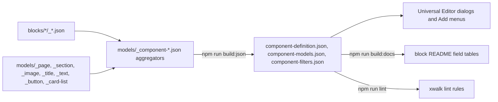

# Universal Editor: Models, Definitions and Filters

This file is the knowledge base entry for the Universal Editor configuration of the TCS Corporate Website (xwalk): how component definitions, models and filters are written and built, the dialog and field naming conventions that follow from what AEM really delivers, the field types in use, defaults, conditions, validation, items versus multifields, legacy properties, the procedure for changing a field, the lint rules and the validation every model change needs. It summarizes the verified rules and links to the detailed sources.

| Attribute | Value |
| --- | --- |
| Audience | Developers and AI agents changing block models; architects and QA reviewing them |
| Source of truth | `blocks/*/_*.json`, [models/](../../../models/_component-models.json), [component-models.json](../../../component-models.json), [component-definition.json](../../../component-definition.json), [component-filters.json](../../../component-filters.json), [.eslintrc.js](../../../.eslintrc.js), [AGENTS.md](../../../AGENTS.md) ("AEM delivery rules", "Dialog tabs", "Item children", "Additional tab"), [docs/audit/](../../../docs/audit/BLOCK-ECOSYSTEM-AUDIT.md) |
| Last reviewed | Written from main at commit 2d06316 on 21 October 2026 |
| Status | Current; persistence checks in Universal Editor require validation (blocked: AEM author access) |

## How the Configuration Is Built

| File | Role | Edit? |
| --- | --- | --- |
| `blocks/<block>/_<block>.json` | The block's `definitions`, `models` and `filters` (partial) | Yes |
| `models/_page.json`, `_section.json`, `_image.json`, `_title.json`, `_text.json`, `_button.json` | Page properties (`page-metadata`), Section, and the default content components | Yes |
| `models/_card-list.json` | Shared field groups (`header`, `cards`, `layout`, `scroll`, `advanced`) included by List and Cards with `"...": "../../models/_card-list.json#/fields/<group>"` | Yes |
| `models/_component-models.json`, `_component-definition.json`, `_component-filters.json` | Aggregators: include the `models/` partials and `../blocks/*/_*.json`; the filters aggregator also defines the `main` filter | Rarely |
| `component-models.json`, `component-definition.json`, `component-filters.json` | Generated by `npm run build:json` (`merge-json-cli`), read by Universal Editor | Never by hand |
| `xwalk.json` | `public.xwalk.multi-field.enabled: true` | No |
| `.husky/pre-commit.mjs` | When a staged file matches `_*.json`, runs `npm run build:json` and stages the three generated files | No |

Partials start with `_` and aren't served (`.hlxignore`).



## Definitions

Definitions are grouped in `component-definition.json`: Default Content (Text, Title, Image, Button (basic)), Sections (Section) and Blocks (57 components: blocks, items and section containers).

| Kind | `resourceType` | Template |
| --- | --- | --- |
| Block | `core/franklin/components/block/v1/block` | `name` (becomes the block class), `model`, optional `filter`, `key-value: true` for key-value blocks, default values |
| Item | `core/franklin/components/block/v1/block/item` | `name`, `model`, default values |
| Section container | `core/franklin/components/section/v1/section` | `name`, `model`, `filter`, `style` (e.g. `columns-container-section`), default values |
| Built-in | `core/franklin/components/{text,title,image,button,columns}/v1/...` | Fixed fields only |

- **The template name is the block class**: AEM renders a block with the class-name form of its template name, not the component id ("Button Block" gives `button-block`; "Column Break" gives `column-break`). `test/models/block-names.test.mjs` checks that every block component's template name names a block folder.
- **Key-value blocks** (17: Anchor List, Button, Cards, Column Break, Conversation Canvas, Filter List, List, Page Header, Quote, Separator, Tab, Table List, Tabs block, TCS Header, Teaser, Testimonial, Video) render one `name | value` row per field, read with `readProperties` (`utils/properties.js`). The other blocks render a row per field (or group) in model order.
- **Only standard resource types** are allowed (`xwalk/no-custom-resource-types`).

## Filters

`component-filters.json` holds 26 filters. `main` (page level) allows Section, Gen Carousel, Tabs Container and Columns Container; `section` allows the blocks authors add to a section; `columns-container`, `tabs` and `gen-carousel` restrict the section containers; each container block has a filter of its items (e.g. `hero: hero-cta`). The compatibility-only Columns and Button (basic) and the experimental Interactive Dashboard are in no filter; the built-in Columns keeps its implicit `columns > column > text, image, title` filters so Columns authored before stay editable. The full table is in [blocks.md](./blocks.md#container-and-child-relationships).

## Field Types in Use

Counted in `component-models.json` at commit 2d06316: 63 models, 991 top-level field entries (82 of them tabs), 1027 including the sub-fields of the 14 `container` fields.

| Component | Count | Typical use |
| --- | --- | --- |
| `select` | 465 | Options, Title Type, Additional tab spacing and animation |
| `text` | 179 | Titles, labels, ids, alt text |
| `boolean` | 128 | Show / hide toggles, Hide block |
| `tab` | 82 | Dialog tabs (also an empty cell in item rows) |
| `aem-content` | 45 | Links, pages, fragments, transcripts, captions |
| `richtext` | 41 | Descriptions, captions, card text |
| `number` | 38 | Counts, columns, intervals, times |
| `reference` | 18 | Images, posters, logos, icons |
| `container` | 14 | Legacy composite multifields (12, `multi: true`) and the Conversation Canvas `menu` / `searchBar` groups (collapsible) |
| `aem-tag` | 9 | Tags (`multi: true` on Card, List, List Item, Teaser) |
| `multiselect` | 6 | `classes` of Cards, List and Table; Columns Container `style`; Filter List Page types and Content types |
| `date-time` | 2 | Teaser and Card date |

Other properties: `description` on 418 fields, `condition` on 155, `options` on 471 (4292 options), `validation` on 35, `required` on 23, `min` / `max` on 34, `readOnly` on 6 (the form items' Field type), `placeholder` on 4. The audit counts (926 dialog fields after the first audit, 924 after the re-audit) used another method (`docs/audit/data/dialog-fields.csv`).

## Dialog Tabs

- **At most three short tabs per model, the last one Additional.** Universal Editor collapses the tabs into a dropdown when they don't fit on one line. No model has more than three tabs; 28 models end with Additional (e.g. Content / Display / Additional for List and Cards, Content / Style / Additional for Hero and Teaser, Video / Playback / Additional for Video). Header and Footer have no Additional tab.
- **Key-value blocks**: tabs only group fields in the dialog; regrouping them changes nothing in the content.
- **Other blocks**: AEM adds an empty row for each dialog tab (Form Variations, Table, Accordion, Hero, Embed, Fragment, Modal): read rows by `data-aue-prop` in the editor, else skip empty tab rows, never "the first row".
- **Item models** (List Item, Card, Tab item, Anchor Link, Stats, Filter Category / Page): each tab is an empty cell of the row, so a tab change shifts the cells. Keep the layout constants and their tests in step: `ITEM_LAYOUT` (`blocks/list/list-data.js`, `blocks/anchor-list/anchor-list.js`, `blocks/tabs/tabs.js`), `CARD_LAYOUT` (`blocks/cards/cards-data.js`), `CATEGORY_LAYOUT` / `PAGE_LAYOUT` (`blocks/filter-list/filter-list.js`); `withoutTabCells` and `matchCells` in `utils/cells.js` drop tab cells and match cells to fields; `test/model-layout.mjs` derives the expected cells from the model.

## Field and Property Naming

The naming rules follow what AEM delivers, verified on aem.page in the block audit of 19 October 2026 ([AGENTS.md](../../../AGENTS.md#blocks), "AEM delivery rules"):

| Rule | Effect | Convention | Example |
| --- | --- | --- | --- |
| Field collapse | Fields ending in `Text`, `Title`, `Type`, `Alt` or `MimeType` fold into their base field (`linkText` is the link's text, `imageAlt` the image's alt, `linkType` becomes bold / italic around the link) | Use the suffix only to fold; for a value that must be read, use another name | `buttonVariant` (not `buttonType`); `posterAlt` folds into `poster` |
| Element grouping | `<group>_<field>` fields render in one cell in row-per-field blocks; **in key-value blocks grouped fields aren't delivered** | Plain names in key-value blocks | Video `poster` / `posterAlt` (was `placeholder_image`, lost: audit L-2); Hero `content_*` (row-per-field block) |
| Block options | A field named `classes` or `classes_<name>` arrives as block classes, never as a content row | Presentation options and the Additional tab | `classes_anchor`, `classes_paddingtop`, Teaser `classes` |
| Section fields | **Sections don't get their `classes_*` fields delivered**: only `style` (as classes) and other fields as data attributes | Section containers use `container*` names, turned into classes by `applySectionBlockOptions` (`scripts/scripts.js`) | `containerAnchor`, `containerHide`, `containerAnimation`, `containerPaddingTop` (re-audit R-L-1) |
| Item node name | An item's `name` property is delivered in class-name form, and an item model with `classes` starts with a cell `<node name>, <classes>` | A value whose case matters gets its own field | Form Variations `fieldName` (re-audit R-D-1); first cell `email, field-text` |
| Non-image references | A Lottie `.json` or PDF reference is delivered as a link whose text is its Alt | Read it with `animationLabel` (`utils/media.js`) | Hero / Teaser Lottie alt (re-audit R-B-3) |
| Built-in components | Built-in Button, Title, Image and Text deliver only their fixed fields; built-in Columns no `classes_*` | Don't add fields to built-in models | Button (basic), Columns Additional tab removed |
| Field name syntax | Letters, digits, `_`, `-`, `:`; starts with a letter; at most one `_` and one `:` | `xwalk/invalid-field-name` | `classes_animationspeed`, `jcr:title` |

Property naming habits in the models: camelCase names (`showEyebrow`, `desktopColumns`); `show*` booleans for optional parts; `*Alt` next to each image; `titleType` next to `title`; Additional tab names are lower case after the prefix (`classes_paddingleft`), container names camelCase (`containerPaddingLeft`).

## The Additional Tab

| Field | Blocks (`classes_*`) | Section containers (`container*`) |
| --- | --- | --- |
| Anchor ID | `classes_anchor` (24 models), validated `^anchor-[a-z0-9][a-z0-9-]*$` | `containerAnchor` (same validation) |
| Hide block | `classes_hideblock` (25 models) | `containerHide` |
| Animation Type, Motion Speed, Animation Trigger | `classes_animation`, `classes_animationspeed`, `classes_animationtrigger` (17 models) | `containerAnimation`, `containerAnimationSpeed`, `containerAnimationTrigger` (Columns Container, Gen Carousel, Tabs Container) |
| Background animation | `classes_bganimation` (Hero, Teaser, Quote, Testimonial, Form Variations, Conversation Canvas) | none |
| Padding / Margin Left, Right, Top, Bottom | `classes_padding*`, `classes_margin*` (`--space-*` tokens: `pt-400` = `var(--space-400)`) | `containerPadding*`, `containerMargin*` |

`decorators/block-options-decorator.js` makes the anchor class the block's id (de-duplicated with `-2`, `-3`); `styles/styles.css` applies Hide block and spacing; `utils/motion.js` and `decorators/motion-decorator.js` run the animations. Motion Speed and Animation Trigger show only once an animation is chosen (condition on `classes_animation`). Copy the tab from an existing `_<block>.json` into a new block model; the Tab item's Additional tab has only Hide block and the Column Break's has no animation fields.

## Defaults and the Template-Value Rule

- **Template values are stored.** New components get their definition template values written to the content, so a sample text in a template appears on every new item: no sample content in templates or model defaults. Use them only for settings (`buttonView: button`, `titleType: h2`, `desktopMode: grid`).
- Corrected cases (re-audit): Table List "Explore" (R-A-6), Tab title "Tab" (R-C-10), Accordion Item Lorem Ipsum (R-C-11), Table rows "Column1" (R-D-9). Retained exceptions: the Submit Button `label` "Send" (template value; localised by translation only, re-audit review D, low) and the TCS Header logo alt defaults ("Tata Consultancy Services", "TATA Group").
- **Model `value`** (672 fields) is the dialog default; keep it equal to the code's default so an empty value and the default render the same (Hero CTA Arrow default corrected to Auto in the audit).
- UI text that isn't authored content comes from placeholders (`utils/placeholders.js`), never from defaults.

## Enumerations

- `select` and `multiselect` options are `{ name, value }`: `name` is the dialog label, `value` the stored value (lower case, hyphenated, usually the class or keyword the code reads, e.g. `align-top`, `motion-fade-up`, `per-row-2`).
- An option with the empty value `''` is the default / none choice in 39 models (e.g. Conversation Canvas `classes` Default, Teaser Layout Image & Text); code treats `''` and a missing value alike.
- Shared vocabularies live in code and must match the options: `BUTTON_VIEWS`, `BUTTON_TYPES`, `BUTTON_ALIGNMENTS` (`utils/buttons.js`), `CARD_STYLES`, `CARD_THEMES`, `IMAGE_RATIOS` (`utils/card-list-config.js`), `CONTENT_MOTIONS`, `BACKGROUND_MOTIONS`, `MOTION_SPEEDS`, `MOTION_TRIGGERS` (`utils/motion.js`); unknown values are ignored.
- When an option is removed, keep reading its stored value (Separator Width "Auto" = 100 %, Variant "Custom" = Default).

## Conditional Visibility

155 fields have a `condition` in JsonLogic, built from `var`, `===`, `!==`, `!`, `and` and `or` (`var` 277 times, `and` 59, `or` 40, `!` 16). Examples:

```json
{ "===": [{ "var": "buttonView" }, "icon"] }
```

```json
{ "and": [{ "var": "classes_animation" }, { "!==": [{ "var": "classes_animation" }, ""] }] }
```

Uses: Button Icon only for the Icon view; Motion Speed and Trigger only with an animation; List source-specific fields; List / Cards layout fields per breakpoint mode (`desktopMode` grid vs horizontal-scroll); Teaser single vs multiple links. Conditions only control the dialog; the code reads whatever AEM delivers, so it applies the same rule when it reads a value (whether a hidden field's stored value is delivered was not verified in the repository). Legacy-only fields (Separator Component ID, Background contrast, Stretch to container width) are shown only where a value already exists (re-audit D-D-17).

## Validation

| Kind | Fields | Rule |
| --- | --- | --- |
| `regExp` Anchor ID | `classes_anchor`, `containerAnchor` | `^anchor-[a-z0-9][a-z0-9-]*$` |
| `regExp` anchor name / tab id | Section, Columns Container, Tabs `anchorName`; Tab and Tabs item `tabId` | `^#?[a-z0-9][a-z0-9-]*$` |
| `regExp` Component ID | Separator `componentId` | `^[A-Za-z][A-Za-z0-9_-]*$` |
| `numberMin` / `numberMax` | Table List `maxCards` | 1 to 10 |
| `maxLength` | Card `analyticsLabel` | 120 |
| `min` / `max` | 34 `number` fields | Ranges of counts and columns |
| `required` | 23 fields: item links (`hero-cta`, `page-header-cta`, `teaser-link`, `list-item`, `footer-link`), form field `fieldName` and `label`, Tab / Tabs item `title`, List `source`, Video `uri`, Filter List item fields, Contact Card region and name | Enforced in the dialog |

Every `validation` has a `customErrorMsg`. The code still validates what it reads (ids through `availableId`, URLs through `isSafeUrl`), because content authored before a rule isn't revalidated.

## Help Text

418 fields have a `description` (the help text under the field) and 4 a `placeholder`. Descriptions say what the field does on the page and its default ("Optional tooltip (most buttons need none)."), label legacy fields ("Links authored before Anchor Link items. Add links to the list with Add (Anchor Link) instead.") and name the AEM delivery consequence where an author could be surprised. Outdated guidance is a defect (re-audit R-D-16, R-A-4). Labels and help text are written in English in the models; no localisation mechanism for dialog text exists in the repository.

## Multifields and Item Children

| Approach | Status | Rule |
| --- | --- | --- |
| Item children (components added with Add, own model, in the container's filter) | Standard | All repeating content: List Items, Cards, CTAs, Teaser Links and Stats, Testimonial Stats, Anchor Links, Filter List tags / categories / pages, Footer Links, form fields, Table rows, Tabs items, Canvas buttons |
| Composite multifields (`container` with `multi: true`) | Compatibility-only | They didn't render from content packages; the 12 remaining ones are labelled "authored before" and still read (`readMultifieldItems` in `utils/multifield.js`, `readLinkItems` in `utils/links.js`, `buildStats` in `decorators/stats-decorator.js`) |
| `multi: true` on simple fields | Used | `aem-tag` (tags) and Page Keywords; Universal Editor doesn't save `multi: true` on `aem-content` fields |
| Non-multi `container` | Used | Collapsible groups in the Conversation Canvas dialog (`menu`, `searchBar`) |

The audit recommends removing the legacy multifields after confirming that no production content uses them (deferral D-B-14, blocked: production content check).

## Container-Child Models

- An item model is a `core/franklin/components/block/v1/block/item` definition with its own model, listed in the container's filter; it has no folder and is documented in its container's README.
- AEM renders each item as a row after the block's own rows, one cell per field (empty and tab cells included); an item model with a `classes` field starts with a `<node name>, <classes>` cell (form items: `classes` is a read-only Field type).
- `itemRows(block, models, isItem)` in `utils/cells.js` finds the item rows: by `data-aue-model` in Universal Editor, else by the cell count (`KEY_VALUE_ITEM` for key-value blocks: 1 or 3+ cells, so a two-field item starts with a tab; `FIELD_ROW_ITEM` for row-per-field blocks: 2+ cells), tested in `test/items/item-rows.test.mjs`.
- An item without content yet (just added) is a placeholder in the editor (`decorators/editor-item-decorator.js`, placeholder key `itemEditorHint`) and is left out on the page.
- `xwalk/max-cells` limits the cells of non key-value models; the item models that need more cells have their own limits in `.eslintrc.js`.

## Accessibility and Analytics Fields

| Purpose | Fields |
| --- | --- |
| Alt text (collapses into its image) | 16 `*Alt` fields: Image, Section and Columns Container background, Card, List Item, Hero image and icon, Quote, Teaser and author images, Testimonial author, TCS Header logos, Embed placeholder, Canvas icon, Video poster |
| Accessible names | Card and List Item `ariaLabel`, Gen Carousel `carouselAriaLabel`, Tabs / Tabs block `tabsAriaLabel`, Separator `accessibleLabel` and `accessibilityMode` (decorative / semantic) |
| Headings | `titleType` and similar Title Type selects (h1 to h6) next to titles |
| Media | Video `transcript`, `captions`, `captionsLanguage`, `captionsLabel`, `privacyMode` |
| Analytics | `analyticsEnabled` (Cards, List, Separator), `analyticsLabel` (Card, List Item, Separator) |

Blocks don't push clicks; the central data layer reads `data-cmp-*` attributes ([decorators-and-utilities.md](./decorators-and-utilities.md)). Adobe Tags and the Web SDK are not configured (blocked: measurement plan), so analytics fields only shape the Adobe Client Data Layer.

## Legacy Properties and Migrations

The code keeps reading values authored before a model change; content is migrated separately (the library by `.home-work/bl/bl-migrate.mjs`, not in git; AEM content by authors or a script).

| Former property | Current | Code compatibility | Content action |
| --- | --- | --- | --- |
| Video `placeholder_image` / `placeholder_imageAlt` (grouped, not delivered) | `poster` / `posterAlt` | Rows of the former group are read (`blocks/video/video.js`) | Copy the property in AEM (re-audit R-D-7) |
| Hero `classes_motion`, Table List `motion` (Motion Type) | Additional tab Animation Type / Speed | `addLegacyMotion` (`utils/motion.js`) | Set the Additional tab (R-A-7, R-B-6) |
| Form item `name` as the key | `fieldName` | Older items keep working with lower-case keys | Set `fieldName` where the case matters (R-D-1) |
| Canvas Button `linkType` | `buttonVariant` (own `conversation-canvas-button` model) | Old items keep model `button` and render as before | Copy `linkType` to `buttonVariant` |
| Built-in Button View / Icon / Alignment / Tertiary | Button block | Primary / Secondary still render | Replace by a Button block |
| Built-in Columns | Columns Container / Column Breaks | Columns still render | Rebuild as Columns Container or Column Breaks |
| Composite multifields (CTA List, Links, Stats, Pages, Tags, Categories) | Item children | Read when present | Re-author as items |
| List / Cards Component ID, Touch swipe; Reduced motion | Anchor ID; removed | Component ID and Touch swipe read; Reduced motion ignored (always honoured) | None required |
| Separator Width Auto, Variant Custom | Widths, Default | Still read | None required |
| Page Header CTA style `''` | `tertiary` | `''` still a text link | None required |

Sources: [BLOCK-ECOSYSTEM-AUDIT.md](../../../docs/audit/BLOCK-ECOSYSTEM-AUDIT.md) section 11, [REAUDIT-2026-10-20.md](../../../docs/audit/REAUDIT-2026-10-20.md) section 5, [DIALOG-OPTIONS-2026-10-20.md](../../../docs/audit/DIALOG-OPTIONS-2026-10-20.md) section 5.

## Procedure: Adding or Changing a Field

1. **Check what exists**: the block README ("Authorable Fields", "Extending the Block"), the shared groups in `models/_card-list.json` and the Additional tab; don't duplicate an existing control.
2. **Choose the name** against the delivery rules (no collapse suffix unless folding, no grouping in key-value blocks, `container*` on section containers, a dedicated field for case-sensitive values).
3. **Edit the partial** (`blocks/<block>/_<block>.json` or `models/_*.json`): field, label, description, `value`, options, condition, validation; no sample content in the template.
4. **Rebuild**: `npm run build:json` (the pre-commit hook also does it); never edit `component-*.json` by hand.
5. **Read it in code** through `readProperties` / `itemRows` / `matchCells`; update `ITEM_LAYOUT` / `CARD_LAYOUT` and their tests when an item model's fields or tabs change; keep reading the old property when renaming.
6. **Lint and test**: `npm run lint`, `npm test`; `npm run build:modules` if imports changed.
7. **Document**: `npm run build:docs` (field tables), the written sections of the README, `tools/docs/blocks.json` if status or relationships change, the handover for significant changes.
8. **Validate** in the editor and on aem.page (table below); migrate the library and record the content action for AEM content.

## Lint Rules

`.eslintrc.js` extends `plugin:xwalk/recommended` (`eslint-plugin-xwalk` 0.1.1); `npm run lint` passed at commit 2d06316.

| Rule | Checks |
| --- | --- |
| `xwalk/max-cells` | Cells a model renders (collapse suffixes fold into their base field, `prefix_*` groups count once, tabs don't count, a multi container counts once); key-value models and `*-metadata` models are exempt. Limits: `*` 4, `section` 6, `tabs` 21, `gen-carousel` 18, `columns-container` 22, `table-list` 10, `table-list-card` 6, `list-item` 19, `card` 16, `table-col-5` 5, `field-text` / `field-select` / `field-textarea` 6, `field-checkbox` / `contact-card` 5 |
| `xwalk/invalid-field-name` | Name syntax (see Naming) |
| `xwalk/no-duplicate-fields` | No duplicate names in a model |
| `xwalk/no-orphan-collapsible-fields` | A suffixed field needs its base field |
| `xwalk/no-custom-resource-types` | Only standard resource types |

## Common Errors

| Symptom | Cause | Fix |
| --- | --- | --- |
| Dialog field missing or outdated in Universal Editor | `component-*.json` not rebuilt or not deployed | `npm run build:json`, commit, wait for code sync (handover 13.5) |
| Value saved but not on the page | Collapse suffix, grouped field in a key-value block, or `classes_*` on a section | Rename per the delivery rules; keep reading the old name |
| Block renders empty or shifted on aem.page but fine locally | An empty tab row or tab cell read as content; item first cell `<name>, <classes>` | Skip tab rows / cells (`withoutTabCells`), read by model |
| Every new item shows the same text | Sample text in the template or model default | Empty the template; use placeholders for UI text |
| `max-cells` lint error | Too many cells in a non key-value model | Make the block key-value, group or fold fields, or raise the limit with a reason in `.eslintrc.js` |
| Block class wrong or block code not loaded | Template name doesn't match the folder | Fix the template name (`test/models/block-names.test.mjs`) |
| Key lower-cased | Item `name` delivered in class-name form | A dedicated field (`fieldName`) |

## Validation Required for Every Model Change

| Area | How | Recorded state |
| --- | --- | --- |
| Model | `npm run build:json`, `npm run lint` | Passed at commit 2d06316 |
| Persistence | Save, reload and re-open the dialog in Universal Editor; check the stored property | Blocked: AEM author access (audit section 9; D-A-26 date storage) |
| Rendering | Library page in the local preview and on aem.page, block by block | Executed in the audits (package 1.0.9 / 1.0.10) |
| Responsive | 1440, 1024, 768, 600 and 390 px | Executed in the audits (940 loads) |
| Accessibility | axe at 1440 and 390 px, keyboard, names, contrast; screen reader | axe executed (0 violations after fixes); screen reader Blocked |
| Data layer | One component entry, `cmp:*` events, no duplicate ids | Executed in the audits (758 of 758 clicks) |
| Tests | `npm test` (layouts, item rows, model names, docs) | 311 passed at commit 2d06316 |
| Docs | `npm run build:docs`, README written sections, handover | Required per change |

## Related

- [blocks.md](./blocks.md): block governance, statuses, variation strategy
- [decorators-and-utilities.md](./decorators-and-utilities.md): `properties.js`, `cells.js`, `multifield.js`, `links.js` and the other shared modules
- [AGENTS.md](../../../AGENTS.md): "AEM delivery rules", "Dialog tabs", "Item children", "Additional tab", "Content Modeling"
- [blocks/README.md](../../../blocks/README.md) and the generated field tables in each block README
- [docs/audit/DIALOG-OPTIONS-2026-10-20.md](../../../docs/audit/DIALOG-OPTIONS-2026-10-20.md), [docs/audit/BLOCK-ECOSYSTEM-AUDIT.md](../../../docs/audit/BLOCK-ECOSYSTEM-AUDIT.md), [docs/audit/REAUDIT-2026-10-20.md](../../../docs/audit/REAUDIT-2026-10-20.md)
- Handover Part 15.4 — Content Modeling Standards and 13.5 — Component Dialog Fields Missing or Outdated in Universal Editor: [TCS-CORP-HANDOVER.md](../TCS-CORP-HANDOVER.md)
- [aem.live: component model definitions](https://www.aem.live/developer/component-model-definitions)
- Other knowledge base files: [authoring.md](./authoring.md), [content-architecture.md](./content-architecture.md), [development-standards.md](./development-standards.md), [testing-and-quality.md](./testing-and-quality.md), [troubleshooting.md](./troubleshooting.md), [decision-log.md](./decision-log.md)
