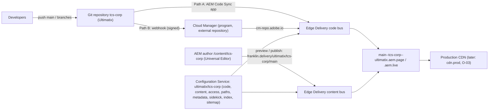

# BYOG environment setup: Git, Cloud Manager and AEM Edge Delivery

The reference for running the TCS Corporate site from the **Ultimatix** organisation: the code in
the repository `tcs-corp` (Bring Your Own Git through Cloud Manager, or github.com), the content in
AEM as a Cloud Service (`/content/tcs-corp`, Universal Editor), the site in the AEM Configuration
Service. It follows Adobe's documentation (section 12) and turns it into ready-to-run steps and a
configuration built from this repository ([byog/site-config.mjs](./byog/site-config.mjs)).
Decision: KB-D-058 (Proposed) in the [decision log](../handover/knowledge-base/decision-log.md).

| Attribute | Value |
| --- | --- |
| Audience | Site Administrator, Cloud Manager administrator (Business Owner / Deployment Manager), Git administrator, AEM administrator, developers |
| Edge Delivery site | org `ultimatix`, site `tcs-corp` (Configuration Service: `https://admin.hlx.page/config/ultimatix/sites/tcs-corp.json`) |
| Code | Repository `tcs-corp` of Ultimatix, branch `main` (production), feature branches for previews |
| Content | AEM author `/content/tcs-corp` (13 locales and the language master), assets `/content/dam/tcs-corp` |
| URLs | Preview `https://main--tcs-corp--ultimatix.aem.page/`, live `https://main--tcs-corp--ultimatix.aem.live/`, branch preview `https://{branch}--tcs-corp--ultimatix.aem.page/` |
| Today | Site `sradha-tcs/tcs-corp` on github.com with AEM Code Sync, configuration in the repository (`fstab.yaml`, `paths.json`, `helix-query.yaml`, `helix-sitemap.yaml`, `tools/sidekick/config.json`) plus `public.json` / `metadata.json` in the Configuration Service |
| State (26 October 2026) | Not set up: `ultimatix/tcs-corp` doesn't exist in the Configuration Service (404); the github.com org `Ultimatix` exists; the repository isn't publicly visible. No call to the Admin API, Cloud Manager or AEM was made for this document |

## 1. Choose the code path first

Adobe recommends github.com (GitHub or GitHub Enterprise Cloud) with the AEM Code Sync app. BYOG
through Cloud Manager is for repositories that **can't** be on github.com. Cloud Manager supports
GitHub Enterprise **self-hosted** (Server), Bitbucket Cloud, GitLab (cloud and self-hosted),
Azure DevOps (cloud) and Adobe's hosted repository (others in alpha through
cloudmanager_byog@adobe.com).

| | Path A: github.com (GitHub Cloud SaaS / Enterprise Cloud) | Path B: BYOG through Cloud Manager |
| --- | --- | --- |
| When | `Ultimatix/tcs-corp` is a github.com repository | The repository is on GitHub Enterprise Server, GitLab, Bitbucket, Azure DevOps or Adobe's hosted repository |
| Code sync | AEM Code Sync GitHub app on the repository; every push syncs | Git webhook → Cloud Manager → `cm-repo.adobe.io` → Edge Delivery; first sync from Cloud Manager |
| Site `code` | `{"owner": "Ultimatix", "repo": "tcs-corp", "source": {"type": "github", ...}}` (`CODE_MODE=github`) | `{"source": {"type": "byogit", "owner": "{programId}", "repo": "{repositoryId}", "secretId": "cm-byog", ...}}` (`CODE_MODE=byog`) |
| Cloud Manager | Optional (Edge Delivery site, domains) | Required: external repository, webhook, Edge Delivery site with BYOG, secret |
| GitHub Actions (`.github/workflows`: lint, cleanup) | Keep | Recreate as the vendor's pipeline (GitLab CI, Azure Pipelines, ...) |
| Sections | 2, 3, 4 (step 4.1, then 4.4 onwards: skip the Cloud Manager steps), 5 to 11 | All |

Everything else (content, path mapping, metadata, Sidekick, index, sitemap, AEM configuration) is
the same for both paths.

**The values given for this setup.** The Admin API path given in the request,
`admin.hlx.page/config/{programId}/sites/{repositoryId}/*`, puts the Cloud Manager ids where the
Edge Delivery org and site belong; that configuration doesn't exist (404). In Adobe's BYOG setup
the program id is `code.source.owner` and the repository id `code.source.repo`; the configuration
path is the Edge Delivery org and site: `admin.hlx.page/config/ultimatix/sites/tcs-corp`. The ids
are kept in `docs/setup/byog/byog.env` (not in git, see section 2), as AGENTS.md allows no program,
environment or repository ids and no author host in the repository.

## 2. Values

| Value | Where it comes from | Kept in |
| --- | --- | --- |
| Edge Delivery org / site: `ultimatix` / `tcs-corp` | Chosen; the org must also exist as a github.com org (it does: `Ultimatix`) | This document, `byog.env` (`AEM_ORG`, `AEM_SITE`) |
| Code owner / repository (Path A): `Ultimatix` / `tcs-corp` | github.com | `byog.env` (`GITHUB_OWNER`, `GITHUB_REPO`) |
| Cloud Manager program id `{programId}`, repository id `{repositoryId}` (Path B) | Cloud Manager → Repositories → `tcs-corp` → Configure Webhook | `byog.env` only (`CM_PROGRAM_ID`, `CM_REPOSITORY_ID`) |
| AEM author host `{aem-author}` | Cloud Manager → environment; today in `fstab.yaml` | `fstab.yaml` (recorded exception, KB-D-056); the script reads it |
| Technical account `{id}@techacct.adobe.com` | AEM → Tools → Cloud Services → Edge Delivery Services Configuration → Authentication | `byog.env` (`TECH_ACCOUNT`) |
| Site admins | Owner's list of emails | `byog.env` (`ADMIN_EMAILS`) |
| BYOG secret | Cloud Manager, shown **once** when BYOG is selected on the site | A password vault; the shell (`CM_BYOG_SECRET`) only while configuring |
| Admin token | An admin's sign-in to the Admin API ([authentication](https://www.aem.live/docs/admin.html#tag/authentication)) | The shell (`ADMIN_TOKEN`) only |
| Cloud Manager API key, webhook secret | Adobe Developer Console project with the Cloud Manager API; chosen when creating the webhook | Vault; the Git vendor's webhook settings |

Prepare the values file:

```bash
cp docs/setup/byog/byog.env.example docs/setup/byog/byog.env   # git-ignored; fill in the values
```

## 3. How it fits together



## 4. Setup, step by step

### 4.1 Prerequisites and roles

| Item | Who | Check |
| --- | --- | --- |
| AEM as a Cloud Service program with Sites and Edge Delivery; the author environment of `/content/tcs-corp` | AEM administrator | Universal Editor opens `/content/tcs-corp/us/en` |
| Cloud Manager access with Business Owner or Deployment Manager (repositories, Edge Delivery sites) | Cloud Manager administrator | Cloud Manager → Repositories and Edge Delivery visible |
| Adobe Developer Console project with the Cloud Manager API (the API key the webhook uses) | Cloud Manager administrator | API key (client id) available |
| github.com org `Ultimatix` with an owner from the customer's organisation (claims the Edge Delivery org name) | Git administrator | `https://github.com/Ultimatix` exists |
| The Edge Delivery org `ultimatix` registered, with an admin | Site Administrator | See 4.2 |
| Git repository `tcs-corp` with the code of this repository on `main` | Git administrator | Branch `main` exists (Edge Delivery requires it) |
| Network: a private Git server must allow Cloud Manager's IPs (Path B) | Git administrator | Ask cloudmanager_byog@adobe.com from the Adobe ID's email: vendor, private / public / enterprise |

### 4.2 Register the Edge Delivery org (both paths)

Install the **AEM Code Sync** app (`https://github.com/apps/aem-code-sync`) on a github.com
repository of `Ultimatix` (Path A: `Ultimatix/tcs-corp` itself; Path B: any repository of the org,
e.g. a small placeholder repository), as the developer tutorial does
(`https://www.aem.live/developer/tutorial`). This creates the org `ultimatix` and makes the GitHub
user who installed the app its admin; ask Adobe for a different admin if needed. A site created
with Cloud Manager's one-click setup gives you no admin rights on it, so don't create the site
there.

### 4.3 Put the code in the repository

```bash
git clone https://github.com/sradha-tcs/tcs-corp.git && cd tcs-corp
git remote add ultimatix <repository URL of Ultimatix/tcs-corp>
git push ultimatix main            # production branch: main
git push ultimatix --tags          # optional: history and tags
```

Path B: recreate the checks of `.github/workflows/main.yaml` (`npm ci`, `npm run lint`; also
`npm test`, AGENTS.md) in the vendor's pipeline and protect `main` (reviews, checks).

### 4.4 Cloud Manager: the external repository (Path B)

1. Cloud Manager → the program → **Repositories** → **Add Repository** → **Private Repository**
   (external) → the vendor, the repository URL, name `tcs-corp`, description
   ([Adobe: external repositories](https://experienceleague.adobe.com/en/docs/experience-manager-cloud-manager/content/managing-code/external-repositories)).
2. Validate the ownership as Cloud Manager asks (vendor access token); wait for status **Ready**.
3. **Configure Webhook** on the repository: note the webhook URL, the program id and the
   repository id (into `byog.env`).
4. In the Git vendor, create the webhook: the URL from Cloud Manager, the Cloud Manager API key as
   it shows, a webhook secret of your choice (it signs every event), events: **push**.
5. Push a commit and check the webhook's delivery log in the vendor (2xx).

### 4.5 Cloud Manager: the Edge Delivery site (Path B)

1. Cloud Manager → **Edge Delivery** → **Add Edge Delivery site** → org `ultimatix`, site
   `tcs-corp`; validate the ownership
   ([Adobe: add an Edge Delivery site](https://experienceleague.adobe.com/en/docs/experience-manager-cloud-service/content/implementing/using-cloud-manager/edge-delivery-sites/add-edge-delivery-site)).
2. On the site, choose **Bring Your Own Git** (offered once a repository is Ready) and select
   `tcs-corp`.
3. Copy the **secret** Cloud Manager shows into the vault: it isn't shown again; configuring the
   site again creates a new secret.

### 4.6 Configuration Service: the site

Run the script as a dry run first: it prints every request with its payload, built from this
repository (`paths.json`, `utils/site.js`, `tools/sidekick/config.json`, `helix-query.yaml`,
`helix-sitemap.yaml`, `fstab.yaml`) and `byog.env`.

```bash
node docs/setup/byog/site-config.mjs                       # dry run, all steps
export ADMIN_TOKEN='…'                                     # an admin's token, the shell only
export CM_BYOG_SECRET='…'                                  # Path B: the secret of 4.5
node docs/setup/byog/site-config.mjs --apply site secret   # create the site, store the secret
node docs/setup/byog/site-config.mjs --apply access public metadata sidekick query sitemap
node docs/setup/byog/site-config.mjs check                 # GET: configuration, config.json, last code job
```

| Step | Request | Payload (from) |
| --- | --- | --- |
| `site` | `PUT /config/ultimatix/sites/tcs-corp.json` | `code` (Path A or B, table in section 1) and `content.source`: `https://{aem-author}/bin/franklin.delivery/ultimatix/tcs-corp/main`, `type: markup`, `suffix: .html` |
| `secret` (Path B) | `POST …/secrets/cm-byog.json` | `{"value": "<secret from Cloud Manager>"}` |
| `access` | `POST …/access.json` | `admin.role.admin`: the admins; `admin.role.config_admin`: the AEM technical account; `requireAuth: auto` (optional `author`, `publish`) |
| `public` | `POST …/public.json` | `paths`: [paths.json](../../paths.json) (42 mappings, 15 includes, 28 excludes) plus `/content/tcs-corp/configuration:/.helix/config.json` (the repoless configuration page, 4.7) |
| `metadata` | `POST …/metadata.json` | `source`: the 13 locales' `/{locale}/metadata.json` and `/language-master/en/metadata.json` |
| `sidekick` | `POST …/sidekick.json` | `project: TCS Corporate`, `editUrlLabel: AEM Editor`, `editUrlPattern: {{contentSourceUrl}}{{pathname}}?cmd=open`, publish confirmation (section 8) |
| `query` | `POST …/content/query.yaml` | [helix-query.yaml](../../helix-query.yaml) |
| `sitemap` | `POST …/content/sitemap.yaml` | [helix-sitemap.yaml](../../helix-sitemap.yaml) with origin `https://main--tcs-corp--ultimatix.aem.live` (or `PROD_HOST`) |

The same requests by hand (Adobe's form; `{…}` from section 2):

```bash
# Path B code source (Adobe: byo-git step 4); Path A: {"owner":"Ultimatix","repo":"tcs-corp"}
curl -X POST https://admin.hlx.page/config/ultimatix/sites/tcs-corp/code.json \
  -H 'content-type: application/json' -H "x-auth-token: $ADMIN_TOKEN" \
  --data '{"source":{"url":"https://cm-repo.adobe.io/api","raw_url":"https://cm-repo.adobe.io/api/raw",
           "owner":"{programId}","repo":"{repositoryId}","type":"byogit","secretId":"cm-byog"}}'

curl -X POST https://admin.hlx.page/config/ultimatix/sites/tcs-corp/secrets/cm-byog.json \
  -H 'content-type: application/json' -H "x-auth-token: $ADMIN_TOKEN" \
  --data "{\"value\":\"$CM_BYOG_SECRET\"}"

# content location (Adobe: config-service-setup, update content location)
curl -X POST https://admin.hlx.page/config/ultimatix/sites/tcs-corp/content.json \
  -H 'content-type: application/json' -H "x-auth-token: $ADMIN_TOKEN" \
  --data '{"source":{"url":"https://{aem-author}/bin/franklin.delivery/ultimatix/tcs-corp/main",
           "type":"markup","suffix":".html"}}'
```

Changing the content location of an existing site creates a new content bus: everything has to
be previewed and published again, and the index and sitemap configuration recreated. This is why
`ultimatix/tcs-corp` is a **new** site next to `sradha-tcs/tcs-corp`, not a change of the old one.

### 4.7 AEM author: point the site to the new configuration

1. AEM → **Tools → Cloud Services → Edge Delivery Services Configuration** → the configuration
   of `/conf/tcs-corp` → **Properties**: Organization `ultimatix`, Site name `tcs-corp`, Branch
   `main`, Project type **aem.live with repoless config setup** → Save & Close
   ([Adobe: repoless authoring](https://www.aem.live/developer/repoless-authoring)).
2. On its **Authentication** tab copy the technical account id (`…@techacct.adobe.com`) into
   `byog.env` (`TECH_ACCOUNT`) and run the `access` step (it lets AEM publish).
3. Create the configuration page `/content/tcs-corp/configuration` (template **Configuration**,
   only the predefined key / value columns) and publish it; it is mapped to `/.helix/config.json`
   by the `public` step (`CONFIG_PAGE` in `byog.env` changes or leaves out this page).
4. Open a page in Universal Editor (`/content/tcs-corp/us/en`): it must render with the site's
   scripts, styles and component definitions.

### 4.8 First code sync

- Path B: Cloud Manager → the Edge Delivery site → **Sync Code** → branch `main`; later pushes
  sync through the webhook.
- Path A: the AEM Code Sync app syncs on every push; push to `main` once.
- Follow the job: `node docs/setup/byog/site-config.mjs check` (or
  `GET https://admin.hlx.page/job/ultimatix/tcs-corp/main/code` with the token).

### 4.9 Publish the content to the new site

The new site has an empty content bus. From AEM (Manage Publication, including child pages):
the locale trees `/content/tcs-corp/{country}/{lang}` and `/content/tcs-corp/language-master/en`,
their references (nav, footer), error pages, sheets (placeholders, metadata, redirects, taxonomy,
`data/*`) and the DAM assets used by pages (videos, PDFs, Lottie files are served only once
published). Until a page is previewed, `aem.page` answers 404 for it.

### 4.10 Verify

| Check | Expected |
| --- | --- |
| `https://main--tcs-corp--ultimatix.aem.live/config.json` | The `paths` mapping of the `public` step |
| `https://main--tcs-corp--ultimatix.aem.page/en/` and `/language-master/en/` | Home pages render (header, footer, blocks) |
| A child page, `/en/placeholders.json`, `/en/metadata.json`, `/en/taxonomy.json` | 200 |
| `/query-index.json`, `/sitemap.xml` | Rows of the published pages; sitemap URLs on the configured origin |
| A page's head | Its bulk metadata (`publish-date`, `content-type`, ...) from the metadata sheet |
| Universal Editor | Opens, edits and publishes a page; the change appears on aem.page / aem.live |
| Code change | A visible change pushed to `main` appears after the sync (private window or no cache) |
| Feature branch | `https://{branch}--tcs-corp--ultimatix.aem.page/en/` shows the branch's code after its push / sync |
| Sidekick | Project "TCS Corporate", Edit opens "AEM Editor", Publish asks for confirmation |
| Old site `sradha-tcs/tcs-corp` | Unchanged until the cut-over |

## 5. After the setup: repository changes (a separate pull request)

The Configuration Service overrides the repository's configuration files once the site uses it.
After the new site is verified:

| File | Change | Rule |
| --- | --- | --- |
| `fstab.yaml` | Remove (the content source is `content.source`); this ends the author host exception of KB-D-056 | Adobe: config-service-setup, "Remove unused configuration files" |
| `tools/sidekick/config.json` | Remove (now `sidekick.json`) | Same |
| `helix-query.yaml`, `helix-sitemap.yaml` | Remove, or keep as the source of the `query` / `sitemap` steps (then re-run them after a change) | Same; the index and sitemap must stay in step |
| `paths.json` | Keep: `npm run build:paths` and `test/site/paths.test.mjs` generate and check it; AEM reads the `public.json` paths (re-run the `public` step after a change) | AGENTS.md, KB-D-004 |
| AGENTS.md "Deployment", the knowledge base, `.migration/project.json` | Preview / live / branch URLs `{branch}--tcs-corp--ultimatix.aem.page`; the code path; the CI | AGENTS.md "Documentation" |
| `.github/workflows` | Path B: replaced by the vendor's pipeline | — |

## 6. Cut-over and go-live

1. Keep `sradha-tcs/tcs-corp` running until `ultimatix/tcs-corp` passes 4.10.
2. Production domain: CDN of the site (`POST …/cdn/prod.json`: host, type, push invalidation;
   Adobe: BYO CDN), then `PROD_HOST` in `byog.env` and the `sitemap` step again (O-03, KB-D-008).
3. Redirects at the CDN (KB-D-055, `docs/proposals/redirects-cdn.md`).
4. Switch the CDN origin to `main--tcs-corp--ultimatix.aem.live`; retire the old site.

## 7. More sites from the same repository (repoless)

A repository onboarded in Cloud Manager serves **one** site at a time; connecting it to another
site from Cloud Manager revokes the first site's configuration and secret. For more sites (a stage
site, a `tcs-corp-dev` copy for Sidekick work) use repoless: the same `code.source` (same program
and repository ids) **without** `secretId` and without the `cm-byog` secret:

```bash
AEM_SITE=tcs-corp-dev BYOG_SECRET=none node docs/setup/byog/site-config.mjs site          # dry run
AEM_SITE=tcs-corp-dev BYOG_SECRET=none node docs/setup/byog/site-config.mjs --apply site public sidekick
```

## 8. Sidekick customisation

The Sidekick reads the site configuration's `sidekick` object
([schema](https://tools.aem.live/sidekick/config.schema.json)); the `sidekick` step writes:

```json
{
  "project": "TCS Corporate",
  "editUrlLabel": "AEM Editor",
  "editUrlPattern": "{{contentSourceUrl}}{{pathname}}?cmd=open",
  "plugins": [{ "id": "publish", "confirm": true }]
}
```

| Option | Use for this site |
| --- | --- |
| `editUrlLabel`, `editUrlPattern` | Edit opens the page in AEM (the content source isn't SharePoint / Google Drive) |
| `plugins[].id: publish`, `confirm: true` | A confirmation before publishing (whole site) |
| `excludePaths` / `includePaths`, `environments` (`dev`, `edit`, `admin`, `preview`, `live`, `prod`) on a default plugin | E.g. no Publish below `**/block-library/**` |
| `host`, `previewHost`, `liveHost`, `reviewHost` | Only to override the CDN settings; normally set `cdn.prod.host` instead |
| Custom plugins: `url` (new tab, `passConfig`, `passReferrer`), `event` (`custom:<name>` on `aem-sidekick`, preview / live / prod / dev only), `isPalette`, `isPopover`, `isContainer`, `isBadge`, `titleI18n`, `pinned` | Project tools (e.g. a link to the block library); none today |
| `specialViews` (`path`, `viewer`) | Custom viewers (e.g. for `**.json`); none today |
| Events on `aem-sidekick` (`sidekick-ready`, `previewed`, `published`, ...) | Listened to in project code only if needed; none today |

Test Sidekick changes on a site copy (`tcs-corp-dev`, section 7), then copy the `sidekick` object
to `tcs-corp` (Adobe: Sidekick development workflow).

## 9. Troubleshooting

| Symptom | Check |
| --- | --- |
| New commits don't appear | The webhook's deliveries in the vendor (Path B); the job: `GET /job/ultimatix/tcs-corp/main/code`; the AEM Code Sync app on the repository (Path A) |
| Job error `Unable to fetch hlxignore: 401` | The `cm-byog` secret is wrong or was regenerated: store the current secret (step `secret`) |
| Universal Editor shows a white page or an AEM error | `config.json` (the `public` step) or `component-definition.json` doesn't load; the Edge Delivery Services Configuration (4.7); the author's error.log |
| Every page 404 on the new site | The content isn't previewed on the new content bus yet (4.9) |
| Pages at the wrong path | `public.json` paths differ from `paths.json`: run the `public` step |
| Bulk metadata missing in the head | `metadata.json` sources (the `metadata` step); the sheet is published |
| Admin API 401 / 403 | The token's user isn't in `access` (admin / config_admin) |
| The first site lost its code after a second site was connected | One repository per site in Cloud Manager: reconnect the first, use repoless for the second (section 7) |

## 10. Security

- Tokens, the BYOG secret, the Cloud Manager API key and the webhook secret are never committed,
  pasted into tickets or chats, or printed (the script masks the secret and reads tokens from the
  shell only); keep them in a vault and rotate them when people leave.
- Program, environment and repository ids, emails and the author host stay out of the repository
  (`byog.env` is git-ignored; AGENTS.md privacy rule, KB-D-056).
- Don't put secrets in `public.json`: it is served at `/config.json`.
- Don't change `code` or `content` of a production site in place (CDN caches, new content bus):
  create a new site, validate it, switch the CDN origin.

## 11. Responsibilities

| Task | Owner |
| --- | --- |
| Choose Path A or B; approve KB-D-058 | Product owner, technical lead |
| github.com org `Ultimatix`, the repository, webhook, CI, branch protection | Git administrator |
| Cloud Manager repository, Edge Delivery site, BYOG secret, Sync Code | Cloud Manager administrator |
| Configuration Service (`site-config.mjs --apply`), access | Site Administrator |
| Edge Delivery Services Configuration, configuration page, publishing the content | AEM administrator, authors |
| Repository clean-up PR (section 5), docs | Developers |

## 12. References

- Adobe, Bring Your Own Git: https://www.aem.live/developer/byo-git (configure the external
  repository in Cloud Manager, site configuration, first sync, repoless, troubleshooting)
- Adobe, Configuration Service setup: https://www.aem.live/docs/config-service-setup (site
  creation, access, code and content location, CDN, headers, public, Sidekick, index, sitemap,
  robots, removing configuration files)
- Adobe, Sidekick development: https://www.aem.live/developer/sidekick-development (events,
  customising the Sidekick, plugins, special views, development workflow)
- Adobe, Repoless authoring with AEM: https://www.aem.live/developer/repoless-authoring
  (content source with `suffix`, configuration page, technical account, project type)
- Adobe, Admin API: https://www.aem.live/docs/admin.html; Cloud Manager external repositories and
  Edge Delivery sites (Experience League links in section 4)
- This repository: [site-config.mjs](./byog/site-config.mjs),
  [byog.env.example](./byog/byog.env.example), AGENTS.md (site structure, paths, metadata),
  [administration-and-operations.md](../handover/knowledge-base/administration-and-operations.md)
