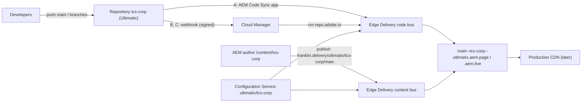

# BYOG environment setup: GitHub (SaaS and Enterprise), Cloud Manager and AEM Edge Delivery

The reference for running the TCS Corporate site from the **Ultimatix** organisation: the code in
the repository `tcs-corp` (GitHub SaaS with AEM Code Sync, or GitHub Enterprise Server and other
Git vendors through Cloud Manager, "Bring Your Own Git"), the content in AEM as a Cloud Service
(`/content/tcs-corp`, Universal Editor), the site in the AEM Configuration Service. Every step was
checked against Adobe's documentation on 26 October 2026 (section 17). The configuration is built
from this repository by [byog/site-config.mjs](./byog/site-config.mjs) and validated by
[byog/validate-site.mjs](./byog/validate-site.mjs). Decision: KB-D-058 (Proposed) in the
[decision log](../handover/knowledge-base/decision-log.md).

| Attribute | Value |
| --- | --- |
| Audience | Site Administrator, Cloud Manager administrator (Business Owner / Deployment Manager), Git administrator, AEM administrator, developers |
| Edge Delivery site | Org `ultimatix`, site `tcs-corp`; configuration `https://admin.hlx.page/config/ultimatix/sites/tcs-corp.json` |
| Code | Repository `tcs-corp` of Ultimatix, branch `main` (production); feature branches for previews |
| Content | AEM author `/content/tcs-corp` (13 locales and the language master), assets `/content/dam/tcs-corp` |
| URLs | Preview `https://main--tcs-corp--ultimatix.aem.page/`, live `https://main--tcs-corp--ultimatix.aem.live/`, branch preview `https://{branch}--tcs-corp--ultimatix.aem.page/` |
| Today | Site `sradha-tcs/tcs-corp` (github.com, AEM Code Sync); configuration partly in the repository (`fstab.yaml`, `paths.json`, `helix-query.yaml`, `helix-sitemap.yaml`, `tools/sidekick/config.json`), partly in the Configuration Service (`public.json`, `metadata.json`) |
| State (26 October 2026) | Not set up: `ultimatix/tcs-corp` doesn't exist in the Configuration Service (404) and its URLs answer 404 (validator: 0 of 9 public checks); the github.com org `Ultimatix` exists, the repository isn't publicly visible. The validator passes all 9 public checks on today's site. No write call to the Admin API, Cloud Manager or AEM was made for this document |

## 1. Choose the Git model

Adobe's FAQ: "Edge Delivery Services supports GitHub Enterprise Cloud through the AEM Code Sync
app. AEM customers can also use GitHub Enterprise Server (self-hosted) with Bring your own Git."
Bitbucket Cloud, GitLab (cloud and self-hosted) and Azure DevOps (cloud) also go through Bring
Your Own Git; Adobe's hosted repository too; other vendors are in alpha
(cloudmanager_byog@adobe.com).

| | Model A: GitHub SaaS | Model B: GitHub Enterprise Server (BYOG) | Model C: other vendors (BYOG) |
| --- | --- | --- | --- |
| Repository host | github.com: GitHub Free / Team, GitHub Enterprise Cloud | Self-hosted GitHub Enterprise Server (`https://{ghe-host}/Ultimatix/tcs-corp.git`) | GitLab, Bitbucket Cloud, Azure DevOps |
| Code sync | AEM Code Sync GitHub app: every push to every branch syncs | Webhook → Cloud Manager → `cm-repo.adobe.io`; first sync from Cloud Manager | As B |
| Site `code` | `{"owner":"Ultimatix","repo":"tcs-corp","source":{"type":"github","url":"https://github.com/Ultimatix/tcs-corp"}}` | `{"source":{"type":"byogit","url":"https://cm-repo.adobe.io/api","raw_url":"https://cm-repo.adobe.io/api/raw","owner":"{programId}","repo":"{repositoryId}","secretId":"cm-byog"}}` | As B |
| Cloud Manager | Optional, recommended by Adobe (Edge Delivery site: domains, CDN) | Required: external repository, webhook, Edge Delivery site with BYOG, secret | As B |
| CI (`.github/workflows`: lint, cleanup) | Unchanged (GitHub Actions) | GitHub Actions on GHE Server (needs runners) | The vendor's pipeline |
| Setup | Section 5 | Section 6 | Section 6 with the vendor table (6.9) |

Everything else is the same for all models: the Configuration Service (section 7), AEM (section
8), publishing (section 9), validation (section 10).

**About the values given for this setup.** The path given in the request,
`admin.hlx.page/config/{programId}/sites/{repositoryId}/*`, puts the Cloud Manager ids where the
Edge Delivery org and site belong; that configuration doesn't exist (404). In Adobe's BYOG setup
the program id is `code.source.owner`, the repository id `code.source.repo`, and the configuration
path is the Edge Delivery org and site: `admin.hlx.page/config/ultimatix/sites/tcs-corp`. The ids
are in `docs/setup/byog/byog.env` (git-ignored): AGENTS.md allows no program, environment or
repository ids and no author host in the repository.

## 2. Values

| Value | Where it comes from | Kept in |
| --- | --- | --- |
| Edge Delivery org / site: `ultimatix` / `tcs-corp` | Chosen; the org must also exist as a github.com org with an owner from the customer (it does: `Ultimatix`) | This document; `byog.env` (`AEM_ORG`, `AEM_SITE`) |
| Model: `github` (A) or `byog` (B, C) | Section 1 | `byog.env` (`CODE_MODE`) |
| Code owner / repository (A): `Ultimatix` / `tcs-corp` | github.com | `byog.env` (`GITHUB_OWNER`, `GITHUB_REPO`) |
| Program id `{programId}`, repository id `{repositoryId}` (B, C) | Cloud Manager → Repositories → `tcs-corp` → Config Webhook | `byog.env` only (`CM_PROGRAM_ID`, `CM_REPOSITORY_ID`) |
| AEM author host `{aem-author}` | Cloud Manager → environments; today in `fstab.yaml` | `fstab.yaml` (recorded exception, KB-D-056); the scripts read it |
| Technical account `{id}@techacct.adobe.com` | AEM → Tools → Cloud Services → Edge Delivery Services Configuration → Authentication | `byog.env` (`TECH_ACCOUNT`) |
| Site admins (emails) | Owner | `byog.env` (`ADMIN_EMAILS`) |
| BYOG secret (B, C) | Cloud Manager, shown **once** when BYOG is selected on the site | Vault; the shell (`CM_BYOG_SECRET`) only while configuring |
| Admin token | Section 10.1 | The shell (`ADMIN_TOKEN`) only |
| Vendor access token (PAT) (B, C) | The Git vendor, for Cloud Manager's ownership validation | Cloud Manager (Manage Access Tokens); vault |
| Webhook URL and secret (B, C) | Cloud Manager → Config Webhook (URL; secret: Generate) | The vendor's webhook settings; vault |
| Cloud Manager API key (B, C) | Adobe Developer Console project with the Cloud Manager API | The webhook URL's `api_key`; vault |

```bash
cp docs/setup/byog/byog.env.example docs/setup/byog/byog.env   # git-ignored; fill in the values
```

## 3. How it fits together



| Flow | From | To | Through |
| --- | --- | --- | --- |
| Code (A) | Push to github.com | Code bus | AEM Code Sync app |
| Code (B, C) | Push to the vendor | Code bus | Webhook (URL with the Cloud Manager API key, signed with the webhook secret) → Cloud Manager → `cm-repo.adobe.io` (the site's `cm-byog` secret) |
| Content | Preview / publish in AEM | Content bus | `https://{aem-author}/bin/franklin.delivery/ultimatix/tcs-corp/main` (`content.source`, `.html` suffix); path mapping from `public.json` |
| Configuration | Site Administrator | Configuration Service | Admin API (`admin.hlx.page/config/ultimatix/sites/tcs-corp`) |
| Delivery | Code and content bus | Visitors | `*.aem.page` / `*.aem.live`, later the production CDN |

## 4. Prerequisites and roles (all models)

| Item | Who | Check |
| --- | --- | --- |
| AEM as a Cloud Service program with an Edge Delivery Services licence; the author environment of `/content/tcs-corp` | AEM administrator | Universal Editor opens `/content/tcs-corp/us/en` |
| Cloud Manager access as Business Owner or Deployment Manager | Cloud Manager administrator | Program → Repositories and Edge Delivery Sites visible |
| github.com org `Ultimatix` with an owner from the customer's organisation (claims the Edge Delivery org name) | Git administrator | `https://github.com/Ultimatix` exists (yes, 26 October 2026) |
| The Edge Delivery org `ultimatix` with an admin (created when AEM Code Sync is installed on a github.com repository of the org) | Site Administrator | Section 5.3 / 6.2 |
| The code of this repository on `main` of `tcs-corp` (Edge Delivery requires `main`) | Git administrator | `main` exists |
| (B, C) Adobe Developer Console project with the Cloud Manager API (the API key) | Cloud Manager administrator | API key available |
| (B, C) A vendor token with the permissions of 6.3 | Git administrator | Token created |
| (B, C) A private Git server reachable by Cloud Manager | Git administrator | Cloud Manager's IPs requested from cloudmanager_byog@adobe.com (from the Adobe ID's email: vendor; private, public or enterprise) and allowed |
| Don't create the site with Cloud Manager's one-click setup: it gives no admin rights on the site | All | — |

## 5. Model A: GitHub SaaS (github.com, GitHub Enterprise Cloud)

### 5.1 Repository

1. In the github.com org `Ultimatix`, create the repository `tcs-corp` (private is supported).
2. Push the code:

   ```bash
   git clone https://github.com/sradha-tcs/tcs-corp.git && cd tcs-corp
   git remote add ultimatix https://github.com/Ultimatix/tcs-corp.git
   git push ultimatix main
   ```

3. Protect `main` (pull request reviews, the `Build` check of `.github/workflows/main.yaml`).

### 5.2 Enterprise Cloud policies

With GitHub Enterprise Cloud, allow the **AEM Code Sync** GitHub App in the enterprise / org
policies (third-party GitHub Apps, IP allow lists) before installing it.

### 5.3 AEM Code Sync

Install `https://github.com/apps/aem-code-sync` on `Ultimatix`, for the repository `tcs-corp`
only. This registers the Edge Delivery org `ultimatix` with the installing user as admin
(Adobe can set another admin) and syncs every push of every branch.

### 5.4 Site configuration

`CODE_MODE=github` in `byog.env`, then section 7.

### 5.5 Cloud Manager (recommended)

Add the Edge Delivery site in Cloud Manager for domains and the CDN (section 6.6: site name
`tcs-corp`, origin `https://main--tcs-corp--ultimatix.aem.live`, ownership file); no repository,
webhook or BYOG for github.com (Cloud Manager integrates with github.com through the GitHub app).

## 6. Model B: GitHub Enterprise Server through Cloud Manager (BYOG)

### 6.1 Repository on GitHub Enterprise Server

```bash
git clone https://github.com/sradha-tcs/tcs-corp.git && cd tcs-corp
git remote add ultimatix https://{ghe-host}/Ultimatix/tcs-corp.git
git push ultimatix main
```

Protect `main`; run the checks of `.github/workflows/main.yaml` (`npm ci`, `npm run lint`, plus
`npm test` as AGENTS.md asks) with GitHub Actions runners on the server.

### 6.2 Register the Edge Delivery org

The org name must be claimed on github.com and registered in the Configuration Service with an
admin: install AEM Code Sync on a github.com repository of `Ultimatix` (Adobe: the developer
tutorial). This creates the org `ultimatix` and makes the installing user its admin.

### 6.3 Cloud Manager: add the repository

1. Cloud Manager (`my.cloudmanager.adobe.com`) → the organisation → the program → **Repositories**
   → **Add Repository** → **Private Repository**.
2. Repository Name `tcs-corp`; Repository URL `https://{ghe-host}/Ultimatix/tcs-corp.git` (must end
   in `.git`); type **GitHub** (GitHub Enterprise, self-hosted); description → **Save**.
3. **Private Repository Ownership Validation**: Add new Access Token → a token name → a personal
   access token of GitHub Enterprise with the repository permissions **Pull requests (read and
   write)**, **Commit statuses (read and write)**, **Metadata (read-only)** → **Validate**.
4. The repository's status becomes **Ready**.

### 6.4 Cloud Manager: the webhook

1. Repositories → the `tcs-corp` row → **…** → **Config Webhook**.
2. Copy the **Webhook URL**; next to Webhook Secret click **Generate** and copy the secret (vault).
   Note the program id and repository id shown for the repository (into `byog.env`).
3. GitHub Enterprise → `Ultimatix/tcs-corp` → Settings → Webhooks → **Add webhook**: Payload URL =
   the Webhook URL with its `api_key` query parameter replaced by the Cloud Manager API key;
   content type `application/json`; Secret = the generated secret; events: **Pull requests**,
   **Pushes**, **Issue comments**; Active.
4. Check the webhook's Recent Deliveries (2xx) after a push.

### 6.5 Configuration Service: create the site

Create the site before Cloud Manager checks it (its origin must answer): section 7, step `site`
(`CODE_MODE=byog`; the secret follows in 6.7).

### 6.6 Cloud Manager: the Edge Delivery site and ownership

1. Cloud Manager → the program → **Edge Delivery** tab (or Services → Edge Delivery Sites) →
   **Add Edge Delivery site**: Site Name `tcs-corp`; Edge Delivery origin
   `https://main--tcs-corp--ultimatix.aem.live`; description → **Add**.
2. **Verify repository ownership**: add the file `well-known/adobe/cloudmanager-challenge.txt` (no
   leading dot) with the code Cloud Manager shows to `main` of the repository the site serves, by
   a pull request; merge; **Verify**. The site must not require authentication meanwhile.
3. The site's status shows a green check.

### 6.7 Cloud Manager: Bring Your Own Git and the secret

1. On the Edge Delivery site choose **Bring Your Own Git** (offered once a repository is Ready) and
   select `tcs-corp`.
2. Copy the **secret** into the vault: it isn't shown again; configuring the site again creates a
   new one.
3. Store it in the site: section 7, step `secret` (`CM_BYOG_SECRET` in the shell).

### 6.8 First sync

Cloud Manager → the Edge Delivery site → **…** → **Sync Code** → branch `main`. Later pushes sync
through the webhook. Follow the job: section 10 (`code sync: latest job`).

### 6.9 Model C: other vendors

The same as 6.1 to 6.8, with the vendor's token permissions and webhook events (Cloud Manager:
external repositories).

| Vendor | Repository URL | Token permissions | Webhook events |
| --- | --- | --- | --- |
| GitHub Enterprise Server | `https://{ghe-host}/Ultimatix/tcs-corp.git` | Pull requests (read and write), Commit statuses (read and write), Metadata (read) | Pull requests, Pushes, Issue comments |
| GitLab (gitlab.com or self-hosted) | `https://gitlab.com/ultimatix/tcs-corp.git` | Scopes `api`, `read_user` | Push events, Merge request events, Note events |
| Bitbucket Cloud | `https://bitbucket.org/ultimatix/tcs-corp.git` | Repository (read), Pull requests (read and write), Webhooks (read and write) | Pull request Created, Updated, Merged, Comment; Repository Push |
| Azure DevOps | `https://dev.azure.com/ultimatix/{project}/_git/tcs-corp` | Code (Read), Code (Status), Pull Request Threads (Read and write) | Code Pushed, Pull request created, updated, commented on; basic authentication user `cloudmanager`, password = the webhook secret |

## 7. Configuration Service (all models)

The script builds every request from this repository (`paths.json`, `utils/site.js`,
`tools/sidekick/config.json`, `helix-query.yaml`, `helix-sitemap.yaml`, `fstab.yaml`) and
`byog.env`; without `--apply` it only prints them. The UI alternative is
`https://tools.aem.live/tools/admin-edit/index.html`.

```bash
node docs/setup/byog/site-config.mjs                       # dry run: review every request
export ADMIN_TOKEN='…'                                     # section 10.1; the shell only
node docs/setup/byog/site-config.mjs --apply site          # create the site (PUT)
export CM_BYOG_SECRET='…'                                  # B, C: after 6.7
node docs/setup/byog/site-config.mjs --apply secret
node docs/setup/byog/site-config.mjs --apply access public metadata sidekick query sitemap
```

| Step | Request | Payload (from) |
| --- | --- | --- |
| `site` | `PUT /config/ultimatix/sites/tcs-corp.json` | `code` (section 1) and `content.source`: `https://{aem-author}/bin/franklin.delivery/ultimatix/tcs-corp/main`, `type: markup`, `suffix: .html` |
| `secret` (B, C) | `POST …/secrets/cm-byog.json` | `{"value": "<secret from Cloud Manager>"}` |
| `access` | `POST …/access.json` | `admin.role.admin`: the admins; `admin.role.config_admin`: the AEM technical account; `requireAuth: auto` (optional `author`, `publish`) |
| `public` | `POST …/public.json` | `paths`: [paths.json](../../paths.json) (42 mappings, 15 includes, 28 excludes) plus `/content/tcs-corp/configuration:/.helix/config.json` (the configuration page, 8.3) |
| `metadata` | `POST …/metadata.json` | `source`: the 13 locales' `/{locale}/metadata.json` and `/language-master/en/metadata.json` |
| `sidekick` | `POST …/sidekick.json` | `project: TCS Corporate`, `editUrlLabel: AEM Editor`, `editUrlPattern: {{contentSourceUrl}}{{pathname}}?cmd=open`, publish confirmation (section 14) |
| `query` | `POST …/content/query.yaml` | [helix-query.yaml](../../helix-query.yaml) |
| `sitemap` | `POST …/content/sitemap.yaml` | [helix-sitemap.yaml](../../helix-sitemap.yaml) with origin `https://main--tcs-corp--ultimatix.aem.live` (or `PROD_HOST`) |

The same by hand (Adobe's form):

```bash
# B, C: code source (Adobe: Bring Your Own Git, step 4)
curl -X POST https://admin.hlx.page/config/ultimatix/sites/tcs-corp/code.json \
  -H 'content-type: application/json' -H "x-auth-token: $ADMIN_TOKEN" \
  --data '{"source":{"url":"https://cm-repo.adobe.io/api","raw_url":"https://cm-repo.adobe.io/api/raw","owner":"{programId}","repo":"{repositoryId}","type":"byogit","secretId":"cm-byog"}}'
# B, C: the secret
curl -X POST https://admin.hlx.page/config/ultimatix/sites/tcs-corp/secrets/cm-byog.json \
  -H 'content-type: application/json' -H "x-auth-token: $ADMIN_TOKEN" \
  --data "{\"value\":\"$CM_BYOG_SECRET\"}"
# A: code source
curl -X POST https://admin.hlx.page/config/ultimatix/sites/tcs-corp/code.json \
  -H 'content-type: application/json' -H "x-auth-token: $ADMIN_TOKEN" \
  --data '{"owner":"Ultimatix","repo":"tcs-corp","source":{"type":"github","url":"https://github.com/Ultimatix/tcs-corp"}}'
# content location (Adobe: config-service-setup, update content location)
curl -X POST https://admin.hlx.page/config/ultimatix/sites/tcs-corp/content.json \
  -H 'content-type: application/json' -H "x-auth-token: $ADMIN_TOKEN" \
  --data '{"source":{"url":"https://{aem-author}/bin/franklin.delivery/ultimatix/tcs-corp/main","type":"markup","suffix":".html"}}'
```

Changing the content location of an existing site creates a new content bus (everything must be
previewed and published again; the index and sitemap configuration recreated), and changing the
code of a production site affects the CDN caches. That is why `ultimatix/tcs-corp` is a **new**
site next to `sradha-tcs/tcs-corp`.

## 8. AEM author (all models)

1. **Tools → Cloud Services → Edge Delivery Services Configuration** → the configuration of
   `/conf/tcs-corp` → **Properties**: Organization `ultimatix`, Site name `tcs-corp`, Branch
   `main`, Project type **aem.live with repoless config setup** → Save & Close.
2. **Authentication** tab: copy the technical account id into `byog.env` (`TECH_ACCOUNT`) and run
   the `access` step (AEM publishes as this account; it is the same for all sites of the author
   environment).
3. Create the page `/content/tcs-corp/configuration` with the **Configuration** template (only the
   predefined key / value columns) and publish it; the `public` step maps it to
   `/.helix/config.json` (`CONFIG_PAGE`: another page, or `none`).
4. Open `/content/tcs-corp/us/en` in Universal Editor: it renders with the site's scripts and
   component definitions (a white page: section 15).

## 9. Publish the content to the new site

The new site's content bus is empty: from AEM (Manage Publication, with child pages) publish the
locale trees `/content/tcs-corp/{country}/{lang}` and `/content/tcs-corp/language-master/en`, their
references (nav, footer), error pages, sheets (placeholders, metadata, redirects, taxonomy,
`data/*`), the configuration page and the DAM assets used by pages (videos, PDFs and Lottie files
are served only once published). Until a page is previewed, aem.page answers 404 for it.

## 10. Validate with Admin API commands

### 10.1 The admin token

Sign in with the Sidekick on a page of the site; in the browser's developer tools (Network), copy
the value of the `x-auth-token` header of a Sidekick request to `admin.hlx.page` (Adobe:
Configuring Authentication for Authors). Use it in the shell only:

```bash
export ADMIN_TOKEN='…'     # never in a file, a ticket or a chat
```

### 10.2 All checks at once

```bash
node docs/setup/byog/validate-site.mjs                   # public checks (no token)
ADMIN_TOKEN="$ADMIN_TOKEN" node docs/setup/byog/validate-site.mjs   # + Admin API checks
```

It prints PASS / FAIL / SKIP with the curl command of each check, changes nothing and exits with 1
when a check fails. On 26 October 2026: today's site (`AEM_ORG=sradha-tcs`) 9 of 9 public checks
pass; `ultimatix/tcs-corp` 0 of 9 (not set up).

### 10.3 The commands (read-only)

```bash
ORG=ultimatix; SITE=tcs-corp; A=https://admin.hlx.page; H="x-auth-token: $ADMIN_TOKEN"
# site configuration: code and content sources
curl -s -H "$H" "$A/config/$ORG/sites/$SITE.json"
curl -s -H "$H" "$A/config/$ORG/sites/$SITE/code.json"
curl -s -H "$H" "$A/config/$ORG/sites/$SITE/content.json"
# path mapping (must equal paths.json), bulk metadata sources (14), access, Sidekick
curl -s -H "$H" "$A/config/$ORG/sites/$SITE/public.json"
curl -s -H "$H" "$A/config/$ORG/sites/$SITE/metadata.json"
curl -s -H "$H" "$A/config/$ORG/sites/$SITE/access.json"
curl -s -H "$H" "$A/config/$ORG/sites/$SITE/sidekick.json"
# index and sitemap configuration
curl -s -H "$H" "$A/config/$ORG/sites/$SITE/content/query.yaml"
curl -s -H "$H" "$A/config/$ORG/sites/$SITE/content/sitemap.yaml"
# code sync jobs (B, C: "Unable to fetch hlxignore: 401" = wrong cm-byog secret)
curl -s -H "$H" "$A/job/$ORG/$SITE/main/code"
# a page's preview / live status and its AEM edit URL
curl -s -H "$H" "$A/status/$ORG/$SITE/main/en/?editUrl=auto"
# public (no token)
curl -s -o /dev/null -w '%{http_code}\n' "https://main--$SITE--$ORG.aem.page/en/"
curl -s "https://main--$SITE--$ORG.aem.live/config.json"
curl -s "https://main--$SITE--$ORG.aem.page/query-index.json?limit=5"
curl -s "https://main--$SITE--$ORG.aem.live/sitemap.xml" | head
curl -s -o /dev/null -w '%{http_code}\n' "https://main--$SITE--$ORG.aem.page/scripts/scripts.js"
```

| Check | Expected |
| --- | --- |
| `config/…/tcs-corp.json` | `code.source.type` `byogit` with the program and repository ids (B, C) or `code.owner` `Ultimatix`, `repo` `tcs-corp` (A); `content.source.url` ends in `/bin/franklin.delivery/ultimatix/tcs-corp/main`, `suffix` `.html` |
| `public.json` | `paths.mappings` contains every mapping of `paths.json` (42) and the configuration page |
| `metadata.json` | `source` lists 14 sheets |
| `access.json` | `admin.role.admin` and `admin.role.config_admin` set |
| `job/…/main/code` | The latest job finished without error |
| `status/…/main/en/` | `preview.status` and `live.status` 200 |
| `config.json` (public) | The paths mapping |
| Pages, `query-index.json`, `sitemap.xml`, `scripts/scripts.js` | 200; index rows; sitemap URLs on the configured origin; the code is synced |

### 10.4 Manual checks

| Check | Expected |
| --- | --- |
| Universal Editor | Opens, edits and publishes a page; the change appears on aem.page / aem.live |
| Code change | A visible change pushed to `main` appears after the sync (private window or no cache) |
| Feature branch | `https://{branch}--tcs-corp--ultimatix.aem.page/en/` shows the branch's code after its push / sync |
| Sidekick | Project "TCS Corporate", Edit opens "AEM Editor", Publish asks for confirmation |
| Bulk metadata | A page's head has its sheet values (`publish-date`, `content-type`, ...) |
| Old site `sradha-tcs/tcs-corp` | Unchanged until the cut-over |

## 11. After the setup: repository changes (a separate pull request)

| File | Change |
| --- | --- |
| `fstab.yaml` | Remove (the content source is `content.source`); ends the author host exception of KB-D-056 |
| `tools/sidekick/config.json` | Remove (now `sidekick.json`) |
| `helix-query.yaml`, `helix-sitemap.yaml` | Remove, or keep as the source of the `query` / `sitemap` steps and re-run them after a change |
| `paths.json` | Keep (`npm run build:paths`, `test/site/paths.test.mjs`); AEM reads `public.json`: re-run the `public` step after a change |
| AGENTS.md, the knowledge base, `.migration/project.json` | Preview / live / branch URLs `{branch}--tcs-corp--ultimatix.aem.page`, the model, the CI |
| `.github/workflows` | B: GHE Server runners; C: the vendor's pipeline |

Adobe: once the Configuration Service is used, its settings override the repository files; remove
them, check that the old document-based configuration is gone, then remove `.helix/config` and
`.helix/headers` from the content if they exist.

## 12. Cut-over and go-live

1. Keep `sradha-tcs/tcs-corp` until `ultimatix/tcs-corp` passes section 10.
2. Production domain: `POST …/cdn/prod.json` (host, CDN type, push invalidation credentials), or
   the domain mapping in Cloud Manager; then `PROD_HOST` and the `sitemap` step again (O-03,
   KB-D-008).
3. Redirects at the CDN (KB-D-055, `docs/proposals/redirects-cdn.md`).
4. Switch the CDN origin to `main--tcs-corp--ultimatix.aem.live`; retire the old site.

## 13. More sites from the same repository (repoless)

A repository onboarded in Cloud Manager serves **one** site at a time: connecting it to another
site revokes the first site's configuration and secret. For more sites (stage, `tcs-corp-dev` for
Sidekick work) use repoless: the same `code.source` (same program and repository ids) without
`secretId` and without the `cm-byog` secret:

```bash
AEM_SITE=tcs-corp-dev BYOG_SECRET=none node docs/setup/byog/site-config.mjs site          # dry run
AEM_SITE=tcs-corp-dev BYOG_SECRET=none node docs/setup/byog/site-config.mjs --apply site public sidekick
```

## 14. Sidekick customisation

The `sidekick` step writes the site configuration's `sidekick` object
([schema](https://tools.aem.live/sidekick/config.schema.json)):

```json
{
  "project": "TCS Corporate",
  "editUrlLabel": "AEM Editor",
  "editUrlPattern": "{{contentSourceUrl}}{{pathname}}?cmd=open",
  "plugins": [{ "id": "publish", "confirm": true }]
}
```

| Option | Use for this site |
| --- | --- |
| `editUrlLabel`, `editUrlPattern` | Edit opens the page in AEM (the content source isn't SharePoint / Google Drive) |
| `plugins[].id: publish`, `confirm: true` | Confirmation before publishing (whole site) |
| `excludePaths` / `includePaths`, `environments` (`dev`, `edit`, `admin`, `preview`, `live`, `prod`) on a default plugin | E.g. no Publish below `**/block-library/**` |
| `host`, `previewHost`, `liveHost`, `reviewHost`, `trustedHosts` | Only to override the CDN settings (`cdn.prod.host` and so on) |
| Custom plugins: `url` (`passConfig`, `passReferrer`), `event` (`custom:<name>` on `aem-sidekick`; dev, preview, live, prod only), `isPalette` / `paletteRect`, `isPopover` / `popoverRect`, `isContainer` / `containerId`, `isBadge` / `badgeVariant`, `titleI18n`, `pinned` | Project tools; none today |
| `specialViews` (`path`, `viewer`, `title`) | Custom viewers (e.g. `**.json`); none today |
| Events (`sidekick-ready` on document; `previewed`, `published`, `env-switched`, `status-fetched`, ... on `aem-sidekick`) | Project code only if needed; none today |

Test changes on a site copy (`tcs-corp-dev`, section 13), then copy the `sidekick` object to
`tcs-corp`.

## 15. Troubleshooting

| Symptom | Check |
| --- | --- |
| New commits don't appear | A: the AEM Code Sync app on the repository; B, C: the webhook's deliveries (2xx), the `api_key` in its URL, the job (`job/…/main/code`) |
| Job error `Unable to fetch hlxignore: 401` | The `cm-byog` secret is wrong or was regenerated: run the `secret` step with the current one |
| Cloud Manager ownership check fails | `well-known/adobe/cloudmanager-challenge.txt` (no leading dot) on `main` of the code the site serves, synced; the site doesn't require authentication |
| Universal Editor shows a white page or an AEM error | `config.json` (the `public` step) or `component-definition.json` doesn't load; the Edge Delivery Services Configuration (section 8); the author's error.log |
| Every page 404 on the new site | The content isn't published to the new content bus (section 9) |
| Pages at the wrong path | `public.json` differs from `paths.json`: the `public` step |
| Bulk metadata missing | `metadata.json` sources; the sheet published |
| Admin API 401 / 403 | The token's user isn't in `access` (admin / config_admin), or the token expired |
| The first site lost its code after another site was connected | One repository per site in Cloud Manager: reconnect it; use repoless for the other (section 13) |

## 16. Security and responsibilities

- Tokens, the BYOG secret, the vendor token, the webhook secret and the Cloud Manager API key are
  never committed, pasted into tickets or chats, or printed (the scripts mask the secret and read
  tokens from the shell); keep them in a vault, rotate them when people leave.
- Program, environment and repository ids, emails and the author host stay out of the repository
  (`byog.env` is git-ignored; AGENTS.md, KB-D-056). No secrets in `public.json` (served as
  `/config.json`).
- Don't change `code` or `content` of a production site in place: create a new site, validate,
  switch the CDN origin.

| Task | Owner |
| --- | --- |
| Choose the model; approve KB-D-058 | Product owner, technical lead |
| github.com org, the repository, branch protection, CI; (B, C) token, webhook | Git administrator |
| (B, C) Cloud Manager repository, webhook URL and secret, Edge Delivery site, BYOG secret, Sync Code; (A) Edge Delivery site | Cloud Manager administrator |
| Configuration Service (`site-config.mjs --apply`), access, validation | Site Administrator |
| Edge Delivery Services Configuration, configuration page, publishing | AEM administrator, authors |
| Repository clean-up PR, docs | Developers |

## 17. Recheck against Adobe's documentation (26 October 2026)

| Item | Source | Result |
| --- | --- | --- |
| GitHub Enterprise Cloud via AEM Code Sync; GitHub Enterprise Server via BYOG | aem.live FAQ | Confirmed (section 1) |
| BYOG vendors; `main` required; org on github.com; no one-click site; webhook, API key, IP list | aem.live Bring Your Own Git | Confirmed |
| `code.json` (`byogit`, `cm-repo.adobe.io`, `secretId`), `secrets/cm-byog.json`, Sync Code, `job/…/code`, repoless without secret, one repository per site, `hlxignore: 401` | aem.live Bring Your Own Git | Confirmed (sections 6, 7, 13, 15) |
| Repository URL ending in `.git`; repository type GitHub for GHE; token permissions per vendor | Experience League: add external repositories | Confirmed; added (6.3, 6.9) |
| Webhook secret generated in Cloud Manager; `api_key` replaced in the webhook URL; events per vendor; no webhook for github.com | Experience League: configure a webhook | Confirmed; the first draft said "a secret of your choice" and "push": corrected (6.4) |
| Edge Delivery site fields (Site Name, Edge Delivery origin); ownership file `well-known/adobe/cloudmanager-challenge.txt` by pull request; authentication off during the check | Experience League: add an Edge Delivery site | Confirmed; added (6.6) |
| Site PUT with `code` and `content` (`suffix: .html`), technical account, `config_admin`, project type "aem.live with repoless config setup", configuration page mapped to `/.helix/config.json` | aem.live repoless authoring | Confirmed (sections 7, 8) |
| Update content location creates a new content bus; code changes on production sites; config files to remove | aem.live Configuration Service setup | Confirmed (sections 7, 11) |
| `public.json` `paths` with mappings / includes / excludes; admin-edit tool | aem.live path mapping | Confirmed |
| Admin token from the Sidekick's `x-auth-token`; `status/…?editUrl=auto` | aem.live authentication for authors | Confirmed (10.1, 10.3) |
| Sidekick options, plugin types, events, special views, development on a site copy | aem.live Sidekick development | Confirmed (section 14) |
| Order of 6.5 / 6.6 for BYOG (the site must answer before Cloud Manager checks it; which repository holds the challenge file while the site isn't synced yet) | Not stated by Adobe | Blocked: confirm with Adobe (cloudmanager_byog@adobe.com) if the check fails; the file can live in the github.com repository of 6.2 until the BYOG sync |
| GitHub Enterprise Cloud with data residency (`*.ghe.com`) | Not covered | Not recorded: confirm with Adobe before choosing Model A for it |

## 18. References

- https://www.aem.live/developer/byo-git (Bring Your Own Git)
- https://www.aem.live/docs/config-service-setup (Configuration Service; update content location)
- https://www.aem.live/developer/sidekick-development (customising the Sidekick)
- https://www.aem.live/developer/repoless-authoring (repoless with AEM authoring)
- https://www.aem.live/developer/authoring-path-mapping (path mapping)
- https://www.aem.live/docs/authentication-setup-authoring (authors, Admin API token)
- https://www.aem.live/docs/faq (GitHub Enterprise)
- https://www.aem.live/docs/admin.html (Admin API)
- https://experienceleague.adobe.com/en/docs/experience-manager-cloud-manager/content/managing-code/external-repositories
- https://experienceleague.adobe.com/en/docs/experience-manager-cloud-service/content/implementing/using-cloud-manager/edge-delivery-sites/add-edge-delivery-site
- This repository: [site-config.mjs](./byog/site-config.mjs), [validate-site.mjs](./byog/validate-site.mjs), [byog.env.example](./byog/byog.env.example), AGENTS.md, [administration-and-operations.md](../handover/knowledge-base/administration-and-operations.md)
